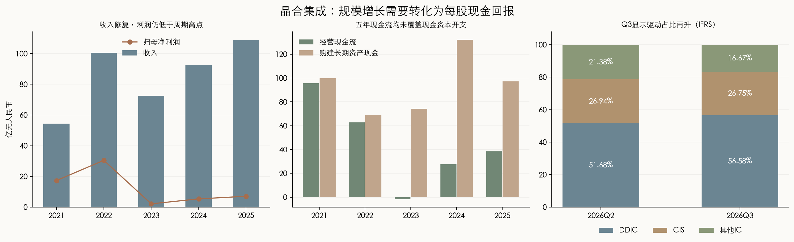

# 晶合集成（688249.SH／02249.HK）研究报告

> 研究日期／数据截止：2026-11-25（北京时间；行情为当日收盘，财务截至2026-09-30，季报未经审计）\
> A股26.63元／H股24.12港元；按全部注册股份计的估值尺度：A价595.12亿元／H价539.03亿港元（458.72亿元人民币）\
> TTM归母PE：A股94.64倍／H股72.95倍；TTM简单自由现金流为-21.43亿元\
> 核心判断：三季度经营修复已经出现，但四季度毛利率指引回落，扩产、研发资本化与少数股权安排仍制约利润转化为每股现金回报。

本报告更新用户指定的[2026-10-08中报复核](晶合集成-earnings-refresh-20261008.md)，并保留[8月原研究](晶合集成-research-20260821.md)。同一家公司为合肥晶合集成电路股份有限公司，英文Nexchip Semiconductor Corporation；A、H是同一发行人的不同股份类别，不是两家公司，也不是ADR。沿用既有公司目录与监控ID“晶合集成”。金额除股价和特别说明外均为人民币亿元。本文用于学习与研究，不构成投资建议。

## AI研究偏见自觉

**信息丰富度评级：A级；经济回报的可预测性低于披露完整度。** 正式年报、中报和季报足以识别收入、费用、现金流与融资，但单片价格、具体稼动率、良率、维护性资本开支和分项目增量资本回报仍没有充分可复核披露。

AI研究局限性声明：不能用AI服务器、国产替代、28nm设备投资或H股折价，替代订单、现金回收与每股收益证据。不能把研发资本化直接指控为会计违规，也不能把单季正现金流当成长期资本回报已获验证。未来模型全部为研究假设，并非公司盈利预测。

- [x] 将财报资料充分与生意长期确定性分开判断。
- [x] 对最强多头证据作正面核验：Q3收入、毛利率及单季现金流确实改善。
- [x] 对最强空头证据作反面核验：利润基数低、扩产融资多，并不等于企业没有价值。
- [x] 与旧报告对账；价带变化须解释模型变化，避免把分析方法修订写成基本面突然恶化。

---

## 第一步：核心数据总览

### 股本、行情与估值口径

[腾讯行情](https://qt.gtimg.cn/q=sh688249,hk02249)与[Yahoo A股日线](https://query1.finance.yahoo.com/v8/finance/chart/688249.SS?range=5d&interval=1d)、[Yahoo H股日线](https://query1.finance.yahoo.com/v8/finance/chart/2249.HK?range=5d&interval=1d)核同收盘价26.63元／24.12港元；[公司IR页面](https://www.nexchip.com.cn/zh-cn/Tzzgx/Invest)亦显示A股26.63元。未采用搜索结果里的盘中旧快照。

| 股本和市值项目 | 数值 | 解释 |
|---|---:|---|
| 总注册股份 | 2,234,787,210股 | A股2,007,733,310股＋H股227,053,900股 |
| A价隐含全公司市值 | 595.1238亿元 | 26.63元乘总注册股份 |
| H价隐含全公司市值 | 539.0307亿港元 | 24.12港元乘总注册股份，不是仅H股类别市值 |
| A/H分别定价的合计市值 | 581.2647亿元 | A价乘A股数，加H价乘H股数再换成人民币 |
| 港元折人民币估值输入 | 0.8510 | 11/25 Yahoo快照，单一外汇源；不作为汇兑盈利预测 |
| A股相对H股人民币价格溢价 | +29.74% | 存在流动性、通道、股份流通和投资者结构差异 |

股本由[Q3正式报告](https://static.cninfo.com.cn/finalpage/2026-10-27/1225625882.PDF)、[首次A股回购公告](https://www.hkexnews.hk/listedco/listconews/sehk/2026/1120/2026112001503_c.pdf)及腾讯交叉核对。回购用于激励的库存股份仍在注册股本内；本报告统一按全部注册股份保守摊薄，不把库存股已经注销计入回报。9月底库存A股62,088,500股，11月又有回购；完整最新扣库存经济股份未逐日重建，故不另报一个貌似精确的“实时流通经济股本”。[汇率来源](https://query1.finance.yahoo.com/v8/finance/chart/HKDCNY=X?range=5d&interval=1d)。

### 五年盈利与现金流



以下统一为中国企业会计准则（CAS）合并数据。“营业利润率”为报表营业利润／营业收入，含其他收益、投资损益及财务费用影响，不冒充剔除这些项目的核心制造利润率。简单FCF＝经营现金流－购建固定资产、无形资产及其他长期资产支付现金；它是集团现金代理，尚未扣除少数股东归属和全部其他资本义务，不能全部视为母公司股东可分配现金。

| 年度 | 营业收入 | 归母净利润 | 毛利率 | 营业利润率 | 经营现金流 | 现金资本开支 | 简单FCF |
|---|---:|---:|---:|---:|---:|---:|---:|
| 2021 | 54.2901 | 17.2883 | 45.13% | 31.81% | 95.7389 | 99.7670 | -4.0282 |
| 2022 | 100.5095 | 30.4543 | 46.16% | 31.26% | 62.8003 | 68.9032 | -6.1028 |
| 2023 | 72.4354 | 2.1163 | 21.61% | 1.60% | -1.6104 | 74.0805 | -75.6909 |
| 2024 | 92.4925 | 5.3284 | 25.50% | 5.21% | 27.6113 | 132.2301 | -104.6188 |
| 2025 | 108.8545 | 7.0420 | 25.52% | 4.26% | 38.4292 | 97.0768 | -58.6476 |

五年损益、现金流以[2020—2022审计资料](https://static.sse.com.cn/bond/bridge2/disclosure/announcement/c/202405/044789_20240530_OG2C.pdf)、[2023年报](https://static.cninfo.com.cn/finalpage/2024-04-15/1219612124.PDF)、[2025年报](https://static.cninfo.com.cn/finalpage/2026-03-27/1225037053.PDF)与东方财富财报接口逐期核对。2021年经营现金流包括客户产能保证金流入，2023年则受保证金返还影响，不能把年际现金波动全部解释为获利能力变化。

2025年归母利润受光罩技术转让收益支持，扣非归母仅2.0204亿元；代工业务毛利率23.56%，也低于综合毛利率。旧研究中对主营毛利率及到期债务的近似数，本次以正式年报精确口径重置，不沿用旧数外推。

### 最近四季：修复发生在哪里

| CAS单季 | 营业收入 | 归母净利润 | 扣非归母 | 综合毛利率 | 经营现金流 | 现金资本开支 | 简单FCF |
|---|---:|---:|---:|---:|---:|---:|---:|
| 2025Q4 | 27.5573 | 1.5403 | -0.2578 | 24.41% | 11.6860 | 24.2170 | -12.5309 |
| 2026Q1 | 29.1198 | 0.5066 | 0.3877 | 21.26% | 9.6381 | 14.2665 | -4.6284 |
| 2026Q2 | 30.4470 | 1.9471 | 0.9186 | 22.09% | 18.3418 | 25.3759 | -7.0341 |
| 2026Q3 | 33.5381 | 2.2944 | 1.9132 | 26.38% | 19.2305 | 16.4636 | +2.7668 |

由年度及累计报表逐项相减，非把累计值当单季；来源为2025年报、[2026Q1](https://static.cninfo.com.cn/finalpage/2026-04-24/1225160553.PDF)、[2026H1](https://static.cninfo.com.cn/finalpage/2026-08-25/1225498332.PDF)、Q3原文及[东方财富财务数据](https://emweb.securities.eastmoney.com/PC_HSF10/NewFinanceAnalysis/Index?type=web&code=SH688249)。Q3单季FCF转正是实质进展；但前三季度仍为-8.8956亿元，TTM仍为-21.4265亿元，现金缺口尚未完全消除。

### A/H收入与产品结构须分开

| 指标 | 2026Q2 | 2026Q3 | 可得结论 |
|---|---:|---:|---|
| IFRS收入 | 29.5968 | 32.5213 | Q3已兑现32—33亿元旧指引 |
| IFRS毛利率 | 22.28% | 25.46% | 已兑现25%—27%旧指引 |
| DDIC收入占比 | 51.68% | 56.58% | 环比反升，不能称持续摆脱显示周期 |
| CIS收入占比 | 26.94% | 26.75% | 业务重要性上升，但本季占比近乎持平 |
| 其他IC收入占比 | 21.38% | 16.67% | 不把整个其他IC都归为AI或PMIC |
| 55nm及以下收入占比 | 16.25% | 16.25% | 同比升级，环比未再提高 |

[H股Q3原文第1—6页](https://www1.hkexnews.hk/listedco/listconews/sehk/2026/1026/2026102600899.pdf)列示：DDIC收入18.3995亿元、CIS8.6997亿元、其他IC5.4221亿元。Q3 CAS收入33.5381亿元包含其他业务，与IFRS32.5213亿元不能作为同口径双源值；CAS毛利率26.38%与IFRS25.46%亦不得混用。H股Q3分部数据另与[FinancialFilings结构化转录](https://financialfilings.com/filings/nexchip-semiconductor-corporation/interim-quarterly-report/2026/74755830/)对照；这增加转录校验渠道，并不构成独立审计。

最近四季总量已核齐；2025Q4、2026Q1的同口径独立分部数据未全部补齐，不倒推制造一套完整产品季度序列。2025全年DDIC占主营收入58.06%；2026H1为53.24%，CIS25.34%、PMIC12.82%、Logic4.02%、MCU4.25%，剩余为其他。年度、半年度与单季数据只比较结构，不当成等长期间增长率。

**最新前瞻约束是Q4 IFRS收入32—34亿元、毛利率20%—24%的管理层指引。** 收入未显示明显失速，但毛利率区间低于Q3实际，不能简单线性年化Q3盈利。

### 融资后的资产负债表

| 2026-09-30项目 | 数值 | 口径 |
|---|---:|---|
| 货币资金 | 121.4966 | 包含受限部分 |
| 现金及现金等价物 | 120.4236 | 净债务计算采用此数 |
| 短借＋长借＋到期非流动负债＋债券 | 251.8181 | 保守计入到期非流动负债全额，不将总负债冒充有息债务 |
| 净债务代理 | 131.3945 | 上行所列债务口径减现金等价物；未扣风险金融资产 |
| 归母净资产 | 288.7783 | PB只用归母，不能用集团全部净资产 |
| 少数股东权益 | 78.2695 | 合并产能和现金流并非全部属于上市母公司股东 |

余额由CAS原文与东方财富核同。H股借款列报分类与CAS存在小额差别，本报告债务计算不跨准则拼接。交易性金融资产含股票投资，未全部认作现金；受限资金亦未重复扣债。IPO显著缓和资金压力，但不是经营现金创造。9月底余额不等于11/25实时净债务，11月回购、投资出资及后续经营现金流仍须桥接。

> 段永平式追问：现金流改善是客户持续付钱，还是融资和付款节奏？本季经营进展是真的，但融资带来的大额现金增长不能当作利润质量。

---

## 第二步：生意本质分析

**客户为通过验证、可稳定交付的晶圆制造服务反复下单；晶合要靠良率、产品结构与产能利用率，赚回设备、研发和融资成本。**

| 环节 | 赚钱机制 | 需要观察的反证 |
|---|---|---|
| 客户与复购 | 芯片设计公司流片、认证、量产后重复下单 | 客户可多供应商布局，认证不是永久独家 |
| 收入 | 可交付晶圆数量乘实现价格，受产品结构影响 | 收入增长可能来自降价放量，未必提升资本回报 |
| 制造利润 | 固定折旧、厂务、人员摊入更多合格晶圆 | 稼动率下滑与价格下跌会同时压低毛利 |
| 研发 | 特色工艺形成客户可量产的平台 | 完成开发、购设备与稳定量产收入之间存在距离 |
| 现金回报 | 回款减经营成本、设备、研发资本化与其他再投资 | 集团FCF还需考虑少数股东、债务和后续资本需求 |

价格、销量、良率和稼动率不是四个可以重复相乘的独立收入因子：若已经用“合格晶圆出货量”，再乘良率会重复扣减。它们应分别进入产能、可售数量和单位成本的驱动树。公司尚未公开足够数据以精算每片成本，本报告不捏造单片ASP或利用率。

当前资产图谱是既有12英寸制造平台加后续四期项目。设备和客户认证构成门槛；新工艺若持续以较低价格换订单，财务价值可能小于技术价值。晶奕四期计划投资355亿元、约5.5万片/月，是未来建设规划，不能加到当前已投产产能或当成已锁定收入。

> 段永平式追问：这门生意好在哪？认证、工艺积累和稳定交付具有复购价值；能否成为好投资，要看每一轮再投资后的每股回报。

---

## 第三步：护城河评估

| 护城河 | 判断 | 验证与可证伪条件 |
|---|---|---|
| 品牌与定价权 | 弱 | Q1披露价格竞争，Q4毛利指引亦低于Q3；还不能证明可持续提价 |
| 转换成本 | 中 | 客户重新验证、流片和良率风险真实存在；若大客户可快速转单，锁定强度要下修 |
| 网络效应 | 弱 | 更多客户帮助工艺学习，但不同于用户越多平台越不可替代 |
| 规模与成本 | 中 | 12英寸平台的固定成本摊薄有效；规模收益可能被同行扩产和折旧抵消 |
| 工艺壁垒 | 中、仍待兑现 | 40nm已有能力，28nm设备投入积极；55nm及以下占比环比持平，未证明新平台规模盈利 |
| 地方产业协同 | 融资与落地优势 | 国资与终端生态有支持作用；支持产业安全与提高少数股东回报并非同一目标 |

过去五年制造规模和工艺覆盖扩大，但利润与FCF没有形成同等稳定性。未来五年，护城河变宽的证据应是特色工艺持续量产、较低波动的单位利润、现金资本开支逐步被经营现金覆盖，以及少数股东分摊后归母回报提高。

不能仅凭重资产否定公司：领先代工厂可以凭工艺、良率、生态和交付形成强壁垒；目前需要证明的是晶合自身已获得这些经济优势到什么程度。

> 巴菲特式追问：十年后护城河还在吗？工厂可能仍在，能维持高于资本成本的增量回报才是股东需要的护城河。

---

## 第四步：逆向思考与风险清单

最强多头论点：Q3量产规模、毛利与现金同时修复，先进一些的成熟制程逐步导入，IPO和地方资本降低短期资金约束；市场可能低估了盈利从低基数恢复的弹性。

最强空头论点：现价依然要求持续高增长，但新增产能带来折旧与资金需求，研发资本化改善当期费用，集团收入又不等于归母利润；即使公司做大，原股东也可能只获得有限现金回报。

| 失败路径 | 主观概率等级 | 影响 | 可观察指标 |
|---|---|---|---|
| 成熟制程供给增速超过需求、价格战持续 | 中高 | 高 | 同产品价格、毛利、客户议价与Q4指引兑现 |
| 四期量产迟延或利用率不足 | 中 | 高 | 设备进场、认证、实际投产、资金到位及折旧 |
| 新工艺研发无法形成足够收益 | 中 | 中高 | 资本化项目结转、摊销、减值与平台量产收入 |
| 大客户调整采购与双供应商策略 | 中 | 高 | 客户集中、订单、回款、应收和产品结构 |
| 少数股权和融资稀释削弱每股回报 | 中高 | 高 | 子公司股权、归母占比、股数、回购再授予 |
| 关键设备断供、单基地重大停厂 | 无法量化 | 极高 | 许可证、供应商、备件与厂务事故 |
| 关联投资条款损害中小股东 | 无法量化 | 高 | 独立财顾、回避表决、定价、退出与实际出资 |

这些概率等级是判断，不是历史频率；下文情景权重同样未经统计校准。2025年前五客户占收入55.69%、最大客户21.60%，集中度仍值得跟踪。

跨学科看，资本密集行业存在“各家扩产都合理、全行业回报却下降”的竞争结果；技术学习曲线降低成本，也可能通过竞争让利给客户。历史上同一晶圆行业中，台积电的差异化与中芯、华虹的不同工艺定位说明“都是晶圆厂”不能推出相同资本回报；晶合自身2022高利润到2023急降，也比套用互联网平台类比更有解释力。此处只作机制类比，不据此给公司分配成功概率。

**最可能的分析错误**是把低谷利润当永久水平，或反过来把单季修复当穿越周期的定价权。因此模型既保留明显复苏上行情景，也不把2022峰值直接作为正常利润。

> 芒格式追问：聪明人为什么不买？因为他们可能赞同国产替代，却认为同一笔钱有更容易验证现金回报的去处。

---

## 第五步：管理层评估

公司由地方国资控制，并结合晶圆制造团队与产业股东资源。蔡国智任董事长；邱显寰、郑志成为联席总经理（联合首席执行官）。[11月职务调整公告](https://www.hkexnews.hk/listedco/listconews/sehk/2026/1105/2026110502246_c.pdf)主要调整名称与职级，不能写成更换两位CEO。

| 决策 | 目前结果 | 资本配置评价 |
|---|---|---|
| 持续建设制造平台 | 规模扩大；五年简单FCF均负 | 产业能力有价值，资本回报仍待考核 |
| H股上市融资 | 增厚9月底现金和净资产 | 缓解资金压力，同时扩大股份基数 |
| 28nm逻辑设备投入 | 11月董事会批准有关量产设备项目 | 技术落地积极；采购批准不等于稳定量产收入 |
| 晶奕四期增资 | 拟上市公司出资51亿，建投30亿、勤合10亿 | 分摊资金压力，也让渡部分未来子公司收益 |
| A股回购 | 计划5—8亿元、上限37元，首笔已实施 | 用于员工持股或激励，不能全当注销回报 |
| H股回购授权 | 11/25股东会已批准一般授权；执行与注销仍须逐项核验 | 不把提议金额、执行金额和永久减少股数混同 |
| 2025年度分红 | 无现金分红 | 与资金需求一致；不是已证明稳定分红的资产 |

[11/6关联投资公告](https://static.cninfo.com.cn/finalpage/2026-11-06/1225660492.PDF)的标的是合肥晶奕集成电路有限公司，非上市公司本体。拟增资后上市公司持股从100%降至63.96%，仍并表；出资期限至2030年底，不能把91亿元记成现在已到账。公司合并收入可能受益，但归母只能享有对应权益。[11/19签约进展](https://www.hkexnews.hk/listedco/listconews/sehk/2026/1119/2026111901060_c.pdf)仍要求独立股东批准，相关通函预期12/31前寄发。11/25股东会已批准H股回购一般授权和审计师聘任，均与该笔增资批准不同。[当日晚公司投票结果原文（AAStocks镜像）](https://iis.aastocks.com/20261125/12425788-0.PDF)。授权通过不等于已回购，更不等于已注销。

9月旧关联投资与本次四期增资是不同事项。[旧10/22股东会](https://www1.hkexnews.hk/listedco/listconews/sehk/2026/1022/2026102201452.pdf)的关联投资议案已获通过；“通过表决”只意味着审批节点完成，不等于新投资已有经济回报。相关记录在监控中保留完成痕迹。

研发会计尤其需要复核：前三季度研发投入11.7809亿元，费用化9.3220亿元，开发支出2.4589亿元，对应资本化比例20.87%。H股Q3说明研发费用同比下降与项目满足资本化条件有关。这会延后费用确认，未来须承担摊销或减值。资本化金额是税前集团口径，不能直接从归母净利润扣掉，宣称得到了“调整后归母”；本报告没有这样做。现金FCF也不把已计入资本购买的研发支出再重复扣除。

持股方面，10/22正式股东会资料列蔡国智直接持有73,543股，按当前注册股本约0.00329%；控制股东及一致行动人当时合计797,211,391股，约35.67%。直接持股与年报／同花顺资料相符，但员工平台穿透权益未完整取得，不能把直接持股冒充全部经济权益。没有足够独立证据量化团队稳定性或组织文化，管理层评价保持“产业经验较强、每股资本回报待证”。

> 段永平式追问：如果董事长退休，竞争力是否仍在？需要看工艺、客户认证和制造管理能否由体系延续，目前公开资料不足以替代组织尽调。

---

## 第六步：行业与文明趋势

半导体本土化、汽车与工业电子、图像传感器和AI终端带来真实制造需求，但晶合卖的是制造服务，并不直接拥有终端定价权、计算架构或软件平台抽成。需求增加可以提升收入，能否提升股东收益取决于供给、产品差异和再投资回报。

更实用的TAM拆解是“可承接的工艺平台×通过认证的客户×客户销量×外包份额×实现价格”。全球晶圆代工市场不等于晶合可服务市场；AI加速器先进节点需求也不能直接映射到以DDIC、CIS及其他成熟特色工艺为主的收入。本报告不在缺少工艺匹配证据时硬填一个AI市场规模或增长率。

公司长期机会在CIS、OLED、PMIC及逻辑等平台；技术风险是客户认证延迟、竞争工艺性价比提高，以及设备投入快于可盈利订单。客户集中度有披露，关键设备供应商逐家占比与不可替代程度未核齐，是需一手补充的问题。

同业比较的重点是规模、特色工艺与现金回报。中芯拥有更广工艺及客户平台，华虹具有特色工艺积累，但同样面临产能爬坡、折旧和融资考验。不能因市场愿意给同行高PE，就把高PE当作晶合的内在价值证明。同行最新经营比较见下表；只比较同为IFRS的毛利率，不把美元收入与人民币收入直接排序。

| 2026Q3 | IFRS毛利率 | 稼动率 | 比较边界 |
|---|---:|---:|---|
| 晶合集成 | 25.46% | 未单独核实 | 不用CAS综合毛利率26.38%代替 |
| 中芯国际 | 29.9% | 97.3% | 更广工艺和客户平台；自身亦面临折旧增长 |
| 华虹宏力 | 24.6% | 102.9% | 含新并入华力，剔除华力为19.9%；统计产能口径可使利用率超过100% |

主源为[中芯Q3正式公告](https://www1.hkexnews.hk/listedco/listconews/sehk/2026/1112/2026111200682.pdf)、[华虹Q3正式公告](https://www1.hkexnews.hk/listedco/listconews/sehk/2026/1105/2026110500668.pdf)；由[东方财富中芯业绩报道](https://finance.eastmoney.com/a/202611123929731845.html)、[东方财富所载业绩会实录](https://caifuhao.eastmoney.com/news/20261113145155357365110)、[华虹独立报道](https://www.ithome.com/1/022/832.htm)交叉核对主要毛利率。产能定义、并表范围和产品结构不同，单季毛利排序不能直接推出护城河排序。

[TrendForce 9/9原研](https://www.trendforce.com/presscenter/news/20260909-13225.html)记录Q2晶合全球代工收入排名第九；截至本次检索未取得Q3完整榜单，因此不把Q2排名称为Q3市场份额，也不据收入排名推导定价权。

> 李录式追问：二十年后公司能否捕获产业进步的利润？制造能力可能有更大社会价值，但上市股东仍要等归母现金回报作答。

---

## 第七步：估值与安全边际

### 当前价买到了什么

TTM按“2025全年－2025前三季＋2026前三季”桥接。归母利润6.2885亿元，扣非归母2.9617亿元，营业收入120.6621亿元；摊薄EPS为0.28139034元，归母每股净资产12.92195820元。股息按最近年度已公布方案为零，不把回购激励股份视为现金股息。 腾讯H股快照PE字段为69.14倍，本报告同一CAS归母TTM利润、全部注册股本与当日汇率重算为72.95倍，相对差异约+5.50%，超过1%阈值；报价商EPS、股本与换汇时点明细未完全披露，故标记为估值口径未对账，不把两者作为同定义双源PE。采用能逐项复核的本报告计算口径，未为贴合报价而反调利润。

| 当前估值 | A股 | H股 | 说明 |
|---|---:|---:|---|
| TTM归母PE | 94.64倍 | 72.95倍 | H股按人民币成本换算，未使用报价商不同EPS口径 |
| 归母PB | 2.06倍 | 1.59倍 | 分母为9月底归母净资产 |
| CAS口径PS | 4.93倍 | 3.80倍 | 两边使用同一收入定义 |
| EV/Revenue粗略代理 | 6.67倍 | 5.54倍 | 市值＋净债务＋少数权益账面值；未逐项扣非经营投资，非严格EV |
| 简单FCF收益率 | -3.60% | -4.67% | 集团代理，不是可分配股东现金收益率 |
| PEG | 不适用 | 不适用 | TTM利润及扣非受周期、一次收益与资本化影响，没有稳定增长率分母 |

EV代理加入少数股东权益以避免用母公司股价对比集团收入时漏掉权益；少数权益采用账面值并非公允价值，金融投资也未做完整经营／非经营拆分，所以只作资本强度提示。PB低于科技股并不等于便宜：低资本回报资产可以长期低于账面价值交易。

历史比较仅采用已存档报告快照：10/8的A/H TTM PE约108.62／68.45倍，本次94.64／72.95倍。A价下降不等于H价也更便宜；两地价格、汇率和TTM盈利都在变。没有统一前复权、统一股本与盈利口径的完整历史PE分布，不报告虚假的历史百分位。同业估值比较存在资料边界：当前中芯／华虹同口径TTM、并购追溯重列与股数尚未完成独立双源校验，故不提供未经验证的PE横排，也不以同行贵支持本公司贵；中期假设倍数取决于利润率、资本强度与回报质量。

### 三年：当前盈利与正常化盈利交叉检查

先按技能要求，以TTM EPS作原点，精算三档：EPS年增速乐观+50%、基准+20%、悲观-10%，三年PE分别40／25／15倍。EPS增速已是每股口径，不另重复扣一次稀释；三年无现金分红假设。基准允许修复，乐观要求明显技术放量和利润率改善；退出PE是中期市场定价假设，不能当永续退出倍数。

| EPS情景 | 三年A股终点价 | 三年H股终点价 | A价变化 | H价变化 | 按8%折回今日A／H |
|---|---:|---:|---:|---:|---|
| 乐观 | 37.99元 | 44.64港元 | +42.65% | +85.07% | 30.16元／35.44港元 |
| 基准 | 12.16元 | 14.28港元 | -54.35% | -40.78% | 9.65元／11.34港元 |
| 悲观 | 3.08元 | 3.62港元 | -88.45% | -85.01% | 2.44元／2.87港元 |

为避免低谷EPS锚定，再从收入和利润率重建2029年正常化盈利。全部为研究假设，单位亿元；每年股数净增加0.5%，无分红，折现8%。归母利润率已经考虑税、融资成本及少数股东分摊，不可再用集团净利率替换。

| 正常化情景 | 2029收入 | 归母净利率 | 归母净利润 | 三年退出PE | 三年A／H终点价 | 今日A／H现值 |
|---|---:|---:|---:|---:|---|---|
| 悲观 | 160 | 3% | 4.80 | 15倍 | 3.17元／3.73港元 | 2.52元／2.96港元 |
| 基准 | 200 | 6% | 12.00 | 25倍 | 13.22元／15.54港元 | **10.50元／12.34港元** |
| 乐观 | 240 | 10% | 24.00 | 35倍 | 37.03元／43.51港元 | 29.40元／34.54港元 |

基准利润12亿元已显著高于TTM，利润年复合增长约+24.04%；这不是假设公司停止增长。两种独立建模角度的基准今日值接近，均低于现价；乐观档可以支持接近当前价格，说明投资者买的是较强且持续兑现的复苏。不能把三年终点价当今日内在价值，也不能把乐观价格直接当卖出线。

H股估值将人民币现金权益按固定汇率换成港元；这只是可比估值尺度，未强加AH价差在三年后必然消失。实际H股仍可能保留折价、汇率也会变化，表内H终点价因此偏理想化。

### 十年：仓位压力测试

全部用人民币口径：H股购买成本先换成人民币，模型现金流不换成港元；因而r也采用人民币资本成本。r取8%＝中债11/25十年国债1.5914%＋β1.0×研究假设ERP6.4086%。ERP为投资者要求的溢价，不是已估计出的公司市场β。人民币r合理区间6%—9%，永续g基准上限2%；不为使结论好看调低r。[无风险利率来源](https://yield.chinabond.com.cn/cbweb-cbrc-web/cbrc/showCbrc)。

稳态增量ROIC假设10%，已经要求资本回报显著改善；未把当前低会计回报伪装成10%已获验证。维护性资本开支、真实税后增量投入回报未充分披露，这是模型最大的识别缺口。永续g取0／0.5%／1%，考虑成熟制造竞争与技术更替；它与未来十年的利润增长不同，敏感性只变r，不变g。

终值PE仅由 `(1−g/ROIC)/(r−g)` 产生。三档分母分别8.0／7.5／7.0个百分点，均通过至少5个百分点约束；终值利润指已承担折旧、利息、税项与少数股东后的正常归母利润，不包括永久补助外推。

| 十年情景 | 主观权重 | 2036收入／归母净利率假设 | 2036归母利润 | 永续g | 终值PE | A股终值年化 | H股终值年化 |
|---|---:|---|---:|---:|---:|---:|---:|
| 悲观 | 35% | 160亿元／5% | 8亿元 | 0% | 12.50倍 | -16.75% | -14.56% |
| 基准 | 45% | 250亿元／10% | 25亿元 | 0.5% | 12.67倍 | -6.58% | -4.12% |
| 乐观 | 20% | 400亿元／12.5% | 50亿元 | 1% | 12.86倍 | +0.27% | +2.92% |

模型假设十年无中期现金分红，年度净股数增加0.5%，终值利润按累计稀释折算回今日股东权益；没有直接把“股息减稀释”线性相加冒充精确复利。这是**零中期分配、无需另向股东征资条件下的终值年化压力代理**，不是逐年FCFE完整IRR。扩产现金须由经营、现有资金或融资解决，若实际再融资稀释高于假设、需要追加股东投入，结果会更差；若较早形成可分配现金，则会更好。也没有把IPO现金再加回终值以重复计价。

反向终值折现：同样r8%、g0.5%、ROIC10%、无中期分红和每年0.5%稀释，要覆盖资本成本，2036归母利润需约A价106.62亿元／H价82.18亿元，较TTM对应利润年复合增长约+32.72%／+29.31%。这展示现价要求的复苏强度；由于缺少可靠逐年股东现金流，不将其标成完整反向DCF。

| r敏感性 | A股加权年化 | A股相对r | H股加权年化 | H股相对r | 有效性 |
|---|---:|---|---:|---|---|
| 6%（r−2pp） | -5.91% | 未通过 | -3.43% | 未通过 | 人民币合理区间内；最窄分母5个百分点 |
| 8%（基准） | -8.77% | 未通过 | -6.36% | 未通过 | 人民币合理区间内 |
| 10%（r＋2pp） | -10.89% | 未通过 | -8.54% | 未通过 | 区间外，仅供参考，不参与翻转判断 |

加权数字是三档年化回报的主观概率加权均值，不等于把现金流加权后再求出的投资组合IRR。合理区间内的6%与8%压力测试不翻转；另有一侧已在区间内，故不触发“两侧均在区间外”才需追加±1pp的规则。该结果约束可承受仓位，不能独立决定买入、持有或回避。

### 估值分歧对账与方法变更

三年基准与十年压力都提示现价预期偏高，二者方向一致；最强多头及Q3经营改善则是正面证据，合理小仓仍可能选择等待后续兑现。三年回答定价，十年回答本组假设下能否提高仓位。最终动作必须结合业务、护城河、管理层、风险和趋势，不能因十年未覆盖r而自动要求所有持仓清仓。

本次价带收紧主要来自补齐“正常化归母利润、终点折现、股数与少数权益”的方法，不是把Q3经营改善反写为恶化。旧A12—20元／H14—23港元只是观察区，不能追溯改成已验证买入带；本次另以三年正常化基准现值为中心，留出进一步折价，形成下文新研究条件带。十年约束使潜在首笔和总仓上限保持很低。

> 巴菲特式追问：r错两个百分点会翻转吗？有效区间内没有翻转；更大的不确定性在盈利与可分配现金，而非折现率小幅变化。
>
> 段永平式追问：股市关闭五年，愿以现价买入吗？在资本回报尚未证明、基准定价仍明显偏低时，当前不愿新增。

---

## 第八步：最终决策与行动清单

| 六个并列维度 | 结论 | 信心度 |
|---|---|---|
| 生意质量 | 有真实复购与制造价值，重资产、高固定成本，单季修复尚未形成长期股东现金回报 | 中高 |
| 护城河 | 工艺认证与交付形成窄护城河，长期定价权待证 | 中 |
| 管理层 | 制造经验与产业资源较强；扩产、关联交易和回购用途须以每股结果评价 | 中 |
| 最大风险 | 新资本投入、稀释与竞争共同抵消利润增长；资本化推迟费用确认 | 中高 |
| 文明趋势 | 半导体本土化受益者，但不自动分享AI全部利润池 | 中高 |
| 估值 | 三年基准今日A10.50元／H12.34港元；十年压力未覆盖r且区间内不翻转，只收紧仓位 | 模型中低 |

估值维度不是唯一裁决。现价观望由定价、资本需求、护城河与盈利质量共同支持；十年模型不作为单独否决票。Q3改善使小仓跟踪持有仍有经营依据，不能替代安全边际。

| 投资者状态／信号 | 具体动作 |
|---|---|
| 空仓者 | **A/H均观望新增，回避追高。** 现价不因H股折价或回购提案而建仓 |
| 研究性首笔条件带 | **A股8—9元／H股9.5—10.5港元**；两地择一，须同时满足下列经营与治理条件，才评估约0.25%—0.5%首笔 |
| 经营条件 | 后续连续两次正式财务披露单季简单FCF为正，滚动FCF接近或转正；扣非增长仍成立，且能解释研发资本化、摊销及项目回款；Q4毛利指引兑现，新平台稳定量产收入或资本回收证据可核 |
| 资本与治理条件 | 晶奕增资独立批准、付款进度和资金来源清楚；归母收益不被少数股权与稀释明显侵蚀；设备、客户与债务无重大新红线 |
| 已有合理小仓 | 有条件持有跟踪，暂停加仓；以A/H合计研究参考上限约1%控制永久损失暴露，不将其视为已知用户持仓或个性化最优比例 |
| 已有较重仓位 | 优先降低集中风险；不能用“跌了很多”“国产替代”替代基准现金回报判断 |
| 加仓信号 | 价格和经营／治理条件同时满足后再重估，第二笔须有新增正式披露支持；单独入带不自动买入 |
| 卖出／减仓复核信号 | 关键客户或设备受损、连续现金缺口扩大且高成本融资、资本化项目减值或关联交易损害每股权益时复核减仓；**A≥30元／H≥35港元**且盈利模型未增强时复核超配，不作为无条件卖出指令 |

新带相对正常化三年基准现值保留折价；两地价格上下沿经过便于跟踪的取整，不是汇率锁定的套利线。跌破A8元或H9.5港元应先查永久损失及融资风险，不能自动越跌越买。上行30元／35港元是本报告结合乐观今日值和资本风险主动设定的仓位复核线，不是把三年乐观终点价临时改成卖出价。

下一步人工复检：12/2北京时间15:00—16:00公司Q3业绩说明会；12/31核晶奕通函、资金与回购进展；2027/4/30作为全年和Q1资料复检兜底日，非公司预约披露日，正式披露即提前复核。[12/2官方公告](https://static.cninfo.com.cn/finalpage/2026-11-24/1225683633.PDF)。当前每日监控只扫描价格，事件登记留作人工复核，不自动提醒事件。

### 四位投资者原文与有限延伸

本节只在读到可核验原文后作方法延伸；不声称四位本人研究、持有或推荐晶合集成。

- 巴菲特原话：“A moat that must be continuously rebuilt will eventually be no moat at all.” [2007股东信，印刷第6页](https://www.berkshirehathaway.com/letters/2007ltr.pdf)。本报告方法延伸：应判断新增投入能否保住超额回报，不能把持续扩产本身当护城河。
- 芒格原话：“inversion frequently will solve problems which nothing else will solve.” [2007 USC演讲实录转载](https://jamesclear.com/great-speeches/2007-usc-law-school-commencement-address-by-charlie-munger)。本报告方法延伸：先检验价格战、研发失效、资金缺口和每股稀释会怎样毁损回报，再讨论增长叙事。
- 段永平原话：“谁说重资产就不是好生意了。了解一下TSMC？” [2026-10-29本人原帖](https://www.xueqiu.com/1247347556/414354147)。本报告方法延伸：重资产可以是好生意；评价晶合应看工艺优势和资本回报，不能一概排斥晶圆制造，也不能将此原话解释为对晶合的推荐。
- 李录原话：“truly know what you know and know what you don’t know.” [哥大2013年访谈，第25页](https://business.columbia.edu/sites/default/files-efs/imce-uploads/Graham%20%26%20Doddsville%20-%20Issue%2018%20-%20Spring%202013_0.pdf)。本报告方法延伸：ASP、良率、维护性资本开支无法充分验证，就应标明能力圈边界，限制仓位。

---

## AI分析置信度与投资确定性

AI分析置信度中高：公司身份、A/H收盘口径、CAS财务、股本、单季现金改善和扩产条款有正式文件支持，关键CAS财务与东方财富核同。投资确定性中低：具体价格、稼动率、维护性资本开支、真实增量ROIC、完整管理层间接持股和新平台经济性未得到充分一手验证。

模型限制：十年概率、2036利润、稳态ROIC、股数增长和ERP均为判断；模型没有对关键设备全面断供、重大停厂或关联交易利益输送分别定量建立尾部损失档，不能把情景均值当作已覆盖灾难风险的期望回报。外汇为单源快照；H股季度分部第二渠道为披露转录；没有完整逐年FCFE和维护性资本开支拆解，因此不提供伪精确的现金DCF目标价。

需要一手验证的问题：新工艺项目实际客户良率与毛利、资本化研发未来摊销／减值、产能保证金变化、四期每元投入的回报及少数权益分摊、未来融资与回购股份再授予安排。资料量减少不会改变“真实制造能力但资本回报待证”的结论；资料增加也不应自动升级投资确定性。

## 数据来源与审计记录

财务主副来源为[东方财富报表入口](https://emweb.securities.eastmoney.com/PC_HSF10/NewFinanceAnalysis/Index?type=web&code=SH688249)及正文所链巨潮／交易所正式财报。独立渠道提供的是对同一公司披露的转录复核，不是两个独立审计意见。可复核API使用东方财富`RPT_F10_FINANCE_GINCOME`、`GBALANCE`、`GCASHFLOW`，简表`RPT_DMSK_FN_*`另作核对；报告不以旧研究或搜索摘要充当第二独立源。

### 关键数据交叉验证记录

以下为financial_rigor工具原始输出节选（金额元；全量计算、核验和抽检中间件留在本次临时工作目录，未写入下载PDF或公告全文）：

```text
市值验算 A：价格26.63 × 股份2,234,787,210
计算市值59.51B CNY；报价市值59.51B CNY；偏差0.00%；验证通过。
市值验算 H：价格24.12 × 股份2,234,787,210
计算市值53.90B HKD；报价市值53.90B HKD；偏差0.00%；验证通过。
估值验算 A：EPS 0.2813903387965067；PE 94.64x；PB 2.06x；FCF Yield -3.60%。
估值验算 H：EPS 0.3306584474694556 HKD；PE 72.95x；PB 1.59x；FCF Yield -4.67%。
```

| 双源字段 | 巨潮／交易所 | 东方财富 | 工具判定 |
|---|---:|---:|---|
| 2025营业收入 | 10,885,449,273.30 | 10,885,449,273.30 | 偏差0%，通过 |
| 2025归母净利润 | 704,204,446.26 | 704,204,446.26 | 偏差0%，通过 |
| 2026前三季收入 | 9,310,481,587.63 | 9,310,481,587.63 | 偏差0%，通过 |
| 2026前三季归母净利润 | 474,813,622.95 | 474,813,622.95 | 偏差0%，通过 |
| 2026Q3末货币资金 | 12,149,664,555.99 | 12,149,664,555.99 | 偏差0%，通过 |
| 2026前三季经营现金流 | 4,721,041,094.24 | 4,721,041,094.24 | 偏差0%，通过 |
| 2026前三季资本购买 | 5,610,603,333.14 | 5,610,603,333.14 | 偏差0%，通过 |

五年现金流、资本购买和由此推导的FCF亦经两源及精确算术核验；总股本由正式回购披露与行情复核。管理层持股只核直接持股，未宣称完整穿透经济权益通过。

最终抽检采用固定种子42，从134个提取点随机抽到21项：两项月份抽取噪声、两项明确未来假设未计作财务事实；其余17项核对通过，其中外汇一项仍为单源输入，模型项只证明算术正确。另补充12项CAS财务／派生值定向双源核验，合计29项有效核验，工具判定PASS，无偏差超限。该判定不证明未来假设正确，也不消除正文列明的资料缺口。

十年模型最终参数再次通过terminal_value的C1币种、C2分母和C3风险归属检查；两项未建模离散风险已在限制中逐项披露。r敏感性、三年终点折现及市值均经程序验算。可追溯文件：[模型参数和精算结果](晶合集成-model-20261125.json)、[抽检项目与判决](晶合集成-validation-20261125.json)。
