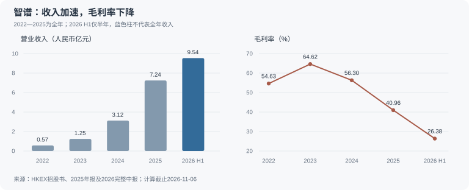

# 智谱（02513.HK）研究报告

**研究与信息截止日：2026年11月6日，Asia/Shanghai。** 财务截止2026年6月30日；采用9月24日完整中报，而非只有损益和资产负债表的业绩公告。正式披露补检覆盖9月至11月6日上午，最新检得文件为11月4日提交的10月证券月报；未检得正式2026Q3损益表。

**估值锚：11月5日完整交易日收盘476.00港元；总股本487,588,090股；复算总市值2,320.92亿港元。** 另取得腾讯11月6日10:14:46延时快照432.40港元，属于盘中价格，未混入收盘估值模型。本文价格带是研究条件，不是交易指令。[收盘价格](https://cn.investing.com/equities/knowledge-atlas-tech-joint-stock-historical-data) · [10月股本月报](https://www1.hkexnews.hk/listedco/listconews/sehk/2026/1104/2026110401758.pdf)

**核心问题：智谱已证明模型能带来迅速增长的收入，尚待证明每一代模型与算力投入之后，普通股股东能留下多少现金。** 本次研究上调对商业化广度的判断，同时收紧对现金流、偿债与安全边际的要求。

本报告用于学习研究，非投资建议；没有获得用户当前持仓、成本及风险承受信息，不推定用户持有智谱。

---

## AI研究偏见自觉

**信息丰富度：B级。** 公司已上市，年报、中报、融资文件和外部技术评测可查；但长期投资最重要的续费、客户净留存、云分成利润、训练投入回报和当前净现金仍不完整。新闻很多不等于盈利确定。

AI研究局限性：财务事实来自公开披露，平台与媒体用于核对提取；不能替代客户访谈、产品长期体验和审计。最新可核验的全业务ARR管理层口径来自9月16日，并非11月实测。本文所有未来收入、利润、现金流和价格情景均为研究假设，不是公司承诺。

- [x] 不把此前极端估值判断当作本次结论的锚。
- [x] 不把榜单能力、云平台上架或订单直接转换为高毛利收入。
- [x] 不把高增长API的月度年化收入当作锁定一年的订阅合同。
- [x] 同时检验“模型层永远赚不到钱”和“AI需求增长必然惠及股东”。

## 已有研究与本次更新

已按交易所、代码及中英文名称确认同一标的：北京智谱华章科技股份有限公司，现英文名Z.AI Co., Ltd.，原Knowledge Atlas Technology Joint Stock Company Limited；沿用 `reports/智谱/`。未发现其在重点看板、建议台账或触发配置中的同公司记录，本次补登记。

| 既有材料 | 原研究或数据时点 | 本次用途 |
|---|---|---|
| [4月研究](智谱AI-研究报告-20260410.md) | 2026-04-10 | 商业模式与上市初期基线 |
| [7月完整研究](智谱投资研究报告_20260704.md) | 2026-07-04，主要财务为FY2025 | 核验项目占比、定价权、现金跑道及极端估值判断 |
| [7月系列终章](《看懂智谱AI》-20260714/04-终章-930倍市销率与2027年1月的大考.md) | 2026-07-14 | 估值、融资与解禁问题 |
| [7月新闻复核](智谱-news-20260720.md) | 2026-07-20 | 区分股价异动与经营因果 |
| [六强横评中的智谱](../中国大模型六强横向研究-20260721/06-智谱GLM.md) | 2026-07-21 | 对手、治理及技术假设 |
| [9月中报解析](智谱-三大报表解析-2026中期-20260901.md) | 2026-09-01；财务截止6/30，当时现金流为推算 | 最近财务基线；用完整中报替换估计 |
| [智谱与MiniMax中报比较](../MiniMax-智谱对比/智谱vsMiniMax-2026中报质地对比-公众号-20260901.md) | 2026-09-01 | 识别同业现金流与口径问题；不复用旧汇率 |

| 旧判断 | 本次状态 | 新证据与行动影响 |
|---|---|---|
| 本地化项目是主要收入，API仍在转型早期 | 推翻其当前适用性 | H1 API占收入86.5%；应按用量平台研究，不能继续描述为主要靠政企交付 |
| 技术只是短期领先，信创是唯一差异化 | 削弱“唯一”判断 | NIST专业评测、AWS分发与法律方向增加了技术和渠道证据；仍不能等同长期经济护城河 |
| 开源意味着模型公司无法从云平台收费 | 削弱 | 旗舰许可改变，公司披露分成合作；费率、收入及毛利仍待财报验证 |
| 千倍市销率足以概括现价 | 失效，重新计算 | 股本、价格、收入及ARR均变化；当前滚动PS132.76倍、9月ARR口径P/ARR16.40倍，不能互相冒充 |
| H1经营净流出约32亿元、FCF约−32.3亿元 | 前者估算被披露替换；后者修正 | 实际CFO−33.74亿元，仍在旧估算范围；广义FCF−39.60亿元，现金资本支出不可用会计新增额替代 |
| 7月募资后静态现金跑道约五年 | 削弱 | 8月底7月款已使用约34.92%；9月新债一年内到期，当前余额未知，撤销固定跑道结论 |
| 非流动资产都可归为算力预付，资本承担为零就代表没有锁量价 | 修正 | 完整中报拆出设备预付、税项及押金；会计资本承担不能代替采购服务合同审查 |
| 2027年1月约40%解禁是确定抛压 | 待逐股东重核 | 配售已改变分母；限制到期不等于实际出售，旧比例及价格因果不直接沿用 |

本次补检包括9月融资及完整中报、10月云渠道与专业模型、10月29日关联交易通函、11月4日股本月报。未解决的问题是：9月后的真实收入与回款、分成合同经济性、续费率、完整算力承诺及期后现金余额。没有查到新季度报表，不用媒体ARR填补报表空白。

---

## 第一步：核心数据总览

### 增长很快，现金消耗也在扩大

下表金额均为人民币亿元；净亏损统一使用集团口径。2022—2025为全年，2026H1仅半年，不能把末列直接当年度同比。成立时间较短，公开可核验序列不足五个完整财年；未披露的季度分部数据不补造。

| 指标 | 2022 | 2023 | 2024 | 2025 | 2026H1 |
|---|---:|---:|---:|---:|---:|
| 营业收入 | 0.57409 | 1.24538 | 3.12414 | 7.24334 | **9.53892** |
| 毛利 | 0.31360 | 0.80482 | 1.75889 | 2.96656 | **2.51611** |
| 毛利率 | 54.63% | 64.62% | 56.30% | 40.96% | **26.38%** |
| 集团净亏损 | −1.43650 | −7.87957 | −29.58007 | −47.18167 | **−20.71992** |
| 研发费用 | 0.84377 | 5.28884 | 21.95436 | 31.80443 | **21.31171** |
| 经营现金流 | −0.68246 | −6.48017 | −22.44919 | −22.46123 | **−33.74057** |

来源：[招股书](https://www1.hkexnews.hk/listedco/listconews/sehk/2025/1230/2025123000017.pdf)附录I、[2025年报](https://www1.hkexnews.hk/listedco/listconews/sehk/2026/0419/2026041900085.pdf)p13、76、82、[2026完整中报](https://www1.hkexnews.hk/listedco/listconews/sehk/2026/0924/2026092401583.pdf)p53—61；[Cibo财务平台](https://cibo.hk/zh-CN/stock-financial-02513.html)核对年度收入、亏损和利润率，现金流另与[富途](https://www.futunn.com/stock/02513-HK/financials-cash-flow)核对。

H1收入同比增长399.7%，毛利同比增长163.7%；经营亏损为21.46552亿元，经调整亏损为19.64138亿元。报表亏损同比收窄与经营改善不能画等号：上市后投资者金融工具重估费用大幅下降，经营亏损和经调整亏损仍扩大。归母亏损为20.71326亿元，与集团20.71992亿元有少数股东差额，不混用。

### API已成为主业，订阅占比仍未知

| H1业务 | 收入，亿元 | 收入占比 | 毛利率 | 经济含义 |
|---|---:|---:|---:|---|
| 开放平台及API／云端 | **8.25176** | **86.5%** | **24.6%** | 标准化调用快速放量，但推理成本随使用增加 |
| 本地化部署合计 | 1.28716 | 13.5% | 37.9% | 较上年同期下降约20.4%，不是整体下降54.6% |
| 其中企业级智能体 | 0.55561 | 5.8% | 35.6% | 属本地化细分，勿与API重复相加 |
| 其中企业级通用模型 | 0.67037 | 7.0% | 42.3% | 下降54.6%的是这条产品线 |
| 其中技术服务及其他 | 0.06118 | 0.6% | — | 小额业务，百分比有四舍五入 |

来源：完整中报管理层讨论与分部附注。占比及变动率按原始千元重算，与管理层舍入文字可能略有不同。API中包含按量与订阅，86.5%不是“订阅收入占比”。合约负债3.02325亿元说明存在预收，不足以单独证明Coding Plan续费或净留存健康。

API毛利率由2025全年的18.91%升至24.59%；由全年减上半年推算，2025H2约22.39%，到2026H1改善约2.19个百分点。方向正面，但产品组合、缓存、提价和利用率都影响均价与成本，不能将全部改善归因于某一项技术。

### 现金流：把估计改成披露数

| H1／6月末项目 | 人民币亿元 | 口径 |
|---|---:|---|
| 经营现金流 | **−33.74057** | 正式现金流表 |
| PPE现金支出 | 5.86417 | 含资产收购及相关受限保证金；无形资产现金购置为零 |
| 广义FCF | **−39.60474** | CFO减上述现金支出；非持续性／内生FCF率 |
| 银行及手头现金 | 39.93722 | 含受限现金1.05995亿元 |
| 非受限现金等价物 | 38.87727 | 现金流表口径 |
| FVPL短期投资 | 5.06139 | 有估值与流动性风险 |
| 银行借款＋租赁负债 | 26.04199 | 6月末，尚不包含9月债券 |
| 非受限现金＋短期投资−上述负债 | **17.89667** | 本文6月广义净现金；不是11月余额 |

H1经营消耗若简单年化，约为2025全年三倍；这只说明现金需求上升，不是全年预测。训练费用已经进入经营支出，不能因传统capex低就称其“轻资本”，也不能在FCF中再扣一次全部研发。

中报附注补全了旧文的缺口：全期限算力服务及其他预付16.49040亿元，其中非流动4.05304亿元；另有设备预付、税项及押金。旧文将非流动资产9.12325亿元全部并入算力预付，范围过大。融资成本中汇兑损失0.73448亿元，银行利息0.09997亿元，租赁利息0.12480亿元，也不应把全部融资成本视作贷款利息。

应收净额7.82944亿元仍需追踪，但用期末应收除半年收入得到的天数不是标准平均应收周转天数；本地化收入下降也不能单独证明全部新增应收来自API。需要客户级账龄和期后回款。

> 段永平式追问：新收入带来的毛利，能否覆盖维持下一代模型竞争力的全部投入？

---

## 第二步：生意本质分析

**智谱向开发者和企业出售可完成编程及专业任务的模型能力，按订阅、调用和交付收费；客户买的是任务效果，股东承担的是持续训练与算力扩张。**

| 收费方式 | 客户为何付钱 | 复购来源 | 主要成本与约束 |
|---|---|---|---|
| 自营API与Coding Plan | 用较低成本完成代码、推理和工具任务 | 工作流使用、模型效果、可用性 | 推理算力随用量增加；订阅限额与成本管理 |
| 云平台托管与分成 | 企业通过原有云账户采购和部署 | 渠道分发、模型更新、企业安全要求 | 分成费率、云平台议价权与收入净额确认 |
| 本地化与专业场景 | 数据治理、合规、定制任务及交付 | 系统集成和领域知识 | 项目工期、回款与交付人力 |

Coding Plan兼容多种开发工具，有利于获客；同样意味着用户可在外部工具中替换模型。API嵌入、评测集、提示词和权限配置形成一定迁移成本，尚未证明强到可以持续提价。[产品机制](https://docs.z.ai/devpack/overview) · [官方定价](https://docs.z.ai/guides/overview/pricing)

经营杠杆的关键不是调用量本身，而是三件事：每项有效任务的净收费、全成本推理毛利，以及保持领先所需的训练投入。H1研发为毛利的8.47倍，离成熟软件式利润结构仍远。

但空方也不能忽略增长可能跨越盈亏门槛。冻结H1研发、销售和管理费用并年化，约48.24亿元；维持26.38%毛利率，静态收入门槛约182.9亿元／年。年底30亿美元ARR指引按研究汇率折约200.7亿元年化，量级上可能跨越这个门槛。**前提是收入全年保持、费用不继续扩张、毛利不下降；这三个前提尚未被验证。** 此计算未覆盖其他损益及现金营运资本，不能当盈利预测。

> 段永平式追问：客户是在为稀缺任务效果持续付费，还是趁这一代模型便宜而暂时路由过来？

---

## 第三步：护城河评估

| 来源 | 当前证据 | 判断与可证伪条件 |
|---|---|---|
| 品牌／定价权 | 提价与调用增长同时出现 | 有支付意愿，缺同款、同客户的续费证据；降价后毛利长期恶化则削弱 |
| 转换成本 | API集成、专业工作流、企业安全评估 | 中低至中等；多模型路由与兼容接口降低迁移成本 |
| 网络效应 | 开发者生态、反馈与工具适配 | 尚未证明用户增加自动提高每位客户价值，不等于社交网络 |
| 规模效应 | API毛利改善、算力工程与国产适配 | 有工程积累；训练与推理仍耗资，尚未证明长期成本领先 |
| 技术与专业能力 | 编程、网络安全、法律模型 | 技术差异化增强；能否转为多年超额利润仍未知 |
| 信任与政策生态 | 政企经验、国产算力适配 | 有本地优势，也承担政策、供应链和关联方治理约束 |

9月17日NIST／CAISI确认，GLM-5.3是当时评测中网络安全能力最强的开放权重模型，同时在其综合网络安全指标上落后美国前沿约四个月。这是专业能力的外部支持，不是全领域“全球第一”。[原始评测](https://www.nist.gov/news-events/news/2026/09/caisis-assessment-zais-glm-53-cyber-capabilities)

旗舰GLM-5.3采用自定义许可：达到规定收入规模的MaaS经营者须先通过安全审查；Flash仍采用MIT许可。这使“所有开源模型都可被大云无条件托管”的旧判断失效。但许可没有公开固定版税，审查权不是已经兑现的收费权。[旗舰许可](https://huggingface.co/zai-org/GLM-5.3/blob/main/LICENSE) · [Flash许可](https://huggingface.co/zai-org/GLM-5.3-Flash/blob/main/LICENSE)

过去几年的技术和分发能力在增强；对未来的判断只能是“正在形成候选壁垒”。若性能差距迅速缩小、云商压低分成、客户把模型视作可替换耗材，技术资产仍可能主要让客户获益。

> 巴菲特式追问：假设对手明天免费提供相近能力，客户仍然留在这里的原因是什么？

---

## 第四步：逆向思考与风险清单

| 失败路径 | 概率判断，非统计测量 | 对股东的影响 | 可观察信号 |
|---|---|---|---|
| 收入增长但推理与训练同步吞掉毛利 | 中高 | 长期依赖融资，普通股回报低 | API毛利停滞、FCF缺口随收入扩大 |
| 技术掉队或客户多模型迁移 | 中高 | 调用、分成与议价能力下滑 | 同类任务表现／成本落后、续费转弱 |
| 把高峰月ARR当成稳定年度收入 | 中高 | 盈利兑现低于市场预期 | 年报确认收入、回款和ARR无法桥接 |
| 2027年债券偿还与新投资冲突 | 中 | 被迫缩投资或低价再融资 | 现金低于偿债准备、转股未发生、融资条件恶化 |
| 算力预付无法有效交付或利用 | 中 | 资金沉淀、减值、成本升高 | 预付持续增加但可交付收入、毛利不跟随 |
| 监管、断供、出海或安全限制升级 | 无法可靠量化，列尾部情景 | 海外渠道受损，极端时股权价值接近零 | 正式禁令、渠道限制、采购终止 |
| 股东限制到期和新股供给冲击 | 事件概率高，出售量未知 | 股价与融资能力承压 | 实际权益申报与配售，而非仅解禁日期 |

最强空方论点是：客户可以随时比价，模型公司必须提前投入，收入的年化速度很容易看起来像SaaS，现金结构却像高强度基础设施企业。这个论点应接受财报验证，不能靠“所有利润都归算力”一句话断言终局。

历史类比可参考商汤的融资依赖与收入变现难题，但不能据此认定智谱一定重复其结局；标准化API与全球分发已构成差异。航空业提醒需求增长不保证资本回报，微软等平台又提醒高前期投入可能形成长期利润。类比用于提出检验项，不用来直接定价。

最可能的分析错误有两种：悲观者低估分成模式降低自营推理负担；乐观者高估模型领先的持久性与云平台分成率。10月竞争对手关于蒸馏的公开指控属于合规及声誉风险，未找到司法定论，不能当作已认定事实。[对手原始声明](https://www.anthropic.com/news/distillation-defenses)

> 芒格式追问：即便智谱收入达到指引，股东仍然赔钱的路径有哪些？

---

## 第五步：管理层评估

| 决策 | 可观察结果 | 评价 |
|---|---|---|
| 坚持基座模型、编程与开源分发 | API收入占比提升，专业技术得到外部验证 | 技术与产品判断正面；资本回报尚未验证 |
| 7月高价配售、9月股债融资 | 融得大额资金，获得继续投入的能力 | 对融资执行加分；募资成功不等于投资成功 |
| 国产算力工程和基础设施扩张 | 公司披露成本改善；预付和资产现金支出上升 | 战略有逻辑，需要全成本、利用率及交付证明 |
| 旗舰许可与云合作 | AWS渠道落地、管理层宣布分成 | 商业路径拓宽，合同经济性尚未披露 |
| 收购与资本配置 | 有团队、设备及商誉投入 | 需用新增毛利、现金回收和减值检验 |

### 融资既增加选择权，也增加了期限约束

| 已完成融资 | 新股／债务 | 净所得及重要条件 |
|---|---|---|
| 7月配售 | 19,780,000股，1,588港元／股 | **313.7495亿港元**净款；旧文部分毛款数字有误，以公告为准 |
| 9月配售 | 21,965,000股，714港元／股 | **156.6413亿港元**净款，9月16日完成 |
| 9月可转债 | 本金人民币**201.4亿元** | 净所得30.1077亿美元；公告等价236.1024亿港元，9月18日完成 |

来源：[7月完成公告](https://www1.hkexnews.hk/listedco/listconews/sehk/2026/0713/2026071300662.pdf)、[9月条款](https://www1.hkexnews.hk/listedco/listconews/sehk/2026/0913/2026091300025.pdf)、[9月完成公告](https://www1.hkexnews.hk/listedco/listconews/sehk/2026/0918/2026091800399.pdf)。零息债按100.5%发行，不能理解为无偿、无限期资本。

债券于2027年9月16日到期，2027年7月1日起可转，初始转股价892.50港元。476港元较该价格低46.67%，所以本次基准按到期偿还处理；未来股价、条款调整及再融资仍可能改变结果。全部转股会增加26,365,026股，合计513,953,116股；这时应同步消除相应债务，不能重复惩罚股本又保留全部债务。

截至8月31日，IPO款已全部使用，7月款已使用109.548亿港元，约34.92%。即使把6月末净现金与后续全部净融资机械相加，并扣债券本金，得到的也只是未扣期后开支的备考桥接。**没有11月资产负债表，不能报出确定的当前净现金或“五年跑道”。** 拟科创板募资不计入已到账资金。

治理方面，现行章程原则上一股一票，未找到AB股证据。按9月融资文件的一致行动集团133,044,230股除最新总股本，约27.29%；唐杰直接26,835,330股若未变约5.50%。这是持股数量未变条件下的重算，不冒充最新个人权益申报，也不能把SFO视作／共同权益重复当作经济持股。[章程](https://www1.hkexnews.hk/listedco/listconews/sehk/2026/0622/2026062202129.pdf) · [中报权益披露](https://www1.hkexnews.hk/listedco/listconews/sehk/2026/0924/2026092401583.pdf)

10月29日通函披露前三季关联方采购与服务1.763588亿元、关联方销售0.055078亿元，主要采购涉及算力；这是A股规范性要求下的关联方口径，不直接等同港交所关连交易口径。既不能据此认定循环收入，也不能认为整体回款风险已经排除。11月13日股东会是治理检查点，不是财报日。[通函](https://www1.hkexnews.hk/listedco/listconews/sehk/2026/1029/2026102901811.pdf)

管理层结论：技术与融资执行较强；持续资本配置能力、客户价值和每股现金回报仍需要时间证明。旧文对裁员沟通的评价未获得本次新的独立核验，不据此延伸为当前组织结论。

> 段永平式追问：如果核心科学家或融资窗口暂时离开，公司能否依靠产品与现金创造维持竞争？

---

## 第六步：行业与文明趋势

AI从回答问题走向完成任务，是长期重要变化；但可替代的知识劳动预算，不会全部变成模型公司的收入。客户可以节省成本，应用与渠道可以获取分成，算力供应商也要收钱。智谱真正能争取的市场，应由可收费任务量、实际净价和可获得份额逐步计算。

| 近期变化 | 已验证到哪一步 | 尚未验证的价值获取 |
|---|---|---|
| 9月16日交流会：全业务ARR18亿美元、年底指引30亿美元 | 管理层经媒体报道的时点口径和指引 | 续费、全年确认收入、订单回款 |
| 公司称Co-work订单超过10亿元 | 公司订单口径 | 确认时间、毛利、收款和持续性 |
| 9月NIST及竞争对手技术评估 | 专业能力有外部验证 | 客户愿意为这些能力支付多少 |
| 10月5日AWS Bedrock上架GLM-5.3 | 官方渠道存在，面向合资格企业客户 | 分成率、确认净额及利润；上架不保证普遍准入 |
| 10月12日GLM-Legal发布 | 官方产品及外部法律评测 | 实际付费、续费与责任边界 |

来源：[9月交流会报道](https://finance.sina.com.cn/tech/roll/2026-09-16/doc-inirzsia9879466.shtml)、[AWS官方](https://aws.amazon.com/blogs/machine-learning/introducing-glm-5-3-on-amazon-bedrock/)、[法律模型官方](https://z.ai/blog/glm-legal)、[Vals评测](https://www.vals.ai/models/zai_glm-legal)。

对竞争格局，DeepSeek、Qwen、Kimi、MiniMax和美国前沿厂商都构成替代；大厂还控制云渠道。没有取得可比、当期、同口径的付费收入份额，不复用2024年市场份额当2026地位，也不把对手融资传闻当已到账事实。

实体清单是正式约束，国产生态可能因此增加需求，但不能据此推导制裁净影响为正。先进芯片获取、海外客户采购与安全审查都可能受影响。[美国正式列名文件](https://www.govinfo.gov/content/pkg/FR-2025-01-16/pdf/2025-00704.pdf)

> 李录式追问：二十年后AI创造的大部分价值，会由客户、渠道、算力还是模型公司留下？智谱凭什么拿到其中稳定的一份？

---

## 第七步：估值与安全边际

### 先把历史收入、ARR与指引分开

人民币兑港元使用11月6日研究快照1人民币＝1.1754港元；ARR美元换算假设1美元＝6.69人民币，仅用于量级比较，非债券合同固定汇率。汇率波动与取数时点差异是限制。[汇率快照](https://dailyfx.com.hk/zh-cn/%E4%BA%BA%E6%B0%91%E5%B8%81%EF%BC%88%E5%9C%A8%E5%B2%B8%EF%BC%89%E5%85%91%E6%B8%AF%E5%85%83/)

| 分母 | 人民币亿元 | 对应市值倍数 | 可以说明什么 |
|---|---:|---:|---|
| 2025已确认全年收入 | 7.24334 | 272.61倍PS | 历史很小，不能单独评价当前增长 |
| 滚动收入：FY2025−H1FY2025＋H1FY2026 | 14.87349 | **132.76倍PS** | 最近已披露十二个月，仍有时滞 |
| H1收入简单乘二 | 19.07784 | 103.50倍 | 静态年化，非2026全年预测 |
| 8月底16亿美元ARR | 107.04 | 18.45倍P/ARR | 单月收入年化的公司口径 |
| 9月16日18亿美元ARR | 120.42 | **16.40倍P/ARR** | 本次最新可核验管理层时点，不是11月实测 |
| 年底30亿美元ARR指引 | 200.70 | 9.84倍 | 尚未实现的预测，不能写“当前PS不到十倍” |

PE、PEG与正FCF收益率当前不适用。若示意性假设扣足全部债务后的净现金200亿元，EV／9月ARR约14.74倍；200亿元不是披露余额，所以不作为确定的“当前EV”发布。

相比旧研究，估值压力明显缓和。与此同时，ARR可能包含按调用计费和高峰用量，没有锁定年度合同、净留存和稳定毛利时，不能直接给予成熟SaaS相同倍数。未上市同行估值与ARR多为不同日期、不同融资权利及非审计口径，本次不以它们反推出智谱终值。

### 十年现金流情景：假设比小数位重要

模型按2027—2036十个年度时段近似折现；未单列研究日至2027年初的短期现金流，该部分须由期初净现金假设吸收。全部现金流为人民币，未来汇率先按研究快照不变；不是港元现金流配人民币折现率。

- 资本成本r：主用8%，敏感性9%。采用长期归一化无风险利率2%＋β1×ERP6%／7%的判断假设；2%不是今日国债报价。没有把断供、退市或监管事件塞进r。
- 稳态ROIC：20%的研究假设，代表技术／渠道形成后仍需再投资；当前负利润不能证明这个回报。若无法形成该回报，基准情景失效。
- 永续增速g：悲观0%、基准1.5%、乐观2%，均为2036年之后的人民币名义增速；不随r改变。
- 净现金桥接：以100／200／300亿元做敏感性，主表取200亿元，均为**假设**，已预留全部银行、租赁及CB债务。未取得期后真实余额，不视作现金底。
- 每年1%无对价股本稀释用于示意股份激励；不预估A股发行。CB基准按偿还处理，未再加入转换股数。

终值利润为扣持续训练、运营和税后、融资前的经营利润；FCF另扣营运资本、现金资本开支及经营租赁现金成本。期初银行、租赁与CB本金已由净现金桥接预留，不再从未来FCF重复扣除；新增使用资产和续租仍有现金成本。永续倍数只来自 `(1−g/ROIC)/(r−g)`；按下一年利润计算终值，所以将2036利润先乘`1＋g`，再折回当前。

| 情景，均为本次假设 | 2029收入，亿元 | 2036收入，亿元 | 2036经营利润，亿元 | 十年FCF序列，亿元 |
|---|---:|---:|---:|---|
| 悲观：价格战、专业场景有限 | 80 | 120 | 6，利润率5% | −40／−35／−30／−25／−15／−5／0／1／2／3 |
| 基准：增长延续，逐渐留下现金 | 200 | 600 | 90，利润率15% | −30／−20／0／10／18／26／34／43／54／63 |
| 乐观：专业平台与云分发成功 | 340 | 1,200 | 240，利润率20% | −15／0／15／35／60／85／110／130／150／168 |

这些不是精确预测。基准2027收入120亿元已接近9月ARR的年化量级，2029达到200亿元；乐观则要求更快扩张和更高现金利润。2036后增长切换至低稳态，资本再投资需求也随之下降，这一终值假设若不成立，估值须下修。

| 情景 | r＝8%倍数／r−g | r＝8%当前价值，港元 | r＝9%倍数／r−g | r＝9%当前价值，港元 |
|---|---|---:|---|---:|
| 悲观 | 12.50倍／8.0个百分点 | **27.62** | 11.11倍／9.0个百分点 | **26.79** |
| 基准 | 14.23倍／6.5个百分点 | **199.13** | 12.33倍／7.5个百分点 | **169.64** |
| 乐观 | 15.00倍／6.0个百分点 | **509.94** | 12.86倍／7.0个百分点 | **422.74** |

另列股权近零的断供／监管／商业化失败尾部情景，不给没有数据支持的精确概率。上表不是概率加权目标价，也不是全风险下限。基准经营价值中约87%来自终值现值，说明结论高度依赖十年后的盈利，不适合凭这个模型重仓。

净现金假设在100／200／300亿元时，r＝8%的基准价值分别为175.02／199.13／223.23港元；不计每年1%稀释则为215.14港元。两档r下均为乐观＞基准＞悲观，当前476港元都高于基准；乐观是否高于现价会随r改变，不能据乐观档宣称明显低估。

### 三年情景与反向检验

亏损阶段不套用“负EPS×正PE”。三年值从同一十年模型滚动到2029：保留前三年FCF形成的现金变化，再折现剩余经营现金流及终值，不额外拍一个同业退出倍数。

| 同一情景的2029参考价值，r＝8% | 港元 | 相对476港元的累计价差，非年化回报 |
|---|---:|---:|
| 悲观 | 23.38 | −95.09% |
| 基准 | 238.66 | −49.86% |
| 乐观 | 629.11 | +32.17% |

即使基准业务收入大幅增长，三年价值仍可能低于今天。乐观情景能提供回报，但需要更高收入、利润率与现金转化同时兑现。没有可靠中间分红及融资预测，本次不报伪精确十年IRR。

反向DCF在维持基准的前十年FCF路径、净现金和稀释假设下，当前价格要求2036税后经营利润约279.63亿元，而非基准90亿元；若当时利润率15%，对应年收入约1,864.20亿元。这个逆推只改变终值，其余路径被冻结，是解释定价要求的检验，不是自洽的经营预测。若早期现金流显著优于基准，所需终值会降低。

限制：未单独量化新增A股融资的金额与对价、重大诉讼损失、未来汇率路径及每份算力合同；净现金和续费是关键数据缺口。尾部情景不会因上述模型通过算术检查而消失。

> 巴菲特式追问：愿意为还没证明能分给股东的终值，今天支付多少现金？
>
> 段永平式追问：如果关闭股市五年，你能否只依靠客户与财报，而不是下一轮估值，解释这笔投资？

---

## 第八步：最终决策与行动清单

| 维度 | 本次判断 | 信心 |
|---|---|---|
| 生意质量 | 标准化收入与专业场景改善，仍是持续投入很重的生意 | 中 |
| 护城河 | 技术与渠道差异化增强，长期租金尚未证明 | 中低 |
| 管理层 | 技术、产品和融资执行强，资本回报待验证 | 中 |
| 最大风险 | 收入跑得快，现金和股权价值留不下来 | 中高 |
| 行业趋势 | 长期需求值得研究，公司价值获取仍分化 | 趋势高，个股中低 |
| 估值 | 较旧研究显著降低，但476港元需要接近乐观路径 | 中低 |

**研究结论：观望，回避现价新仓；不列为长期核心持仓候选。** 与7月相比，对商业化与技术的评价提高；与9月相比，现金流口径更完整、偿债纪律更严格。这不是“公司没进步”，而是仍未获得足够证据为现价的长期现金回报背书。

| 投资者／价格条件 | 动作 | 还需满足的经营条件 |
|---|---|---|
| 空仓者，当前估值附近 | **不新增，继续观察** | 等确认收入、回款、云分成利润及CB准备金 |
| 200港元以下 | **启动完整复核，非买入信号** | 用最新财报重算净现金、股本与模型；旧数据不能自动套入 |
| 100—125港元 | **条件通过后才考虑研究性小仓分批** | 至少两个可比报告期API毛利≥30%、经营现金消耗率下降；云分成有确认收入和毛利；扣承诺投资后仍有足够到期CB偿债准备；无重大合规或收入真实性问题 |
| 125—200港元 | 观察，等待更高确定性或更好回报 | 不能仅因跌入基准价值附近就买入 |
| 低于100港元 | 先查论文是否破坏，再讨论价格 | 下跌不自动提高仓位，现金和偿债条件优先 |
| 已持仓者，当前估值附近 | 不以亏损成本摊低；复核集中度，稳健者考虑减至可承受损失的小观察仓 | 未知实际持仓，不给伪精确卖出数量 |
| 400港元以上且经营证据未明显增强 | 回避追价、复核持仓 | 这是估值警戒，非机械止盈；不能据此推出做空指令 |

100—125港元来自较谨慎r＝9%基准169.64港元再留约25%安全折让（计算约127.23港元），并向下取整；只是低置信度研究带。若下一份财报改变现金、毛利或股本，必须重算，不能视为保证价值底。

提高仓位须在上述条件之外进一步看到：持续正FCF、可解释的正常化资本回报、续费与云分成不依赖单代模型，以及明确可承受的稀释。卖出／减仓复核信号包括：可动用流动资金不足以覆盖到期债务及必要投入（已扣债务的净现金不再重复扣同一债务）；确认收入、回款与ARR持续背离；API毛利在规模扩大后仍恶化；技术／渠道或重大合规红线实质破坏。

| 复检节点 | 性质 | 本次安排 |
|---|---|---|
| 2026-11-13 | 已公告股东会 | 核关联交易决议与治理解释，不期待季报 |
| 2026-12-31 | 研究检查日，非承诺披露日 | 核年底ARR指引兑现口径、云分成及最新融资 |
| 2027-01-08 | 限售规则研究检查 | 逐股东核限制及权益变化，不直接沿用旧“40%” |
| 2027-03-31 | 全年业绩披露情况检查 | 未查得公司确认发布日期；结果披露后核现金、回款与完整资本开支 |
| 2027-07-01 | 公告转股窗口起点 | 核转股、股本与债务，避免双重计算 |
| 2027-09-16 | 公告债券到期日 | 核偿还／转股／再融资完成情况 |

以下为方法论模拟，非本人发言或真实引语：

> 巴菲特式：优秀模型值得关注，股东能获得的现金才决定应付的价格。
>
> 芒格式：最危险的不是没有增长，而是把需要不断融资的增长误当成复利。
>
> 段永平式：先确认这门生意最终能够赚钱，再讨论市场给了多少折扣。
>
> 李录式：时代方向可能很清楚，但赢得时代和赢得股东回报仍要分别验证。

## AI分析置信度与投资确定性

对已披露财务、融资条款和当前股本，AI分析置信度较高；对客户留存、分成经济性及长期ROIC，置信度中低。实际投资确定性仍低于成熟盈利企业，不能因资料变多而把估值模型变成确定性。

需要一手补验的问题：客户为何续费或更换模型；Coding Plan各档真实使用成本；云合作的分成、总额／净额确认与回款；国产集群全成本及可用率；预付合同的期限、退出和最低采购义务；资本扩张后的年度现金消耗。以上未补齐前，本次结论不支持核心仓位。

---

## 数据来源与审计记录

关键一手资料已在正文就近链接。数值取原始披露，第三方用于检查提取及口径；它们通常共享公司的原始报表，不是第二次独立审计。AAStocks访问未成功，未找到适用ADR财务源，因此使用HKEX＋Cibo／富途／具名媒体的替代组合并注明来源关系。

### 关键数据交叉验证记录

| 项目 | 原件／工具值 | 外部核对值 | 结果 |
|---|---:|---:|---|
| FY2025收入，亿元 | 7.24334 | Cibo 7.24 | 偏差＜1% |
| FY2025集团净亏损，亿元 | −47.18167 | Cibo −47.18 | 偏差＜1% |
| H1收入，亿元 | 9.53892 | 第一财经9.54 | 偏差＜1% |
| H1集团净亏损，亿元 | −20.71992 | Cibo −20.72 | 偏差＜1% |
| H1现金等价物，亿元 | 38.87727 | 富途38.88 | 偏差＜1% |
| H1经营现金流，亿元 | −33.74057 | 富途−33.74 | 偏差＜1% |
| H1广义FCF，亿元 | −39.60474 | 钛媒体−39.60 | 偏差＜1%；同样包含资产现金支出 |
| 总股本，股 | 487,588,090 | 老虎证券分项加总487,588,090 | 一致 |
| 11/5收盘价，港元 | 476.00 | Investing／摩根大通／腾讯昨收476.00 | 一致 |
| 股价×总股本，港元 | 232,091,930,840 | 报告市值同值 | 工具偏差0% |

收入交叉源：[第一财经](https://www.yicai.com/brief/103341288.html)；现金流交叉源：[富途](https://www.futunn.com/stock/02513-HK/financials-cash-flow)、[钛媒体原稿的新浪转载](https://finance.sina.cn/stock/jdts/2026-09-29/detail-initnwnc2877878.d.html)；股本交叉源：[老虎证券](https://www.itiger.com/hans/news/1121394546)；报价交叉源：[摩根大通](https://www.jpmhkwarrants.com/zh-cn/market-statistics/underlying/underlying-terms/code/2513)。

市值、跨币种倍数、净现金与情景使用 `financial_rigor.py` 的Decimal输入函数及可复算脚本；终值使用 `terminal_value.py` 的永续模型，8%／9%参数均通过币种、分母宽度与风险归属检查。计算及逐项交叉验证保存在[验证目录](validation/20261106/)，[完整参数](validation/20261106/model-inputs.json)与[计算结果](validation/20261106/calculations.json)区分事实和假设。

**数据抽检准出**：随机样本中的披露数据已回源核对，派生值已重算；日期／时间按元数据核验，未来情景按参数及算式校核，均未发现超出容差的偏差。技术服务收入另与[富途业务构成](https://www.futunn.com/stock/02513-HK/financials-revenue)核对。详见[抽检结果](validation/20261106/audit-results.json)及[准出记录](validation/20261106/audit-verdict.txt)。工具数值准出不代表投资假设已获验证。
