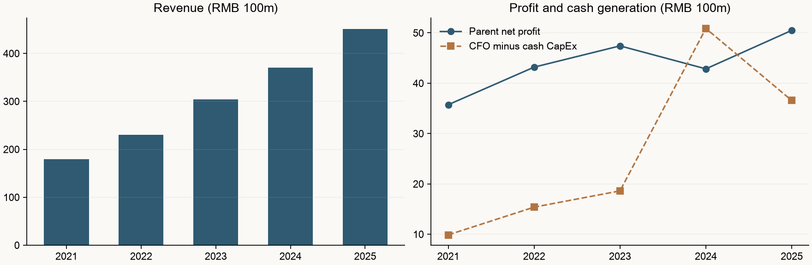
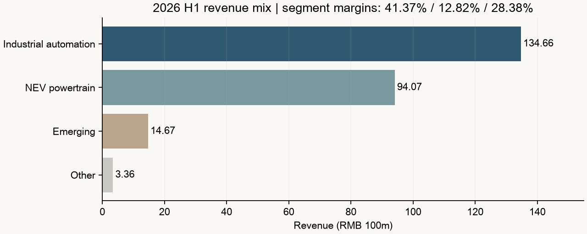

# 汇川技术（300124.SZ）研究报告

**研究与信息截止：2026-11-26，北京时间；财务截至2026-09-30，最新年度审计截至2025-12-31。** 深圳市汇川技术股份有限公司，Shenzhen Inovance Technology Co., Ltd.，深交所创业板300124。11月26日收盘价 **51.80元**；总股本2,712,360,503股，复算总市值 **1,405.00亿元**；归母TTM PE约27.05倍、扣非TTM PE约28.27倍。股价由腾讯与新浪核对；股本由当日回购完成公告与腾讯核对。联合动力（301656）是已上市并表子公司，不能把两只股票或两者收入相加。[腾讯行情](https://qt.gtimg.cn/q=sz300124)、[新浪行情](https://hq.sinajs.cn/list=sz300124)、[11月26日公告](https://static.cninfo.com.cn/finalpage/2026-11-26/1225689466.PDF)

**研究假设：** 汇川靠控制、驱动与行业工艺帮助设备客户缩短调试和停机时间；工控复购与替代需求仍强，但汽车业务的毛利、扩产和营运资金正在消耗集团现金，机器人商业化还不足以支撑集团利润预期。

本报告接续[9月28日研究](汇川技术-research-20260928.md)，保留旧稿供追溯。必须先纠正：旧稿把既有财务分析中的**ROA 7.86%误作ROIC**，并让十年压力测试过度主导22—25元价带。本次重建参数和决策依据；这项纠错不等于基本面已经改善，也不机械恢复更早的45—52元方案。

## AI研究偏见自觉

**信息丰富度评级：A。** 财报、交流记录和券商覆盖丰富；最容易形成的共识是“国产替代＋人形机器人＝工业平台溢价”。反面检验应看客户肯不肯付钱、库存能否卖掉、收到的现金能否覆盖扩产，而非资料多少。

- [x] 将财报事实、管理层预期和研究假设分别标明。
- [x] 不以集团规模或份额直接证明定价权。
- [x] 同时检查低估工控能力、与高估汽车回报两种偏误。
- [x] 不把研究工具输出当成投资确定性。

**AI研究局限性声明：** 未访问客户现场或取得付费行业数据库原表；季度产品毛利、分部投入资本、机器人确认收入与长期复购仍有缺口。价格区间、增长率、概率和稳态ROIC是有条件的研究判断。资料充足有助于核对历史，不保证未来可预测。本报告供学习研究，不构成个人投资建议。

---

## 第一步：核心数据总览

### 五年趋势：规模增长快于利润与现金回报

金额为亿元。营业利润率为法定营业利润/收入，含投资、公允价值等项目，不能当作纯主营利润率；简单FCF为经营现金流减购建长期资产现金支出，未扣收购款，亦未分离少数股东权益。2021—2022对照2022年报，2023对照2023/2025年报，2024—2025对照2025年报，并与东方财富财务接口交叉。[2022年报](https://static.cninfo.com.cn/finalpage/2023-04-25/1216560890.PDF)、[2023年报](https://static.cninfo.com.cn/finalpage/2024-04-23/1219748593.PDF)、[2025年报](https://static.cninfo.com.cn/finalpage/2026-04-28/1225208488.PDF)、[东方财富财务摘要](https://datacenter-web.eastmoney.com/api/data/v1/get?reportName=RPT_LICO_FN_CPD&columns=ALL&filter=%28SECURITY_CODE%3D%22300124%22%29&pageSize=100&sortColumns=REPORTDATE&sortTypes=-1)

| 年度 | 收入 | 归母净利 | 毛利率 | 营业利润率 | CFO | 现金CapEx | 简单FCF | 货币资金 |
|---|---:|---:|---:|---:|---:|---:|---:|---:|
| 2021 | 179.43 | 35.73 | 35.82% | 21.30% | 17.66 | 7.79 | 9.87 | 39.51 |
| 2022 | 230.08 | 43.20 | 35.01% | 19.43% | 32.01 | 16.62 | 15.39 | 74.38 |
| 2023 | 304.20 | 47.42 | 33.55%* | 16.44% | 33.70 | 15.09 | 18.61 | 84.87 |
| 2024 | 370.41 | 42.85 | 28.70% | 12.49% | 72.00 | 21.12 | 50.88 | 35.58 |
| 2025 | 451.05 | 50.50 | 28.95% | 12.05% | 66.81 | 30.24 | 36.57 | 70.33 |

*2023年报营业成本202.1470亿元，东方财富当前接口为205.8352亿元，两源直接偏差1.82%；据此前者毛利率33.55%、后者32.34%。本报告保留法定年报值，未将差异写成核验一致；历史重分类原因未完整核实。其余历史字段及来源定位见[财务证据](研究核验-20261126/financial-evidence.json)。



规模增长并没有保住早年的集团利润率。2024现金流较强，2025扩产支出上升；估值不能只资本化高增长年份的净利润。

### 最新经营：归母改善与主营现金改善有距离

以下来自[2026三季报](https://static.cninfo.com.cn/finalpage/2026-10-27/1225623209.PDF)，主要报表金额与东方财富独立财务接口核对；季度报告未经审计。

| 指标 | 2026前三季 | 同比/含义 |
|---|---:|---|
| 收入 | 379.56亿元 | +19.88% |
| 归母净利 | 43.98亿元 | +3.38% |
| 扣非归母净利 | 39.07亿元 | +0.49% |
| 综合毛利率 | 28.24% | 根据收入与成本计算 |
| 营业利润率 | 12.27% | 含公允价值及投资项目 |
| 研发费用 | 34.26亿元 | 收入占比9.02%，投入未等同回报 |
| CFO | 8.95亿元 | -77.22%；仅为归母净利的20.36% |
| 现金CapEx | 23.97亿元 | 购建长期资产现金支出 |
| 简单FCF | **-15.02亿元** | 目前无法由经营现金覆盖扩产 |
| 应收账款 | 133.33亿元 | 年初115.19亿元 |
| 存货 | 124.58亿元 | 较年初+54.20%，明显快于收入增长 |

最近四季的合并数据如下，单位亿元；单季用累计差额推算，2025Q4净利用年度披露的季度数。**完整的最近四季分部收入与毛利未逐季披露，不能用半年毛利填满季度表。**

| 季度 | 收入 | 归母净利 | 扣非净利 | CFO | 综合毛利率 |
|---|---:|---:|---:|---:|---:|
| 2025Q4 | 134.42 | 7.96 | 10.62 | 27.50 | 28.21% |
| 2026Q1 | 101.43 | 10.13 | 10.46 | 0.94 | 29.08% |
| 2026Q2 | 145.32 | 17.96 | 17.10 | 18.81 | 30.21% |
| 2026Q3 | 132.81 | 15.89 | 11.51 | **-10.80** | **25.45%** |

Q3归母同比+23.55%，但扣非同比-5.37%；非经常性损益4.37亿元，占单季归母27.52%。[10月27日业绩说明会](https://static.cninfo.com.cn/finalpage/2026-10-28/1225635636.PDF)解释，较高公允价值收益主要与被投企业IPO有关。因此不能按归母增长标题判断主业已经全面复苏。

### 分部地图：赚到的钱来自哪里

2025与2026H1为公司分产品表，前三季为季报经营回顾的约数，分类并不完全覆盖精确收入合计；其他业务未列入前三季约数。2025年末调整分类，跨期采用公司重述后的产品口径。毛利率只属于各自期间。[2025年报](https://static.cninfo.com.cn/finalpage/2026-04-28/1225208488.PDF)、[2026半年报](https://static.cninfo.com.cn/finalpage/2026-08-29/1225524610.PDF)

| 业务 | 2025收入/毛利率 | 2026H1收入/毛利率 | 2026前三季收入/同比 |
|---|---|---|---|
| 工业自动化与数字化 | 222.45亿元 / 40.27% | 134.66亿元 / 41.37% | 约199亿元 / +27% |
| 新能源汽车动力系统 | 203.23亿元 / 16.10% | 94.07亿元 / 12.82% | 约155亿元 / +8% |
| 新兴产业 | 17.95亿元 / 未在此引用 | 14.67亿元 / 28.38% | 约21亿元 / +88% |
| 其他 | 7.42亿元 | 3.36亿元，按合并收入减上列推算 | 未单列 |



工控前三季中，通用自动化约159亿元、+33%；伺服约69亿元、变频约48亿元、PLC与HMI约19亿元；智慧电梯约38亿元、+6%。这些是嵌套分类，不能相加为集团收入。新兴产业包含储能等业务；半年报明确其毛利下滑受低毛利储能占比提高影响，不能把21亿元都归为人形机器人。

分部数据主要为公司一手披露，尚无独立第三方逐项交叉；其置信度低于合并报表。公司披露经不同网站转发，仍是同一个原始来源。

### 现金与股本：有流动资产，不等于母公司可全数分红

9月末货币资金61.18亿元、交易性金融资产28.88亿元。短借、长借、一年内到期非流动负债及租赁负债保守合计31.76亿元；上述两类资产减该债务代理为58.30亿元。另有一年内到期非流动资产39.71亿元，季报称主要为长期定存及利息。因此58.30亿元只是**窄口径余额代理**，既未囊括所有定存，也未完全识别受限资金、经营必需现金与少数股东归属，不能称为可全部分配的净现金，更不直接叠加到股权估值。

9月末股本2,709,870,189股，11月25日公告前更新为2,712,360,503股，估值采用后者。腾讯当日股本与公告一致；新浪及[Investing当日历史行情](https://cn.investing.com/equities/shenzhen-inovance-tech-historical-data)也为51.80元。[Google财经搜索页](https://www.google.com/finance/beta/quote/300124%3ASHE?hl=zh)显示市值1,452.71亿元，与最新股本乘股价不符，弃用其市值，不能将其当作一致的第二来源。

> 数据追问：去掉投资收益和题材，客户回款足以支持现有扩产吗？前三季现金证据尚不支持。

---

## 第二步：生意本质分析

**一句话：汇川向设备厂与工厂出售能稳定运行、容易调试的控制和驱动方案，靠扩产、设备迭代及备件带来复购；汽车客户也重复采购，但更有能力压价。**

| 环节 | 客户为什么付款 | 复购与成本机制 | 真正影响利润的变量 |
|---|---|---|---|
| 伺服、变频、控制器与行业方案 | 控制速度、位置与能耗，减少调试与停机 | 一次性硬件销售；工程适配、程序与人员经验促进重复采购 | 控制层渗透、产品组合、提价能否覆盖材料上涨 |
| 电梯控制与配套 | 安全可靠、交付及维护 | OEM配套和更新需求；受地产与电梯产业周期影响 | 客户订单、原材料、更新需求与价格 |
| 汽车电驱及车载电源 | 效率、集成、可靠性与成本 | 车型认证形成黏性；年度降本及主机厂自制削弱议价 | 每套毛利、定点质量、减值、回款与资本占用 |
| 工业机器人、数字能源、物理AI | 提高工序效率或新增自动化能力 | 仍需验证规模化交付与复购 | 量产盈利及真实节省，不以试机数量替代利润 |

工控H1毛利41.37%，车业务12.82%，反映客户价值与议价结构明显不同。新增汽车收入若要求更多库存、账期和产能，集团利润与现金增长可以弱于收入；经营杠杆并非销量增长后自动出现。Q3通用自动化订单仍增长20%以上，但公司称较上半年放缓、多个业务毛利受材料成本挤压，涨价措施尚须验收。[业绩说明会](https://static.cninfo.com.cn/finalpage/2026-10-28/1225635636.PDF)

> 段永平式追问：这门生意好在哪？好在把可靠产品与现场工程经验绑定；必须继续验证客户支付的溢价是否留给股东。

---

## 第三步：护城河评估

| 护城河 | 当前判断 | 可验证证据与破坏条件 |
|---|---|---|
| 品牌及定价权 | 工控中等；汽车偏弱 | 工控毛利明显较高；但没有普遍提价又不失销量的充分证据。材料上涨时顺价失败会削弱判断 |
| 转换成本 | 工控中高，车定点中等 | 程序、调试、工艺认证和服务网络需要重新适配；车企仍可多供或自制 |
| 网络效应 | 弱 | 工艺经验可以积累，不等于用户数量增加就自动提高其他客户效用 |
| 规模与成本 | 中高 | 研发、采购、行业服务可分摊；库存激增说明规模也带来资本占用 |
| 技术与软件生态 | 驱动较强，控制层继续追赶 | 系统可靠性及工具链较难复制；并无证据证明已取得海外头部同等的软件生态 |

按公司[半年报](https://static.cninfo.com.cn/finalpage/2026-08-29/1225524610.PDF)援引睿工业，2026H1国内收入份额：通用伺服35.2%、低压变频20.6%，均第一；中大型PLC6.7%、小型PLC14.6%。这是公司引述的行业统计，本次没有取得MIR付费原表，不能标为独立双源验证。2025年报引述弗若斯特沙利文的总PLC口径也不能与H1小型/中大型口径直接相减。

过去五年，产品组合、交付与客户覆盖在扩大；集团毛利和资本现金表现却提示护城河的经济成果被低毛利业务稀释。未来五年变宽的路径是控制层与工艺软件提高客户终身价值；变窄的路径是驱动件同质化、海外认证服务跟不上、汽车降本吞噬技术收益。投入资金可以复制产能，短期较难复制客户验证与现场积累；但这并不保证十年不被替代。

> 巴菲特式追问：十年后还在的是什么？应是可靠性、工程数据库与客户信任，而不是某代电机参数；应看转换成本能否变成现金回报。

---

## 第四步：逆向思考与风险清单

强空方论点是：市场用工控平台和机器人增长的倍数，给一组需要持续扩产、备货且受车企压价的业务定价。收入增长可能由资产负债表先垫钱，减值和融资随后消耗每股价值。现阶段最有力的反证是扣非停滞、现金流负担和库存，而非主观判断国产替代会停止。

下表为研究者主观风险等级，不是测得的发生频率；项目相互相关，不能相加为总失败概率。

| 失败路径 | 主观可能性 | 长期影响 | 需要盯的事实 |
|---|---|---|---|
| 汽车低毛利或负毛利项目长期存在 | 中高 | 高 | 顺价之后毛利仍弱、减值反复、累计现金不转正 |
| 战略备货变成呆滞库存 | 中高 | 高 | 存货增速继续显著快于收入、库龄和跌价增加 |
| 工控增长来自降价，控制层未形成黏性 | 中 | 高 | 工控毛利跌破研究阈值、研发增长而现金利润无改善 |
| 外资与本土对手夹击 | 中 | 中高 | 大型PLC项目与高价值客户流失，产品组合退化 |
| 出海扩张资本回收慢或关税、认证受阻 | 中 | 中高 | 海外有收入但售后和本地化成本长期吃掉利润 |
| 激励、子公司稀释或新增融资损害每股回报 | 中 | 中高 | 母公司与子公司股数增长，归母现金未同步增长 |
| 核心器件断供、重大并购或治理事故 | 低但不可忽略 | 极高 | 供应、资金与审计异常；未完整量化，不塞进折现率 |

历史对照可参考两条公司自己已经发生的路径：驱动产品扩到整套工控，提高交付价值；从工控进入汽车，做大收入却降低毛利。它们比随意找一家历史赢家更接近当前问题。海外西门子、施耐德、罗克韦尔提供的是控制、软件、服务结合的商业模式参照，不能因为“像西门子”就照搬其倍数。自动化采用曲线支持数量增长，竞争博弈决定利润归属，营运资本周转决定增长能否自我融资。

我最可能的错误：把2026库存与毛利压力当成永久问题，低估后续顺价和去库存；相反的错误是把单季归母转正当成完整修复。未来两次正式披露需同时检验。

> 芒格式追问：聪明人为什么不买？他们可能愿意拥有这项能力，却不愿承担当前价格下主营现金恢复仍未证实的风险。

---

## 第五步：管理层评估

朱兴明具有华为电气、艾默生网络能源等从业背景，现任董事长兼总裁；公司已形成工控、联合动力等分工，不能只用创始人履历评价资本配置。[2025年报](https://static.cninfo.com.cn/finalpage/2026-04-28/1225208488.PDF)

| 时点 | 决策及已发生结果 | 研究评价 |
|---|---|---|
| 既往至今 | 从变频与伺服延伸控制、整套方案和行业服务 | 工控增长说明产品迁移和执行力；评分较好 |
| 2025及以后 | 联合动力已于2025年9月上市，继续并表 | 融资分担扩张成本，也带来少数股东与每股利益问题；评价取决于回报 |
| 2026 | 持续研发、扩建产能；H1研发全费用化 | 会计处理审慎，现金投入回报仍待验收；不能只因投入大给高分 |
| 2026Q3交流 | 联合动力转向提质增效、主动减少低毛利项目，部分车型接受涨价 | 方向合理，尚未形成连续毛利与现金证据 |
| 2026-11-26 | 完成约2亿元回购，拟用于员工持股或激励 | 有利绑定人才；非注销，不作为额外持久缩股收益计入模型 |

[联合动力三季报](https://static.cninfo.com.cn/finalpage/2026-10-27/1225622743.PDF)显示，Q3单季归母约0.41亿元，已转正，但同比-83.23%；前三季仍累计亏损约0.47亿元，CFO约-5.02亿元，累计毛利率12.01%，并披露部分项目负毛利及存货增加带来的减值。母公司直接持有20亿股，在子公司最新股本下占81.91%；不能继续把2025/H1直接持股83.17%或更早合并持股83.3129%当作当日比例。间接持股未核最新变动，因此不报看似精确的最新总经济权益。

[9月24日公告](https://static.cninfo.com.cn/finalpage/2026-09-24/1225581105.PDF)给出的当时结构为汇川投资17.20%、朱兴明直接1.29%、朱瀚玥0.76%；一致行动关系与表决委托不等于朱兴明个人经济权益。该结构没有AB股之分。以上比例有日期限定，今日总股本与增持已变化。

[今天的回购完成公告](https://static.cninfo.com.cn/finalpage/2026-11-26/1225689466.PDF)确认：回购321.2万股、支出199,999,658.54元；回购期间股本仍因激励登记和行权增加，库存股还部分用于归属。另披露汇川投资截至11月25日已增持59万股，不能继续说“仅计划”，也不能把它与公司回购混同或说增持计划全部完成。

组织能力有历史交付支持；创始人退休后的战略及人才接续仍未充分验证。资本配置的下一项考卷，是在汽车顺价、产能建设、AI投入和股东现金之间作出有回报的取舍，而不是同时追求所有规模指标。

> 段永平式追问：创始人退休后还能保持竞争力吗？工控已有体系基础；跨业务配置和新方向投入是否已制度化，仍需证据。

---

## 第六步：行业与文明趋势

制造业自动化与电气化能够持续提高生产率，方向有利；但供应商能否获得超额回报，要看控制层、算法工艺、客户认证和服务，而非只看终端装机量。中国设备厂出海也可能带动汇川，但跨国售后、标准认证和本地化投入会延迟现金回报。

| 趋势 | 已有证据 | 尚不能推出的结论 |
|---|---|---|
| 自动化与国产控制层替代 | 工控、PLC需求较强，Q3通用自动化订单仍增长20%以上 | 所有制造业同步景气、控制层份额必然持续上升 |
| 汽车电气化及出海 | 联合动力海外业务与本地产能已有交付 | 高收入增长必然带来高利润；主机厂不再自制 |
| 物理AI与人形机器人 | 电机、仿生臂部分批量交付，焊接智能体试机 | 集团已成为成熟机器人平台，存在可资本化的大额机器人现金流 |

公司在[10月27日交流](https://static.cninfo.com.cn/finalpage/2026-10-28/1225635636.PDF)预计，人形相关订单及收入全年可达“千万级”；这是管理层预期，并非审计确认收入。轮式人形整机仍在场景验证。公司利用外部/开源通用模型与自身控制、工艺能力结合，技术路线和最终产品形态仍会演进。基准估值不给未披露的人形利润单独溢价，上行情景才容纳部分新业务成功。

TAM方面，没有取得同时覆盖传统工控、车动力和物理AI且去除重叠的独立最新统计；因此不拼接一个“万亿市场”，也不据此预测渗透率。海外工控头部在软件、数字化和方案上的积累仍是公司承认的差距。客户/供应商最新完整集中度与合同质量缺少独立验证，功率器件、原材料、车企信用和大型客户认证列入后续访谈清单。

> 李录式追问：二十年后什么决定它是基础设施还是普通供应商？能否在持续提高客户生产率的同时，保留足以覆盖再投资的利润与现金。

---

## 第七步：估值与安全边际

### 当前价格已经计入多少恢复

TTM代理采用2025全年减2025前三季、加2026前三季。会计政策解释第19号使2025比较期归母、扣非及2026年初留存收益各增加39万元；本模型保留已审计全年与重述比较期组合，全年同政策重述未直接列示，故称研究代理。若全年同步推算加回39万元，TTM归母及扣非各增加0.0039亿元，影响不足0.01%，不改变价带判断。每股值以当前总股本相除，是估值代理，不冒充报表加权EPS。

| 指标 | 复算值 | 口径与限制 |
|---|---:|---|
| 市值 | 1,405.00亿元 | 51.80元×2,712,360,503股 |
| 归母TTM / 扣非TTM | 51.94 / 49.69亿元 | 采用上述已声明的代理口径 |
| 估值EPS：归母 / 扣非 | 1.9149 / 1.8321元 | 当前总股本口径 |
| PE：归母 / 扣非 | 27.05 / 28.27倍 | 主营估值优先用扣非，不将其视为完美业主盈利 |
| 收入TTM / PS | 513.98亿元 / 2.73倍 | 不能忽视工控与汽车利润率差 |
| PB | 3.65倍 | 9月末归母权益口径 |
| 2025简单FCF收益率 | 2.60% | 36.57亿元/当前市值；历史全年，非当前可持续收益率 |
| 每股0.50元现金股息对应收益率 | 0.97% | 2025年度股息标准；未来并不保证 |
| EV/Revenue | 完整同口径值未确认 | 窄现金/债务代理、不计少数股权价值约2.62倍，仅作口径演示，不作估值依据 |
| PEG | 不采用 | 所需增长率是情景假设，扣非当前近乎持平，单一比率易误导 |

10月董事会通过中期每股0.26元分红方案；截至本次资料核查未取得实施除息公告。不得把方案当已到账，也不把0.50与0.26机械外推为每年分红。[董事会决议](https://static.cninfo.com.cn/finalpage/2026-10-27/1225623211.PDF)

历史比较只能谨慎做：旧7月20日、9月28日报告的静态2025 EPS同为1.87元，当时价格对应约31.94倍、27.96倍；今天同口径约27.70倍。它表明价格有所消化，**不是历史PE分位**。信捷偏小型控制、埃斯顿偏机器人、海外头部的软件服务与地域组合均不同，缺少同日且同口径的可核验分部利润和同行估值，不能用同行当前倍数证明汇川或十年终值应该值多少。

### 三年三情景：回答当前贵不贵

以扣非TTM代理EPS 1.8321437元为起点，增长率为**已考虑正常激励影响后的每股盈利增长假设**；不再另扣一次稀释。三年末PE为研究情景，不是永久终值。汽车持续承压对应零增长、15倍；中性要求工控增长和汽车降本逐步转换为每股利润；乐观需要控制层、顺价及新业务均较顺利。22倍中性仍高于十年成熟期模型倍数，反映三年后仍在成长，需警惕乐观偏差。

| 情景 | EPS年增长假设 | 三年末PE | 三年末价格 | 对当前纯价格变化 | 今日现值，含假设股息 |
|---|---:|---:|---:|---:|---:|
| 悲观 | 0% | 15倍 | 27.48元 | -46.95% | 23.10元 |
| 中性 | +10% | 22倍 | **53.65元** | +3.57% | **43.88元** |
| 乐观 | +16% | 28倍 | 80.07元 | +54.58% | 64.85元 |

现值统一以人民币8%折现，年末每股股息0.50元，连续三年；股息是模型假设。53.65元是三年后的中性价格，不能直接当今天的公允价。当前51.80元距离中性终价很近，承受的悲观下行远大于中性上涨，现金恢复又尚未验证，因此缺少安全边际。三年“含股息现值”仍是盈利倍数法，**不是用实际自由现金流预测证明出的DCF**。

据此，**36—40元**可作为有条件的研究评估带，较中性现值折让约17.95%—8.84%；安全垫不厚，必须配合经营改善和较低初始仓位。40—44元为继续核验区；44元以上新增资金等待更强证据。低于36元先查永久损失，而非越跌越买；≥60元且盈利模型未增强时复核超配。这些是研究行动阈值，均不是自动订单。

### 十年折现：回答仓位能否加大

**参数与理由。** 人民币r=8%，分解为规范化无风险率2%＋β1×ERP6%；2%是研究参数，非当日国债报价。币种合理区间6%—9%，基准永续g上限2%；悲观/基准/乐观永续g=0.5%/1%/2%，与十年成长率分别4%/10%/16%分开。g在敏感性中保持不变。

稳态增量ROIC取12%，是独立判断。为检验量级，剔除投资、公允价值及处置收益，加回净财务费用，以规范税率15%计算合并NOPAT，再除平均全部权益加保守债务：2025回报代理约12.29%，仅扣货币与交易性金融资产后约16.11%；2026前三季简单年化相应约11.01%/14.68%，非TTM且有季节性。这些均不是公司披露ROIC，未剔除全部定存、未将全部补助和资金占用完美分离。12%较现金净额口径保守，但未来增量仍可能低于该值。

作为另一端的机械下界，用2025现金分红约13.53亿元/50.50亿元净利约26.8%派息率、配永续g=2%，可反推约2.7%的隐含增量回报；它把未派利润都当必要再投，明显可能偏低。12%处于该机械下界与经营资本代理之间，**不因此成为已验证的未来回报**。原7.86%为ROA，禁止作为存量ROIC锚。

| 十年情景 | 主观概率 | 每股盈利年增长 | 十年后等效归母利润 | 永续g | r−g | 永续式退出PE | 工具近似回报 / 完整现金IRR |
|---|---:|---:|---:|---:|---:|---:|---:|
| 悲观 | 30% | +4% | 73.56亿元 | 0.5% | 7.5个百分点 | 12.78倍 | -2.97% / -2.78% |
| 基准 | 50% | +10% | 128.89亿元 | 1.0% | 7.0个百分点 | 13.10倍 | +2.82% / +2.74% |
| 乐观 | 20% | +16% | 219.22亿元 | 2.0% | 6.0个百分点 | 13.89倍 | +9.01% / +8.74% |

等效利润指按当前股数还原的未来每股利润，不预测未来实际总股数；增长率已净含正常稀释。退出PE仅由`(1−g/ROIC)/(r−g)`产生，未用同行价格。增长阶段资本回报未必等于成熟期12%；目前FCF弱，增长与分红能否同时实现需要后续现金证据，模型本身不能证明融资需求不存在。

工具按终价几何回报加固定股息收益率0.9653个百分点，属于近似回报；另将每年0.50元股息与末期卖价逐年折现，数值求根得完整现金流IRR。概率加权情景回报分别约2.32%与2.29%，**加权情景IRR不等于先加权全部现金流再求IRR**。本表不包含重大断供、额外H股稀释和重大并购损失的完整概率尾部，因此不是全风险期望收益。

### 必做的折现率翻转检查

表中“通过”指期望情景回报≥该r，只决定仓位压力，不裁决买卖。以下直接按`terminal_value.py flip`重算；完整现金流结果亦同方向。

| r | 工具期望回报 | 完整现金流情景IRR加权值 | 相对该r | 有效性 |
|---|---:|---:|---|---|
| 6%（−2pp） | +5.86% | +5.71% | 未通过 | 人民币区间内，但乐观档r−g仅4个百分点，仅作情景参考 |
| 8%（基准） | +2.32% | +2.29% | 未通过 | 三档分母均合格 |
| 10%（＋2pp） | -0.23% | -0.15% | 未通过 | **人民币区间外，仅供参考，不参与翻转判定** |
| 7%（补充−1pp） | +3.92% | +3.83% | 未通过 | 三档分母6.5/6/5个百分点，合格 |
| 9%（补充＋1pp） | +0.95% | +0.98% | 未通过 | 三档分母8.5/8/7个百分点，合格 |

**在币种合理且分母合格的已测7%/8%/9%内，仓位压力测试未发生翻转。** 6%乐观档不能当有效估值，10%不能用于人民币买入论证；±2pp与补充±1pp结果均保留。未覆盖r只限制重仓与加仓，不单独推翻买入/持有判断。

反向现金折现：在r8%、ROIC12%、永续g1%、每年0.50元股息下，51.80元要求十年后扣非EPS约7.99元，相对当前代理需年复合约+15.86%。若仅实现+10%，同一十年模型现值约32.18元。后者是**仓位压力价格**，不是另一个买入区间，不登记为买点。

### 估值分歧对账

| 对账项 | 三年定价判断 | 十年仓位压力 | 本次如何处理 |
|---|---|---|---|
| 最新模型 | 中性现值43.88元，当前缺乏折让；乐观保留上行 | r8%下加权回报不足，成熟期退出倍数较低 | 价格判断独立支持等待；十年结果把研究参考仓位限制在小仓 |
| 期限差异 | 三年末仍给成长阶段22倍PE | 十年末按成熟再投与永续增长，约13倍 | 两者并非同一资产状态，不能挑高值证明便宜，也不能以低值自动否决 |
| 9月旧稿22—25元 | 未独立给出三年现值支持该买点 | 把满足十年要求回报的价格直接变成建仓带，另误用ROA | 撤下旧价带的主索引；保留旧稿、公开纠错，不以“模型更严谨”掩盖错误 |
| 更早45—52元 | 来自不同的五年期限和较高成长假设 | 无法与本次直接对比 | 不机械恢复；用扣非、现金风险和三年现值重建36—40元条件带 |

综合而言，工控质量和长期方向支持持续研究、合理小仓有条件持有；现金、汽车资本回报与当前三年定价共同支持空仓者等待。十年未通过只将首笔/总仓位参考分别收紧至约0.5%/2%，**不是最终观望结论的唯一否决票**。这些比例只是供研究比较的组合风险预算示例，未依据用户资产或持仓作个性化配置。

> 巴菲特式追问：r错两点会翻转吗？已测有效区间没有翻转，但低r下部分情景分母失效；比调整r更需要核实的是现金与每股盈利。
>
> 段永平式追问：关市五年愿以51.80元持有吗？目前无法凭已验证证据确信现金恢复足以补偿价格，故不以此价新建核心仓；已有小仓按经营证据管理。

---

## 第八步：最终决策与行动清单

| 维度 | 综合结论 | 信心度 |
|---|---|---|
| 生意质量（段永平） | 工控有复购与工程价值，汽车现金经济性偏弱 | 中高 |
| 护城河（巴菲特） | 驱动、交付与切换成本可见，软件和控制层仍需追赶 | 中 |
| 管理层（段永平＋巴菲特） | 产品扩展执行较强；扩产、激励和新业务须以每股现金验收 | 中 |
| 最大风险（芒格） | 库存、应收、车业务低毛利与资本占用共同削弱增长质量 | 中高 |
| 文明趋势（李录） | 自动化与电气化有利，物理AI利润归属尚未定型 | 中 |
| 估值（巴菲特＋段永平） | 三年：中性现值43.88元，当前安全垫不足；十年：未覆盖资本成本、有效区间无翻转，只限仓 | 中低 |

**研究结论：空仓者观望新增；合理小仓有条件持有，暂停加仓。** 依据是六维综合：好工控值得跟踪，但汽车盈利质量、营运资金和当前定价尚未提供足够容错。估值一格不是唯一裁决，十年测试更不是一票否决。

| 策略 | 可执行的研究条件 |
|---|---|
| 空仓者 | 36—40元只启动核验；下一正式财报且随后一期可比披露验证回款、库存和汽车盈利改善后，才研究约0.5%首笔，总参考≤2%。经营未达标即使触价也不买 |
| 持仓者 | 合理小仓可有条件持有，暂停机械摊低成本；如超出自身风险预算，先复核超配，参考不以其作核心重仓。持有不以成本价为依据 |
| 加仓信号 | 工控最新披露毛利约40%或以上；汽车经常盈利、顺价和减值连续改善；滚动CFO/归母≥70%且CFO覆盖现金CapEx；库存增速回到不高于收入增速或去化有可核证据；最新股本与融资可解释。全部阈值为本次研究设定 |
| 卖出/减仓信号 | 核心客户及控制层竞争力发生永久损失、审计治理或供应红线；或连续正式披露现金恶化而增量扩产无回报。≥60元且模型未升级时复核超配，价格本身不自动卖出 |
| 低价复核 | <36元先排查永久损失、负毛利合同和资本缺口；不得把旧22—25元或十年32.18元压力价当额外自动买点 |
| 下一步 | 2026-12-31人工检查库存、顺价、资本与H股进展；2027-04-30为全年/一季报信息兜底复核日，非已确认预约披露日，正式披露即提前核查 |

### 四位大师原话与方法延伸

以下均先读取原文，**方法延伸是本报告作者判断，不是本人对汇川技术的评价、持股或推荐**。未发现足以证明四位直接评价汇川的原始材料，故不模拟直接代言。

- 巴菲特原话：“It's far better to buy a wonderful company at a fair price than a fair company at a wonderful price.” [1989年股东信](https://www.berkshirehathaway.com/letters/1989.html)。方法延伸：认可工控质量仍需独立检验价格与资本回报，也须纠正低估它的错误模型。
- 芒格原话：“I sought good judgment mostly by collecting instances of bad judgment, then pondering ways to avoid such outcomes.” [《Poor Charlie’s Almanack》授权电子版，Talk Eleven](https://stripe.press/poor-charlies-almanack/book)。方法延伸：库存、负毛利扩张与研究者误用ROA，都应进入失败清单。
- 段永平原话：“不懂不做，不要跟消息走，跟着理解走。” [2011年10月7日雪球原帖](https://xueqiu.com/1247347556/20416338)，本次先读[仓库原发言存档第163条](../段永平/段永平雪球全量原发言.md)，未声称重新登录验证原帖在线。方法延伸：要理解工艺与现金怎样转成每股回报，机器人标签不能代替理解。
- 李录原话：“现代化的本质是市场经济和现代科技的结合”。[2024年12月北大演讲官方中文全文，第4页](https://cdn.prod.website-files.com/5ef3c7300432b4eb48659917/6b05f9bf53d0ca5c100e0fad_%E5%85%A8%E7%90%83%E4%BB%B7%E5%80%BC%E6%8A%95%E8%B5%84%E4%B8%8E%E6%97%B6%E4%BB%A32024%E5%B9%B412%E6%9C%88.pdf)。方法延伸：趋势带来机会，但利润池与增量资本回报仍须逐家公司证明。

> 综合追问：下一份正式披露能否同时提高对主营盈利、现金和资本配置的信心？若只有归母或题材改善，维持小仓纪律。

---

## AI分析置信度与投资确定性

**AI分析置信度：历史合并数据较高，经营机制中等，长期估值中低。实际投资确定性：中等偏低。** 充分证据支持工控增长、集团现金转弱、单季非经常收益和最新股本；分部份额是公司引述，部分汽车改善是管理层展望。未来每股增长、ROIC、终值概率、行动价带是有限信息下的推理。

未完整建模的离散风险：关键器件突然断供、H股或其他超预期融资稀释、重大并购及治理事故、海外贸易与合规冲击。H股本次仅核实到申请披露，未核得完成上市公告，不预先计入拟发行股数。已在悲观经营情景考虑车企自制与价格竞争，但未赋独立灾难尾部概率，实际风险可能更大。

需要的一手验证包括：客户切换的实际调试代价及PLC稳定性；负毛利合同剩余履约义务；库存库龄与在手订单对应；真实现金回款周期；机器人复购和单项目毛利；关键供应商替代周期。没有这些证据，不应把资料丰富转换成重仓信心。

## 数据来源与审计记录

原始财报与东方财富是两个取数渠道，不代表对财报真实性作了独立审计。24项关键合并财务交叉验证偏差均为0；2023成本来源冲突已单列。市值验算与官方当日股本一致，报价市值因亿元舍入差异不足0.01%。

精确记录见[关键财务与来源](研究核验-20261126/financial-evidence.json)、[交叉核对原始输出](研究核验-20261126/cross-validation.txt)、[估值计算原始输出](研究核验-20261126/calculation-validation.txt)、[模型参数及现金流求根结果](研究核验-20261126/model-results.json)。工具近似IRR与逐年现金流IRR分别标示，未伪装为同一算法。

工具原始输出节选如下（B为十亿，非亿元；完整字段和精确元数见附档）：

```text
交叉验证: 2026-09-30 OPERATE_INCOME (Cross-Validation)
  ✅ 巨潮法定披露              : 37.96B 元  (偏差 0.00%)
  ✅ 东方财富                : 37.96B 元  (偏差 0.00%)
交叉验证: 2026-09-30 PARENT_NETPROFIT (Cross-Validation)
  ✅ 巨潮法定披露              : 4.40B 元  (偏差 0.00%)
  ✅ 东方财富                : 4.40B 元  (偏差 0.00%)
  计算市值:           140.50B CNY
  报告市值:           140.50B CNY
  偏差:               0.00%
```

随机抽检、模型复算和最终口径审计记录在[抽检说明](研究核验-20261126/audit-scope.md)及[最终口径审计](研究核验-20261126/terminal-final-audit.txt)。事实项必须回原始披露及独立取数渠道；模型假设只能核对其定义与算式，不能声称获外部双源证实。报告不提供完整同口径TAM、同行PE分位、季度分部毛利或可自由分配净现金的确定数值。

触发登记沿用既有“汇川技术”ID，由本报告接替旧价格依据；旧Q3日历事件完成留档。日常监控仅扫描登记价位，复检事件供人工检查，触价不代表买入。

*仅供学习与研究，不构成投资建议。*
