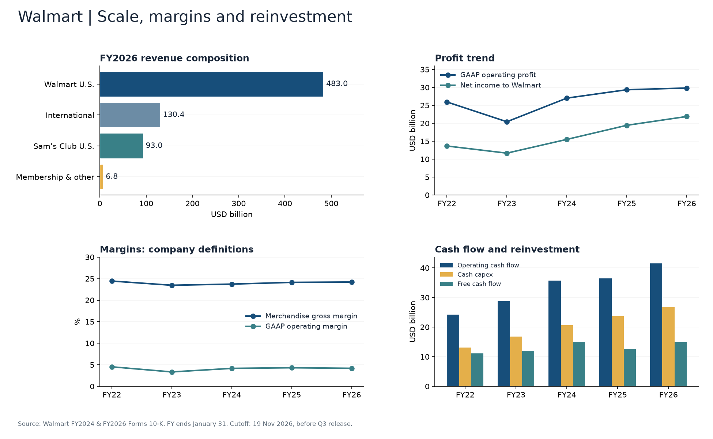

# 沃尔玛（WMT）研究报告

**研究日与数据截止**：2026-11-19，北京时间 13:00；行情为美国 11 月 18 日常规交易收盘，财务截至 2026-07-31。本文是 FY2027 Q3 发布前研究。

**标的**：Walmart Inc.，沃尔玛，NASDAQ: WMT，普通股、非 ADR。公司已于 2025-12-09 从纽约证券交易所转板纳斯达克；旧报告中的 NYSE 标识不再适用。

**价格与估值**：US$127.36；用最新已披露流通股复算市值 US$1,010.442B；TTM 稀释 EPS 口径 PE 46.14x，P/FCF 74.80x，年化股息率 0.78%。B 为十亿美元，全文以美元计价。

**一句话论文**：沃尔玛靠采购规模和密集门店，把家庭高频补货做得便宜、方便，再向商家销售广告和履约服务；经营优势耐久，但现价要求利润增长和现金回收同时显著加速。

公司定于今日北京时间 **20:00** 发布 FY2027 Q3。报告未纳入尚未发生的业绩披露，也不把搜索结果中的预告当作业绩。[官方发布安排](https://corporate.walmart.com/news/2026/11/Walmart-To-Host-Q3-Earnings-Call-Nov-19-2026)、[行情核对](https://stockanalysis.com/stocks/wmt/history/)、[第二行情源](https://www.google.com/finance/quote/WMT:NASDAQ)。

---

## AI研究偏见自觉

**信息丰富度评级：A 级。** 沃尔玛的难点是共识过强。门店履约、电商、会员、广告和 AI 都有事实依据，市场也早已知道。研究价值在于核验这些业务是否真的提高每股可分配现金，而非重新讲一遍转型故事。

**AI研究局限性声明**：公司未单列广告、Walmart+、第三方履约的完整利润、维持性资本开支及增量投入资本回报；因此无法可靠做各业务独立估值。最新官方股数披露日为 8 月 26 日，可能滞后于回购。管理层精确持股只有同日一手资料；个别第三方指标存在标准化重分类，不能直接拼成 GAAP 趋势。模型概率和远期增速均为研究判断。

- [x] 持续经营的信心来自采购、周转和履约机制，不来自资料数量。
- [x] 即使删掉一半媒体报道，门店网络优势仍成立；广告独立利润池的判断仍有缺口。
- [x] 反面检验包括退款、资本开支、估值收缩和数字业务利润缺乏拆分。
- [x] 没有证明公开信息优势；本报告的作用是约束价格和假设。

---

## 第一步：核心数据总览

### 收入和资产地图

| FY2026，B 美元 | 金额 | 占总收入 | 钱从哪里来 |
|---|---:|---:|---|
| Walmart U.S. 净销售 | 482.975 | 67.72% | 美国超市、药房、百货、电商与平台服务 |
| Walmart International 净销售 | 130.423 | 18.29% | 墨西哥及中美洲、中国、加拿大、印度等 |
| Sam’s Club U.S. 净销售 | 93.015 | 13.04% | 美国会员仓储店及其电商，含燃油 |
| 会员及其他收入 | 6.750 | 0.95% | 三分部及总部的会员和其他收入 |
| 合并收入 | 713.163 | 100.00% | 分部净销售之和再加会员及其他收入 |

以上会员及其他收入已经包含在合并收入内；广告也可能体现为净销售或冲减销售成本，不能再往总收入上加。FY2026 美国、国际、山姆美国电商销售分别约 99.6B、35.8B、15.0B；这些同样属于分部销售的一部分。[FY2026 年报](https://stock.walmart.com/sec-filings/all-sec-filings/content/0000104169-26-000055/wmt-20260131.htm)。

截至 11 月公司介绍，全球有超过 10,900 家门店、覆盖 19 国，每周约 2.8 亿人次顾客及会员到访，员工约 210 万。它们是履约资产，也是工资、租金、维护和改造负担。美国 Walmart 门店、国际门店、美国山姆须分别理解，不能把全球门店数都当成美国配送节点。[11 月正式披露](https://stock.walmart.com/sec-filings/all-sec-filings/content/0000104169-26-000165/wmt-20261113.htm)。



### 五年财务：收入稳定，资本强度上升更快

金额为 B 美元；财年截至标示年份 1 月 31 日。毛利率采用公司定义的“商品毛利／净销售”，营业利润率采用 GAAP 营业利润／总收入。

| 财年 | 收入 | 归母净利 | 商品毛利率 | GAAP 营业利润率 | CFO | 现金 CapEx | FCF | 期末现金 |
|---|---:|---:|---:|---:|---:|---:|---:|---:|
| FY2022 | 572.754 | 13.673 | 24.44% | 4.53% | 24.181 | 13.106 | 11.075 | 14.760 |
| FY2023 | 611.289 | 11.680 | 23.46% | 3.34% | 28.841 | 16.857 | 11.984 | 8.625 |
| FY2024 | 648.125 | 15.511 | 23.73% | 4.17% | 35.726 | 20.606 | 15.120 | 9.867 |
| FY2025 | 680.985 | 19.436 | 24.13% | 4.31% | 36.443 | 23.783 | 12.660 | 9.037 |
| **FY2026** | **713.163** | **21.893** | **24.21%** | **4.18%** | **41.565** | **26.642** | **14.923** | **10.727** |

四个年度间隔内，收入 CAGR 为 +5.63%，CapEx 为 +19.41%，FCF 为 +7.74%。FY2026 FCF 仍略低于 FY2024；不能把利润改善自动解释成现金回报同幅改善。FY2023 GAAP 营业利润为 20.428B，第三方标准化的 24.528B 剔除了诉讼及重组项目，本表采用前者。[FY2024 年报，含 FY2022—2024](https://stock.walmart.com/sec-filings/all-sec-filings/content/0000104169-24-000056/wmt-20240131.htm)、[FY2026 年报](https://stock.walmart.com/sec-filings/all-sec-filings/content/0000104169-26-000055/wmt-20260131.htm)、[独立财务核对](https://stockanalysis.com/stocks/wmt/financials/)。

### 最近四季：分部净销售、同比和商品毛利率

每格依次为“净销售 B 美元／报告币种同比／商品毛利率”；国际同比含汇率，山姆销售含燃油。季节、促销日历及退款会影响横向比较。

| 季度与截至日 | Walmart U.S. | International | Sam’s Club U.S. |
|---|---|---|---|
| FY26 Q3，2025-10-31 | 120.678／+5.05%／27.60% | 33.541／+10.78%／20.88% | 23.550／+3.06%／11.67% |
| FY26 Q4，2026-01-31 | 129.223／+4.61%／26.94% | 35.927／+11.55%／21.78% | 23.763／+2.87%／11.17% |
| FY27 Q1，2026-04-30 | 117.169／+4.46%／27.76% | 35.110／+18.00%／21.14% | 23.405／+6.08%／11.42% |
| FY27 Q2，2026-07-31 | 125.189／+3.54%／29.43% | 35.198／+12.81%／21.42% | 25.713／+8.78%／11.35% |

| 合并单季，B 美元 | FY26 Q3 | FY26 Q4 | FY27 Q1 | FY27 Q2 |
|---|---:|---:|---:|---:|
| 总收入 | 179.496 | 190.656 | 177.751 | 187.937 |
| GAAP 营业利润 | 6.696 | 8.708 | 7.493 | 9.383 |
| 归母净利 | 6.143 | 4.237 | 5.330 | 6.366 |
| 商品毛利率 | 24.22% | 23.98% | 24.26% | 25.41% |
| CFO | 9.100 | 14.113 | 4.738 | 14.972 |
| 现金 CapEx | 7.218 | 8.015 | 6.684 | 7.497 |

来源分别为 [FY26 Q3 10-Q](https://stock.walmart.com/sec-filings/all-sec-filings/content/0000104169-25-000191/wmt-20251031.htm)、[FY26 Q4 原始发布](https://stock.walmart.com/sec-filings/all-sec-filings/content/0000104169-26-000032/earningsreleasefy26q4.htm)、[FY27 Q1 10-Q](https://stock.walmart.com/sec-filings/all-sec-filings/content/0000104169-26-000102/wmt-20260430.htm)、[FY27 Q2 10-Q](https://stock.walmart.com/sec-filings/all-sec-filings/content/0000104169-26-000154/wmt-20260731.htm)。单季 Q4 也按全年减前三季复算。

**Q2 的利润跳升需要拆开看。** 当季约 2.9B 关税退款降低了成本；调整后固定汇率营业利润增长 +17.4%，仍包含约 750 个基点的退款与价格投入净利好。公司称剔除这一净效应后的底层增长处于原指引上端；不能把 +28.8% GAAP 增长或 +17.4% 调整增长直接外推。公司继续把剩余退款投入价格，符合低价战略，但会限制利润保留。[官方 Q2 说明](https://corporate.walmart.com/news/2026/08/20/walmart-releases-q2-fy27-earnings)。

Q2 全球电商 +23%、全球广告 +38%、全球会员费 +17%；美国 Walmart Connect 剔除 VIZIO 后 +43%。这些指标支持商业转型，却没有提供可直接单独折现的利润或现金流。最新 FY27 指引为固定汇率净销售 +4%—5%、调整营业利润 +7%—8.5%、调整 EPS 2.80—2.87 美元，CapEx 约净销售 4%。调整 EPS 也没有把全部退款影响剔除。[Q2 业绩附件](https://stock.walmart.com/sec-filings/all-sec-filings/content/0000104169-26-000145/earningsreleasefy27q2.htm)。

> 段永平式追问：账上利润变好，是否等于股东拿到的钱变多？这里必须同时看退款、资本开支和融资后的现金余量。

---

## 第二步：生意本质分析

**生意本质：用难以复制的采购量和本地库存密度，反复满足家庭补货，再提高每次到访的服务与广告价值。**

| 机制 | 为什么有效 | 股东应检验什么 |
|---|---|---|
| 天天低价 | 低价带来流量，采购和配送规模降低单位成本 | 交易数与销量能否增长，低价是否靠永久补贴 |
| 门店兼履约仓 | 同一库存兼顾到店、自提和配送，缩短最后一程 | 拣货、配送和退货成本，门店劳动生产率 |
| 会员 | 预付费用、重复消费、便利权益强化使用习惯 | 收入增长之外，还要看续费、服务成本和真实增量 |
| 广告与市场平台 | 高购买意图和交易归因吸引商家付费 | 新业务利润是否留在集团，而非被配送与促销抵消 |
| 高周转与供应商账期 | 应付款支持部分营运资金 | 应付增长是否可持续，库存是否滞销 |

商品销售仍是主干；会员具有订阅属性，消费者也能同时使用 Amazon、Costco 和区域超市，因此锁定有限。低毛利本身不等于差生意：高频、高周转及供应商融资可以带来回报，但让经营容错空间很小。

毛利率比较要先统一定义。StockAnalysis 标准化 TTM 毛利率为沃尔玛 24.84%、Costco 12.77%、Target 29.85%；沃尔玛该口径还把退款从营业层移出。这些是商品组合和会计分类的参照，不是质量排名。Costco 用较低商品加价换会员续费，Target 百货组合不同；沃尔玛必须用更大销售规模、周转和较低费用率兑现利润。[沃尔玛统计](https://stockanalysis.com/stocks/wmt/statistics/)、[Costco 统计](https://stockanalysis.com/stocks/cost/statistics/)、[Target 统计](https://stockanalysis.com/stocks/tgt/statistics/)。同行快照为单一数据商，只作背景，不进入估值参数。

滚动收入规模下，费用率每改善 1 个百分点，对应约 7.358B 税前利润空间；同样的幅度若被配送、工资、能源或促销吞掉，影响也很大。这是利润杠杆，不是可以无条件得到的增长。公司没有单列完整研发费用；不能把全部技术 CapEx 当研发投入，也不能用 AI 产品数量证明研发回报。

> 段永平式追问：这门生意好在哪？它让成本优势不断变成客户愿意重复选择的低价和便利，而不是依赖消费者无法离开。

---

## 第三步：护城河评估

| 护城河 | 判断与证据 | 过去五年及未来验证 |
|---|---|---|
| 规模与成本 | 强。大采购量、供应商关系、库存和配送网络互相支撑 | 稳中扩宽；检验费用率、库存周转及低价差距 |
| 品牌与定价权 | 低价信任强，直接提价权弱 | 可通过品类与便利获客，不能按奢侈品提价逻辑估值 |
| 转换成本 | 中低。会员和习惯有效，购物仍可多平台并用 | 小幅改善；必须验证续费和复购质量 |
| 网络效应 | 中等。更多交易吸引卖家与广告，提高选择和变现 | 在变宽；零售规模不自动等于广告主导权 |
| 技术与专利 | 中等。自动化、库存数据和组织执行有效，软件可被采购 | 看投入回报，无法声称领先若干年或不可复制 |

公司称三小时配送能力可覆盖 95% 美国家庭。这是网络可服务范围，不等于所有订单都在三小时内送达。复制该覆盖需要门店、库存、供应链及组织协同，单独拿一笔钱买软件难以完成。[公司门店投资说明](https://corporate.walmart.com/news/2026/04/16/how-we-are-investing-in-our-stores-to-drive-speed-convenience-and-growth)。

竞争也在升级。Costco FY2026 美加续费率 92.3%、全球 89.8%，会员黏性并不弱；Amazon 最新季度广告收入 19.637B。沃尔玛广告增速更快，不代表已主导商家预算。[Costco 年报](https://www.sec.gov/Archives/edgar/data/909832/000090983226000093/cost-20260830.htm)、[Amazon Q3 披露](https://ir.aboutamazon.com/news-release/news-release-details/2026/Amazon-com-Announces-Third-Quarter-Results/)。

判断为宽护城河，未来仍可能存在。最危险的破坏方式是成本和低价承诺脱节：客户为便利付出的费用上升、库存可靠性下降，或管理层为保持数字增速持续投入却得不到回报。护城河会降低商业失败概率，不会替买入者消除估值收缩。

> 巴菲特式追问：十年后什么仍难复制？更可能是本地库存密度与低成本组织；什么能摧毁它？持续损害价格信任和资本回报的决策。

---

## 第四步：逆向思考与风险清单

最强空方论点是：投资者可能正在以平台公司的估值，购买一家资本强度上升的零售商。广告和会员会增长，但增量利润可能要补贴价格、配送与自动化；企业可以继续成功，股东回报却很普通。

以下概率是未来数年主观等级，彼此相关、不能相加，不代表统计频率。

| 失败路径 | 主观概率 | 影响 | 可观察证据 |
|---|---|---|---|
| 盈利增速正常化、估值溢价回落 | 高 | 股价损失可大于经营损失 | EPS 增长放缓，估值仍高，盈利兑现不能抵消倍数下降 |
| 自动化及门店投资回报不及预期 | 中高 | 现金回报低、资产减值 | CapEx 率长期不降，滚动 FCF 停滞、折旧继续上行 |
| 价格竞争、人工及能源挤压利润 | 中高 | 薄利模式下放大 | 交易或单位下滑、费用率恶化、更多促销保份额 |
| 药房价格法规与关税变化 | 中 | 收入与利润口径波动 | 剔除退款后增长不足，药房销售压力无法用单位增长弥补 |
| 印度、中国等海外资本回收不足 | 中 | 国际估值及资本配置受损 | 促销日历之外的利润和回款减弱、进一步现金投入 |
| 重大食品安全、隐私或网络事件 | 低但不可忽略 | 尾部重大损失 | 大规模召回、系统停摆、正式监管调查 |

历史类比是 Sears 与沃尔玛：规模会产生采购优势，也会产生总部官僚和组织迟缓。芒格的历史分析明确肯定 Walton 的执行力；因此合理问题是沃尔玛能否避免变成自己曾击败的组织，不能凭 Sears 衰落就推出沃尔玛必然失败。出处见末尾原文点评。

从竞争博弈看，自动化节约可能被竞争传导成更低售价，消费者先受益；从固定成本模型看，履约密度提高才可能摊薄投资；从技术扩散看，AI 的普及也会降低技术稀缺性。这三种机制都要求看每单利润和现金，不能只看订单或软件功能。

最可能的分析错误：把 Q2 一次性退款当持续毛利改善，把标准化利润当 GAAP，或把营业利润增长当可分配现金增长。反向的错误则是低估电商密度成熟后利润释放的速度；出现持续现金验证时，必须上修模型。

> 芒格式追问：聪明人为什么不买？因为即使判断对了企业的生存和增长，也可能判断错支付的倍数，以及维持增长需要花多少钱。

---

## 第五步：管理层评估

John Furner 于 2026-02-01 继任 Doug McMillon；他从基层岗位成长，曾负责美国业务和山姆，组织传承有基础。集团 CEO 任期仍短，不能把前任完整任期的业绩全归给他。[公司履历](https://corporate.walmart.com/about/leadership/john-furner/)。

| 时间 | 决策 | 已知结果与评价 |
|---|---|---|
| 2024 年底 | 完成 VIZIO 收购，约 2.3B 股权价 | 丰富电视广告和交易归因能力；独立收购回报未披露，暂不评成功 |
| FY2024—2026 | 提高供应链、翻新及技术投资 | 能力增强，但 FY26 FCF 仍低于 FY24；战略合理，现金回报待验证 |
| 2026 年 2 月 | 内部继任、扩大回购授权至 30B | 降低交接摩擦；回购授权不是已执行金额，也不是便宜的证据 |
| 2026 年 Q2 | 将退款继续投入价格 | 加强客户价值与长期成本竞争，短期利润不全留给股东 |

来源：[VIZIO 完成交割](https://corporate.walmart.com/news/2024/12/03/walmart-completes-acquisition-of-vizio)、[FY26 年报](https://stock.walmart.com/sec-filings/all-sec-filings/content/0000104169-26-000055/wmt-20260131.htm)、[Q2 10-Q](https://stock.walmart.com/sec-filings/all-sec-filings/content/0000104169-26-000154/wmt-20260731.htm)。

FY26 现金分红 7.507B、回购 8.088B，合计 15.595B，高于 FCF 14.923B。FY27 H1 FCF 5.529B，扣分红 3.945B 和回购 5.104B 后为 -3.520B。负值不等于偿债危机，但说明股东分配不能无限独立于融资能力。FY26 SBC 为 3.603B；FCF 再扣 SBC 的保守现金代理为 11.320B，对当前市值收益率 1.12%。这是单独的经济成本对照，不在已扣股酬的 EPS 模型里重复扣除；TTM SBC 未取得可靠独立披露，不估造。

2026-04-10，Walton Enterprises 的有益持股及委托投票合计 3,516,197,849 股、44.11%；其中 Trust 的 6.44% 已包括，不能再相加。普通股每股一票，无 AB 股倍数；44.11% 代表很强影响力，不写成绝对过半所有权。Furner 有益持股 475,161 股，按同日总股数折算约 0.00596%；其薪酬和长期激励的约束，比个人持股绝对比例更重要。[2026 Proxy，持股表及薪酬章节](https://stock.walmart.com/sec-filings/all-sec-filings/content/0001193125-26-173673/wmt-20260423.htm)。家族比例有独立发布者转引同份文件，但不是独立底层证据；CEO 同日精确持股缺第二独立来源，结论置信度降级。

总体评价为中高：低价文化和内部培养值得肯定，高价回购和投资回收必须持续监督。董事会在 11 月补充 Joe Creed，不构成新业绩证据。[11 月 16 日 8-K](https://stock.walmart.com/sec-filings/all-sec-filings/content/0000104169-26-000165/wmt-20261113.htm)。

> 段永平式追问：CEO 再次更换，生意能继续吗？大概率能；但资本配置是否保持纪律，必须靠现金结果证明。

---

## 第六步：行业与文明趋势

长期变化是流通效率、即时履约和商家触达的一体化。沃尔玛处于实体消费和数字交易的交汇点，有机会把已有门店利用得更充分；它不是凭空创造一个全新消费市场。

美国 Census 的 Q2 初步发布显示，单季零售约 1,986.5B、电商约 340.2B。但官网已注明该发布在 9 月修订后不再是最新完整估计，Q3 更新也安排在今天。因此本报告只用它说明市场数量级，不给一个混合零售、广告和云业务的“精确 TAM”，也不用过时份额证明沃尔玛增长空间。[Census 发布及修订提示](https://www.census.gov/retail/ecommerce.html)。

成熟美国零售的长期增长主要来自名义消费和份额转移；国际业务和高毛利附加服务提供更快增长的可能。估值模型的基准利润增长 +10% 已要求收入增长之外持续改善业务组合、效率或每股收益，不是行业自然增长就足够。

| 趋势 | 谁可能获得价值 | 沃尔玛的限制 |
|---|---|---|
| 当日配送与自动化 | 库存靠近消费者、订单密度高的平台 | 资本开支、人工、运输和退货仍需现金 |
| 零售媒体 | 拥有购买意图与闭环交易数据的平台 | 与 Amazon 等竞争，广告预算并非无限 |
| AI 采购、库存及购物助手 | 有数据、有执行反馈的经营者与消费者 | 工具可扩散，节约可能让利，缺独立盈利证据 |
| 海外现代零售及会员仓储 | 供应链、本地经营和商品力强的企业 | 汇率、监管、当地竞争及少数股东权益 |

终端消费者分散，未见依赖单一大客户的模式；供应商也多元，但大型消费品、药品渠道、进口产地和物流节点仍可能集中。未取得完整前十大供应商和产地集中度数据，不能把“供应商很多”等同于供应链没有集中风险。

> 李录式追问：二十年后它属于持久基础设施还是昙花一现？更像持久的流通网络；投资者能否受益，仍取决于效率收益被客户、竞争者、员工和股东如何分配。

---

## 第七步：估值与安全边际

### 先统一股数、利润与债务

| 当前定价指标 | 结果 | 口径 |
|---|---:|---|
| 股价 | 127.36 美元 | 11 月 18 日常规盘收盘 |
| 最新官方流通股 | 7.933746241B 股 | 2026-08-26 披露时点，可能滞后回购 |
| 复算股权市值 | 1,010.442B 美元 | 股价乘上述股数 |
| TTM GAAP 归母净利 | 22.076B 美元 | 年度加本期 H1 减上年 H1 |
| TTM GAAP 营业利润 | 32.280B 美元 | 同一滚动方法，含退款 |
| TTM 稀释 EPS | 2.76 美元 | 与当前流通股不是相同分母 |
| TTM PE，EPS 口径 | 46.14x | 股价／滚动稀释 EPS |
| TTM PE，当前市值口径 | 45.77x | 市值／滚动归母净利，两者差异来自股数 |
| FY27 指引 PE | 44.38x—45.49x | 采用调整 EPS 2.87—2.80，仍含部分退款 |
| P/S | 1.37x | TTM 收入 735.840B |
| P/FCF | 74.80x | TTM FCF 13.509B；收益率 1.34% |
| 含全部租赁的 EV／收入代理 | 1.46x | 市值加净债 62.226B；未加少数股权及掉期，不冒充完整 EV |
| PEG 研究代理 | 4.55x | 指引低端 PE／本报告 +10% EPS 增长假设，非卖方 PEG |

独立行情页显示约 7.93B 股；市值与本报告复算相符。禁止用 Q2 稀释加权股数代替流通股数去验市值。[官方股数及资产负债表](https://stock.walmart.com/sec-filings/all-sec-filings/content/0000104169-26-000154/wmt-20260731.htm)、[第三方估值](https://stockanalysis.com/stocks/wmt/statistics/)。

截至 7 月 31 日，现金 11.529B，无单列短期金融投资可额外加入。债务桥接如下：

| 债务层次，B 美元 | 金额 | 对应净债务 |
|---|---:|---:|
| 短借及长债，不含租赁 | 50.411 | 38.882 |
| 加融资租赁 6.832B | 57.243 | 45.714 |
| 再加经营租赁 16.512B | 73.755 | 62.226 |
| 再加净衍生负债 1.337B，第三方标准化 | 75.092 | 63.563 |

最后一层差额对应利率与跨币种掉期净负债，不能只解释成租赁。报告采用逐层桥接，既不说沃尔玛是净现金公司，也不把 75.092B 与公司 57.243B 当互相矛盾的数据。[10-Q Note 4](https://stock.walmart.com/sec-filings/all-sec-filings/content/0000104169-26-000154/wmt-20260731.htm)、[独立资产负债表](https://stockanalysis.com/stocks/wmt/financials/balance-sheet/)。

第三方 TTM 营业利润 28.980B 与官方 32.280B 的差异也已对清：第三方将本期 Q2 退款 2.9B 移出营业利润、将上年 Q2 诉讼费 0.4B 移出费用，滚动差额合计 3.3B。两套数可以并列，不能混成“GAAP 营业利润下降”。[第三方季度明细](https://stockanalysis.com/stocks/wmt/financials/income-statement/?p=quarterly)。

### 三年三情景：现价有没有安全边际

起点 EPS 取 2.80 美元，为公司 FY27 调整指引低端，**不是已经完全剔除退款后的经常性 EPS**。为避免叠加乐观假设，不再额外加回购贡献；股数保持不变。模型允许底层经营增长，但若退款退出无法被经营改善抵消，起点仍需下修。

悲观 +4% 代表增长回到成熟零售水平；基准 +10% 要求组合、广告及效率持续改善；乐观 +15% 要求较强兑现。三年退出 PE 20x／28x／35x 是过渡期定价假设，参考经营质量和历史区间，主观性显著。每年分红固定 0.99 美元，未假设提高；按美元资本成本 10% 将第三年股价及三次股息折到今天。

| 三年情景 | EPS 年增速 | 第三年 EPS | 退出 PE | 第三年价格 | 含息今日价值 | 从 127.36 买入的三年含息年化 |
|---|---:|---:|---:|---:|---:|---:|
| 悲观 | +4% | 3.15 | 20x | 62.99 美元 | 49.79 美元 | -19.92% |
| 基准 | +10% | 3.73 | 28x | 104.35 美元 | **80.86 美元** | -5.59% |
| 乐观 | +15% | 4.26 | 35x | 149.05 美元 | 114.44 美元 | +6.12% |

工具的三情景终点价格为 63.0／104.4／149.0 美元；“今日价值”另用现金流时点折现，不能把第三年价格直接当现在的买入价。乐观情景的三年年化回报仍低于所用 10% 门槛，是现价缺安全边际的主要定价依据。

反推看，若三年后回到 28x，想从现价获得 10% 含息回报，EPS 需连续三年约 +28.47%，显著高于本报告基准。这是条件推演，不是预测。另从 TTM FCF 13.509B 出发，以 10% 折现、十年后永续 +3% 的股权现金流 DCF，现市值隐含未来十年 FCF 约 +25.07% CAGR。该 FCF 已扣利息，DCF 不再重复减净债；尚未另扣 SBC、融资租赁本金，也未清除退款现金及税收时点效应，因此只解释市场要求，不给它精确内在价值地位。

历史标准化 PE 的财年末快照约为 FY22 28.36x、FY23 33.22x、FY24 28.68x、FY25 40.57x、FY26 43.37x，现约 46.14x；这不是历史估值分位。拆股后的 EPS 与价格口径需一致，不用未复权旧股价比较。[历史倍数](https://stockanalysis.com/stocks/wmt/financials/ratios/)。

同一 11 月 18 日行情，Costco 标准化 TTM PE 52.82x、P/FCF 51.80x；Target 为 15.42x、18.07x。沃尔玛相对 Target 的溢价有经营质量解释，相对 Costco 更低也不能证明便宜。同行倍数不用于十年终值。[Costco](https://stockanalysis.com/stocks/cost/statistics/)、[Target](https://stockanalysis.com/stocks/tgt/statistics/)。

### 十年折现：只做仓位压力测试

| 输入 | 本报告取值与理由 |
|---|---|
| 币种及资本成本 r | USD，10%。无风险利率取已发布 H.15 的 11 月 17 日十年美债 5.10%，研究 ERP 4.90%，β 固定 1；不是用低历史股价 β 降低回报要求 |
| 稳态增量 ROIC | 12%，研究假设。成熟门店及自动化须付真实资本成本，不能直接延用历史规模形成期回报。FY26 现金派息率约 34.29%，用稳态 g 3% 简单反推仅约 4.57%，但它错误忽略回购及投资回报，只作低端参照。公司披露的 ROI 15.4% 是另一种 non-GAAP 算法，不能当成同口径 ROIC；12% 是两端证据约束下的保守判断，未实测 |
| 永续 g，悲观／基准／乐观 | 2%／3%／4%，只用于第十年以后；基准不高于美元长期名义经济增长上限，敏感性时固定 g |
| 前十年利润增长 | +4%／+10%／+15%，起点为 2.80 美元乘已披露股数；不再额外记回购或 AI 收益 |
| 主观情景概率 | 25%／55%／20%，不是客观频率，不把相关风险假装成独立事件 |
| 股息减稀释 k | 固定 0.99／127.36，即约 +0.7773%；假设净稀释为零，不另加回购收益 |

利率来源为[美联储 H.15](https://www.federalreserve.gov/releases/h15/)。使用当时已发布数据，不将 11 月 18 日发布日期误称为 18 日观测值。12% 增量 ROIC 的披露缺口与利润起点偏乐观风险，均会限制模型置信度。

终值唯一采用 `PE = (1 − g/ROIC) / (r − g)`，按工具准出后计算：

| 十年情景 | 第十年归母利润，B 美元 | r−g | 退出 PE | 工具近似年化回报 |
|---|---:|---:|---:|---:|
| 悲观 | 32.883 | 8 个百分点 | 10.42x | -9.48% |
| 基准 | 57.619 | 7 个百分点 | 10.71x | -4.03% |
| 乐观 | 89.870 | 6 个百分点 | 11.11x | +0.66% |

基准算式为 `(1 − 0.03/0.12)/(0.10 − 0.03) = 10.7143x`。全部分母不少于 5 个百分点。工具把终值几何回报直接加上固定“股息率减稀释率”；这里的“IRR”是该工具近似口径，**不是逐年现金流求根的精确 IRR**，也没有把将来派息率上升充分模拟进去。概率加权回报是三档年化回报的加权平均，不是组合实际 IRR。

| 折现率敏感性 | 加权年化回报 | 相对该档 r 的仓位压力测试 |
|---|---:|---|
| r−2pp：8% | -1.18% | 未通过；USD 合理区间外，仅供参考 |
| 基准：10% | -4.45% | 未通过 |
| r+2pp：12% | -6.81% | 未通过；USD 合理区间外，仅供参考 |
| 区间内补检：9% | -2.97% | 未通过 |
| 区间内补检：11% | -5.72% | 未通过 |

**翻转检查：在美元合理区间内的 9%、10%、11% 三档，压力测试均未通过，没有随折现率翻转。** ±2pp 两端均在区间外，因此已补做 ±1pp。此结果只收紧仓位，不能单独裁定买入、持有或回避。

关税、药价和竞争风险放在情景及概率判断内，不加进 r 或 β。重大食品安全和重大数据泄露未单独量化，且三档未覆盖所有灾难结果；实际尾部损失可能更差。

### 估值分歧对账

三年基准给今日含息价值 80.86 美元，基于第三年仍享有 28x 溢价；十年压力测试则要求成熟期以永续现金回报约束退出，基准只有 10.71x。因此即使股价回到旧报告的 80—90 美元，短期估值吸引力改善，也不能自动推导可以长期重仓。差异主要来自高倍数能保留多久，以及增量利润能分配多少，不能用调低 r 抹平。

定价判断仍由三年情景、现金回收及历史溢价并列支持；十年模型专门限制仓位。业务质量、护城河和趋势支持继续跟踪及合理小仓持有；新 CEO 的回报记录、退款归一化和资本强度使大幅扩仓缺乏证据。报告将研究性条件价带降至 65—72 美元、限制小仓；这不是十年模型单独否决旧 thesis，而是加入现金流时点和安全边际后的定价修正。

> 巴菲特式追问：r 错 2 个百分点会翻转吗？合理区间内补检未翻转，但所有结果仍依赖利润增长、增量 ROIC 与终值分配假设。
>
> 段永平式追问：股市关五年，愿意按 127.36 买吗？本报告不愿新增；缺乏价格余量，且高资本投入的回收仍需验证。

---

## 第八步：最终决策与行动清单

| 维度 | 结论 | 信心度 |
|---|---|---|
| 生意质量 | 高频日常消费、周转与供应商关系，耐久性强；资本强度上升 | 高 |
| 护城河 | 采购成本和门店密度宽；转换成本和独占技术有限 | 高 |
| 管理层 | 内部传承及低价文化可靠，当前资本配置回报需更长记录 | 中高 |
| 最大风险 | 倍数收缩叠加退款退出、CapEx 回收慢，可能出现公司赢而股票不赚钱 | 中高 |
| 文明趋势 | 全渠道与流通效率方向有利，效率收益未必全部留给股东 | 中高 |
| 估值 | 三年现价缺安全边际；十年合理 r 区间不翻转且均未过压力测试，仅收紧仓位 | 中；模型假设敏感 |

估值是六维之一。十年未覆盖资本成本不具有单独否决权；以下决策同时基于生意、治理、风险和三年定价证据。

| 策略 | 本报告建议 |
|---|---|
| 空仓者 | **观望，127.36 美元不新增。** 65—72 美元进入有条件研究性分批评估；价格单独到达不等于买入 |
| 持仓者 | 合理小仓可有条件持有，暂停加仓；已超配者在当前估值警戒带复核降仓，结合税费与替代机会决定，不机械清仓 |
| 条件价带 | **65—72 美元**，相对三年基准今日价值约有 10.96%—19.62% 余量；低于 65 先排查永久损失，不能越跌越确信 |
| 首笔与仓位示例 | 经营条件通过后首笔约组合 0.5%，研究总仓参考不超过 1%；十年压力、证据缺口及尾部风险共同限制仓位。此为通用研究示例，未结合个人税务与组合 |
| 加仓所需证据 | 随后连续两次正式披露：剔除退款后底层营业利润仍增长；滚动 FCF 为正并改善；FCF／归母净利向至少 75% 修复；CapEx 率不再上修、投产回报有说明；交易和广告会员未出现结构性转弱；再按新数据重估 |
| 减仓／卖出信号 | 价格≥120 美元且现金及盈利模型未明显增强时复核超配；或后续连续两次披露显示底层利润与交易走弱、现金再投资失控；重大治理、食品安全、数据合规事件随时复核 |
| 下一动作 | 今日 20:00 后取得 Q3 原件核退款、经营增长、库存、CapEx/FCF及 FY27 指引；2026-12-31 做现金与资本配置研究检查；2027-03-01 查全年披露日历，后两项均非公司确认财报日 |

现价已在 ≥120 美元警戒带内，含义是“不追高、复核持仓”，不是已触发交易指令。65—72 美元价带替代旧报告 80—90 美元；旧带原本也是附带经营条件，不能因本次下修就倒推过去建议“命中／未命中”。

### 四位原文与原则推演

以下短引已读取出处。除芒格历史上谈及 Sam Walton 外，均为一般投资原则；延伸点评是本报告推演，**不是本人对 WMT 当前价格的表态**。

- 巴菲特：“It's far better to buy a wonderful company at a fair price than a fair company at a wonderful price.” 出自 [1989 年官方股东信](https://www.berkshirehathaway.com/letters/1989.html)，背景是百货收购教训。原则推演：肯定好企业，同时要求公允价格；不能仅因短期跌价就否定企业，也不能把好企业理解成任何价格都可买。
- 芒格：“He played the chain store game harder and better than anyone else.” 出自 [1994 USC 演讲的授权转载](https://tilsonfunds.com/Mungerwritings2001.pdf)，PDF 第 33 页、印刷页 54，明确肯定 Sam Walton。原则推演：执行和组织形成真实规模优势；本报告认可这条护城河，不借其名字否定沃尔玛生意。
- 段永平：“安全边际指的是你对公司有多懂，这是我的理解。” 出自 [2025 年 11 月方三文访谈实录](https://www.thepaper.cn/newsDetail_forward_31947522)。原则推演：本报告对广告独立利润、维护性投资仍不够懂，低价本身不能补齐理解。65—72 美元只是条件价带，需经营验证。
- 李录：“A stock is a piece of ownership, not a piece of paper to trade around.” 出自 [2026-10-05 哥大官方访谈实录第 3 页](https://business.columbia.edu/sites/default/files-efs/imce-uploads/36th%20Annual%20Graham%20%26%20Dodd%20Luncheon%20Transcript%20%2820261005%29%20CBS.pdf)。原则推演：关注企业长期购买力与可分配现金，不能把财报前股价强势当长期价值增长。

> 四位方法共同留下的追问：如果没有下一位买家愿意继续给高倍数，企业本身创造的现金是否足以支持支付的价格？

---

## AI分析置信度与投资确定性

AI 分析置信度：历史财务、会计口径对账、分部经营为高；盈利归一化和资本配置为中等；广告独立价值、未来增量 ROIC 和情景概率为中低。双源多数是独立发布渠道对同一公司披露的核对，不代表独立审计。

实际投资确定性：企业长期保持竞争力的确定性较高；以 127.36 美元获得理想回报的确定性偏低。价格降到研究带也只改善算术，不能替代退款退出后现金、资本回报及竞争证据。公司存续、利润增长和股票回报是不同问题。

仍需验证：Walmart+ 与广告的独立利润及获客成本；成熟配送订单的完全成本；维护与增长 CapEx 的拆分；海外少数股东后的现金回收；回购抵消 SBC 后的净股数；管理层同日持股的独立第二来源。

---

## 关键数据交叉验证记录

Macrotrends 收入、净利及现金页均尝试访问，返回 403 或受限，未声称从中取得数据。采用公司 SEC/IR 原件与 StockAnalysis；收入和净利另有 [Morningstar 数据页](https://lt.morningstar.com/1c6qh1t6k9/stockreport/default.aspx?ClientFund=0&CurrencyId=USD&Id=0P000005UH&SecurityToken=0P000005UH%5D3%5D0%5DE0EXG%24XNYS&tab=0&vw=sum) 旁证。管理层精确持股双源缺口保留，不拿转载冒充第二底层来源。

| 项目 | 一手值 | 独立渠道值 | 判定 |
|---|---:|---:|---|
| FY26 收入，B 美元 | 713.163 | 713.163 | 一致 |
| FY26 归母净利，B 美元 | 21.893 | 21.893 | 一致 |
| 7 月末现金，B 美元 | 11.529 | 11.529 | 一致 |
| 流通股，B 股 | 7.933746241 | 7.93 | 显示精度差异，非加权股数 |
| 全租赁加衍生负债，B 美元 | 75.092，逐项桥接 | 75.092 | 统一口径后一致 |
| TTM 营业利润，B 美元 | GAAP 32.280 | 标准化 28.980 | 超过 1% 的差异已解释，分别保留，不强行平均 |

`financial_rigor.py` 原始输出节选，完整记录见[计算日志](research-20261119/financial-rigor.txt)：

```text
市值验算 (Market Cap Verification)
股价 (Price):       127.36 USD
总股本 (Shares):    7.93B
计算市值:           1.01T USD
报告市值:           1.01T USD
偏差:               0.00%
✅ 验证通过, 偏差仅 0.00%

交叉验证: FY26收入m (Cross-Validation)
✅ 官方                  : 713,163.00 USDm或股b  (偏差 0.00%)
✅ StockAnalysis       : 713,163.00 USDm或股b  (偏差 0.00%)
交叉验证: FY26归母净利m (Cross-Validation)
✅ 官方                  : 21,893.00 USDm或股b  (偏差 0.00%)
✅ StockAnalysis       : 21,893.00 USDm或股b  (偏差 0.00%)
交叉验证: 20260731现金m (Cross-Validation)
✅ 官方                  : 11,529.00 USDm或股b  (偏差 0.00%)
✅ StockAnalysis       : 11,529.00 USDm或股b  (偏差 0.00%)

PE (TTM):  127.36 / 2.76 = 46.14x
P/FCF:     127.36 / 1.7027265039292805 = 74.80x
FCF Yield: 1.34%
股息率:    0.99 / 127.36 = 0.78%
```

市场股数与股价乘积为 1,010.44192125376B 美元，报价市值为 1,010.442B；日志显示百分比经过四舍五入。比率与估值同时用 Decimal 复核；[计算结果及表达式](research-20261119/calculations.json)、[十年参数](research-20261119/terminal-config.json)、[十年原始准出与敏感性](research-20261119/terminal-value.txt) 可复查。工具日志的单位标签为通用标签，表内已明确股数与美元单位。

**数据抽检准出**：按百分之十五、固定随机种子抽得二十七项，其中十八项历史事实及其衍生比率、八项模型算术均通过，偏差不超过百分之一；另有一项明确声明的主观退出倍数，只检查输入一致性，不冒充未来事实。没有跳过未通过的历史事实。[原始样本](research-20261119/audit-sample.json)、[核验值与来源](research-20261119/audit-results.json)、[主观输入分类](research-20261119/audit-assumptions.json)、[判决原文](research-20261119/audit-verdict.txt)。抽检不能证明未抽中数值全部无误。

**估值口径最终准出**：终值模型的币种、资本成本、永续增速分母及离散风险归属检查通过；完整输出见上方十年记录。日志币种栏展示工具内置旧利率提示，不是本报告采用的利率；本次实际传入值以十年参数表和日志末尾说明为准。预测与研究阈值不作为已发生事实核验。

**跟踪交接**：沿用既有“沃尔玛”标的 ID，旧报告保留；新研究事件进入非重点标的台账，旧建议以新报告接续关闭、历史结果保留为无法判定。今日 Q3 事件尚未完成，价带到达只提醒复核，不自动交易。

*本报告用于学习与研究，不构成投资建议。*
