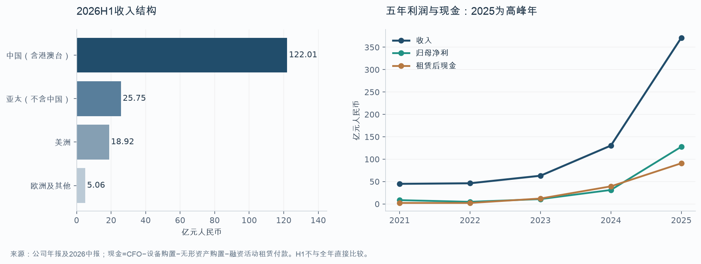

# 泡泡玛特（09992.HK）研究报告

> **研究与资料截止**：2026-11-19，Asia/Shanghai，已运行日期核验。**价格基准**：11月18日完整交易日收盘144.20港元；不用11月19日不同时间的盘中报价拼接。**法定已发行股本**：1,331,779,203股；**计算市值**：1,920.43亿港元。换算采用11月19日中间价1港元=0.85563元人民币，人民币等值市值1,643.17亿元；该汇率是估值换算假设，并非可成交汇率。**统一重算估值**：截至2026H1的TTM归母PE 12.41倍、租赁后集团现金收益率3.75%。
>
> 核心命题：泡泡玛特已证明能把艺术家形象做成全球商品；下一阶段的价值取决于热度回归常态后，老客复购、新IP和全球门店能留下多少现金。

信息来源：[历史行情](https://stockanalysis.com/quote/hkg/9992/history/)、[ETnet股本及市值](https://www.etnet.com.hk/www/eng/stocks/realtime/quote_ci_basicdata.php?code=9992)、[11月18日法定回购申报](https://www1.hkexnews.hk/listedco/listconews/sehk/2026/1118/2026111800586.pdf)、[当日中间价公告转述](https://news.smm.cn/news/L7KRTIBL4KFXKFL4FTNEXSANKHZDLIOWAGJUOTY)。财务金额以下除特别说明均为人民币亿元，价格均为港元。

## AI研究偏见自觉

**信息丰富度评级：A，历史财报置信度较高，拐点判断置信度有限。** 新闻、研报和用户讨论充足，海外跨年复购、成熟店同店、IP分地区利润和SKU库龄却缺少连续披露。资料数量不能补齐这些缺口。

AI研究局限性声明：本报告没有消费者访谈或实地巡店，也未取得艺术家最新完整合同；无法预测下一个爆款。财务核验能降低历史事实和计算错误，不能证明未来利润。公司最新完整报表截至6月30日；10月27日公布的Q3仅为未经审计、未经审阅的收入同比区间。下文严格区分已披露事实、计算值与分析假设。

- [x] 不以个人是否喜欢玩具判断消费者需求，也不以“情绪价值永恒”证明公司盈利永恒。
- [x] 不把集团Q3下滑等同于LABUBU单个角色下滑，不把THE MONSTERS家族全部收入叫作LABUBU收入。
- [x] 不将半年会员复购率直接与全年比较，不将注册会员数当作活跃买家数。
- [x] 同时检验“爆款已结束”和“已经成为迪士尼”两种容易先入为主的叙事。
- [x] 不以段永平买入、公司回购或股价低于高点代替内在价值判断。

证券身份为泡泡玛特国际集团有限公司，英文Pop Mart International Group Limited，港交所普通股09992；研究未把OTC存托凭证与港股每股指标混算。复用既有主目录与触发标的ID“泡泡玛特”；既有跨公司专题和专题底稿保留其项目结构，作为历史来源引用，不另建同公司主目录。

---

## 第一步：核心数据总览

### 五年利润跃升很大，现金曲线更有约束力

| 指标 | 2021 | 2022 | 2023 | 2024 | 2025 | 2026H1 |
|---|---:|---:|---:|---:|---:|---:|
| 收入 | 44.91 | 46.17 | 63.01 | 130.38 | 371.20 | 171.73 |
| 归母净利润 | 8.54 | 4.76 | 10.82 | 31.25 | 127.76 | 50.38 |
| 毛利率 | 61.4% | 57.5% | 61.3% | 66.8% | 72.1% | 69.7% |
| IFRS经营利润率 | 25.60% | 12.63% | 19.53% | 31.86% | 45.50% | 39.16% |
| 经营现金流CFO | 7.79 | 8.91 | 19.91 | 49.54 | 108.65 | 36.37 |
| 租赁后集团现金 | 2.25 | 2.20 | 12.13 | 39.32 | 90.85 | 24.10 |
| 期末现金及等价物 | 52.65 | 6.85 | 20.78 | 61.09 | 137.75 | 124.42 |

“租赁后集团现金”定义为CFO减设备购置、无形资产购置、融资活动中的租赁付款；它仍含少数股东权益，不能原样称作归母股东可分配现金。2022年现金等价物减少主要伴随转入定存，不能解读为现金烧完。中报与全年时间长度不同，不作简单环比增长判断。

损益原值见[2025年报第6页](https://www1.hkexnews.hk/listedco/listconews/sehk/2026/0421/2026042100395_c.pdf)，现金流另核[2022年报](https://prod-out-res.popmart.com/cms/ANNUAL_REPORT_2022_e5c3886181.pdf)、[2023年报](https://www.hkexnews.hk/listedco/listconews/sehk/2024/0425/2024042500730.pdf)、[2024年报](https://www1.hkexnews.hk/listedco/listconews/sehk/2025/0423/2025042300687.pdf)与2025年报；独立交叉为[StockAnalysis损益](https://stockanalysis.com/quote/hkg/9992/financials/)、[现金流](https://stockanalysis.com/quote/hkg/9992/financials/cash-flow-statement/)、[资产负债表](https://stockanalysis.com/quote/hkg/9992/financials/balance-sheet/)及[ETnet损益](https://www.etnet.com.hk/www/eng/stocks/realtime/quote_ci_pl.php?code=9992)。经营利润保留法定口径，另以[Yahoo的“Total Operating Income as Reported”行](https://hk.finance.yahoo.com/quote/9992.HK/financials/)核对；该页直接访问限流，第二来源读取层级为搜索可见表格。数据商标准化经营利润有重分类差异，未将它们混为一列。



### 2026年增长由中国支撑，Q3压力已经扩展至所有地区

| 地区，沿用最新分类 | 2025全年收入 | 2026H1收入 | H1同比 | Q3收入同比 |
|---|---:|---:|---:|---:|
| 中国，含港澳台 | 208.52 | 122.01 | +47.3% | -30%至-25% |
| 亚太，不含中国 | 80.11 | 25.75 | -9.7% | -70%至-65% |
| 美洲 | 68.06 | 18.92 | -16.5% | -75%至-70% |
| 欧洲及其他 | 14.51 | 5.06 | +5.9% | -55%至-50% |
| 集团 | 371.20 | 171.73 | +23.8% | -50%至-45% |

来源：[年报](https://www1.hkexnews.hk/listedco/listconews/sehk/2026/0421/2026042100395_c.pdf)、[完整中报第16—24页](https://www1.hkexnews.hk/listedco/listconews/sehk/2026/0924/2026092400544.pdf)、[Q3正式公告](https://www1.hkexnews.hk/listedco/listconews/sehk/2026/1027/2026102700268.pdf)，Q3另由[每经报道](https://www.nbd.com.cn/articles/2026-10-27/4620642.html)核对。Q3中国线下下降5%—10%，线上下降45%—50%。公司不披露完整季度损益，不能提供一套貌似精确的最近四季分部收入、毛利和利润。最近可比窗口是全年、半年及季度收入区间；季节性和基数会影响解释。

Q1集团收入同比+75%至+80%，H1实际+23.8%，Q3转负，增长减速可以确认；Q2准确收入、Q3准确收入及Q3环比幅度不能直接确认。本报告不采用基于历史季度占比倒推的“Q3约66亿元”作为事实。[Q1正式更新](https://www1.hkexnews.hk/listedco/listconews/sehk/2026/0512/2026051200579.pdf)

### 新IP接棒有效，但还没有消除共同周期

| IP | 2025全年收入 | 2026H1收入 | 2025H1收入 | 观察 |
|---|---:|---:|---:|---|
| THE MONSTERS家族 | 141.61 | 44.54 | 48.14 | H1下降，占集团26.0%；全年曾占38.1% |
| 星星人 | 20.56 | 26.50 | 3.89 | H1同比+580.6%，是真实接棒证据 |
| CRYBABY | 29.29 | 16.33 | 12.18 | 维持增长 |
| DIMOO | 27.77 | 16.19 | 11.05 | 维持增长 |
| SKULLPANDA | 35.40 | 15.51 | 12.21 | 维持增长 |
| MOLLY | 28.97 | 9.01 | 13.57 | 老IP存在不代表每期收入稳定 |

来源：[2025年报IP表](https://www1.hkexnews.hk/listedco/listconews/sehk/2026/0421/2026042100395_c.pdf)、[中报第25—27页](https://www1.hkexnews.hk/listedco/listconews/sehk/2026/0924/2026092400544.pdf)。IP及渠道详细字段以发行人单源为主，独立媒体只覆盖主要项目，精细分项的交叉覆盖弱于集团财务；其中本表主要IP当期收入已由[MoneyDJ独立整理](https://www.ttv.com.tw/finance/view/0820262108451571F0A49C0A4F1991AA26B0814C08460B74/587)再核对。

H1毛绒收入98.25亿元，占57.2%；手办51.92亿元，占30.2%；衍生品及其他21.55亿元，占12.6%。IP分散和品类分散是两回事：多个形象都依赖毛绒挂件时，可能同时受一种消费风格退潮影响。Q3未披露IP表，尚无法判断星星人能否继续抵消THE MONSTERS回落。

### 利润转为现金时，税和库存都要付账

| 项目 | 2025全年 | 2025H1 | 2026H1 |
|---|---:|---:|---:|
| 付税前经营所得现金 | 147.05 | 69.75 | 67.64 |
| 已付所得税 | 40.77 | 11.90 | 32.20 |
| CFO | 108.65 | 59.77 | 36.37 |
| 设备现金购置 | 9.85 | 3.54 | 6.74 |
| 无形资产现金购置 | 1.86 | 0.21 | 0.51 |
| 融资活动租赁付款 | 6.08 | 2.64 | 5.03 |
| 租赁后集团现金 | 90.85 | 53.39 | 24.10 |

H1 CFO同比-39.15%，付税前经营所得现金同比-3.03%，租赁后集团现金同比-54.86%。现金弱于利润，既有前期税款结算，也有库存、应付和开店支出影响；不能全归咎于需求消失，也不能全部解释成一次性税款。H1 CFO/归母为72.19%，该比率是合并现金流与归母利润的近似对照。[中报第69—70页](https://www1.hkexnews.hk/listedco/listconews/sehk/2026/0924/2026092400544.pdf)

存货净额从2025年末54.73亿元升至61.02亿元；披露周转天数由全年123天升至H1的201天。更可比的上年H1为83天。半年与全年窗口不同，但同比库存周转明显放慢，方向清楚。管理层称Q3库存开始下降属于电话会转述，尚无9月底金额、库龄及现金释放证明。[2025中报](https://www.hkexnews.hk/listedco/listconews/sehk/2025/0925/2025092500443.pdf)、[2026中报](https://www1.hkexnews.hk/listedco/listconews/sehk/2026/0924/2026092400544.pdf)、[电话会报道](https://www.nbd.com.cn/articles/2026-10-27/4621622.html)

> 段永平式追问：下一轮新品不再需要抢购时，留下来的收入、利润与现金分别是多少？

---

## 第二步：生意本质分析

**消费者为喜欢的形象、收藏和社交表达付钱；泡泡玛特把艺术家创意、商品开发和自有渠道组织起来，用不断更新的产品争取重复消费。**

| 环节 | 钱如何流动 | 决定长期价值的变量 |
|---|---|---|
| 艺术家与IP | 支付或分配创作、版权及合作收益 | 持续找到好作品、权利与分成安排稳定 |
| 设计和产品 | 将形象开发为手办、毛绒、配件 | 系列迭代、工艺还原、质量、开发周期 |
| 供应与库存 | 提前下单、付款、运输和配货 | 需求预测、补货速度、库龄及折扣 |
| 直营和线上销售 | 大量收入来自商品零售 | 客单、购买频次、真实终端需求、获客成本 |
| 门店及品牌 | 租金、人力、装修换曝光与体验 | 成熟店现金回报、关店成本、海外本地运营 |
| 授权及内容 | 存在授权费、乐园和内容延伸 | 能否逐步形成稳定的非商品利润，而非只增加投入 |

这是一笔笔商品交易，复购需要持续创造吸引力。收藏会形成心理偏好，却没有合同锁定；消费者随时可以改买其他IP、游戏、旅行，或者减少消费。

国内有一定复购证据：H1内地注册会员8,244万，贡献内地销售92.9%；半年复购率51.6%，上年同期50.8%。其定义是当期购买会员中半年内购买至少两次的人数占比，既不是全部注册会员的复购比例，也不是上一年用户今年还在的留存率。海外跨年留存仍是核心未知。[2026中报第13页](https://www1.hkexnews.hk/listedco/listconews/sehk/2026/0924/2026092400544.pdf)、[2025中报第12页](https://www.hkexnews.hk/listedco/listconews/sehk/2025/0925/2025092500443.pdf)

高毛利来自形象附加值、产品设计及直营零售收益的叠加。2025年毛利率72.1%并非授权公司式的纯版权经济；H1列入其他收入的IP授权及服务收入仅0.606亿元，商品仍是主体。更高定价只有在正常供给、没有黄牛溢价的情况下仍有持续销量，才算长期定价权。

核心技术能力是商品化能力，而非领先数年的排他专利：材料、模具、色彩、软硬件供应链协作、配货与用户运营共同决定体验。公司未披露一个适合跨科技公司比较的统一研发支出指标；不填造“研发率”。艺术家生态和渠道经营比某项生产工艺更难一夜复制。

经营杠杆已经反向出现：海外H1收入下降11.1%，分部业绩下降38.8%，分部利润率从44.06%降至30.34%。分部利润尚未分摊全部总部项目，不是归母净利率；但收入回落时租金、人工和新店费用较难同步下降，可以据此确认。[中报分部附注5](https://www1.hkexnews.hk/listedco/listconews/sehk/2026/0924/2026092400544.pdf)

> 段永平式追问：这门生意好在能持续创造消费者喜欢的商品；公司能否在不过量备货的情况下重复做到？

---

## 第三步：护城河评估

| 护城河来源 | 判断 | 支持证据 | 可以推翻判断的证据 |
|---|---|---|---|
| 品牌与定价 | 中等偏强，但还在验证 | 多个大IP、全球消费者认知和高毛利 | 正价动销持续下滑、依赖折扣仍无法周转 |
| 转换成本 | 弱 | 收藏偏好会增加复购 | 消费者无需迁移成本即可转买别的IP |
| 网络效应 | 弱至中等的传播效应 | 晒图、收藏社群帮助获客 | 用户增加不会自动提高单件商品功能；退潮时传播也会反向 |
| 规模与分发 | 中等偏强 | H1全球676家零售店，供应与新品发售体系 | 店数增加而店效、库存和现金回报持续恶化 |
| 艺术家与组织 | 中等偏强 | THE MONSTERS之外出现多个有规模的IP | 核心人才流失、新IP难以接棒或权利分配失衡 |
| 工艺与专利 | 单项壁垒有限 | 还原度、品控和量产经验 | 对手可以外包生产，仿品与替代品长期存在 |

过去五年渠道、品牌和商品开发体系明显变强；2026年收入转弱说明这些资产不能阻止需求波动。未来五年护城河能否继续变宽，取决于成熟门店产出、海外复购与多代产品生命周期，而非继续开店本身。

给竞争对手一笔巨额资本，可以复制盲盒形式、采购产能、租门店；很难立刻复制艺术家互信、消费者对多个IP的情感及跨区域产品判断。反过来，已有品牌也无法确保下一个系列被喜欢。这里存在组织优势，尚不能按不可替代的消费垄断定价。

权利边界必须讲清：历史招股文件的授权期限不等于今天仍未变更的合同。段永平2026年8月公开更正过对LABUBU权属的理解；本报告没有最新完整合同，既不把“2030必然失权”列为事实，也不把第三方发言替代权利审计。完整权利、地域、媒介与经济分成仍待核。[本仓库原帖索引及更正记录](段永平雪球发言-泡泡玛特相关-20261021.md)、[相关原帖](https://xueqiu.com/1247347556/406842903)

> 巴菲特式追问：十年后留下的是稳定的全球品牌，还是一套需要不断靠爆款填满的昂贵店网？能摧毁它的可能是需求预测和资本配置，而非工厂产能不足。

---

## 第四步：逆向思考与风险清单

聪明人不买的最强理由是：公司在全球爆款高峰获得的高利润率，可能包含短缺、低获客成本和渠道快速放量的共同红利。补齐供给并扩建店网之后，收入正常化的速度可能快于成本收缩；12倍历史PE可能对应20倍以上正常化PE。对平台能力的认可，尚不能证明它值得按高峰利润持续增长定价。

| 失败路径 | 概率判断 | 影响 | 需要看的证据 |
|---|---|---|---|
| 旧IP退潮，新IP无法持续接棒 | 中高；主要下行情景 | 正常化利润显著低于高峰 | 非THE MONSTERS收入、正价售罄、海外复购 |
| 海外店网按高峰需求扩张 | 高度值得警惕，已见部分证据 | 租赁及人工吞噬利润与现金 | 成熟店销售、关店费用、海外分部利润率 |
| 库存以折扣或减值换去化 | 中高 | 毛利和现金回报受损 | 库龄、减值、终端折扣、现金释放同时核验 |
| 盲盒规则、贸易关税或渠道限制 | 中等，地域与程度不确定 | 需求、定价和成本改变 | 正式监管文件、通关及实际税负 |
| 管理层跨界投资失去纪律 | 中等偏低，尚未证实 | 乐园、内容等长期占款 | 项目预算、股东现金回报、是否追求规模 |
| 品质安全或重大权利争议 | 低频高损失，无法可靠量化 | 召回、诉讼或品牌损伤 | 监管裁决、合同、产品追踪 |
| 汇率不利及估值倍数下降 | 持续存在 | 人民币利润与港元回报不同步 | 外币敞口、汇兑损益、支付币种 |

概率词是主观排序，不是有统计基础的发生率；后面的情景权重也不代表精确预测。

历史类比应抽取机制。三丽鸥证明形象可跨越多代消费者，但授权结构与直营商品不同；Funko提示SKU、库存与终端需求匹配的重要性，但不能把其历史困难直接套成泡泡玛特的命运。Funko最新季度已有盈利，不能沿用“持续亏损”的旧标签。[Funko官方2026Q3结果](https://investor.funko.com/news-and-events/press-releases/Press-Releases/2026/Funko-Reports-Strong-Third-Quarter-2026-Financial-Results-Reiterates-Full-Year-Net-Sales-and-Adjusted-EBITDA-Guidance/default.aspx)

中国现行盲盒指引对未成年人销售、概率公开及禁止操纵抽取结果有明确要求；合规经营是长期前提。美国CPSC针对仿冒LABUBU的安全警告，不能写成泡泡玛特全部正品被召回。供应链原产地、产品安全和关税作为风险跟踪，未取得的正式禁运或处罚不得写成已发生。[市场监管总局指引](https://www.samr.gov.cn/zw/zfxxgk/fdzdgknr/zfjcs/art/2023/art_e2facd76a7fb4e90b03912cffb5e7d53.html)、[CPSC仿品警告](https://www.cpsc.gov/Warnings/2025/Consumer-Safety-Alert-CPSC-Issues-Urgent-Safety-Warning-to-Labubu-Collectors)

跨学科解释中，社交传播符合注意力扩散，但商品复购不等于软件网络效应；供给从短缺变充裕后，二手溢价下降也不必然等于一级市场需求归零。需要分别观察终端销量、单价、复购与库存。

**最可能的分析错误**是把2025的峰值当常态，或把2026的急降当永久消失。另一种错误是因看好情绪消费便跳过每股现金回报。当前没有足够数据支持这两种极端外推。

> 芒格式追问：如果三年后投资失败，最可能是我高估了消费者的长久喜爱，还是高估了公司把喜爱转成现金的效率？

---

## 第五步：管理层评估

王宁同时任董事长与CEO，创始团队仍是商品判断、艺术家关系和组织文化的重要来源。其最有说服力的成绩是从零售走向多IP商品化和全球渠道；最大的待验证项是能否从爆发式扩张转向成熟运营。[2025年报与管理层资料](https://www1.hkexnews.hk/listedco/listconews/sehk/2026/0421/2026042100395_c.pdf)

| 时期 | 关键决策 | 已见结果 | 评价 |
|---|---|---|---|
| 从创立到上市前 | 从杂货零售逐步转向IP、艺术家和自有产品 | 多IP收入成形 | 成功，体现对产品与商业模式的判断 |
| 2023—2025 | 海外直营扩张，扩大毛绒等载体 | 全球收入和利润跃升 | 产品及渠道能力获得验证 |
| 2025—2026 | 继续备货和扩张全球店网 | 高峰后库存、店效和固定支出承压 | 需求预测与资本纪律需要纠偏 |
| 2026H1 | 派息、回购并注销 | 回报真实，现金亦下降 | 方向积极，不能以回购价格证明便宜 |
| 2026年8月以后 | 提出调整与后续回购计划 | 11月已执行新一轮回购 | 应核执行、现金和净股数，不能将上限当已完成 |

H1回购1,122万股、耗资17.4449亿港元并已注销；现金分红支付31.49亿元人民币。8月宣布未来六个月计划回购人民币20亿—50亿元，属于计划。11月18日回购41万股、支付5,904.968万港元；当次授权下累计回购571万股尚待注销，不等于本年全部回购。[完整中报第48—49、70页](https://www1.hkexnews.hk/listedco/listconews/sehk/2026/0924/2026092400544.pdf)、[公司发布的计划](https://www.prnewswire.com/news-releases/pop-mart-reports-first-half-2026-financial-results-announces-future-stock-buyback-plan-302856357.html)、[11月18日正式申报](https://www1.hkexnews.hk/listedco/listconews/sehk/2026/1118/2026111800586.pdf)

法定股本仍用13.31779203亿股，不将未注销股份从法定股本中再扣一次。单看本轮571万待注销股，约占法定股本0.43%，不足以改变估值结论；员工激励、受托持股及现金支出还需一并检查。报告不预先计入回购带来的EPS增长。

### 利益绑定强，经济权益与披露权益须区分

最近已核官方口径截至6月30日：王宁被视为持有654,381,407股、49.14%，包括信托、全资载体及受控实体的整块权益。Pop Mart Hehuo持有62,053,027股，王宁在该载体的权益为40.96%；不能把49.14%直接称作精确的个人经济权益，更不能据此推断AB股超额投票权。本次未穷尽全部期后权益变动，不能保证其截至11月19日经济权益完全未变。[中报第45—46页](https://www1.hkexnews.hk/listedco/listconews/sehk/2026/0924/2026092400544.pdf)、[ETnet权益资料](https://www.etnet.com.hk/www/eng/stocks/realtime/quote_ci_share.php?code=9992)

高权益绑定有利长期思考，也增加创始人和少数关键人的依赖。公司已有产品、零售、海外区域管理体系，但创意判断是否完全制度化还未被继任事件检验。薪酬与激励应看最终净股数、归属条件和股东回报；没有足够资料量化艺术家和核心商品团队的流失率。当前也没有依据给未经核验的并购回报率打高分。

> 段永平式追问：如果王宁退休，商品判断、艺术家合作和海外运营能否继续运转？目前只能给“有组织基础、未完全验证”的回答。

---

## 第六步：行业与文明趋势

精神消费、个性表达和全球文化传播是长期需求；潮玩仍要与游戏、影视、旅游、运动和其他收藏品争夺同一个消费预算。泡泡玛特的机会来自全球分发成本下降与中国商品化能力，不能仅凭“文明趋势”假设公司获得永久超额利润。

这里不是一次类似电力替代蒸汽的技术范式转换。互联网让小众形象更快全球扩散，也让替代热点更快出现；AI可能降低部分设计及营销成本，却不能保证形成消费者愿意付费的原创形象。技术路线风险较低，审美、权利归属和商品节奏风险更高。

本次未取得具有统一定义、可独立交叉验证的全球潮玩TAM，不引用咨询机构高增速制造确定性。更有约束力的自下而上问题是：每年有多少真实付费用户、每人消费多少、复购持续多久、实现这些销售要占多少库存和门店资本。当前缺海外cohort，不能给精确全球渗透率或剩余空间。

公司处于“创作权利—商品化—生产—零售”链条中，主要利润仍来自商品化与零售。未来若成熟授权业务扩大，资本回报可能改善；电影、乐园等尚不足以量化的收益只列期权，不加入基准利润。TOP TOY等相邻业态仍在增长，也说明泡泡玛特下滑不能全部归因行业需求共同下降。[MINISO官方半年结果](https://ir-tc.miniso.com/2026-08-28-MINISO-Group-Announces-2026-June-Quarter-and-Interim-Unaudited-Financial-Results)

零售分散了单一客户信用风险，未消除关键IP、艺术家、生产伙伴与平台流量的集中风险。公司依赖外部生产合作，全球关税和供应链合规也会影响利润。未获得统一可比的最新前五供应商比例及分IP采购敞口，明确保留为缺口，不将外包生产写成无供应链风险。

> 李录式追问：二十年后值得拥有的资产是几代消费者仍喜爱的形象与高效分发体系。今天已看到雏形，还没有跨世代现金流记录可以证明终局。

---

## 第七步：估值与安全边际

### 先把股本、币种和盈利时点对齐

| 指标 | 统一重算值 | 口径 |
|---|---:|---|
| 股价 | 144.20港元 | 11月18日收盘 |
| 法定股本 | 13.31779203亿股 | 11月18日申报，不等于加权平均股数 |
| 市值 | 1,920.43亿港元 | 价格乘股本；约合1,643.17亿元人民币 |
| TTM收入 | 404.17亿元 | 2025全年减2025H1加2026H1 |
| TTM归母净利润 | 132.40亿元 | 尚包含2025H2高峰，不含2026Q3利润 |
| TTM归母PE | 12.41倍 | 统一汇率后重算 |
| TTM PS | 4.07倍 | 股权市值除收入 |
| （股权市值−现金及短存）/收入 | 3.72倍 | 未加少数股东权益和租赁；不是标准EV/收入 |
| TTM租赁后集团现金 | 61.56亿元 | 不等于归母所有者现金 |
| P/租赁后集团现金 | 26.69倍 | 现金收益率3.75% |
| PB | 7.13倍 | 使用归母净资产230.59亿元 |
| 已支付年度股息率 | 1.89% | 已派2.7248港元除参考价格，非未来承诺 |
| 正常化归母PE，假设 | 20.54倍 | 以80亿元年利润作为模型起点 |

现金负债桥截至6月底：现金及等价物124.42065亿元，短期定存15.20187亿元，长期定存2.01773亿元；无银行借款列项，租赁负债37.27572亿元。因此现金加短存为139.62252亿元，扣租赁后为102.34680亿元；加长期定存后的扣租赁余额为104.36453亿元。受限资金和长期权益/理财不并入立即可分配现金。[法定中报](https://www1.hkexnews.hk/listedco/listconews/sehk/2026/0924/2026092400544.pdf)、[独立资产负债表](https://stockanalysis.com/quote/hkg/9992/financials/balance-sheet/)

以上均为期末旧余额，不能忽略H2回购、库存和其他现金流后当成11月现款。数据商首页、市值与财务分表可能使用不同股数、币种及更新时间，因此不直接采集首页PE拼入估值。PEG不报单点：利润正常化期选择何种增长基数会主导结果。

### 三年三情景：衡量价格，而非替长期盈利作保证

**模型假设：正常化年归母80亿元，固定股本和汇率，三年后估值。** 80亿元不是公司指引，也不是精确2026全年预测；它意味着在300亿—320亿元收入假设下约25%—26.7%归母利润率，较2025高峰回落，仍需要公司保住相当的品牌和渠道收益。Q3骤降后，连这个起点也可能偏高。

| 情景 | 未来三年利润年增速，假设 | 2029年归母，亿元 | 退出PE，假设 | 三年末价格 | 三年累计现金股息，假设 | 按10%折现的今日含息值 |
|---|---:|---:|---:|---:|---:|---:|
| 悲观 | -10% | 58.32 | 12倍 | 61.42 | 5.14 | 50.43 |
| 基准 | +10% | 106.48 | 18倍 | 168.20 | 7.67 | 132.69 |
| 乐观 | +20% | 138.24 | 24倍 | 291.16 | 9.20 | 226.29 |

三情景经financial_rigor精算。股息按每年预测归母的30%派发，逐年折现；无额外回购收益。退出PE是三年阶段定价假设，允许考虑恢复阶段的增长和风险，不是十年稳态终值来源。基准终值168.20看似高于144.20，但其价格年化升幅仅约+5.27%，含息今日值132.69低于参考价格；“三年后上涨”不等于今天具备安全边际。

取100—115港元作为**经营验证后的分批研究带**，较基准含息值折让约13.3%—24.6%；折让仍不足抵御所有悲观路径，所以须绑定现金和经营条件，不能到价自动买。120—145港元大致处于基准价值附近；不是一条无条件买入带。若正常化利润下修，全部价格锚要随之下修。

### 反向DCF：市场仍在要求现金恢复和继续增长

以租赁、税和必要再投资后的归母所有者现金作为假设；先从现金加短存中保留60亿元运营缓冲，仅加回79.62亿元假设富余现金。未来现金流已完整扣租赁，不再重复扣租赁负债。用港元现金流、10%资本成本、十年后2%永续增长，解出当前价格所需增长：

| 起始正常化所有者现金，假设 | 十年所需年增长，计算值 | 含义 |
|---|---:|---|
| 60亿元人民币等值 | +11.86% | 接近滚动集团现金，但归属和正常化仍需判断 |
| 80亿元人民币等值 | +7.92% | 先假设现金转化改善，之后仍需持续增长 |

现金流与资产统一换为港元再折现；这里使用现金永续增长公式，不是以同行PE定终值。没有把滚动61.56亿元直接认作稳态所有者现金，也没有把富余现金加到已经含全部股权价值的PE估值上。起点、运营缓冲及未来汇率是判断，不是公司披露。反向模型表明价格仍包含恢复与增长，并非只要求当前利润不归零。

### 历史和同业只能帮助检查，不能直接给出合理倍数

StockAnalysis年度估值表显示2023、2024、2025年度回顾PE分别约22.57、35.75、17.54倍；另一供应商口径有差异，且它们并非当时可得信息下的每日TTM序列。因此只能说今天历史PE表面较低，不能声称处于经严格复权验证的某一历史分位。[年度估值序列](https://stockanalysis.com/quote/hkg/9992/financials/ratios/)、[另一供应商历史PE](https://companiesmarketcap.com/sgd/pop-mart-international-group/pe-ratio/)

| 参考公司 | 11月18日价格 | 估值参考 | 比较边界 |
|---|---:|---|---|
| 泡泡玛特 | 144.20港元 | TTM 12.41倍；本报告正常化20.54倍 | 高峰利润与现金转换差异较大 |
| 三丽鸥8136.T | 1,042.5日元 | 公司FY2027/3预测EPS52.62日元，对应19.81倍 | 公司指引而非分析师未来十二月；授权占重要地位 |
| 名创优品MNSO | 11.70美元/ADS | 数据商TTM 21.60倍、预测约8.1倍 | 预测随时更新；投资公允价值、经营模式与利润口径不同 |

三丽鸥价格核[FT](https://markets.ft.markitdigital.com/data/equities/tearsheet/historical?s=8136%3ATYO)及[Rakuten](https://www.rakuten-sec.co.jp/smartphone/market/info/pagecontent?pid=305&ric=8136.T)，EPS来自[11月6日法定半年结果](https://finance-frontend-pc-dist.west.edge.storage-yahoo.jp/disclosure/20261106/20261106567560.pdf)。名创优品见[历史价格](https://stockanalysis.com/stocks/mnso/history/)、[估值统计](https://stockanalysis.com/stocks/mnso/statistics/)。同业预测未完成全部双源同口径审计，仅作背景，不进入模型或准出事实结论。MNSO一份ADS对应四股普通股；三丽鸥今年拆股后EPS已重列，不混用拆股前价格。

### 十年折现：只用于仓位压力测试

这一步不决定“低于某IRR就卖掉”。它检查：若品牌成为成熟生意，现金分配和稳态估值能否支持较重仓位。

| 参数 | 采用值与理由 |
|---|---|
| 现金流币种 | HKD；未来人民币利润按固定0.85563换算，汇率不变是模型假设 |
| r | 10%；规范化无风险基准4.7%+β1.0×权益风险溢价5.3% |
| 利率边界 | 港元合理r区间9%—11.5%；4.7%是规范化长期假设，非11月19日现券收益率 |
| 现券参照 | ADB记录11月18日香港十年政府债收益率3.913%；不机械以当日利率替代长期权益资本成本 |
| 稳态增量ROIC | 20%，判断值；低于当下高盈利和无形资产不上表所显示的存量回报，仍承认品牌与轻生产模式 |
| 2036年后g | 悲观1%、基准2%、乐观3%；均为港元名义永续增长，不是前十年增速，基准低于4%上限 |
| 净股息贡献k | 每年+1%，近似股息减净稀释；不是承诺，不额外奖励未来回购 |
| 三档权重 | 35% / 50% / 15%，主观压力权重；不宣称统计概率 |

[ADB利率参照](https://asianbondsonline.adb.org/hongkong/)。现行工具对Rf采用固定币种基准约束；本模型明确使用其规范化4.7%，而非将3.913%伪装为同一个输入。r保持10%，未为提高估值降低资本成本。

终值PE唯一来自：`(1−g/ROIC)/(r−g)`。例如基准为`(1−2%/20%)/(10%−2%)=11.25倍`，没有从三丽鸥或其他公司的现价倍数推定。

| 情景 | 2036归母利润，亿元人民币等值，假设 | g | r−g | 终值PE | 十年近似IRR |
|---|---:|---:|---:|---:|---:|
| 悲观 | 35 | 1% | 9个百分点 | 10.56倍 | -12.86% |
| 基准 | 130 | 2% | 8个百分点 | 11.25倍 | -0.16% |
| 乐观 | 260 | 3% | 7个百分点 | 12.14倍 | +7.75% |

基准代表正常化80亿元之后温和恢复，2036年约回到2025—2026H1滚动利润的量级；乐观代表全球多IP扩张成功，悲观代表需求和成本适应不佳。都是假设，不是盈利预测承诺。ROIC20%仅用于终值后再投资率；前十年利润已直接假设，不能再加一次同等增长。

工具的近似IRR为终值股权价值的十年几何增幅加净股息贡献，未逐年模拟分红时点和再投资；概率加权均值为**-3.42%**，不是投资组合实际可实现的复合回报。全额市值作投入、不另加回现金，避免同一资产重复计价；对未来净现金与派息路径的简化会影响结果。

| 敏感性 | r | 加权近似IRR | 相对资本成本 |
|---|---:|---:|---|
| r−2个百分点 | 8% | -0.66% | 未通过；区间外，仅供参考 |
| 基准 | 10% | -3.42% | 未通过 |
| r+2个百分点 | 12% | -5.51% | 未通过；区间外，仅供参考 |
| 区间内补检 | 9% | -2.15% | 未通过 |
| 区间内补检 | 11% | -4.53% | 未通过 |

**结论在本次港元合理区间采样内不随折现率翻转，均未覆盖资本成本。** ±2个百分点两端都在区间外，已按规则补做±1个百分点；区间外档位不用于论证买入。所有基准档分母均不低于5个百分点。

离散风险处理：IP需求衰退、店效及关税影响归入利润情景，没有加进β或r。全面禁运、严重安全事故与IP权利重大争议没有可靠发生概率，标为未建模；本表是条件压力分析，不包含全部永久损失尾部。

### 估值分歧对账

本报告三年基准今日含息值132.69，144.20缺少明显安全边际；十年压力亦偏弱，两者对“此刻不加仓”方向一致。但三年仍存在恢复后的正回报路径，多IP与管理层证据支持保留适当持有，且历史thesis保有长期正面判断；这与十年压力的低回报形成仓位层面的分歧。

三年模型判断阶段价格，十年模型检验成熟后还能否支撑大仓位。最终观望新增、小仓有条件持有，来自六维综合：品牌和组织优势尚存，需求及现金证据转弱，当前价格也无充分折让；不是十年IRR低于r单独否决。十年结果把研究仓位约束为小额验证，示意总仓上限约2%；不能因“长期看好”升级为核心重仓。该比例是研究纪律，未掌握用户资产负债、成本和实际持仓，不是个人最优配置。

> 巴菲特式追问：r错两个百分点会改变结论吗？本次采样内不会；利润路径、现金分配与IP寿命比r的小幅移动更重要。
>
> 段永平式追问：若股市关闭五年，我愿意以144.20港元新买入并承担现金回报的不确定性吗？本报告选择等待更好的价格或更扎实的经营证据。

---

## 第八步：最终决策与行动清单

| 维度 | 综合判断 | 信心度 |
|---|---|---|
| 生意质量 | 已验证多IP商品化能力，复购需持续创造新价值，现金回报不稳定 | 中高 |
| 护城河 | 品牌、艺术家关系和分发体系有价值；转换成本与排他技术弱 | 中 |
| 管理层 | 产品与出海成绩强，高权益绑定；库存与门店扩张纪律待检验 | 中高 |
| 最大风险 | 把高峰利润当常态，海外需求回落叠加库存与固定支出 | 高，指风险证据可信，不是精确概率 |
| 文明趋势 | 精神消费长期存在，公司获得多少超额回报仍需证明 | 中 |
| 估值 | 三年基准今日含息值132.69，144.20折让不足；十年压力未通过，合理r采样不翻转，限制仓位 | 计算高、参数中低 |

估值维度与其他五项并列。十年压力没有单独决定买卖，不能把它解释为必然亏损或一票清仓。

**最终判断：现价观望新增；已有合理小仓可有条件持有，暂停加仓。长期品牌方向仍值得跟踪，当前证据不足以给重仓确定性。**

| 投资者或触发 | 行动 |
|---|---|
| 空仓者 | 144.20港元不急于建立仓位；100—115港元且下列经营条件得到后续正式披露支持后，才研究首笔约0.5%、分步验证，总仓参考不超过2% |
| 持仓者 | 合理小仓可保留，复核长期持有依据；若原论文只依赖海外高速增长或峰值利润，先纠正依据。明显超配应评估降至可承受范围，不以成本价决定是否补仓 |
| 加仓信号 | 后续连续两次正式经营/财务披露可比收入降幅收窄，至少最近一期中国恢复非负增长、海外降幅明显收窄；下一完整报表库存净额和可比周转改善，滚动租赁后现金为正且现金/归母向70%以上修复，毛利率约65%以上、无治理合规红线；全部为研究门槛，未达标不因到价加仓 |
| 低于100港元 | 优先核查正常化利润、库存减值和品牌永久损伤；当前估值区间不构成底部保证 |
| 115—145港元 | 侧重持有和经营验证；新资金等待折让或足以提高估值的新证据 |
| 145—200港元 | 证据没有明显改善时不追高，复核机会成本与集中度 |
| 达到或超过200港元 | 若模型和现金证据未增强，评估减仓或恢复目标仓位；这是复核警戒，不是无条件卖出 |
| 卖出/减仓信号 | 确认重大诚信或权利问题、产品/合规严重破坏商业模式，或多次正式披露显示正价动销与现金持续恶化且管理层仍扩大无回报投入；需先核实事实，不用集团Q3下降替代某IP连续两季下降的旧红线 |

连续两次披露不能各自证明所有财务条件：季度更新用于收入，库存、现金和毛利率必须等完整财报。未披露的指标保持“未知”，不作默认达标。即使价格没有到100—115，如果财报持续改善并提高可验证价值，也应重做估值，而不是永远等旧价。

复检安排：2026-12-31检查库存与回购的新增证据、Q4经营信息和正式业绩日历；2027-03-31检查FY2026业绩是否已披露并更新现金桥。二者是研究复检日，不是公司已确认的财报日。比日期更早出现正式重大公告时立即复核。Q3已于10月27日发布，旧监控中“预计11月10日Q3”应关闭，不能继续当未来事件。

> 四大师综合追问：什么新证据会让我改变主意？现金与复购的恢复可以提高价值；更低价格只能改善赔率，不能替代经营验证。

### 四位投资者原话与方法延伸

以下为原话引导的方法应用，延伸均为本报告作者判断，不是四位投资者对本次价格的评价。

- **巴菲特**：“You only have to be able to evaluate companies within your circle of competence.” 出自[1996年股东信](https://www.berkshirehathaway.com/letters/1996.html)。方法延伸：能解释商品为何赚钱，还要知道自己能否判断十年持续性；不因历史利润精确便假设预测也精确。未找到其对泡泡玛特的直接公开判断，不模拟公司立场。
- **芒格**：“wonderful businesses purchased at fair prices”。这是巴菲特在[2023年股东信首段](https://www.berkshirehathaway.com/letters/2023ltr.pdf)对芒格建议的明确转述。方法延伸：好生意仍要核对正常化价格；同时反过来查库存和固定支出怎样伤害回报。不是芒格对泡泡玛特的原评。
- **段永平**：“大家要顾虑的其实是持续性的问题。” 见[2026年4月10日原帖](https://xueqiu.com/1247347556/383395579)，本次从[仓库原文归档](段永平雪球发言-泡泡玛特相关.md)读取，雪球网页抓取受限。其后公开立场转为积极，认可团队、壁垒与需求持续性的可能，不能只拿早期“看不懂”代表今天。**与大师公开立场存在差异**：其积极判断不能替本报告的观望新增背书；本报告对库存现金验证与价格折让要求更高。期权计划及权益披露不等于全部已持现股，不报未经核实的实时持仓比例。[后续发言索引](段永平雪球发言-泡泡玛特相关-20261021.md)
- **李录**：“The most important thing in our business is intellectual honesty.” 出自[哥大Graham & Doddsville，2013春，第32页](https://business.columbia.edu/sites/default/files-efs/imce-uploads/Graham%20%26%20Doddsville%20-%20Issue%2018%20-%20Spring%202013_0.pdf)。方法延伸：精神消费的方向可以理解，海外复购和IP跨世代寿命仍未知；不把文明趋势当作可以省略验证的理由。未找到其对泡泡玛特的充分原文，不模拟公司立场。

---

## AI分析置信度与投资确定性

历史集团收入、归母、现金余额、股本、Q3收入区间及工具算术的AI分析置信度较高。精细IP、地区及会员指标主要依赖发行人披露，独立交叉覆盖较弱；正常化80亿元利润、十年利润、情景权重、终值ROIC、固定汇率、未来派息与研究价带均是有限信息下的推理。

实际投资确定性为中等偏低：多IP、国内复购与管理能力提供正面基础，海外复购、店效、现金转换与IP生命周期尚未充分验证。资料量越多并不自动让这门生意的未来越确定。全面禁运、严重安全事故和重大IP权利争议未纳入概率模型；预测还可能受回购后现金余额和真实分红路径影响。

值得补充的一手验证包括：不同年份海外买家跨年留存；成熟店正价销售和经营现金；按IP、地区与库龄拆分的库存；核心形象的最新完整权利及分成；艺术家与商品团队稳定性。应通过正式披露、公司问答、消费者与渠道访谈补充，不能让AI用合理措辞填满空白。

## 数据来源与审计记录

港股规范首选AAStocks，本次其基础财务页访问受限；改用公司/港交所原件加ETnet、StockAnalysis/S&P。公司公告与同一公告的镜像只算一个发行人来源。泡泡玛特不存在可以机械套用的、已核验Macrotrends同口径ADR数据，本报告未假称取得。

### 关键数据交叉验证记录

| 字段 | 一手或精确计算 | 独立来源 | 核验处理 |
|---|---:|---:|---|
| 已发行总股本，股 | HKEX 1,331,779,203 | ETnet 1,331,779,203 | 一致 |
| 2025收入，亿元 | HKEX 371.20052 | ETnet 371.20052；SA 371.20 | 舍入差异远低于1% |
| 2025归母，亿元 | HKEX 127.75689 | ETnet 127.75689；SA 127.76 | 舍入差异远低于1% |
| 2026H1收入，亿元 | HKEX 171.72921 | ETnet 171.72921 | 一致 |
| 2026H1归母，亿元 | HKEX 50.38384 | ETnet 50.38384 | 一致 |
| 2026H1现金等价物，亿元 | HKEX 124.42065 | SA 124.42；ETnet 124.42065 | 一致 |
| 2026H1租赁债务，亿元 | HKEX 37.27572 | SA 37.28 | 舍入差异远低于1% |
| 现金加短存减租赁，亿元 | 法定分项102.34680 | SA分项计算102.34 | 一致；不含长期定存 |
| 王宁SFO视作权益 | 官方49.14% | ETnet 49.14% | 已核官方截至H1，不等于个人经济权益 |

工具原样输出摘录：

```text
市值验算 (Market Cap Verification)
  计算市值:           192.04B HKD
  报告市值:           192.04B HKD
  偏差:               0.00%
  ✅ 验证通过, 偏差仅 0.00%
```

完整交叉验证、估值与敏感性原输出见[工具记录](证据/20261119/关键数据与估值工具输出.txt)，原值及Decimal复算见[计算与输入](证据/20261119/计算与输入.json)，十年模型采用[本期参数](证据/20261119/十年模型参数.json)，未直接沿用工具内置旧预设。

特别口径对账：SA的H1库存约62.13亿元包含预付存货1.11676亿元，法定存货净额61.01530亿元；并非将来源差异取平均。SA的FCF只扣设备，本报告另外扣无形和租赁。SA标准化经营利润与公司IFRS有重分类差异，采用法定一致序列。工具打印的简化ROE使用期末净资产，正文没有将它称为平均净资产ROE。

数据随机抽检与估值口径最终复检：见[发布审计记录](证据/20261119/发布审计记录.md)。通过仅表示所抽样事实和算术未发现超限偏差，不代表预测会实现。

触发与跟踪：本报告价位和复检登记在既有“泡泡玛特”target；此前120—140加仓带由本次100—115有条件研究带接替，旧Q3事件完成留档；≥200为复核警戒。每日监控只提示价位或事件到达，经营条件仍需研究判断。标的已属重点，更新[重点标的看板](../重点标的看板.md)，不在非重点跟踪表重复新增。

*本项目用于学习与研究，不构成投资建议。*
