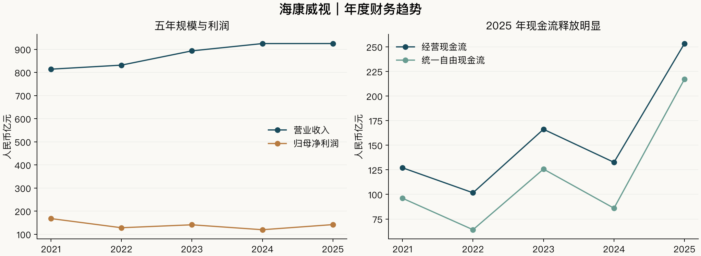
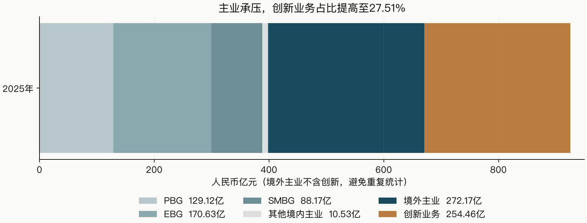

# 海康威视（002415.SZ）研究报告

**研究与数据截止日：2026-11-24（北京时间）**。公司全称为杭州海康威视数字技术股份有限公司，英文名 Hangzhou Hikvision Digital Technology Co., Ltd.，深圳证券交易所人民币普通股；本报告不涉及其他上市子公司的独立买卖建议。复用既有「海康威视」目录，接续[7月历史报告](最终报告.md)。

| 定价基准 | 截止日数据 |
|---|---:|
| 11月24日收盘价 | 34.85元 |
| 已披露且行情源确认的总股本 | 9,164,871,550股 |
| 复算普通股总市值 | 3,193.96亿元 |
| TTM归母净利润 / 归母PE | 177.88亿元 / 17.96倍 |
| 最近十二个月实付税前股息 / 静态股息率 | 1.30元 / 3.73% |

研究主线：海康正在从国内安防投资下行中修复，创新产品和经营提效已反映在利润中；下一阶段的价值取决于库存能否变成现金，以及工业场景收入能否持续落到母公司每股盈利。当前价格已包含一部分改善。

行情由腾讯、新浪当日收盘快照互核，并与[长桥行情](https://longbridge.com/zh-CN/quote/002415.SZ)核对；股本以[2026三季报](https://static.cninfo.com.cn/finalpage/2026-10-17/1225607861.PDF)为准。TTM使用2025全年加2026年前三季减2025年前三季，未将前三季利润直接年化。

## AI研究偏见自觉

信息丰富度评级为 **A级**。年报、季度披露和机构讨论充分，最容易犯的错是把资料多、全球龙头和AI产品多，误当成高投资确定性。

AI研究局限性声明：本报告核验财务报表与公开政策，未进行渠道走访、客户试用或库存实物检查。管理层关于提价、原材料与AI价值的解释，均不能替代独立因果检验；未披露的AI独立利润和分季度事业群数据不予估造。

- [x] 将正式披露、管理层解释、研究假设分开。
- [x] 同时检验“国内永远衰退”和“AI已经重塑盈利”两种叙述。
- [x] 删除本轮未能复核的全球份额、华为增速及历史估值分位。
- [x] 不把四位投资人的方法论写成他们对海康价格的背书。

---

## 第一步：核心数据总览

### 五年财务：收入平台期，盈利和现金并不同步

单位为人民币亿元；比例为本报告计算值，毛利率与东方财富展示值互核。营业利润率采用会计营业利润除收入，包含投资收益等项目，不能直接当作纯主营EBIT利润率。

| 年度 | 收入 | 归母净利 | 毛利率 | 营业利润率 | 经营现金流 | 现金资本开支 | 统一FCF | 货币资金 |
|---|---:|---:|---:|---:|---:|---:|---:|---:|---:|
| 2021 | 814.20 | 168.00 | 44.33% | 22.69% | 127.09 | 30.98 | 96.10 | 347.22 |
| 2022 | 831.67 | 128.38 | 42.29% | 17.77% | 101.65 | 37.56 | 64.10 | 400.12 |
| 2023 | 893.41 | 141.08 | 44.33% | 17.95% | 166.22 | 40.48 | 125.74 | 496.38 |
| 2024 | 924.96 | 119.77 | 43.83% | 15.47% | 132.64 | 46.66 | 85.98 | 362.71 |
| **2025** | **925.08** | **141.95** | **45.88%** | **18.34%** | **253.39** | **36.22** | **217.17** | **465.08** |

统一FCF＝合并经营现金流－购建固定资产、无形资产和其他长期资产支付的现金，尚未扣租赁本金，也未分配少数股东权益。2022收入、归母和经营现金流采用2024年报同控合并重述数；其余旧年成本/资本开支优先采用可互核披露，微小重述差异不构成趋势判断。2021—2025收入复合增速为+3.24%，归母为-4.12%，并非仍处于持续高增长阶段。

来源：[2021年报](https://static.cninfo.com.cn/finalpage/2022-04-16/1212941495.PDF)、[2023年报](https://static.cninfo.com.cn/finalpage/2024-04-20/1219703072.PDF)、[2024年报](https://static.cninfo.com.cn/finalpage/2025-04-19/1223153152.PDF)、[2025年报](https://static.cninfo.com.cn/finalpage/2026-04-18/1225123062.PDF)与[东方财富财务数据](https://datapc.eastmoney.com/emdatacenter/profit/report?code=002415&from=f10&reporttype=1)。



### 收入地图：境外主业与创新业务不能和地理口径混加

| 事业群 / 业务 | 2025收入（亿元） | 2025同比 | 2026H1收入（亿元） | H1同比 |
|---|---:|---:|---:|---:|
| 公共服务PBG | 129.12 | -4.12% | 58.33 | +4.67% |
| 企事业EBG | 170.63 | -3.33% | 77.33 | +3.63% |
| 中小企业SMBG | 88.17 | -26.35% | 46.18 | +13.55% |
| 其他境内主业 | 10.53 | +12.86% | 5.24 | 未单独复核同比 |
| 境外主业 | 272.17 | +4.73% | 129.45 | +5.84% |
| 创新业务 | 254.46 | +13.17% | 151.70 | +28.93% |
| 合计 | 925.08 | +0.01% | 468.23 | +11.97% |

上表中创新业务包括境内外收入；境外主业不包含创新。2025全公司按地理划分的境外收入为342.86亿元，不能再加254.46亿元创新收入后称作海外业务。三大国内事业群已恢复正增长，旧文“持续全面萎缩”的判断需要撤回；半年转正也不足以证明长期财政需求已经恢复。

事业群组织口径另与[年度券商整理](https://stock.finance.sina.com.cn/stock/go.php/vReport_Show/kind/lastest/rptid/829873569593/index.phtml)和[半年度券商整理](https://data.cfi.cn/ybdata.aspx?id=20260803000169)对照，不能声称东方财富结构化财务接口覆盖了每一项事业群。年度“其他境内主业”仅取得公司原表和分部重加总核对，缺少独立整理的第二证据，标作次要数据缺口；该项不影响盈利、现金与估值输入。

2025主业产品服务毛利率49.07%，创新业务39.12%；2026H1创新业务毛利率升至44.35%。创新产品正在改善组合，但不同子公司股权结构、投入需求与周期各异，收入增长不能直接等同母公司股东回报。依据[2025年报](https://static.cninfo.com.cn/finalpage/2026-04-18/1225123062.PDF)和[2026半年报](https://static.cninfo.com.cn/finalpage/2026-07-25/1225440236.PDF)。



### 最近四个完整季度

| 季度 | 收入（亿元） | 归母净利（亿元） | 分部数据可得性 |
|---|---:|---:|---|
| 2025Q4 | 267.50 | 48.76 | 年报季度合计；无完整单季事业群表 |
| 2026Q1 | 207.15 | 27.81 | 有合并报表，无完整分部表 |
| 2026Q2 | 261.07 | 51.15 | H1减Q1计算；分部仅H1累计 |
| 2026Q3 | 272.22 | 50.16 | 有合并报表，无完整分部表 |

Q4来自2025年报季度表，其余来自2026季度/半年累计差额及东方财富。没有把H1业务比例套用到Q3。Q3单季毛利率49.05%来自公司10月17日说明会，前三季累计毛利率49.63%来自报表复算，两者不能混用。

### 最需要跟踪的是现金与存货

| 指标 | 2025全年 / 年末 | 2026年前三季 / 9月末 |
|---|---:|---:|
| 归母净利润 | 141.95亿元 | 129.11亿元，+38.55% |
| 经营现金流 | 253.39亿元 | 72.13亿元，-47.34% |
| 统一FCF | 217.17亿元 | 49.81亿元 |
| CFO / 归母净利润 | 178.50% | 55.87% |
| 应收账款净额 | 298.12亿元 | 283.66亿元 |
| 存货账面净额 | 204.72亿元 | 333.34亿元 |
| 货币资金 | 465.08亿元 | 370.84亿元 |

2025经营性应收减少贡献80.12亿元现金流，说明那一年的高现金产出部分来自回收历史占款。2026存货较年初增加128.62亿元、+62.83%，公司解释为应对存储等原材料涨价而提前备货。该解释有商业合理性，但只有后续销量、库龄、跌价准备和回款能验证备货价值，不能直接把现金下降都归为恶化或都归为聪明采购。[年报现金流补充资料](https://static.cninfo.com.cn/finalpage/2026-04-18/1225123062.PDF)、[三季报](https://static.cninfo.com.cn/finalpage/2026-10-17/1225607861.PDF)、[10月17日公司说明会](https://vip.stock.finance.sina.com.cn/corp/view/vCB_AllBulletinDetail.php?id=12647439)。

TTM统一FCF仍为160.86亿元，TTM CFO/归母为106.01%，因此不能凭前三季现金下降就宣布盈利失真；也不能继续把2025的217.17亿元FCF当作稳定年金。

> 巴菲特式追问：利润中有多少能够在维持竞争力之后，真正交到普通股股东手里？

---

## 第二步：生意本质分析

**海康向政府、企业与家庭出售能感知物理世界并完成具体任务的设备和系统，客户为安全、可追溯和生产效率付费，公司靠规模研发、交付网络及设备更新反复获得收入。**

| 收钱环节 | 客户为何支付 | 复购与成本机制 |
|---|---|---|
| 摄像机、录像存储、门禁及系统 | 安保、合规、事故取证 | 新增部署及更新换代；并非自动续费 |
| 企业场景解决方案 | 将识别结果接入质检、设备管理、安全生产 | 集成与交付建立黏性；定制也占用工程人力 |
| 机器人、机器视觉、热成像 | 提高良率、减少人工、覆盖人眼难以检测的场景 | 更多依赖客户投资回报和产线资本预算 |
| 家居、汽车电子及存储 | 消费体验、车载感知和数据保存 | 更新周期、渠道库存、价格竞争各不相同 |

2025研发投入117.53亿元、占收入12.70%，研发资本化为零。持续费用化使利润没有靠研发资本化美化，但研发本身仍需每年用真金白银维持。2025主业收入下滑而毛利改善，2026前三季收入恢复、费用增幅较温和，经营杠杆推动利润增长。由此推断，海康有一定提价与产品组合优化能力；尚不足以认定它拥有无需竞争投入的长期定价权。[2025年报研发与成本披露](https://static.cninfo.com.cn/finalpage/2026-04-18/1225123062.PDF)、[公司10月说明会](https://vip.stock.finance.sina.com.cn/corp/view/vCB_AllBulletinDetail.php?id=12647439)。

客户迁移时要重做设备兼容、软件集成、人员培训和部分流程验证，这支持存量项目续用海康。采购新系统时，集成商仍能选择大华、宇视或海外品牌。锁定的是一个项目中的工作流程，难以扩大成整个社会对海康的不可替代依赖。

最关键的盈利变量是：企业和政府是否持续有预算、产品毛利能否抵御上游成本、以及新业务在扣除少数权益和营运资金后能给母公司留下多少钱。大模型是改善这些变量的工具，暂时没有证据支持单独给予AI订阅平台估值。

> 段永平式追问：这门生意好在哪？答案在于用大规模共享研发解决大量具体场景，而投资难点在于它每年仍要竞争、投入和收款。

---

## 第三步：护城河评估

| 来源 | 强弱判断 | 支持证据及可证伪条件 |
|---|---|---|
| 品牌与定价权 | 中等 | 大项目交付记录有价值；若提价后销量、渠道回款持续受损，则定价权判断失败 |
| 转换成本 | 中等 | 设备、平台、培训形成项目黏性；开放接口和统一集成可降低迁移成本 |
| 网络效应 | 偏弱 | 更多出货能改善研发和样本经验；未证实新客户加入就普遍提高既有客户效用 |
| 规模与成本 | 较强 | 研发、采购、产品平台及交付分摊有优势；若规模领先却长期低回报，优势不能算股东护城河 |
| 技术与专利 | 中等偏强 | 多维感知、编码、机器视觉与边端部署有工程积累；无法可靠断言领先固定年数 |
| 合规和渠道 | 分地区 | 本地服务和准入能保住客户；地缘限制也会把同一技术优势挡在市场外 |

过去五年护城河呈分化：工程规模和产品广度仍有价值，国内安防财政扩张带来的顺风减弱，海外准入反而形成额外成本。2026利润修复显示竞争能力尚在，不能从2024盈利低点直线外推“护城河消失”。未来能否加宽，要看工业感知产品的交付、复购和现金回报，而非摄像机存量数量。

同行可以复制部分功能，较难迅速复制产品广度与交付体系；但大客户削减预算、准入封锁或软件平台控制采购入口，都可能绕开海康的优势。这是规模护城河，尚未证明是高黏性软件平台的护城河。

> 巴菲特式追问：十年后护城河还在吗？工程与渠道大概率仍有价值，能否继续给股东带来超额回报取决于准入、再投资回报和价格。

---

## 第四步：逆向思考与风险清单

最强空方论点是：当前盈利修复混合了低价库存、提价和降本效果，市场可能误把阶段性高毛利看作AI驱动的长期跃迁；与此同时，大量现金重新进入库存，创新子公司增长又并非全部归母，普通股股东未必得到与合并收入同等的价值增长。

以下概率为未来数年的定性研究判断，彼此可能重叠，不构成统计预测。

| 失败路径 | 概率判断 | 影响 | 应观察的证据 |
|---|---|---|---|
| 备货超过真实需求，上游价格或终端价格反转 | 中高 | 现金占用与减值，利润受压 | 库存增速、库龄、原料/成品结构和跌价准备 |
| 毛利修复部分为低成本库存收益，不能持续 | 中 | 盈利中枢被高估 | 后续毛利、实际提价接受度、单位产品成本 |
| 政府和企业预算再走弱 | 中 | 主业收入与回款回落 | PBG/EBG收入、合同现金回收、应收账龄 |
| 海外准入限制向其他市场扩散 | 中 | 市场缩小、渠道和合规支出增加 | 正式政策、认证清单、公司分地区说明 |
| AI价值被通用平台或客户自行获取 | 中 | 海康承担硬件和研发投入，利润池被压缩 | 客户付费、实际节省、软件附着与价格变化 |
| 子公司扩张、分拆与少数权益稀释归母价值 | 中 | 合并繁荣但每股现金不增长 | 归母/总利润、关联交易、对子公司资本投入 |
| 关键元件全面断供、重大隐私诉讼或其他极端事件 | 无可靠概率 | 可能造成永久损失 | 许可与供应替代、诉讼原文、资本与现金变化 |

公司承认低价原材料曾帮助上半年毛利，同时指出移动平均成本逐季上升后Q3毛利仍较高；本报告据此接受“多因素改善”，没有将全部提升归为库存，也没有将全部提升归为AI。[公司10月说明会](https://vip.stock.finance.sina.com.cn/corp/view/vCB_AllBulletinDetail.php?id=12647439)。

### 地缘风险必须按国家与法律范围核对

- 美国：FCC在6月26日发布相关决定、7月16日生效，限制部分此前已获授权的Covered List设备进口和营销，含适用范围与暂缓条款。更直接的经营证据是公司10月17日确认已经正式退出美国市场、不再正式销售；不能把这一句话扩大成北美所有收入归零。[美国正式公报](https://www.govinfo.gov/content/pkg/FR-2026-07-06/html/2026-13518.htm)、[公司说明会](https://vip.stock.finance.sina.com.cn/corp/view/vCB_AllBulletinDetail.php?id=12647439)。
- 加拿大：政府决定页保留2025年6月27日停止加拿大经营及清盘命令；公司申请司法复核与暂停执行，本轮未读到截至截止日的官方最终诉讼裁决，执行和财务结果保留不确定性。[政府决定](https://ised-isde.canada.ca/site/investment-canada-act/en/national-security-decisions)、[官方诉讼背景](https://www.ised-isde.canada.ca/site/ised/en/parliamentary-committee-briefing-materials/appearance-standing-committee-public-safety-and-national-security)。
- 印度：官方文件规定2026年4月起CCTV销售须符合安全要求，不能据此称所有中国品牌已被一律禁止；海康逐型号资格和实际收入影响未核完。[MeitY备忘录](https://www.meity.gov.in/static/uploads/2026/01/06f42f7b81035795b9db65ae4f339227.pdf)、[印度政府说明](https://www.pib.gov.in/PressReleasePage.aspx?PRID=2245073&lang=2&reg=3)。

历史类比采用机制而非命运类比：安防主业已出现设备行业从新增建设转向更新需求的特征，企业可长期存在但回报中枢下降；工业感知业务若能解决真实生产瓶颈，则有第二条增长曲线。无法从“像某家历史公司”推出成功概率。技术采纳曲线解释需求扩大，竞争博弈和采购预算决定利润能留下多少。

本报告最可能犯的错，是低估AI和机器视觉带来的新场景变现，因现金保守估值错过复苏；另一面是高估当前毛利的持续性。两种错误都需用后续每股现金而非叙事修正。

> 芒格式追问：聪明人为什么不买？因为在现金转化和海外准入仍需验证时，当前价格给出的容错空间有限。

---

## 第五步：管理层评估

胡扬忠现任董事长，徐鹏为董事、总经理；徐鹏长期参与公司研发与产品体系，并非临时空降。不能继续把胡扬忠的职务写成兼任CEO。2026三季末胡扬忠直接持股155,996,477股，披露比例1.70%；与杭州威讯的一致行动关系不等于其个人拥有该企业全部经济权益。中电海康直接持股37.28%，加两家已披露一致行动主体，控制集团合计约41.97%。没有AB股差异投票权口径。[半年报](https://static.cninfo.com.cn/finalpage/2026-07-25/1225440236.PDF)、[三季报股东表](https://static.cninfo.com.cn/finalpage/2026-10-17/1225607861.PDF)、[东方财富股东数据](https://emweb.securities.eastmoney.com/PC_HSF10/ShareholderResearch/PageAjax?code=SZ002415)。

| 时间 / 决策 | 已观察结果 | 评价 |
|---|---|---|
| 长期投入智能物联、机器视觉等新业务 | 创新收入增长，毛利改善，但少数权益与现金投入需分清 | 战略有成果；回报仍在验证 |
| 2024年徐鹏接任总经理，延续内部培养 | 管理职责已接续，利润在随后恢复 | 组织有深度；不能把复苏全归因换帅 |
| 2025转向经营质量和回款 | 应收释放明显，费用控制及盈利改善 | 正面；一次性回款不可重复资本化 |
| 2025研发投入继续费用化 | 没有研发资本化粉饰，但高投入是持续负担 | 会计审慎；研发ROI未独立披露 |
| 2026继续现金分红 | 5月实付0.75元、8月实付0.55元 | 股东回报可验证，未来分红不保证 |
| 2026增厚原材料库存 | 毛利有韧性，同时吞噬现金 | 尚不能判定成功，等待周转与减值验证 |
| 推进海康机器人分拆 | 项目仍在推进，不能称已上市 | 需看发行、关联交易与母公司权益变化 |

股息口径尤其要分清：归属于2025盈利年度的分红为中期0.40元加年度0.75元，共1.15元；截至本次截止日最近十二个月实际支付的是0.75元加0.55元，共1.30元。旧文约1.1%的股息率不适用于当前口径。[年度权益分派](https://epaper.cs.com.cn/zgzqb/html/2026-05/14/nw.D110000zgzqb_20260514_8-B027.htm)、[中期权益分派](https://static.cninfo.com.cn/finalpage/2026-08-12/1225468251.PDF)。

治理方面，2026预计日常关联交易上限为753,600万元，即75.36亿元，旧文753亿元存在单位错误；这既不是已发生金额，也不是任意关联方交易都不公允的证明。2025年末财务公司存款约62.96亿元已包含在货币资金中，要跟踪资金保管与关联风险，不能再加进净现金。旧文汽车电子94%负债率来自特定子公司，不能代表整个板块。[关联交易公告](https://paper.cnstock.com/html/2026-04/18/content_2201702.htm)、[子公司担保/资助披露](https://epaper.stcn.com/att/202604/18/ZQ18B218-HJ_eBook.pdf)、[年报关联方资金披露](https://static.cninfo.com.cn/finalpage/2026-04-18/1225123062.PDF)。

综合判断为能力较强、激励与股东有联系，但资本配置并非无需监督。未完成全部历史减持逐笔追溯与薪酬绩效回归，不使用“从未减持”“绝无治理问题”等绝对评价；回购注销和员工激励也不能一概当作自由股东回报。

> 段永平式追问：如果董事长退休还能运转吗？内部培养的经营班子和产品体系提供支持，战略取舍及再投资纪律仍需继续观察。

---

## 第六步：行业与文明趋势

从“拍得到、存得下”走向“看得懂、能执行”，确实扩大感知设备在工业和服务业中的用途。海康位于物理世界的数据入口、边端计算与场景交付环节；芯片、通用模型、企业软件和最终客户也会分走价值。文明趋势支持需求方向，无法单独证明海康的利润率或估值倍数。

2025前五客户销售占比2.00%，前五供应商采购占比14.50%。客户集中度低能减轻单一客户损失，仍无法消除政府与企业预算同向收缩；供应商数量分散也不能证明关键芯片与核心软件完全可替代。[2025年报](https://static.cninfo.com.cn/finalpage/2026-04-18/1225123062.PDF)。

没有取得口径一致、足够透明的最新全球TAM与份额原始数据库，因此不延用旧文的市场份额或把多个工业市场规模相加。以实际收入作锚更可靠：2025创新业务254.46亿元，2026H1为151.70亿元；机器视觉、AGV、热成像、存储的增长空间应逐项看付费与资本回报。公司同时说明半导体相关外围设备当前占全公司收入并不显著，不能据产品展出就按半导体设备平台重估。[半年报](https://static.cninfo.com.cn/finalpage/2026-07-25/1225440236.PDF)、[10月公司说明会](https://vip.stock.finance.sina.com.cn/corp/view/vCB_AllBulletinDetail.php?id=12647439)。

技术路线风险是：通用模型让视觉功能更容易复制；边端算力成本和存储成本上升；客户更偏向开放接口或平台统一采购。机会则是海康已有交付体系，能将通用技术转成可运行、可维护的工业产品。未来利润来源应从更多SKU转向更高的场景解决价值，但当前尚未获得标准化独立AI收入、续约率或ROI数据。

> 李录式追问：二十年后它是否仍重要？感知与自动化大概率更重要，海康能否获取可观经济利润仍是公司层面的竞争问题。

---

## 第七步：估值与安全边际

### 当前定价与现金边界

| 指标 | 复算结果 | 口径 |
|---|---:|---|
| TTM收入 | 1,007.94亿元 | FY25＋9M26－9M25 |
| TTM归母净利润 / EPS | 177.88亿元 / 1.94085元 | 用当前股本统一摊薄 |
| PE / PB / PS | 17.96倍 / 3.79倍 / 3.17倍 | PB分母为归母净资产842.75亿元 |
| 合并统一FCF收益率 | 5.04% | 未扣租赁本金、少数权益，不能叫普通股可分配收益率 |
| 实付税前股息率 | 3.73% | 历史支付1.30元除当前价，未来不保证 |
| 保守债务扣项 | 53.81亿元 | 短借＋长借＋全部一年内非流动负债＋非流动租赁负债 |
| 货币资金减上述债务 | 317.02亿元 | 合并口径，仍含受限/非等价资金 |
| 现金等价物减上述债务 | 312.20亿元 | 从366.01亿元现金等价物起算，更谨慎 |
| EV/TTM收入观察值 | 2.95倍 | 市值＋上述债务＋账面少数权益－货币资金；非严格可比EV |

季度报表不含完整债务和受限现金附注，53.81亿元把全部一年内非流动负债作为扣项，可能高估有息债务，因此只称保守扣项。净现金还有子公司权益及维持运营的需求，不应全部视为可立即发给母公司股东。以下盈利估值和现金估值均不再额外加净现金，避免与已有资金收益重复。

大华同日收盘14.02元，以行情源TTM EPS0.987元复算PE为14.20倍；海康存在估值溢价，但业务结构、投资收益和现金质量不同。宇视未独立上市，不能把千方科技的PE直接当宇视PE。历史对照仅保留可核时点：东方财富按2026年4月17日价计算当时PE约21.39倍；今天约18倍低于该时点，无法由此得出五年分位。旧文“历史均值22.2倍、60%—70%分位”本轮不采纳。[大华行情](https://longbridge.com/zh-CN/quote/002236.SZ)、[4月估值记录](https://finance.eastmoney.com/a/202604183709683344.html)。

### 三年三情景：当前接近合理价格，折价尚不充分

以TTM EPS 1.94085元为起点，三年盈利增速和退出PE均为研究假设。三年末价格不是今日价值；今日价值用人民币8%折现，并假设未来每年税前现金股息维持1.30元。历史已付股息不能再计入未来应收股息。

| 情景 | 概率假设 | EPS年增速 | 三年末PE | 三年末股价 | 三年含息总回报 | 含未来股息的今日价值 |
|---|---:|---:|---:|---:|---:|---:|
| 悲观：利润回落、倍数收缩 | 25% | -5% | 14倍 | 23.30元 | -21.96% | 21.84元 |
| 基准：适度增长、维持估值 | 50% | +6% | 18倍 | 41.61元 | +30.58% | 36.38元 |
| 乐观：创新兑现、溢价保留 | 25% | +10% | 22倍 | 56.83元 | +74.27% | 48.47元 |

情景加权今日价值35.77元。退出倍数反映三年后的相对定价判断，不能当作十年终值倍数的来源。悲观股息仍固定是一项简化；若盈利和分红同时下降，结果更差。额外压力例：盈利较当前基准下降30%、市场仅付12倍，对应价格16.30元；这未赋概率，也不是损失下限。

### 现金流交叉检查与反向DCF

不能拿160.86亿元合并FCF全部归给母公司。本报告用可复核的粗桥接生成假设，而非声称精确算出FCFE：

| 桥接步骤 | 每股金额 / 比例 | 性质 |
|---|---:|---|
| TTM合并统一FCF / 当前股本 | 1.7552元 | 报表计算 |
| 按TTM归母净利/合并净利分配 | 89.41% | 代理分配，子公司真实现金分布未披露 |
| 分配后现金代理 | 1.5694元 | 上两项相乘；不是实发母公司现金 |
| 租赁等年度现金预留 | -0.03元 | 参考FY25租赁偿还约0.0255元/股，向上取整；不是已核实TTM租赁数 |
| 正常营运资金及误差缓冲 | -0.09元 | 主观审慎预留；不重复扣已进入CFO的128.62亿元库存增加 |
| 正常化股东现金流假设 | 约1.45元 | 未来模型起点，可被后续数据推翻 |

以该1.45元为起点，未来十年增长5%、之后永续增长1%、人民币折现率8%，逐年折现中间现金与终值，得到 **28.24元/股**。这是另一种定价交叉检查；FCFE已经在再投资后，终值用FCFE永续增长法，不再另扣一次留存投资，也不加一次账面现金。

反过来，在其余参数不变时，34.85元需要未来十年正常股东现金流年增约7.78%。它并非无法实现，但比五年历史利润趋势更积极。若真实可分配现金起点或未来增速提高，现金估值会提高；若库存无法兑现则降低。28.24元来自假设，不能自证28元绝对安全。

### 十年终值：只用于仓位压力测试

币种采用CNY。r＝8%＝规范化无风险利率假设2%＋β1.0×股权风险溢价假设6%。2%是长期模型输入，不冒称11月24日现券收益率；[当日公开现券报价](https://hk.investing.com/rates-bonds/china-10-year-bond-yield-historical-data)约1.6%，不能直接据此把权益资本成本压到低位。基准r位于技能规定的人民币6%—9%区间，人民币基准永续g上限2%，本模型选择更保守的1%。

稳态增量ROIC取12%。参考东方财富对2025存量ROIC计算约15.57%；用FY25股息1.15元/基本EPS1.546元反解派息率约74.39%，若仅以1%稳态增长和留存率反推增量ROIC，低端约3.90%。这个低端忽略研发及投资结构变化，不能当成真实边际回报；12%放在两者之间，表达新业务无法完全复制成熟业务优势的判断。[ROIC外部口径](https://finance.eastmoney.com/a/202604183709683344.html)、[年报分红与EPS](https://static.cninfo.com.cn/finalpage/2026-04-18/1225123062.PDF)。

终值PE只由 `(1−g/ROIC)/(r−g)` 推导，绝不借用大华或其他公司今天的PE。十年终点约为2036年，利润为滚动起点复合增长的模型结果，不是公司指引。

| 十年情景 | 概率假设 | 十年利润年增速 | 终点归母利润（亿元） | 永续g | r−g | r8%退出PE | 十年回报代理 |
|---|---:|---:|---:|---:|---:|---:|---:|
| 悲观 | 25% | -2% | 145.34 | 0% | 8个百分点 | 12.50倍 | -1.76% |
| 基准 | 50% | +5% | 289.74 | 1% | 7个百分点 | 13.10倍 | +5.47% |
| 乐观 | 25% | +9% | 421.10 | 1% | 7个百分点 | 13.10倍 | +9.34% |

这里的工具输出采用“终值市值复合回报＋固定股息率k”的近似，k＝1.30/34.85＝3.73%，未另计未来回购或稀释；**它不是逐年股息现金流计算的IRR**。概率加权的年化回报代理为4.63%，也不是概率加权财富的精确IRR。它刻意保守地限制终值倍数，适合压力测试，不能与上面的完整现金折现或三年目标直接混称。

| 折现率敏感性 | 期望回报代理 | 相对该档r | 仓位压力测试 |
|---|---:|---:|---|
| r−2pp＝6% | +7.96% | +1.96个百分点 | 通过，人民币区间内 |
| r＝8% | +4.63% | -3.37个百分点 | 未通过，人民币区间内 |
| r+2pp＝10% | +2.19% | -7.81个百分点 | 未通过；区间外，仅供参考 |
| 额外复核：r＝7% | +6.15% | -0.85个百分点 | 未通过，区间内 |
| 额外复核：r＝9% | +3.33% | -5.67个百分点 | 未通过，区间内 |

**在人民币合理区间内，压力测试会随r从6%升至8%而翻转；7%—9%采样均未通过。本结论对折现率敏感，仓位建议须降级。** g未随r改变；6%档最窄分母也有5个百分点。没有通过降低r修改最终基准。

离散风险没有塞入r或β。海外市场缩小和硬件替代由收入、利润情景表达；关键元件全面断供、重大隐私赔偿、无法预见的子公司再融资稀释没有完整损失/概率模型，仍属未建模风险。不得把三档概率之和为一理解为已经覆盖全部世界状态。

### 估值分歧对账

| 方法 | 回答的问题 | 本轮含义 |
|---|---|---|
| 三年盈利与股息估值 | 当前价格贵不贵 | 基准36.38元、加权35.77元，现价接近合理，缺少厚折价 |
| 正常化股东现金流DCF | 对可拿走现金付多少钱 | 假设值28.24元，对现金桥接与增速很敏感 |
| 十年终值压力测试 | 是否有把仓位做大的余地 | r8%未覆盖、合理区间会翻转，应收紧仓位 |

三年模型保留盈利修复与18倍估值，十年压力要求稳态倍数收敛，现金DCF还约束了母公司现金转化，所以结果不同。最终“新增观望、合理小仓持有”来自生意仍有优势、现金尚待验证、地缘风险和当前折价不足的共同判断，**不由十年未覆盖r单独否决买入或持有**。若三年和现金证据继续增强，即使十年近似仍未通过，也应重估首笔机会；仓位上限继续受压力测试约束。

> 巴菲特式追问：r错2个百分点会翻转吗？会，因此不能把低r档的通过当成重仓理由。
>
> 段永平式追问：股市关闭五年还愿意按34.85元持有吗？合理小仓可以承受经营验证，尚不足以用当前现金证据支持集中投入。

---

## 第八步：最终决策与行动清单

| 维度 | 结论 | 信心度 |
|---|---|---|
| 生意质量 | 规模研发和交付有价值，属于持续竞争和投入的好制造生意 | 中高 |
| 护城河 | 工程与规模较强，项目转换成本中等，网络效应弱；国内外分化 | 中 |
| 管理层 | 内部培养、费用化研发和实付分红可验证；库存及关联资本配置继续核查 | 中高 |
| 最大风险 | 高毛利与现金转化是否可持续，以及海外准入进一步缩小 | 中 |
| 文明趋势 | 感知、质检和自动化需求有长期空间，公司利润捕获仍需证明 | 中 |
| 估值 | 三年接近合理；现金DCF偏低；十年仓位压力未过且合理r区间会翻转 | 中低 |

估值维度与其他五项并列；十年未覆盖r只收紧仓位。没有用户成本、真实仓位、负债和资金期限资料，以下仓位仅是研究风险预算示例，不能视为已经替用户下单或完成个性化配置。

| 投资者 / 价格条件 | 建议 |
|---|---|
| **空仓者，现价34.85元** | **观望新增**。价格接近盈利合理值，现金折现与利润估值分歧尚大 |
| **已有合理小仓** | **有条件持有、暂停加仓**。跟踪现金与库存；若已明显超配，优先复核集中度 |
| **28—31元** | 条件式小额分批研究带：后续完整财报须证明库存周转或库龄改善、同口径累计现金转化较本期改善，且滚动CFO/归母维持约1倍、毛利未结构性下台阶，重大准入/治理风险未恶化；重新估值后才考虑首笔 |
| 低于28元 | 先检查是否出现永久损失，再定价；不能机械越跌越买 |
| 31—38元 | 正常观察或持有区间，新增资金等待现金证据或更厚折价 |
| 38—48元 | 需更强每股现金和增长假设支持；不以AI标签追价 |
| **达到或超过48元且模型未上修** | **估值警戒，复核超配与减仓**；约为当前乐观现值附近，非自动卖出线 |
| 经营卖出信号 | 毛利、销量与回款连续恶化且无法解释；库存减值或供应/准入冲击显著改变长期现金；治理损害或母公司每股价值被持续稀释 |
| 加仓信号 | 价格与经营条件同时满足，并由后续披露验证，现金DCF与盈利估值分歧收窄 |

28—31元高端仍高于本轮现金DCF，因此价带必须附经营验证条件。当前滚动现金转化已约1倍，其中包含2025Q4的大额回款，不能据此宣布2026备货验证完成；必须查看新披露的完整现金与库存附注。若条件通过，小额首笔和后续披露后再分批的方式更合适；纯研究风险预算总仓参考不超过约2%，这是主观上限示例，并非精确优化结果。若现金起点仍只有本轮保守假设，31元也不能称为深度安全价。

复检安排：2026-12-31人工检查库存、准入、治理和新公告；2027-04-30作为全年披露的自定兜底复检日，均非公司确认的财报预约日。正式年度业绩提前披露即提前复检。价格监控只登记≤31元和≥48元两个边界；中间观察区间人工判断。事件登记仅保留人工复检，当前每日监控流程只扫描价格。

### 与7月报告的接续

保留历史文件，不把旧结论静默改写成当时已知。此次更新撤回“毛利率持续下行、国内三群持续萎缩”的直线外推；现金余额与净现金分开；将关联交易上限从错误的753亿元改为75.36亿元，区分公司退出美国与北美整体影响，并纠正董事长/总经理职责及汽车电子子公司口径。旧26—29元研究带由本次28—31元条件带接续，依据为已披露盈利修复与现金桥接模型，并非简单随股价抬价。

### 四位大师：原话与本报告的延伸分开

以下延伸均为本报告对方法论的运用，无人公开为本报告价位背书。

| 人物 | 可核验原话与出处 | 本报告的延伸判断 |
|---|---|---|
| 巴菲特 | “It's far better to buy a wonderful company at a fair price than a fair company at a wonderful price.” [1989股东信](https://www.berkshirehathaway.com/letters/1989.html) | 先验证生意与现金，再判断合理价格；不能仅凭行业龙头给溢价 |
| 芒格 | “He wanted decisions that maximized long-term results” [2014年报中芒格署名文章，印刷第40页](https://www.berkshirehathaway.com/letters/2014ltr.pdf) | 原文描述巴菲特的制度选择；延伸到海康，应看备货和新业务是否提高长期每股结果 |
| 段永平 | “我也不知道，但好的方面是犯罪率可能会因此得到控制。” [2019-05-04原帖](https://xueqiu.com/1247347556/126066049)；已读[本地原文归档第1810条](../段永平/段永平雪球全量原发言.md) | 这是他对海康能否保持领先的真实回应，体现不确定；旧文替其给出“10—12倍才合理”等评价没有原话依据，本报告不沿用 |
| 李录 | “他提供的是服务，而不是指导。” [2024-12-07演讲本地实录，市场先生一节](../李录/李录-北大演讲-20241207.md) | 独立判断价值，不能让今天的股价决定研究假设；该原话不表示他对海康的买卖意见 |

> 综合追问：下一次披露出现什么结果，会迫使我们承认这次判断错了？若库存兑现、母公司现金明显增强，应上修；若利润修复不能转化为可分配现金，应下修。

---

## AI分析置信度与投资确定性

AI分析置信度：对证券身份、历史财务、股本、已付股息及当前报价较高；对海外规则适用范围中等，部分司法和逐型号认证结果仍有缺口；对未来毛利、AI独立回报、正常化FCFE和十年增长仅中低。

投资确定性：中等。海康的竞争体系有充分证据，未来普通股每股现金增长则没有同等强度的证据。渠道库存、终端需求、AI节省成本的真实比例、子公司现金分布和新投入回报，仍需要客户、渠道与供应链一手验证。即使把公开材料增加一倍，这些判断也不会自动变确定。

本项目用于学习和研究，不构成投资建议。

## 数据来源与审计记录

财务主要独立取数渠道为巨潮正式文件与东方财富财务接口；同一公告的深交所、巨潮、新浪转载不能充作三份独立证据。两个数据渠道都基于上市公司披露，也不是两次独立审计。第三方显示与年报有差异时，以正式年报及重述口径优先。

关键数据交叉验证记录由工具实际输出，完整文件见[验证日志](研究底稿-20261124/validation-log.txt)；以下为输出摘录：

```text
市值验算 (Market Cap Verification)
  股价 (Price):       34.85 CNY
  总股本 (Shares):    9.16B
  计算市值:           319.40B CNY
  报告市值:           319.40B CNY
  偏差:               0.00%
  ✅ 验证通过, 偏差仅 0.00%

市值验算：34.85 × 9,164,871,550 = 319,395,773,517.50 CNY
行情报告市值：319,396,000,000 CNY；偏差0.00%，验证通过
FY25收入：巨潮92,507,796,069.94 / 东方财富92,507,796,069.94 元；偏差0.00%
FY25归母：巨潮14,195,371,894.42 / 东方财富14,195,371,894.42 元；偏差0.00%
FY25现金：巨潮46,508,328,658.44 / 东方财富46,508,328,658.44 元；偏差0.00%
9M26收入：巨潮74,044,332,688.88 / 东方财富74,044,332,688.88 元；偏差0.00%
9M26归母：巨潮12,911,386,245.87 / 东方财富12,911,386,245.87 元；偏差0.00%
9M26现金：巨潮37,083,532,987.38 / 东方财富37,083,532,987.38 元；偏差0.00%
总股本：巨潮与腾讯均9,164,871,550股；胡扬忠直接比例：巨潮与东方财富均1.70%
估值复算：PE17.96倍，PB3.79倍，FCF收益率5.04%，实付股息率3.73%
```

所有估值、市值、现金桥接和情景数据均程序计算，使用financial_rigor工具并以Decimal复算；十年估值使用terminal_value工具。输入和未取整结果见[模型底稿](研究底稿-20261124/model.json)、[十年配置](研究底稿-20261124/terminal-config.json)。报表与自建模型的数值不能使用同一种“外部来源已验证”标记。

数据随机抽检及定向补检均已通过，见[审计结果](研究底稿-20261124/audit-results.json)与[审计记录](研究底稿-20261124/audit-verdict.txt)；定稿参数另经[终值准出检查](研究底稿-20261124/terminal-final-audit.txt)通过。抽检覆盖范围与局限以记录为准，次要组织口径数据的单源缺口仍保留；通过工具抽检不表示未来预测已经被证实。
