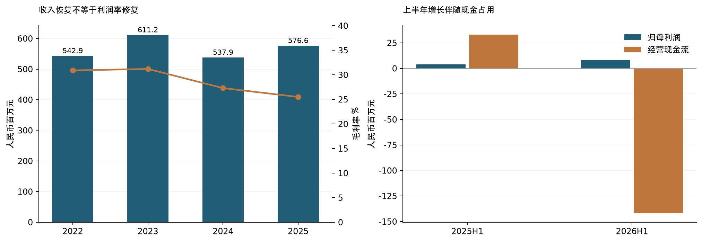
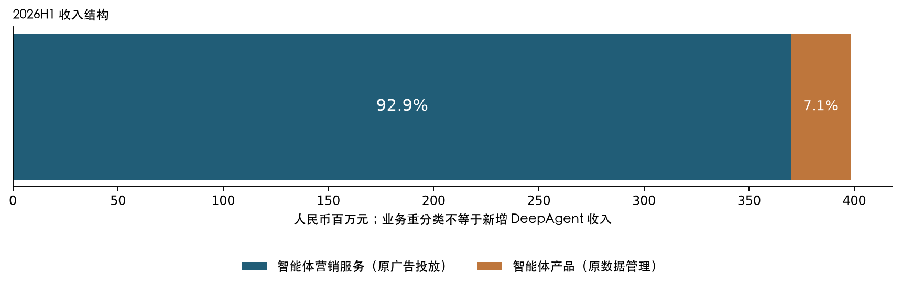

# 深演智能（02723.HK）研究报告

**研究及资料检索截止：2026年11月18日（北京时间）**；最新纳入财务期间：2026年上半年，未经审计。行情采用11月17日16:08:19收盘后快照，42.06港元；总股本906,791,750股，复算市值381.3966亿港元。人民币现金流估值，换算采用11月17日中间价1港元＝0.85562元人民币。信息丰富度：**B级，产品商业化分拆信息接近C级**。

深演为企业提供算法投放、客户数据管理及智能体应用；转型已有收入增长证据，但毛利率、回款和现价所要求的利润规模尚不匹配。本次接续[7月旧报告](最终报告.md)，保留历史原文，以本报告更新经营判断、估值及监控条件。

行情由[腾讯快照](https://qt.gtimg.cn/q=hk02723)与[华盛通](https://www.hstong.com/hk/quotes/10000-02723-HK)交叉；股本以[10月证券变动月报](https://www.deepzero.com/uploads/IMAGE/20261106/0/3d949f329a40439a8f0c405ab068c0e5.pdf)为准；汇率见[中国外汇交易中心](https://www.chinamoney.com.cn/chinese/bkccpr/index.html?tab=2)。价格均为拆股后每股港元，下文人民币与港元严格分开。

---

## AI研究偏见自觉

公司全称北京深演智能科技股份有限公司，英文Beijing DeepZero Technology Co., Ltd.，前身品友互动，海外品牌DeepZero / iPinYou，2026年5月27日于香港上市。它与DeepSeek、深科技或格灵深瞳不是同一公司。仓库已有“深演智能”目录和同名监控ID，本次沿用。

**AI研究局限性声明：**招股书、中报及月报足以核查会计结果；尚不能独立核实DeepAgent的付费续约、纯新增软件收入、客户实际ROI及完整当前股权变动。主来源与独立财经平台交叉的是披露转录，不是第二次审计。没有客户访谈和产品实测，不把管理层宣传升级为经济护城河，也不把公开信息少等同于产品无价值。

- [x] 区分“财务数据充分”与“未来商业结果确定”。
- [x] 重新核对拆股、上市费用和业务重分类，避免锚定旧报告。
- [x] 同时检验“只是代投”和“已经成为高毛利AI平台”两种极端叙事。
- [x] 缺失的独立DeepAgent收入不填零，也不拿合同数量替代收入。

---

## 第一步：核心数据总览

### 先处理拆股和旧报告口径

2026年10月16日每1股拆为10股，10月底全部已发行股份为H股、库存股为零，注册资本不因拆股增加。原发行价55.5港元应换算为5.55港元；旧报告327港元相当于32.70港元，原80港元关注线相当于8港元。**42.06港元并不意味着从旧报告327港元跌去了接近九成。**[月报，第1、2、7页](https://www.deepzero.com/uploads/IMAGE/20261106/0/3d949f329a40439a8f0c405ab068c0e5.pdf)，[信报公司行动记录](https://stock360.hkej.com/quotePlus/stockEvents/2723)。

| 旧报告表述 | 本次复核 |
|---|---|
| 2025年现金“IPO后”1.55亿元 | 2025年底现金1.54885亿元为上市前；IPO发生于2026年5月 |
| 2025年资本开支约370万元 | 现金购建物业设备及无形资产为36.8万元；另有租赁本金，不应漏看 |
| 净利约918万元与归母混用 | 2025年集团净利917.7万元，归母909.5万元；2024年分别2152.0万、2196.7万元 |
| 广告代投因此等于无技术、无转换成本 | 算法竞价及流程嵌入真实存在；总额法主要影响收入可比性，不能直接证明无技术 |
| 中移/广电股东约10.92%/17.49% | 中报披露发行后相关权益为9.83%/15.74%，且“被视为权益”须避免重复计数 |

以上修正来自[正式招股书](https://www1.hkexnews.hk/listedco/listconews/sehk/2026/0518/2026051800023.pdf)及[2026中报](https://www.deepzero.com/uploads/IMAGE/20260925/0/f3aca796c0c34585a79c8592a6cf1fae.pdf)。旧报告并非可直接沿用的数据底稿。

### 四个完整年度与最新半年

单位：人民币百万元；净利润与归母分列，半年不作全年使用。

| 指标 | 2022 | 2023 | 2024 | 2025 | 2025H1 | 2026H1 |
|---|---:|---:|---:|---:|---:|---:|
| 收入 | 542.902 | 611.190 | 537.870 | 576.563 | 277.344 | **398.247** |
| 毛利 | 167.943 | 190.459 | 146.582 | 147.201 | 75.029 | **97.754** |
| 毛利率 | 30.9% | 31.2% | 27.3% | 25.5% | 27.1% | **24.5%** |
| 营业利润 | 64.279 | 64.487 | 20.812 | 7.535 | 1.550 | 7.784 |
| 集团净利润 | 59.362 | 60.658 | 21.520 | 9.177 | 3.639 | 8.195 |
| 归母净利润 | 59.362 | 60.658 | 21.967 | 9.095 | 3.775 | **8.178** |
| 研发费用 | 46.865 | 54.063 | 56.344 | 45.755 | 23.336 | 33.678 |
| 经营现金净额 | 75.136 | 52.060 | 42.052 | 31.864 | 33.049 | **-141.896** |
| 现金购建资本开支 | 0.087 | 0.033 | 0.951 | 0.368 | 0.156 | 0.207 |
| 租赁本金支付 | 6.849 | 6.422 | 5.573 | 5.479 | 2.531 | 3.056 |

2022来自[历史申请文件](https://www1.hkexnews.hk/listedco/listconews/sehk/2026/0527/sehk25120103938.pdf)印页302—304、I-13；2023—2025来自[正式招股书](https://www1.hkexnews.hk/listedco/listconews/sehk/2026/0518/2026051800023.pdf)印页232、I-9；半年来自[中报](https://www.deepzero.com/uploads/IMAGE/20260925/0/f3aca796c0c34585a79c8592a6cf1fae.pdf)印页15—19、39—40。独立交叉：[ETNet损益表](https://www.etnet.com.hk/www/tc/stocks/realtime/quote_ci_pl.php?code=02723)、[ETNet现金流](https://content.etnet.com.hk/content/iq/compinfo/tc/quote_ci_cashflow.php?code=2723)、[Yahoo财务](https://finance.yahoo.com/quote/2723.HK/financials/)。

五年同口径IFRS完整财年、最近四个独立季度分部数据均不足，不用2021年中国准则报表或半年数据强行补齐。2026H1收入同比+43.6%，归母+116.6%；毛利增长+30.3%落后收入，尚非利润率扩张型增长。经调整集团净利1746.2万元、同比+30.6%，只加回926.7万元上市费用；这是会计利润调整，并非现金回款。[中报摘要交叉来源](https://wap.stockstar.com/detail/AN2026092500014717)。



### 现金多了，为什么仍要警惕

6月底现金及等价物4.71318亿元，定存4351.4万元，FVPL金融资产1511.9万元，广义流动金融资产合计5.29951亿元。银行借款为零；减租赁负债868.5万元后的广义净现金为5.21266亿元。仅用现金等价物减租赁，较严格净现金为4.62633亿元。定存的期限限制、理财风险与募集资金用途仍须分别核实，不能全部视为可分给股东的剩余现金。[中报印页35](https://www.deepzero.com/uploads/IMAGE/20260925/0/f3aca796c0c34585a79c8592a6cf1fae.pdf)，[ETNet资产负债表](https://content.etnet.com.hk/content/iq/compinfo/tc/quote_ci_bs.php?code=2723)。

现金增加主要受IPO融资支持。上半年IPO发行收款4.38603亿元，支付上市费用2210.7万元、股息3019.6万元。同期应收款含长期部分由2.18648亿增至3.34988亿元，增长+53.21%；预付款等由2983.3万增至5753.2万元。公司解释现金流出主要来自扩张预付款，但简表没有完整经营现金流调节桥，不能把每一元流出都归给单一因素。[中报印页18、35、40](https://www.deepzero.com/uploads/IMAGE/20260925/0/f3aca796c0c34585a79c8592a6cf1fae.pdf)，[观点网交叉报道](https://finance.sina.com.cn/stock/estate/integration/2026-08-26/doc-iniprytr6013017.shtml)。

上半年简化自由现金流＝经营现金流−现金资本开支＝-1.42103亿元；再扣租赁本金及利息后为-1.45235亿元。最新滚动十二个月简化FCF为-1.435亿元。研发费用已计入经营支出，不能因为设备开支很低，就把企业描述为无需持续投入。

> 巴菲特式追问：如果增长需要先替客户垫款，新增利润究竟什么时候能归股东所有？

---

## 第二步：生意本质分析

**一句话：企业为更有效地找到和经营客户付费，深演用算法、数据和工作流执行营销，但流量入口与客户数据所有权主要掌握在其他人手里。**

| 收费业务 | 客户为什么付钱 | 复购及成本驱动 | 经济判断 |
|---|---|---|---|
| 智能体营销服务，原广告投放 | 跨媒体投放、竞价优化、运营及转化改善 | 客户预算、投放量、效果及回款；媒体采购和交付是主要成本 | 有专业价值，但收入包含流量成本，不能按纯软件销售额定价 |
| 智能体产品，原数据管理 | 数据整合、客户运营、部署和智能体工作流 | 新项目、许可/部署/运维及扩展；实施和研发不可省略 | 可能提高附加值，尚未披露足够ARR、续费率和独立产品毛利 |

上半年两类收入分别3.70051亿元、2819.6万元，占92.9%和7.1%。**中报第7页明确只是分类与展示调整，收入确认政策不变。**因此7.1%也不是“纯新增DeepAgent收入占比”，更不能把92.9%的营销服务改名后理解为高毛利智能体订阅。[中报印页7、16](https://www1.hkexnews.hk/listedco/listconews/sehk/2026/0925/2026092500415.pdf)。



2025年广告业务中，总额法收入5.03973亿元，净额平台费288.8万元。AlphaDesk确有实时算法竞价和优化能力，并非简单人工买版位。总额法说明其承担相应交易责任，营收中包括媒体采购，不能单凭会计政策否定技术。反过来，这也意味着把集团PS与高毛利SaaS直接比较会高估可留存的收入价值。[招股书印页13—14、154](https://www1.hkexnews.hk/listedco/listconews/sehk/2026/0518/2026051800023.pdf)。

最新披露称新智能体软件与服务合同数量同比增长超过300%，约30%的软件客户购买多个智能体。这说明销售拓展有进展；没有合同金额、独立确认收入和获客回收期，尚不足以证明可扩张的订阅飞轮。毛利率下行而研发增加，使收入增长暂未体现强经营杠杆。[中报印页11、17](https://www.deepzero.com/uploads/IMAGE/20260925/0/f3aca796c0c34585a79c8592a6cf1fae.pdf)。

> 段永平式追问：客户持续付钱，是因为系统越来越不可替代，还是因为仍需要一个专业团队代为执行？

---

## 第三步：护城河评估

| 类型 | 可核证据 | 判断及可证伪条件 |
|---|---|---|
| 品牌与定价权 | 长期企业客户及外部产品认可存在，但整体毛利率下降 | 有品牌积累，尚未证明提价权；需看同客同服务毛利、续约及回款 |
| 转换成本 | 历史数据、系统接口及流程迁移有成本；客户协议不排他 | 窄护城河；若实施周期缩短但留存不升，锁定力可能在减弱 |
| 网络效应 | 客户拥有自身数据，公司不主张所有权或独立使用 | 不能据客户增多直接推出跨客户数据网络效应 |
| 规模效应 | 可摊薄研发、复用行业模板；媒体成本仍影响利润 | 规模价值需在毛利、费用率和营运资金上兑现 |
| 技术与专利 | 广告领域算法经验真实；DeepAgent接入通义千问、DeepSeek等模型 | 优势可能在落地经验，基础模型并非独占；不能量化领先几年 |

数据权、媒体数据滚动保留约7天、协议非排他及迁移成本见[招股书印页48、180、190—191](https://www1.hkexnews.hk/listedco/listconews/sehk/2026/0518/2026051800023.pdf)。公司10月披露IDC“领导者”类别认可，是正面信号，但公司公告的外部评级转述尚未替代客户现金回报验证。[10月14日公告](https://www1.hkexnews.hk/listedco/listconews/sehk/2026/1014/2026101401319.pdf)。

过去数年可见产品能力扩展，经济护城河是否变宽则缺乏证据；毛利和现金结果更支持“尚未兑现”。未来若软件能形成可复核的续费及现金利润，判断可以上调。若基础平台自带跨媒体执行、或者客户低成本自建智能体，公司的实施经验可能被压价。

> 巴菲特式追问：十年后客户仍需要独立营销系统的理由是什么？什么证据能证明利润不会被媒体和云平台拿走？

---

## 第四步：逆向思考与风险清单

最强空方论点是：公司拥有真实产品，但总额收入、业务名称升级和合作框架被定价成成熟软件平台；客户预算增长同时要求公司先垫更多钱，股东尚未得到相应现金。**最可能的分析错误**则是低估领域经验与智能体交付结合后的利润跃迁，机械把低历史利润永久化。

| 失败路径 | 主观发生可能性 | 影响 | 可观察信号 |
|---|---|---|---|
| 增收持续占款，应收账款不能及时回收 | 中高 | 现金和融资需求恶化 | 应收增幅持续高于收入、减值增加、滚动CFO不转正 |
| 软件产品增速快但体量始终不足 | 中 | 高估值无法被盈利消化 | 无独立确认收入及续费披露，增长仍主要依赖低毛利服务 |
| 大客户预算波动、媒体规则或接口改变 | 中 | 收入及利润同时承压 | 客户流失、返利/采购条件变化、跨媒体执行受限 |
| 通用平台内置同类能力 | 中高 | 定价与交付优势被压缩 | 单客收费下降、实施需求减少、续费困难 |
| 社保、个人数据、广告合规出现重大损失 | 概率无法可靠量化 | 补缴、处罚或业务限制 | 正式监管披露、审计准备增加、客户暂停合作 |
| 估值先行压缩、交易流动性恶化 | 高波动已可观察 | 股价可远快于业务下跌 | 公司证据未变而换手和价格剧烈变动；不据此反推基本面 |

这些风险相互关联，不可相加为统计概率。终端客户/前五大客户的旧数据不能当作最新半年事实；在新报表提供可比口径前，集中风险保留、精确变动方向不作推断。

历史类比宜看“独立广告技术商面对封闭媒体、营销软件面对大平台整合”的结构问题，而非照搬某家公司的股价结局。Adobe已提供智能体营销产品，说明AI工作流扩张也吸引成熟生态竞争；它只提供竞争机制参照，不是深演终值倍数的依据。[Adobe官方介绍](https://business.adobe.com/blog/adobe-leader-2026-idc-marketscape-agentic-marketing)。

从委托代理看，客户要求可衡量效果，服务商可能通过垫款和增配人员换订单；从技术采纳曲线看，试用和签约可能先于稳定续费。两者都要求把订单数量、确认收入、毛利、现金四层证据分别跟踪。

> 芒格式追问：即使产品有用，什么机制仍会让付出高价格的股东亏钱？聪明的不买者会首先检查现金还是合同数量？

---

## 第五步：管理层评估

黄晓南兼任董事长和总经理，谢鹏为共同创始人及副总经理。中报披露两人直接经济权益分别18.86%与13.29%，合计约32.15%，有一致行动安排；双方“被视为持有”对方权益不能再加一次，也没有证据据此宣称有超级投票权。股份拆细本身不改变比例；上述是6月底披露，未当作11月最新完整股权穿透。[中报印页22—25](https://www.deepzero.com/uploads/IMAGE/20260925/0/f3aca796c0c34585a79c8592a6cf1fae.pdf)。

| 时间/决策 | 已有结果 | 对资本配置的评价 |
|---|---|---|
| 从广告算法扩展至数据管理 | 建立了企业客户关系及实施经验，软件业务尚未主导收入 | 能力圈相邻扩展合理，回报仍需验证 |
| 2025—2026智能体投入 | 2026H1收入与合同数量增长，研发费用增至3367.8万元 | 方向有依据，缺独立产品经济数据，暂不评为成功转型 |
| 2026年IPO融资 | 显著补充流动性，同时上半年经营耗现 | 融资完成不等于经营自我造血；看后续资金回报 |
| 上半年支付股息3019.6万元 | 与扩张占款同期发生 | 需要解释股东分配、融资、营运资金三者的优先顺序 |
| 社保及公积金历史不规范 | 招股披露2023—2025缺口分别1080万、1100万、1050万元，相关金额未计提 | 属治理扣分项；未核到独立整改完成证明，不直接上升为财务造假结论 |

缺口合计3230万元是公司披露的估计，不是已确定罚款。招股书称拟于2026年底前按监管要求整改，需核实际范围、付款与准备；这不是承诺届时一定补缴全部金额。[招股书印页195—196](https://www1.hkexnews.hk/listedco/listconews/sehk/2026/0518/2026051800023.pdf)。

创始人拥有行业经历且有较高经济权益，是积极证据；董事长与总经理合一、关键客户关系依赖及历史合规问题限制治理评分。现有资料不足以验证二线团队继任、关键研发人才留存或CEO离任后的客户稳定性。

> 段永平式追问：如果黄晓南退出日常经营，留下的是可重复交付的系统，还是主要依靠创始人推动的项目组织？

---

## 第六步：行业与文明趋势

营销正从人工配置规则向模型辅助决策、智能体执行演进，深演处于应用交付和客户流程层。趋势可以扩大需求；利润归属还取决于模型、云、媒体和企业客户之间的议价能力。公司既可能以行业知识降低企业采用成本，也可能被上游打包服务压缩收费。

| 最新事件 | 已确定事项 | 未确定事项 |
|---|---|---|
| 华为云合作备忘录，10月21日 | 拟共建智能营销云，结合算力及智能体能力，优先汽车与零售 | 公告未披订单金额或最低采购承诺，正式业务合同待另签 |
| 百度合作框架，11月2日 | 拟结合DeepAgent与百度算法，用于预测及运营优化等 | 具体经济条款、客户回款和收入贡献未确定 |

见[华为云公告第1—2页](https://www1.hkexnews.hk/listedco/listconews/sehk/2026/1021/2026102101091.pdf)、[百度公告第1—2页](https://www1.hkexnews.hk/listedco/listconews/sehk/2026/1102/2026110203757.pdf)。合作扩大触达是利好；本报告未把意向框架计为确定订单或估值现金流。

招股书引用沙利文2024年窄口径营销及销售决策AI市场203亿元、公司份额2.6%，以及2029年944亿元预测。它是委托研究口径，不是已实现市场；名列第一而份额很小，说明“第一”没有自动带来市场控制力。[招股书行业部分](https://www1.hkexnews.hk/listedco/listconews/sehk/2026/0518/2026051800023.pdf)。本报告不把TAM增速直接当公司增速，也不把广告总额收入与纯软件TAM混为同一利润池。

境外客户收入上半年9520万元，有助拓展客户，但客户在境外不必然意味着广告投放也在境外。历史互联网普及创造了巨大价值，却并非每个应用中介都获得长期超额回报；AI同样要求验证留存、定价和现金。[国际业务独立整理](https://cbgl.iabchina.cn/brands/deepzero)。

> 李录式追问：二十年后，客户愿意持续分给深演的经济价值，会随AI能力普及而扩大还是缩小？

---

## 第七步：估值与安全边际

### 当前定价

滚动口径为2025全年减2025上半年、加2026上半年；所有每股指标用当前拆股后总股本重新计算，避免直接使用历史加权平均EPS。集团调整净利作为偏宽松盈利代理，略含非控股权益，不能冒充精确的归母自由现金流。

| 指标 | 本次计算 |
|---|---:|
| 当前价格 / 总股本 | 42.06港元 / 906,791,750股 |
| 股权市值 | 381.3966亿港元＝326.3306亿元人民币 |
| TTM收入 / 毛利 | 6.97466亿 / 1.69926亿元人民币 |
| TTM归母利润 / 经调整集团利润代理 | 1349.8万 / 2896.2万元人民币 |
| 归母PE / 调整后盈利代理PE | 2417.62倍 / 1126.75倍 |
| PS / EV收入比 | 46.79倍 / 46.04倍 |
| 市值/毛利 / PB | 192.04倍 / 40.63倍 |
| TTM简化FCF / 收益率 | -1.435亿元人民币 / -0.440% |

EV用市值减广义净现金；金融资产可能非等同现金，因此该EV偏宽松。报价网站PE可能采用不同EPS、汇率、加权股数或更新日期，本报告以同币种复算为准，不将不同网站的倍数硬凑一致。历史发行价拆股后5.55港元，至当前数学涨幅约+657.84%；上市不足一年，没有可依赖的长期估值分位。

可比公司包括Adobe等成熟营销软件、独立广告技术商及国内营销技术企业，但收入总额/净额、亏损调整、软件与服务组合差异很大。本轮未取得统一时点、统一口径的可比估值面板，不列伪精确同行倍数，也不据同行贵来证明本公司便宜。PEG在低利润基数和非经常费用下缺乏稳定解释力。

### 三年三情景：回答贵不贵

起点采用TTM经调整集团利润2896.2万元，EPS代理0.037328港元；均不含分红，股数暂不变，属于有利于公司的简化。估值基准为人民币资本成本8%，同样用于三年折现。近端PE为显式情景假设；它与后面的十年稳态PE承担不同角色。

| 情景（主观权重） | 三年利润年增速 | 第三年利润，人民币百万元 | 第三年PE | 第三年每股价格，港元 | 按8%折回今日，港元 |
|---|---:|---:|---:|---:|---:|
| 悲观（35%） | 0% | 28.962 | 15倍 | 0.56 | 0.44 |
| 基准（50%） | +50% | 97.747 | 30倍 | 3.78 | **3.00** |
| 乐观（15%） | +100% | 231.696 | 50倍 | 14.93 | **11.85** |

基准要求利润连续三年增长一半，且第三年仍获成长溢价；乐观要求连续翻倍，远非已经兑现的事实。权重加总现值约3.43港元，对概率和增长假设高度敏感，不能当精确目标价。当前价格连这套乐观情景的近端结果也未提供安全边际；若公司获得远超假设的现金利润，须重做模型，不能永久固守此区间。

现金没有另外全部加到股权PE估值：盈利代理含财务收益，且现金需支持已显现的营运资金和转型投入；重复加回会高估。若后续证明存在可分配剩余现金，届时可用剔除现金收益后的经营估值加回，方法应保持一致。

### 十年折现：仅用于仓位压力测试

全部现金流及市值先统一人民币。采用**r＝8%**，由观察到约1.61%的国债收益率，加β＝1及规范性ERP假设6.39个百分点构成；ERP是研究假设，不是市场精确估计。人民币合理r区间6%—9%，永续增长基准上限2%。不因公司有停牌、数据合规等离散风险而把r抬到港元/美元量级。[无风险利率参考：中国货币网11月17日10年国债约1.6146%](https://www.chinamoney.com.cn/english/bmkierirtrattym/)。

稳态增量ROIC设15%，是假定公司成功形成可复用软件和实施能力后的回报，并非现有ROE外推。缺少研发无形资本调整后的历史ROIC及可反解的稳定分红，本参数置信度低。永续g设0%、0.5%、1%，低于人民币2%上限，反映长期竞争和营销中介利润可能被压价；g不随r变化。

终值PE仅来自 `(1−g/ROIC)/(r−g)`，不用同行当前股价作来源。2036年利润分别设3000万元、3亿元、15亿元人民币，对应业务停滞、成功扩大软件利润、强转型三种路径。前述三年增长不再机械延长十年。模型无中途股息，k＝0；这是零分配、终值财富折现近似，不是逐年完整FCFE预测。它假定增长所需再投资可被内部资源覆盖；若需额外股权融资，回报还会下降。

| 情景 | 2036年利润，人民币百万元 | 永续g | r−g | 稳态退出PE | 现价十年年化回报 |
|---|---:|---:|---:|---:|---:|
| 悲观，35% | 30 | 0% | 8.0个百分点 | 12.50倍 | -36.02% |
| 基准，50% | 300 | 0.5% | 7.5个百分点 | 12.89倍 | -19.21% |
| 乐观，15% | 1500 | 1.0% | 7.0个百分点 | 13.33倍 | -4.78% |

| r敏感性 | 权重平均情景IRR | 是否覆盖该档r | 用途 |
|---|---:|---|---|
| 6%（r−2pp） | -20.51% | 未通过 | 币种区间内；最窄分母5个百分点 |
| 8% | -22.93% | 未通过 | 币种区间内；基准 |
| 10%（r＋2pp） | -24.72% | 未通过 | **区间外，仅供参考**，不参与翻转判定 |

权重平均是各情景IRR的算术期望，不等于先平均终值再反算的复合回报。工具判定：**币种合理区间内没有随Δr翻转，压力测试始终未通过。**这约束仓位承受能力；并非一票决定买入或回避。

反向折现也给出相同警讯：若无中途分红、终值用基准12.89倍，要让当前人民币市值取得8%十年回报，末年利润需约54.66亿元，对当前调整后盈利代理约需+68.88%的十年复合增长。假设末年净利率10%，对应收入约546.61亿元。这里的收入只是条件推算；会计口径、软件组合及分配政策变化都会改变它，不是公司指引或对行业份额的预测。

### 估值分歧对账

三年定价判断与十年仓位测试当前同向，但与“产品增速恢复、合作渠道扩展”的经营积极信号不同。前者说现价没有安全边际，后者说即使接受转型路径也不宜增加资金暴露；积极经营证据则要求持续研究，而非预判失败。最终现价回避还同时依据窄护城河、现金占用、治理验证缺口和增长价值归属，**没有用十年低于r单独否决公司**。

若未来落入低价带，三年可能转为有吸引力，十年仍应按新现金、股数和经营证据重新测算；不能拿本次现价计算的负IRR永久封杀低价机会，也不能为买入而任意调低r。

> 巴菲特式追问：r错2个百分点会翻转吗？本次区间内不会；真正更敏感的是未来利润能否跃迁并收回现金。
>
> 段永平式追问：市场关闭五年，还愿意按42.06港元承受这些经营与兑现风险吗？本报告的答案是否定的。

---

## 第八步：最终决策与行动清单

| 并列维度 | 结论 | 信心度 |
|---|---|---|
| 生意质量 | 企业价值真实，利润与资金效率尚未达到优秀软件生意标准 | 中 |
| 护城河 | 流程及经验构成窄壁垒，未证明强网络效应及定价权 | 中 |
| 管理层 | 行业能力、持股积极；合规、分配及资金回报仍须验证 | 中低 |
| 最大风险 | 高预期估值与现金占用同时存在，可能发生永久损失 | 中高 |
| 文明趋势 | AI应用长期需求明确，利润未必由独立营销商独占 | 中 |
| 估值 | 三年：现价安全边际不足；十年：仓位测试未通过，合理r内不翻转 | 算术高、预测低 |

估值只是六个维度之一，十年测试未覆盖r只用于收紧仓位；本次**回避现价新仓**由六维综合得出。并不由“经营现金流一个半年为负”或“缺少纯AI收入分拆”单独裁决。

| 策略 | 建议与条件 |
|---|---|
| 空仓者 | 现价回避，不用跌幅、第一股标签、框架合作作买入依据 |
| 持仓者 | 不加仓；按现有组合及流动性复核减仓，把超过自身可承受损失的部分降下来；没有用户持仓信息，不给具体卖出股数 |
| 2.0—2.4港元 | 仅为条件式重新研究带，相对三年基准现值约有20%—33%余量；须同时满足下述经营条件，方考虑首笔约权益0.25%、本轮总参考不超0.5%；不满足则继续观望 |
| 低于2.0港元 | 先核资本/业务永久受损及新增稀释，不能因更低自动加仓 |
| 2.4—6港元 | 观望，等待利润、现金和价值证据变化；尚无足够条件自动建仓 |
| 6港元及以上 | 不追高，复核估值与持仓集中度；是警戒线，不代表自动卖出或做空 |
| 加仓信号 | 至少连续两次后续正式披露共同证明：滚动CFO转正、应收占用改善、毛利回升至约30%、独立付费软件收入/续约可核、历史合规及资金用途可解释；同时重新估值仍有余量 |
| 卖出/下调信号 | 重大客户或平台能力丧失、应收出现实质坏账、合规损失改变资本充足、无回报融资稀释；不能仅因短期价涨或价跌机械处理 |

条件式小仓是假定投资者接受高不确定性的研究路径，不是适合所有人的资产配置建议；尚不能验证产品和回款者可以持续不持有。原80港元线先按拆股换算8港元，但8港元仍对应调整盈利代理约214.31倍，故本次进一步以新模型替换为2.0—2.4港元研究带，**不是仅做机械除权**。

| 复检节点 | 内容 |
|---|---|
| 2026-11-20 | 拆股平行交易窗口结束的研究检查，核标准代码、股数及旧价带；公司行动日程有官方变更时以新公告为准 |
| 2026-12-31 | 社保/公积金整改证据、客户回款、合作是否出现正式有金额订单；是研究检查日，不是保证披露或付款日 |
| 2027-03-31 | 2026全年业绩及披露日历检查，核滚动CFO、毛利、软件口径、募集资金；不是已确认财报发布日期 |

本次更新沿用监控ID“深演智能”，保留旧报告链接；旧跟踪建议接续关闭，不因未复核完整持有期间交易、执行条件和总回报而宣称命中。新报告作为独立建议事件入非重点标的跟踪表。

### 四位投资者的原则参照

以下均为读过出处后的原则应用，**不是四位本人对深演智能发表的观点**。

| 人物 | 可核验短引与出处 | 本报告据此延伸 |
|---|---|---|
| 巴菲特 | “knowing its boundaries, however, is vital.” [1996股东信](https://www.berkshirehathaway.com/letters/1996.html) | 能核财务，不代表能精确预言产品转型，估值必须保留认知边界 |
| 芒格 | “pay a fair price for a good business” [2014年副主席文字，印页39](https://www.berkshirehathaway.com/letters/2014ltr.pdf) | 评估产品及企业质量后还需合理价格；不能只凭赛道前景 |
| 段永平 | “不懂不做，不要跟消息走，跟着理解走。” [雪球原帖](https://xueqiu.com/1247347556/20416338)，[仓库存档第163条](../段永平/段永平雪球全量原发言.md) | 合作消息和拆股都不能代替对利润及回款的理解 |
| 李录 | “宏观是我们必须接受的，微观才是我们可以有所作为的。” [2024年北大演讲仓库存档](../李录/李录-北大演讲-20241207.md) | 接受AI演进，再判断具体公司能留下多少现金利润 |

> 综合追问：当价格和经营证据变了，能否同时避免追随叙事和固守旧结论？

---

## AI分析置信度与投资确定性

披露收入、现金流、股本和拆股等事实置信度较高；调整利润转为股东现金、长期ROIC、转型路径及情景概率置信度低。**AI分析置信度不等于投资确定性。**本次不买的把握高于对未来价格路径的把握；不会因价格短期继续上涨就认定业务证据已兑现。

未建模的极端合规停业、未来额外稀释与停牌/流动性损失可能令结果更差；未来中途分红或剩余现金分配可能改善回报，均需获得证据后纳入。广义净现金中金融资产、社保未计提金额、客户应收可收回性均有口径与实质限制。

需要一手验证的问题：

1. 请公司分开披露DeepAgent纯新增收入、原服务迁移收入、合同金额、确认收入与实收现金。
2. 向付费客户核验持续使用、续费、实施人天、营销ROI和停用迁移成本。
3. 核查应收账期、期后回款、媒体付款条件；增长是否需要同等甚至更多垫款。
4. 核查软件毛利、推理成本、客户留存和获客回收期，区分交付人效与总额收入人效。
5. 核查社保整改凭证、资金用途及分红/再融资决策，取得可验证的管理层解释。

---

## 数据来源与审计记录

核心原始文件：正式招股书、历史申请稿、2026中报、10月月报及华为云/百度正式公告，链接及印刷页码已在相应论断后标出。ETNet、Yahoo、华盛通及观点网用于独立转录交叉；不是对公司数据的独立鉴证。未找到可作为本轮主副源的Macrotrends ADR财务，故未虚构ADR映射；AAStocks报价读取受限，改以可读取第三方及交易所原文核对。

### 关键数据交叉验证记录

| 项目 | 主源 | 独立交叉 | 工具输出 |
|---|---:|---:|---|
| 总股本，股 | 月报906,791,750 | 腾讯906,791,750 | 一致 |
| 11月17日价格，港元 | 腾讯42.06 | 华盛通42.06 | 一致 |
| 2025收入，人民币元 | 招股576,563,000 | ETNet 576,563,000 | 一致 |
| 2025归母，人民币元 | 招股9,095,000 | ETNet 9,095,000 | 一致 |
| 2026H1收入，人民币元 | 中报398,247,000 | ETNet 398,247,000 | 一致 |
| 2026H1归母，人民币元 | 中报8,178,000 | ETNet 8,178,000 | 一致 |
| 2026H1现金等价物，人民币元 | 中报471,318,000 | ETNet 471,318,000 | 一致 |
| 2025经营现金流，人民币元 | 招股31,864,000 | ETNet 31,864,000 | 一致 |
| 2026H1经营现金流，人民币元 | 中报-141,896,000 | 观点网约-142,000,000 | 四舍五入差异，小于1% |

计算与三情景经金融严谨性工具验算；以Decimal另核关键公式。终值倍数、从零IRR、r敏感性和C1/C2/C3审计已执行；极端风险标注未建模，不用折现率掩盖。完整工具原始输出见[计算核验记录](证据-20261118/financial-validation.txt)，参数及每个公式见[模型底稿](证据-20261118/model.json)、[终值配置](证据-20261118/terminal-config.json)。未保存完整公告文本或PDF至仓库。

<details>
<summary>关键核验的工具原始输出</summary>

```text
============================================================
市值验算 (Market Cap Verification)
============================================================
  股价 (Price):       42.06 HKD
  总股本 (Shares):    906.79M
  计算市值:           38.14B HKD
  报告市值:           38.14B HKD
  偏差:               0.00%

  ✅ 验证通过, 偏差仅 0.00%

============================================================
交叉验证: 总股本 (Cross-Validation)
============================================================
  数据来源数: 2
  参考中位数: 906.79M 股

  ✅ HKEX_October_monthly_return: 906.79M 股  (偏差 0.00%)
  ✅ Tencent_quote       : 906.79M 股  (偏差 0.00%)

  ✅ 所有来源偏差 ≤ 1.0%, 数据一致

  共识值 (加权中位数): 906.79M 股

============================================================
交叉验证: 股价_20261117 (Cross-Validation)
============================================================
  数据来源数: 2
  参考中位数: 42.06 HKD

  ✅ Tencent_160819      : 42.06 HKD  (偏差 0.00%)
  ✅ HSTong_close        : 42.06 HKD  (偏差 0.00%)

  ✅ 所有来源偏差 ≤ 1.0%, 数据一致

  共识值 (加权中位数): 42.06 HKD

============================================================
交叉验证: 2025收入 (Cross-Validation)
============================================================
  数据来源数: 2
  参考中位数: 576.56M CNY

  ✅ HKEX_prospectus     : 576.56M CNY  (偏差 0.00%)
  ✅ ETNet               : 576.56M CNY  (偏差 0.00%)

  ✅ 所有来源偏差 ≤ 1.0%, 数据一致

  共识值 (加权中位数): 576.56M CNY

============================================================
交叉验证: 2025归母净利润 (Cross-Validation)
============================================================
  数据来源数: 2
  参考中位数: 9.10M CNY

  ✅ HKEX_prospectus     : 9.10M CNY  (偏差 0.00%)
  ✅ ETNet               : 9.10M CNY  (偏差 0.00%)

  ✅ 所有来源偏差 ≤ 1.0%, 数据一致

  共识值 (加权中位数): 9.10M CNY

============================================================
交叉验证: 2026H1收入 (Cross-Validation)
============================================================
  数据来源数: 2
  参考中位数: 398.25M CNY

  ✅ HKEX_interim        : 398.25M CNY  (偏差 0.00%)
  ✅ ETNet               : 398.25M CNY  (偏差 0.00%)

  ✅ 所有来源偏差 ≤ 1.0%, 数据一致

  共识值 (加权中位数): 398.25M CNY

============================================================
交叉验证: 2026H1归母净利润 (Cross-Validation)
============================================================
  数据来源数: 2
  参考中位数: 8.18M CNY

  ✅ HKEX_interim        : 8.18M CNY  (偏差 0.00%)
  ✅ ETNet               : 8.18M CNY  (偏差 0.00%)

  ✅ 所有来源偏差 ≤ 1.0%, 数据一致

  共识值 (加权中位数): 8.18M CNY

============================================================
交叉验证: 2026H1现金等价物 (Cross-Validation)
============================================================
  数据来源数: 2
  参考中位数: 471.32M CNY

  ✅ HKEX_interim        : 471.32M CNY  (偏差 0.00%)
  ✅ ETNet               : 471.32M CNY  (偏差 0.00%)

  ✅ 所有来源偏差 ≤ 1.0%, 数据一致

  共识值 (加权中位数): 471.32M CNY

============================================================
交叉验证: 2025经营现金流 (Cross-Validation)
============================================================
  数据来源数: 2
  参考中位数: 31.86M CNY

  ✅ HKEX_prospectus     : 31.86M CNY  (偏差 0.00%)
  ✅ ETNet               : 31.86M CNY  (偏差 0.00%)

  ✅ 所有来源偏差 ≤ 1.0%, 数据一致

  共识值 (加权中位数): 31.86M CNY

============================================================
交叉验证: 2026H1经营现金流 (Cross-Validation)
============================================================
  数据来源数: 2
  参考中位数: -141.95M CNY

  ✅ HKEX_interim        : -141.90M CNY  (偏差 -0.04%)
  ✅ GuanDian_rounded    : -142.00M CNY  (偏差 -0.04%)

  ✅ 所有来源偏差 ≤ 1.0%, 数据一致

  共识值 (加权中位数): -141.95M CNY

============================================================
交叉验证: 2026H1归母权益 (Cross-Validation)
============================================================
  数据来源数: 2
  参考中位数: 803.15M CNY

  ✅ HKEX_interim        : 803.15M CNY  (偏差 0.00%)
  ✅ ETNet               : 803.15M CNY  (偏差 0.00%)

  ✅ 所有来源偏差 ≤ 1.0%, 数据一致

  共识值 (加权中位数): 803.15M CNY

============================================================
估值指标验算 (Valuation Verification)
============================================================
  当前股价: 42.06

  PE (TTM):  42.06 / 0.017397263283210226 = 2417.62x
  盈利收益率: 0.04%
  PB:        42.06 / 1.0351603651390584 = 40.63x
  ROE:       0.017397263283210226 / 1.0351603651390584 = 1.68%
  P/FCF:     42.06 / -0.18495386584239645 = -227.41x
  FCF Yield: -0.44%
  股息率:    0.0 / 42.06 = 0.00%
  PS:        42.06 / 0.8989479651124243 = 46.79x

  ✅ 以上指标均使用精确十进制计算, 无浮点误差
```

</details>

抽检已完成。按固定种子抽取的20项及6项补充关键检查均通过数值核验，其中2项为解析器误提取的年份元数据、2项为情景假设，已分类记录，不冒充外部事实。收入、利润、现金、股本及报价已双源交叉；2022/2023/2026H1资本开支和2022租赁本金四项细项仅完成一手文件复读，仍缺独立第二平台精确转录，不能据工具通过声称全部数据双源齐备。详见[逐项抽检底稿](证据-20261118/audit-results.json)与[覆盖限制](证据-20261118/audit-summary.json)。定稿终值审计通过，未建模风险继续保留。

*仅供学习与投资研究，不构成投资建议。*
