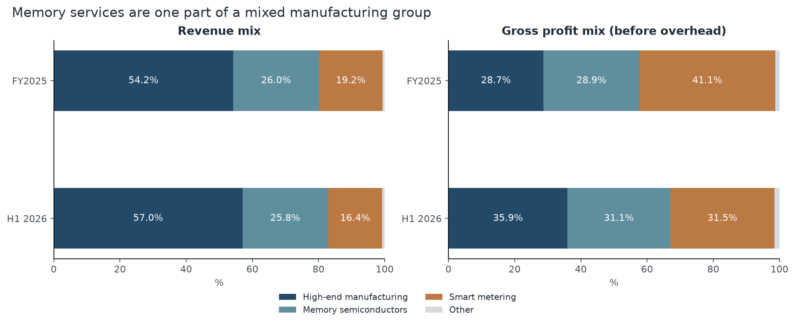
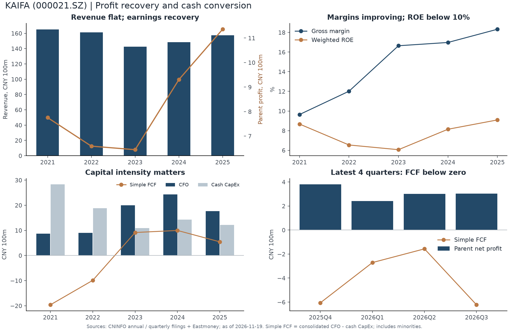

# 深科技（000021.SZ）研究报告

**研究日／数据截止日：2026-11-19（北京时间）**  
**证券身份：**深圳长城开发科技股份有限公司，Shenzhen Kaifa Technology Co., Ltd.，深交所主板；不是北交所控股子公司开发科技（920029）。  
**行情锚：**11 月 19 日收盘 26.06 元；腾讯收盘后快照时间 16:14:48，东方财富交叉核对；总股本 1,584,924,462 股，复算市值 413.0313 亿元。  
**估值快照：**TTM 归母 PE 33.65 倍、扣非 PE 34.41 倍、PB 3.01 倍、PS 2.38 倍；历史每股股息 0.22 元对应股息率 0.84%。  
**研究主线：**国产存储扩产提供真实订单，但普通股股东买到的是封测、电子制造与计量业务的合并现金流；满产和先进封装研发，尚未证明持续的高资本回报。

财务最新到 2026 年三季报（未审计），分部最新到半年报；公告核至 11 月 19 日。本文为学习研究，不构成投资建议，未假定读者的实际持仓、成本或风险预算。

---

## AI研究偏见自觉

**信息丰富度评级：A。**年报、季报、扩产公告与调研纪要充足；客户份额、服务单价、维持性资本支出和 HBM 商业化的可研究性只有 B 级。财报多，不能替代客户合同与现金回收的确定性。

**AI研究局限性声明：**不能访问客户订单、产线良率原始记录或银行账户安排；不把问答中投资者的前提当成公司确认，不把“可承载产能”当成已投产。本次没有足够证据确认长鑫采购份额、HBM 量产收入或英伟达认证。估值中的正常化利润、资本回报和概率是研究假设。

- [x] 检验确定性是否来自生意机制，而非资料数量。
- [x] 区分芯片涨价、封测服务量价与归母可分配现金。
- [x] 用现金、少数股东和资本开支挑战“国产存储核心受益者”的共识。
- [x] 若资料量减半，仍能保留“有工程门槛、无充分定价权”的判断；无法保留精确份额或 HBM 盈利预测。

## 第一步：核心数据总览

### 收入与毛利的来源

金额均为人民币亿元。分部数据已用巨潮原文与东方财富经营分析交叉核对；毛利不是分部净利润，尚未扣总部、研发、财务及税项。

| 业务 | 2025收入 | 2025收入占比 | 2025毛利率 | 2026H1收入 | H1收入同比 | H1毛利率 | H1毛利贡献占比 |
|---|---:|---:|---:|---:|---:|---:|---:|
| 高端制造 | 85.35 | 54.20% | 9.71% | 47.22 | +20.78% | 11.90% | 35.95% |
| 存储半导体 | 40.91 | 25.98% | 20.40% | 21.38 | +1.83% | 22.72% | 31.07% |
| 计量智能终端 | 30.21 | 19.18% | 39.26% | 13.57 | −19.18% | 36.25% | 31.48% |
| 其他 | 1.01 | 0.64% | 36.34% | 0.61 | +19.62% | 38.52% | 1.50% |
| **集团合计** | **157.47** | **100%** | **18.32%** | **82.78** | **+6.96%** | **18.88%** | **100%** |

来源：[2025年报第21—22页](https://static.cninfo.com.cn/finalpage/2026-04-29/1225227167.PDF)、[2026半年报第16页](https://static.cninfo.com.cn/finalpage/2026-08-26/1225504175.PDF)、[东方财富经营分析](https://emweb.eastmoney.com/PC_HSF10/BusinessAnalysis/Index?code=SZ000021&type=web)。百分比尾差来自四舍五入。



存储业务重要，但只贡献约四分之一收入。2025 年计量贡献约四成集团毛利，到了上半年，该业务收入和毛利率同时下降；高端制造增长和利润率改善抵消了部分压力。因此，仅根据 DRAM 或 HBM 行业景气推算全公司利润，很容易漏掉另一半生意。

### 五年财务趋势

| 年度 | 收入亿元 | 归母亿元 | 扣非归母亿元 | 毛利率 | 营业利润率 | 加权ROE | CFO亿元 | 现金CapEx亿元 | 简单FCF亿元 | 货币资金亿元 |
|---|---:|---:|---:|---:|---:|---:|---:|---:|---:|---:|
| 2021 | 164.88 | 7.75 | 3.08 | 9.64% | 6.19% | 8.67% | 8.68 | 28.30 | -19.63 | 85.45 |
| 2022 | 161.18 | 6.59 | 6.53 | 12.02% | 5.01% | 6.54% | 8.96 | 18.85 | -9.89 | 88.97 |
| 2023 | 142.65 | 6.45 | 6.73 | 16.65% | 6.78% | 6.06% | 20.02 | 10.87 | 9.16 | 77.23 |
| 2024 | 148.27 | 9.30 | 9.01 | 16.98% | 8.34% | 8.14% | 24.28 | 14.32 | 9.97 | 73.22 |
| 2025 | 157.47 | 11.36 | 9.68 | 18.32% | 10.88% | 9.09% | 17.65 | 12.20 | 5.44 | 68.28 |

来源为各年度巨潮年报与东方财富完整三表，原值和页码保存在[双源记录](研究核验-20261119/source-validation.json)。毛利率按收入和营业成本复算；“营业利润率”是法定营业利润／收入，含投资、金融资产及汇兑等影响，不能直接当制造经营利润率。

**简单 FCF＝合并经营现金流－购建固定资产、无形资产和其他长期资产支付现金。**包含扩产和少数股东现金，未进一步扣租赁本金、分红及并购，不是归母股东可自由取走的现金。

五年加权 ROE 的简单平均值为 7.70%。毛利改善是真实的，但收入没有呈现持续高速增长；2025 年归母利润增长 +22.07%，扣非仅增长 +7.48%。当年财务费用为 −4.18 亿元，盈利仍受套保与外汇因素影响。



### 最近四季：利润与现金分开看

以下为累计报表差分，金额亿元。公司未披露逐季度分部收入／毛利率，不能补造四季度分部数据。

| 期间 | 收入亿元 | 归母亿元 | 扣非归母亿元 | CFO亿元 | 现金CapEx亿元 | 简单FCF亿元 |
|---|---:|---:|---:|---:|---:|---:|
| 2025Q4 | 44.70 | 3.80 | 3.91 | -2.69 | 3.37 | -6.06 |
| 2026Q1 | 37.24 | 2.42 | 1.43 | 1.14 | 3.85 | -2.71 |
| 2026Q2 | 45.55 | 3.01 | 3.62 | 0.04 | 1.61 | -1.57 |
| 2026Q3 | 46.23 | 3.04 | 3.05 | -4.07 | 2.15 | -6.23 |
| **TTM至2026Q3** | **173.71** | **12.27** | **12.00** | **−5.58** | **10.98** | **−16.56** |

2026 前三季收入 129.02 亿元、归母 8.48 亿元、扣非 8.09 亿元，同比分别 +14.40%、+12.15%、+40.32%。Q3 单季收入 +30.66%，归母仅 +0.06%，扣非 +17.65%；增长没有同比例落到每股回报。滚动四季度 FCF 都为负，不能仅用季节性解释。

### 账面现金不是可分配净现金

| 2026年9月底项目 | 亿元 | 解释 |
|---|---:|---|
| 货币资金 | 139.25 | 含不符合现金等价物定义的存款，不能全部视为随时可用 |
| 现金及现金等价物 | 61.75 | 是更严格的流动性口径，仍可能含用途受约束的募集资金 |
| 交易性金融资产 | 1.05 | 单列计入广义金融资金 |
| 短借＋长期借款＋一年内到期非流动负债＋租赁 | 108.38 | 一年内到期项整体纳入，属于审慎口径 |
| 货币资金＋交易资产－上述债务 | +31.93 | 集团广义净金融资金，不能全额加给归母股东 |
| 现金等价物＋交易资产－上述债务 | −45.57 | 严格流动性对照，不等于立即需要清偿全部债务 |
| 应付票据 | 38.13 | 另列信用证等经营融资；并非全部应直接认作银行借款 |
| 广义净金融资金再减全部应付票据 | −6.20 | 更保守融资压力口径，不与上行口径混用 |
| 归母净资产／少数股东权益 | 137.18／32.86 | 多家重要子公司并非百分百持有 |
| 应收账款／存货 | 50.29／43.14 | 存货较年初增长 +77.64% |

[三季报原文](https://static.cninfo.com.cn/finalpage/2026-10-30/1225640380.PDF)解释，备货增加是应重要客户要求并应对元器件供应紧张，预付款用于锁价；这是合理的经营解释，仍须用后续回款检验。上半年披露的未质押且意图持有到期定存及利息约 53.63 亿元，说明“货币资金与现金等价物的差额”不能全称为受限资金，也不能忽略期限差异。[半年报现金附注](https://static.cninfo.com.cn/finalpage/2026-08-26/1225504175.PDF)

**历史口径订正：**2025年报少数股东附注列合肥沛顿净利润4,766,770.65元，即476.68万元、约0.04767亿元；旧7月报告写“约0.48亿元”，放大约一个数量级。本次以年报附注为准，单列为原始披露值，未取得第三方子公司口径独立复核，不作为集团估值起点。深圳沛顿单体报表、合肥沛顿报表与集团存储分部也不能重复加总。

> 段永平式追问：销售增长的钱，最后留在股东口袋，还是留在库存、设备和银行存贷循环里？

---

## 第二步：生意本质分析

**一句话：客户为可验证的良率、可靠交付和跨地区制造能力付加工与产品费用；深科技先投入设备、工程师和营运资金，再争取长期重复订单。**

| 环节 | 谁付钱、为什么 | 收入如何重复 | 真正制约回报的变量 |
|---|---|---|---|
| 存储封测 | 存储芯片客户购买后道封装、测试与模组加工 | 认证后随产品放量重复下单 | 单位加工费、产品组合、稼动率、折旧、测试效率 |
| 高端制造 | 医疗、汽车、消费电子等客户购买制造及供应链交付 | 同一平台持续生产、升级和新项目导入 | 订单迁移、材料成本、议价、付款账期 |
| 计量智能终端 | 公用事业客户及渠道购买电水气表、系统与方案 | 安装替换、项目扩容和能源数字化 | 招标节奏、地区需求、认证、外汇及回款 |

这是一门以硬件与工程交付为主的业务，复购来自持续合格供货，缺少订阅式锁定。存储芯片售价上涨可以改善客户扩产意愿和封测利用率，却不会按比例传到封测单价；10 月调研明确，定价取决于供需、客户协议和合作模式。[官方纪要](https://static.cninfo.com.cn/finalpage/2026-10-16/1225607922.PDF)

规模扩大时，固定折旧和工程成本摊薄，利润弹性可能高于收入；一旦周期反转，设备不会自动变回现金。2021—2022 年扩产阶段的负 FCF，与其后两年转正，已经展示了这种经营杠杆。2026 新一轮资金占用仍需跨周期观察。

> 段永平式追问：这门生意好在哪？答案是可靠交付和认证积累；还需要证明，这些优势能转成超额资本回报。

---

## 第三步：护城河评估

| 来源 | 评估 | 证据 | 可证伪条件 |
|---|---|---|---|
| 品牌／定价权 | 弱至中 | 工程信誉有价值，报价仍受客户与供需制约 | 满产但加工费、毛利及回款持续恶化 |
| 转换成本 | 中 | 良率验证、测试程序、认证和稳定交付增加切换摩擦 | 客户迁单、内制或第二供应商快速接替 |
| 网络效应 | 弱 | 客户更多可积累经验，产品价值不随用户数直接增强 | 不能据客户数增长推导平台垄断 |
| 规模效应 | 中 | 深圳／合肥双基地、工程和采购摊薄 | 同业扩产、低稼动率使成本优势消失 |
| 技术／专利 | 中、分产品判断 | 多层堆叠、测试软硬件及客户认证是实际能力 | 新工艺验证停滞、研发支出长期不转量产 |

2025 研发投入 4.60 亿元，占收入 2.92%，全部费用化；这支持持续工程能力，不能证明技术领先若干年。公司披露的 NAND 堆叠、GDDR 倒装与 HBM 是不同工艺和产品问题，不能互换名词。[年报研发披露](https://static.cninfo.com.cn/finalpage/2026-04-29/1225227167.PDF)

过去五年毛利改善，证明产品组合和运营能力增强；ROE 仍未建立明显的高回报区间。未来五年，转换成本可能随国产存储客户规模扩大而增强，定价权也可能被大客户内制或多供应商策略抵消。年报已披露，硬盘磁头销量受客户产能布局转移影响；迁移风险有现实案例。

> 巴菲特式追问：十年后工程门槛可能仍在，但客户是否仍让加工商赚取足够回报？护城河必须保护利润，而不只是保护订单。

---

## 第四步：逆向思考与风险清单

**最强看空论点：市场愿意为 HBM 与国产替代付成长溢价，股东却先承担低资本回报制造业务的营运资金、设备和融资需求。**不需要公司失败，估值回归和稀释也可能造成差回报。

下表概率为定性判断，无统计频率，不与估值情景权重相加。

| 失败路径 | 可能性 | 影响 | 可观察信号 |
|---|---|---|---|
| 元器件备货未顺利消化 | 中高 | 现金被占、减值和融资增加 | 库存／应收持续快于收入，滚动 CFO 不恢复 |
| 2027—2028扩产撞上周期回落 | 中 | 折旧和利息压利润，回收期拉长 | 客户利用率下行、新线投产后回报低于预算 |
| HBM研发商业化慢于市场预期 | 中高 | 估值溢价回落、研发持续消耗 | 无客户认证、无量产收入、预算追加 |
| 大客户内制或分散采购 | 中 | 订单和加工费受压 | 份额下降、降价或产线闲置 |
| 计量业务恢复不足 | 中 | 高毛利支柱减弱 | 收入与毛利率未止跌、海外项目延迟 |
| 汇率及衍生品错配 | 中 | 单期利润波动，扣非也未必完全剔除 | 财务费用与公允价值变动持续大幅背离 |
| 设备断供或重大合规限制 | 低频、无法可靠量化 | 工艺升级和扩产可能受阻 | 正式许可限制、供应商停止交付 |
| 期限错配引发流动性紧张 | 尾部、未量化 | 需要融资、资产处置或稀释 | 短贷续作受限、存款难支取、现金用途收紧 |

**最强看多论点也成立：**合肥基地满产、存储毛利改善、客户认证积累和国产产能扩大，都可能形成持续放量。若存储增速和归母现金回报同步提高，当前现金压力可能是增长前置投入，而非永久损失。

历史类比不必寻找股价走势图：本公司上轮扩产后的现金恢复，说明前置投入可能兑现；年报记录的客户迁移又说明长期关系并非永固。跨学科看，这是固定成本经营杠杆与大客户议价的组合，并非典型网络效应。

**最可能的分析错误：**高估研发到量产的速度，或把满产当成可以提价；反方向也可能因短期备货而低估后续现金回流。因此以两个后续正式披露的现金与周转变化验证，不用一个季度下定论。

> 芒格式追问：聪明人为什么不买？他可以相信国产存储增长，同时不愿为尚未兑现的每股现金增长预付高价。

---

## 第五步：管理层评估

最新董事长为**周庚申**，2026 年 9 月 9 日接替退休的韩宗远；总裁仍为郑国荣。周具有精密仪器、工程与制造管理背景，兼任沛顿相关职务；郑长期参与经营，团队连续性强。不能继续沿用年报中的旧董事长作为现任。[换任公告](https://vip.stock.finance.sina.com.cn/corp/view/vCB_AllBulletinDetail.php?id=12593015&stockid=000021)、[11月股东会](https://static.cninfo.com.cn/finalpage/2026-11-13/1225669264.PDF)

| 时间 | 决策 | 已知结果与资本配置评价 |
|---|---|---|
| 2025年 | 计量子公司开发科技上市 | 持股由69.72%降至50.40%，融资能力增强，但少数股东分走更多权益；评价中性偏正 |
| 2025年11月 | 深圳／合肥扩产合计7.4亿元 | 为后续扩产基础；须区分批准额与实际已支付额 |
| 2026年5月 | 再批准14.7亿元封测扩产 | 贴合客户需求，但税前回收约8.6—8.8年；贷款比例较高，回报尚待验证 |
| 2026年6月 | 实施2025年度每股0.22元分红 | 已实际执行，股息率较低；不能写成零分红或仅为预案 |
| 2026年9月 | 18.5亿元厂房与先进封装研发项目 | 长期能力布局；厂房税前回收12.01年，研发线不直接产生经济效益，需审慎跟踪 |
| 2026年11月 | 股东会批准挂牌出售昂纳全部17.034%权益 | 资本回收方向可理解；尚未核实成交与到账，不把预计处置收益计入正常化利润 |

扩产来源：[5月公告](https://static.cninfo.com.cn/finalpage/2026-05-27/1225331325.PDF)、[9月公告](https://static.cninfo.com.cn/finalpage/2026-09-10/1225555678.PDF)。三轮批准总额合计 40.6 亿元，存在不同建设期，**不是未来一年现金开支，也不是所有项目都已支付**。5 月深圳计划 2027 年 6 月、合肥计划 2027 年 12 月建成；9 月新项目计划 2028 年 12 月建成。

周庚申披露持有 20,000 股，以当前股本计算约 0.00126%；郑国荣年报披露 167,083 股，约 0.01054%。[董事会公告](https://vip.stock.finance.sina.com.cn/corp/view/vCB_AllBulletinDetail.php?id=12593015&stockid=000021)与[搜狐高管持股](https://q.stock.sohu.com/cn/000021/glc.shtml)交叉支持。持股分子的披露时点不同于当前股本，不代表核实了每人的实时证券账户。没有 AB 股安排，不能把央企控股比例当成高管个人经济权益。

分红来源：[实施公告](https://static.cninfo.com.cn/finalpage/2026-06-05/1225351143.PDF)、[东方财富分红](https://emweb.eastmoney.com/PC_HSF10/BonusFinancing/Index?code=SZ000021&type=web)。昂纳进展来源：[挂牌公告](https://static.cninfo.com.cn/finalpage/2026-10-27/1225625960.PDF)、[已获股东会批准](https://static.cninfo.com.cn/finalpage/2026-11-13/1225669264.PDF)。

**资本配置评分：中等、待现金验证。**央企背景和长期团队支持经营连续性；低个人持股意味着主要依赖治理和考核约束。尚无充分证据证明新增产能能持续赚取高于资本成本的回报，不能因扩产规模大直接给高分。

> 段永平式追问：总裁退休后，公司大概率还能运转；更需要追问，继任团队是否会约束低回报扩产，而不仅是把工程建成。

---

## 第六步：行业与文明趋势

AI、数字基础设施和能源计量数字化是长期需求来源。WSTS 的 Q2 更新显示全球存储销售额高速增长，但芯片销售包含产品价格、位数需求与工艺结构变化；深科技赚取的是可承接环节的服务与制造利润。[WSTS官方更新](https://www.wsts.org/76/Global-Semiconductor-Market-records-exceptional-growth-in-Q2-2026)

可服务市场应按“相关芯片出货量 × 委外比例 × 公司可承接工艺／份额 × 服务单价”拆解。公开资料缺少后三项，**不给精确封测 TAM 或公司份额预测**。这比把全球存储销售额直接乘一个份额更诚实。WSTS 秋季预测预定 12 月 1 日发布，本报告不引用未来预测。[发布日程](https://www.wsts.org/61/Forecasts)

### HBM边界与建设阶段

| 披露内容 | 可以支持 | 不能推出 |
|---|---|---|
| 7月公告：HBM仍处研发阶段、预计短期不产生收入利润 | 技术方向存在、商业化尚待证据 | 已量产、已获特定大客户认证或已锁定收入 |
| 9月12.2亿元新厂房 | 测算可承载传统封测9万片／月、2.5D 1万片／月 | 已装齐生产设备、已获订单或现有量产产能 |
| 另6.3亿元2.5D／3DS研发线 | 计划建成后各100片／月，工艺验证用途 | 直接产生商业利润或等于1万片／月量产线 |
| 10月纪要：合肥封测满产 | 现有客户需求和利用率较好 | 所有新产能都有保底需求、封测费同步芯片涨价 |

来源：[7月异动公告](https://static.cninfo.com.cn/finalpage/2026-07-01/1225400742.PDF)、[9月项目公告](https://static.cninfo.com.cn/finalpage/2026-09-10/1225555678.PDF)、[10月正式纪要](https://static.cninfo.com.cn/finalpage/2026-10-16/1225607922.PDF)。在本次找到的正式资料中，没有足够证据推翻“HBM尚未商业化兑现”的边界。

存储原厂也在投入先进封装。Micron FY2026 年报披露其新加坡 HBM 封装扩容计划及后续产品研发，意味着这是持续投入和快速迭代的竞争，不是等待国内代工商领取的固定利润池。[Micron 10-K](https://www.sec.gov/Archives/edgar/data/723125/000072312526000023/mu-20260903.htm)

2025 年前五客户占收入 57.25%，第一客户 20.44%，均匿名；客户集中体现重复关系，也放大议价和迁单风险。供应端还需跟踪先进设备、材料及关键元器件可得性，本次没有独立确认全部供应商替代能力。[年报客户披露](https://static.cninfo.com.cn/finalpage/2026-04-29/1225227167.PDF)

> 李录式追问：二十年后，数字化需求大概率更多；它是否让这家公司每股自由现金流更高，才决定它是不是好的长期资产。

---

## 第七步：估值与安全边际

### 先统一估值口径

| 指标 | 复算结果 | 口径 |
|---|---:|---|
| 总股本 | 15.84924462亿股 | 腾讯、东方财富当前股数一致 |
| 市值 | 413.0313亿元 | 26.06元 × 当前总股本 |
| TTM归母／扣非归母 | 12.2750／12.0033亿元 | 2025全年＋2026前三季−2025前三季 |
| TTM EPS | 0.77448元 | TTM归母／当前股数，不累加不同加权股本EPS |
| TTM归母PE／扣非PE | 33.65／34.41倍 | 使用当前市值 |
| 静态PE／前三季年化PE | 36.37／36.55倍 | 分母分别为2025归母及前三季归母年化 |
| PB／PS | 3.01／2.38倍 | Q3归母净资产、TTM收入；PB用当前股数摊薄 |
| 简单FCF收益率 | −4.01% | 合并TTM简单FCF／市值，非归母可分配收益率 |
| EV／Revenue | 约2.19倍 | 最简EV＝市值＋有息债−货币资金−交易资产；未作NCI／联营资产调整，仅作对照 |
| PEG | 不用作决策 | 正常化增长是假设，且周期和套保使单一增速失真 |

来源：[腾讯行情](https://qt.gtimg.cn/q=sz000021)、[东方财富行情](https://quote.eastmoney.com/sz000021.html)、[官方Q3报表](https://static.cninfo.com.cn/finalpage/2026-10-30/1225640380.PDF)。Q3 官方股本为 1,584,882,362 股，较当前少 42,100 股；最新股本用于估值，不能拿市值反推股本再声称独立验算。小额差异与期后自主行权口径相符，但本次未取得覆盖这 42,100 股的逐笔登记证明。

数据工具将腾讯本次字段标作“PE(动)”，实算该字段与 TTM 的 33.65 倍吻合；本报告以报表重建口径，年化 PE 另列。工具打印的 EPS／期末净资产简比 ROE 也不等于官方加权 ROE，未混用。

### 同业与历史比较

| 公司 | 11月19日收盘元 | 市值亿元 | TTM归母PE | PB | 2025毛利率 | 2025加权ROE |
|---|---:|---:|---:|---:|---:|---:|
| 深科技 | 26.06 | 413.03 | 33.65x | 3.01x | 18.32% | 9.09% |
| 长电科技 | 55.47 | 992.59 | 44.53x | 3.36x | 14.15% | 5.56% |
| 通富微电 | 44.08 | 702.55 | 20.55x | 3.15x | 14.59% | 8.08% |
| 华天科技 | 14.73 | 528.07 | 41.63x | 2.44x | 13.26% | 4.14% |

行情时间 16:14:30—16:14:48；TTM 利润均按三期报表桥接验算。[腾讯四股行情](https://qt.gtimg.cn/q=sz000021,sh600584,sz002156,sz002185)、[东方财富财务入口](https://emweb.eastmoney.com/PC_HSF10/FinanceAnalysis/Index?code=SZ000021&type=web)。通富 2026 前三季有 16.83 亿元非经常性净损益，表观低 PE 不能直接理解为核心盈利便宜；华天归母与扣非也有较大差异。[通富三季报](https://static.cninfo.com.cn/finalpage/2026-10-30/1225640437.PDF)

深科技同时有 EMS 和计量业务，毛利、估值不是纯 OSAT 的同质比较；同行今天的价格也不能证明内在价值。7 月旧研究的估值快照约 48 倍附近，当前倍数已下降，但旧材料中存在静态／TTM／年化标签混用，未重建完整前复权历史 PE 序列，**不报告历史分位**。

### 三年三情景：回答贵不贵

正常化归母利润暂取 **11 亿元**，对应当前股数 EPS 0.69404 元；低于 TTM 归母 12.275 亿元和扣非 12.003 亿元，是考虑汇兑／套保波动、计量业务与少数股东结构后的判断，**不是公司指引，也不是额外声称已发生一笔减值**。

乐观增长 +25% 需扩产、产品组合与现金回报共同兑现；基准 +12% 允许国产产能拉动，但不提前计 HBM 量产；悲观 −5% 表示周期与客户压力。三年退出 PE 的 16／24／30 倍反映制造周期、技术进展与盈利质量，均为情景判断，不能当十年终值倍数来源。

| 情景 | 盈利年增速 | 三年退出PE | 第三年EPS元 | 三年后股价元 | 假设每年股息元 | 按8%折算今日含息值元 | 现价出发含息年化近似 |
|---|---:|---:|---:|---:|---:|---:|---:|
| 悲观 | -5% | 16x | 0.595 | **9.52** | 0.00 | **7.56** | -28.51% |
| 基准 | +12% | 24x | 0.975 | **23.40** | 0.22 | **19.14** | -2.62% |
| 乐观 | +25% | 30x | 1.356 | **40.67** | 0.22 | **32.85** | +16.61% |

三年后股价与今日内在价值必须区分。含息现值将每年假设股息逐年折现；基准／乐观延续 0.22 元、悲观为零，均非承诺；年化列用三年累计股息与退出价近似，未模拟再投资。

### 现金流对照与反向DCF

由于维持性／成长性资本开支、净营运资金和子公司资金归属未完整拆分，不能把今天的负 FCF 直接永续，也不能假装已精确算出归母 Owner Earnings。以下使用**中周期归母可分配现金假设**；它已扣必要再投资，不另加折旧，也不以新增借款制造股东现金。

| 假设组 | 初始正常化归母现金亿元 | 十年现金年增速 | 折现率 | 永续增长 | 今日每股值元 |
|---|---:|---:|---:|---:|---:|
| 谨慎 | 6.0 | +8% | 8% | 1.5% | 9.70 |
| 基准 | 7.5 | +10% | 8% | 1.5% | **14.12** |
| 改善 | 9.0 | +12% | 8% | 1.5% | 19.73 |

上述初始现金约为正常化利润的不同转化情景；2025 合并简单 FCF／归母仅 47.93%，且尚含少数股东，基准 7.5 亿元已经需要现金转化改善。假设从下一年开始即实现中周期现金，未单列建设期更大的现金缺口，可能偏乐观；也未把未成交昂纳出售收益、物业出售或集团广义净现金加回。故表格是验证假设的尺度，不是已经证实的精确现金价值。

反推当前 26.06 元：以正常化现金 7.5 亿元、r＝8%、终值 g＝1.5%、不加超额净现金计算，未来十年现金需要约 **+18.10%年增长**。这显著高于本报告 +10% 基准，且起点本身尚未实现。当前价格已经要求持续改善，而非只要求维持现状。

### 十年折现：只作仓位压力测试

**币种为人民币，r＝8%。**采用长期模型无风险锚 2%＋β 1.0×ERP 6%；这是规范化资本成本假设，不冒充当日实测国债利率或回归估计 β。人民币合理区间 6%—9%，基准永续 g 上限 2%。离散风险放在情景或未建模清单，不提高 β 或 r 代替。

**稳态增量 ROIC＝6%。**东方财富标准公式下 2025 存量 ROIC 约 6.38%，受到存贷与金融收益口径影响，不能当精确工厂回报；2025 实际现金分红／归母约 30.50%，用基准永续 g 1.5% 除以留存率反解约 2.16%，只是保守下界。6% 位于两者之间，考虑厂房和成熟封测的再投资需求；不是将 ROE 9.09%当 ROIC。终值后回报弱于 r，增长会占用现金，因此更高 g 并不必然抬高 PE。

永续 g 分悲观 0%、基准 1.5%、乐观 2%，对应成熟后的长期名义增长；与未来十年利润增速分开判断，敏感性中保持不动。十年利润从 11 亿元分别按 −3%／+10%／+18%推演。其间的扩产效率和资金可得性仍是强假设；终值稳态 ROIC 不等于扩张阶段的新增回报。

终值 PE 唯一使用 `(1−g/ROIC)/(r−g)`。基准为 `(1−1.5%/6%)/(8%−1.5%)＝0.75/0.065＝11.54倍`。k＝股息率减稀释率暂取零，表示不预设额外净分配回报；历史股息与期权增股并存，此项仍需后验验证。

| 情景 | 判断权重 | 十年利润年增速 | 2036归母亿元 | 永续g | r−g | 公式退出PE | 十年年回报近似 |
|---|---:|---:|---:|---:|---:|---:|---:|
| 悲观 | 30% | -3% | 8.11 | 0.0% | 8.0pp | 12.50x | -13.10% |
| 基准 | 50% | +10% | 28.53 | 1.5% | 6.5pp | 11.54x | -2.24% |
| 乐观 | 20% | +18% | 57.57 | 2.0% | 6.0pp | 11.11x | +4.47% |

三档概率加权年回报近似为 **−4.16%**，不覆盖 8% 资本成本。权重 30%／50%／20% 是主观压力分布，非客观发生概率；对 IRR 求加权平均也不是实际组合回报或财富期望 CAGR。k 为零时单档回报是终值价值比的十次方根；加入实际分红／稀释后需要重估。

| 敏感性r | 期望年回报近似 | 相对资本成本 | 是否通过压力测试 | 有效性 |
|---|---:|---|---|---|
| 6% | −0.70% | 低于r | 未通过 | 币种区间内；基准／乐观分母仅4.5／4.0pp，只作情景参考 |
| 7% | −2.60% | 低于r | 未通过 | 区间内，分母均至少5pp |
| 8% | −4.16% | 低于r | 未通过 | 基准，分母8／6.5／6pp |
| 9% | −5.48% | 低于r | 未通过 | 区间内，分母均至少5pp |
| 10% | −6.62% | 低于r | 未通过 | **区间外，仅供参考** |

已执行 r±2pp，并额外用 ±1pp 覆核 7%—9%。**在人民币合理区间、且分母合格的档位内，压力测试结论不随折现率翻转。**不能用区间外档位证明买入，也不能用十年未通过单独否决公司。

### 估值分歧对账

三年基准今日值 19.14 元与现金基准 14.12 元有明显差距，来自正常化会计盈利的资本化，与股东真正可取走现金的区别；十年模型再叠加成熟资本回报与终值倍数收敛。**三年模型用于定价，十年模型用于控制仓位，二者职责不同。**

旧研究关注国产存储份额、相对同业估值和 24—28 元观察带。本次仍认可客户认证和满产的正面事实，但已核到滚动现金为负、长期扩产与 HBM 研发边界；旧观察带的财务前提不足。本次价带调整来自现金与定价证据重建，不是由十年负回报一票否决，也没有将旧材料中未重新核实的客户份额沿用为确定事实。

当前观望由中等生意质量、有限定价权、资本配置尚待回报验证、现金及周期风险、趋势受益但价值捕获有限、价格缺安全边际六项共同得出。若未来低价且现金条件满足，可以研究小额买入；十年压力要求其仍为小仓，不升级核心仓。现金 DCF 基准与三年值都依赖尚待实现的正常化，不能把估值区间当承诺。

> 巴菲特式追问：r 错两个百分点会改变重仓判断吗？本次不会，7%—9%均未覆盖资本成本；主要问题是现金回报假设与付出的价格。  
> 段永平式追问：如果股市关闭五年，26.06元买入后只能等现金分配，现有证据还不足以让我把它当核心持仓。

---

## 第八步：最终决策与行动清单

| 维度 | 结论 | 信心度 |
|---|---|---|
| 生意质量 | 有认证、交付与复购，重资产和营运资金需求明显 | 中高 |
| 护城河 | 工程与转换成本中等，缺少充分定价权和网络效应 | 中 |
| 管理层 | 经营连续性较强，扩产与资产处置需要现金回报验证 | 中 |
| 最大风险 | 现金占用、周期与扩产错配，以及研发叙事提前定价 | 中高 |
| 文明趋势 | 国产存储和数字化顺风明确，公司利润捕获并不等于产业增速 | 中 |
| 估值 | 三年基准今日19.14元／现金基准14.12元低于现价；十年压力未过、合理r内不翻转，仅约束仓位 | 中低，依赖假设 |

**综合结论：观望，26.06元不新增长期价值仓；已有合理小仓可持有复检，暂停加仓。**估值维度不是唯一裁决，十年模型只收紧仓位。没有充分依据把它定为核心复利资产，也没有证据断言公司基本面已永久破坏。

| 策略 | 明确动作 |
|---|---|
| 空仓者 | 当前等待。**10—12元**进入条件式研究带；价格到达后仍须通过下述现金和经营检查，才考虑首笔约0.25%—0.5%，参考总仓不高于1% |
| 持仓者 | 未知实际成本；合理小仓持有复检，不补仓摊低成本；若已超上述风险预算，先评估降低集中度，而非等待回本 |
| 加仓信号 | 价位进入研究带，并且后续连续两次正式披露的滚动CFO覆盖全部现金CapEx、可推导单季CFO均为正；库存／应收增速回到收入附近，存储毛利维持约20%以上，净债与定存期限可解释，新产能客户消化／资金安排可核 |
| 卖出／降仓信号 | 客户流失、回款或库存出现结构性损失、扩产融资危及流动性、重大治理问题；或**≥32元**且现金与盈利模型未增强，复核估值与超配，非自动清仓 |
| 跌破10元 | 先核查永久损失、融资和客户变化，撤销“越跌越便宜”的默认前提 |

32元警戒线接近三年乐观含息现值32.85元，含义是模型未增强时复核持仓；不表示低于32元便宜。

10—12 元相对现金基准 14.12 元留出约 15%—29%折价，相对三年含息基准 19.14 元折价约 37%—48%；现金恢复条件没有满足之前，这只是监控阈值。若公司在更高股价先证实更强现金创造，应重建模型，不机械等待旧数字。

### 复检安排

| 日期／节点 | 核查任务 | 日期性质 |
|---|---|---|
| 2026-12-13 | 第十届董事会任期届满／换届公告与经营连续性复核 | 已披露任期止日，不是确认的股东会日期或必然更换管理层 |
| 2026-12-31 | 备货、融资／定存期限、昂纳挂牌与成交到账、管理层换届公告 | 人工研究复检日，非公司财报日 |
| 2027-04-30前 | 2026年报及2027Q1实际披露后核现金、库存、分部和资本开支 | 研究披露窗口，非已确认预约日；提前披露即提前复检 |
| 2027-06-30 | 深圳封测扩产计划进度、客户消化与预算回报 | 依据计划建设期设的检查日，不保证投产 |
| 2027-12-31 | 合肥扩产计划、负债／折旧及稼动率 | 同上 |
| 2028-12-31 | 新厂房与2.5D／3DS研发线进展、真实商业化证据 | 同上；不预设HBM销售额 |

以上价位与节点登记到既有 target“深科技”，沿用 `sz000021`。旧 Q3 检查留档并标已完成，旧台账建议由本报告接续；不把触及旧价带当成投资成功。

### 四种方法论的点评

以下是已阅读原文后的分析延伸，**不是四位本人对深科技的评价或荐股**。

- **巴菲特：**短引“Price is what you pay; value is what you get.”——[2008股东信第5页，转述格雷厄姆](https://www.berkshirehathaway.com/letters/2008ltr.pdf)。本报告的延伸：同业倍数更高、股价已经回落，都不替代现金价值与价格的比较。
- **芒格：**短引“He wanted decisions that maximized long-term results”——[本人2014年度评论第40页](https://www.berkshirehathaway.com/letters/2014ltr.pdf)。本报告的延伸：资本配置要等完整周期回报验证，不能只按建成多少厂房评分。
- **段永平：**“未来现金流折现不是公式，是思维方式。”——[2011-09-07雪球原帖](https://xueqiu.com/1247347556/20386904)，已读[仓库原发言存档第79条](../段永平/段永平雪球全量原发言.md)。本报告的延伸：存款、借款、少数权益与再投资拆不清，就降低估值与仓位的自信。
- **李录：**“留出充足的安全边际”——已读[2024北大演讲存档“安全边际”节](../李录/李录-北大演讲-20241207.md)，原始来源索引含[喜马拉雅资本官方英文稿](https://cdn.prod.website-files.com/5ef3c7300432b40ed865991a/67a4f75703627bd3a927077e_Global%20Value%20Investing%20in%20Our%20Era%20(2024-12-07).pdf)。本报告的延伸：产业顺风值得研究，仍需给客户、周期与判断误差留余地。

> 四种方法论的共同追问：即使国产存储发展完全正确，今天付出的价格，是否仍可能让股东赚不到钱？

---

## AI分析置信度与投资确定性

**AI分析置信度：财务历史较高，商业回报判断中等，估值与HBM预测较低。**年度关键财务和主要季度数字经过巨潮与东方财富两路取数，市值另以独立股数验算；计算可复现，不表示未来会按模型发生。

**实际投资确定性：中低。**主要约束是客户匿名、定价／份额不可见、存贷与少数股东结构、建设期投入和周期；这些不会因为报告更长而消失。基于充分资料的结论是分部结构、历史盈利、负滚动现金和官方研发边界；基于有限信息推理的是正常化归母利润、Owner Earnings、扩产增量ROIC、情景概率与所有价格阈值。

需要补充一手验证：客户对新增产能的采购承诺与账期；满产如何传导加工费；维持性CapEx；合肥／深圳封测的单独归母现金回报；定存与债务期限／币种匹配；计量业务订单恢复；HBM认证与量产收入。最好由客户、供应链、银行安排和现场产线证据交叉验证。

未数值建模的离散风险：**地缘设备断供、极端流动性断裂**。已在终值 audit 中标为未建模，不能把三情景当穷尽；没有因无法可靠给概率而把它们偷塞进 r。

## 数据来源与审计记录

- 身份、业务与管理层：巨潮／深交所公告为准，官方调研只支持其明确表述；第三方网页用于交叉，不视为额外客户证明。
- 财务主源：[东方财富财务分析](https://emweb.eastmoney.com/PC_HSF10/FinanceAnalysis/Index?code=SZ000021&type=web)；原始源：[2021年报](https://static.cninfo.com.cn/finalpage/2022-04-21/1213001411.PDF)、[2022年报](https://static.cninfo.com.cn/finalpage/2023-04-21/1216497188.PDF)、[2023年报](https://static.cninfo.com.cn/finalpage/2024-04-11/1219568873.PDF)、[2024年报](https://static.cninfo.com.cn/finalpage/2025-04-25/1223270327.PDF)、[2025年报](https://static.cninfo.com.cn/finalpage/2026-04-29/1225227167.PDF)、[2026H1](https://static.cninfo.com.cn/finalpage/2026-08-26/1225504175.PDF)、[2026Q3](https://static.cninfo.com.cn/finalpage/2026-10-30/1225640380.PDF)。
- 年度原始值95项、季度关键值15项已运行 cross-validate，容差1%，均无差异；分部收入8项另行验证。[完整交叉输出](研究核验-20261119/financial-cross-validation.txt)、[分部及补充运算](研究核验-20261119/supplemental-validation.txt)。同源财报经第三方加工不代表独立审计，这是两路取数核对。
- [全部计算、三情景和终值工具原始输出](研究核验-20261119/financial-rigor-and-terminal.txt)，[估值结果](研究核验-20261119/calculations.json)，[十年输入](研究核验-20261119/terminal-inputs.json)。工具 calc 部分先用浮点求值，金额与模型另以 Decimal 复核，报告按披露精度舍入，未将尾数当经济差异。
- 报告随机抽检与最终估值 audit 结果见[准出记录](研究核验-20261119/审计说明.md)。无完整PDF、公告全文、模型提示或秘密写入版本库。

### 附录：关键数据交叉验证记录（工具输出摘录）

```text
市值验证（CNY）
股价 26.06 × 总股本 1,584,924,462 = 41,303,131,479.72
报告市值 41,303,131,479.72；偏差 0.00%，验证通过。

cross-validate，tolerance=1%
2025收入：东方财富 15,747,393,092.50；巨潮 15,747,393,092.50；一致。
2025归母：东方财富 1,135,679,007.05；巨潮 1,135,679,007.05；一致。
2025货币资金：东方财富 6,828,043,306.01；巨潮 6,828,043,306.01；一致。
2026Q3货币资金：两路 13,925,410,800.43；一致。
当前股本：腾讯 1,584,924,462；东方财富 1,584,924,462；一致。

verify-valuation
PE(TTM) 33.65x；PB 3.01x；PS 2.38x；简单FCF Yield -4.01%；股息率0.84%。
工具ROE简比为8.95%，不是官方加权ROE，未用于经营评分。

terminal audit：CNY、r8%、ROIC6%、g0%/1.5%/2%；C1/C2/C3准出。
未建模：地缘设备断供、极端流动性断裂，已披露限制。
flip：r7%/8%/9%期望IRR -2.60%/-4.16%/-5.48%，区间内不翻转。
```

以下为工具直接输出，金额单位B表示十亿人民币；完整精确元值见上文及核验文件。

```text
============================================================
市值验算 (Market Cap Verification)
============================================================
  股价 (Price):       26.06 CNY
  总股本 (Shares):    1.58B
  计算市值:           41.30B CNY
  报告市值:           41.30B CNY
  偏差:               0.00%

  ✅ 验证通过, 偏差仅 0.00%

============================================================
交叉验证: 2025收入 (Cross-Validation)
============================================================
  数据来源数: 2
  参考中位数: 15.75B 元

  ✅ 东方财富                : 15.75B 元  (偏差 0.00%)
  ✅ 巨潮年报                : 15.75B 元  (偏差 0.00%)

  ✅ 所有来源偏差 ≤ 1.0%, 数据一致

  共识值 (加权中位数): 15.75B 元

============================================================
交叉验证: 2025归母净利 (Cross-Validation)
============================================================
  数据来源数: 2
  参考中位数: 1.14B 元

  ✅ 东方财富                : 1.14B 元  (偏差 0.00%)
  ✅ 巨潮年报                : 1.14B 元  (偏差 0.00%)

  ✅ 所有来源偏差 ≤ 1.0%, 数据一致

  共识值 (加权中位数): 1.14B 元

============================================================
交叉验证: 2025货币资金 (Cross-Validation)
============================================================
  数据来源数: 2
  参考中位数: 6.83B 元

  ✅ 东方财富                : 6.83B 元  (偏差 0.00%)
  ✅ 巨潮年报                : 6.83B 元  (偏差 0.00%)

  ✅ 所有来源偏差 ≤ 1.0%, 数据一致

  共识值 (加权中位数): 6.83B 元
```
