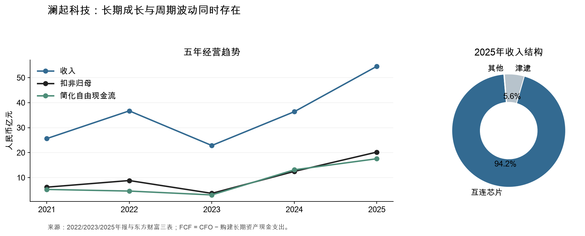

# 澜起科技（688008.SH / 06809.HK）研究报告

> **数据截止日：2026-11-19，Asia/Shanghai。** 财务更新至2026Q3正式报告（未经审计）；市场估值统一采用2026-11-18完整收盘：A股137.79元、H股157.10港元，避免当日网页缓存与盘中快照错配。  
> **市值与估值：**按A股价格乘全部法定股本约1,681.78亿元；A/H分市场价值合计约1,679.20亿元。A股TTM归母PE 43.79倍、扣非PE 58.37倍、P/FCF 58.41倍。  
> **研究主线：**标准参与、模拟设计与客户认证使澜起具备全球竞争力；Q3订单与回款强化了生意证据，当前价格仍要求未来数年持续增长。

---

## AI研究偏见自觉

**信息丰富度评级：A。** A/H年报、季报、招股书和调研纪要充足；风险是把“AI需要更多内存”直接推成“澜起利润和估值均可持续上升”。

**AI研究局限性声明：**财务数字可以较高置信度核验，但无法验证客户真实库存、下一代认证份额、未公开ASP、各新品独立利润或调查最终结果。东方财富与巨潮是独立访问渠道，底层仍来自公司披露，不能视为两次独立审计。行业预测属于预测；本文模型、概率和仓位均是研究假设，不是公司指引，不推定用户实际持仓。

- [x] 将资料充足与生意确定性分开；少一半券商材料，认证壁垒判断仍成立。
- [x] 不以DRAM涨价推断接口芯片同步提价。
- [x] 不把归母、公允价值收益、扣非及股份支付调整利润混用。
- [x] 把下一代技术发布、客户认证和规模收入分开。
- [x] 当前没有独家订单、渠道或客户信息优势；优势只能来自口径与价格纪律。

---

## 第一步：核心数据总览

### 身份、资料与五年经营趋势

公司为澜起科技股份有限公司（Montage Technology Co., Ltd.），上交所科创板688008、港交所主板06809，属于同一发行人的A/H普通股；H股不是ADR。沿用现有“澜起科技”目录及监控ID。H股于2026年2月上市。[H股招股书](https://www1.hkexnews.hk/listedco/listconews/sehk/2026/0130/2026013000007.pdf)

以下金额均为人民币亿元，FCF为简化口径。

| 年度 | 收入 | 归母净利 | 毛利率 | 法定营业利润率 | CFO | 现金CapEx | FCF | 货币资金 |
|---|---:|---:|---:|---:|---:|---:|---:|---:|
| 2021 | 25.62 | 8.29 | 48.08% | 35.71% | 6.80 | 1.53 | 5.27 | 51.04 |
| 2022 | 36.72 | 12.99 | 46.44% | 38.52% | 6.89 | 2.27 | 4.62 | 58.70 |
| 2023 | 22.86 | 4.51 | 58.91% | 20.65% | 7.31 | 4.24 | 3.07 | 57.44 |
| 2024 | 36.39 | 14.12 | 58.13% | 38.83% | 16.91 | 3.79 | 13.12 | 68.43 |
| 2025 | 54.56 | 22.36 | 62.23% | 42.55% | 20.22 | 2.66 | 17.56 | 84.79 |

来源：[2022年报](https://static.cninfo.com.cn/finalpage/2023-04-28/1216669836.PDF)、[2023年报](https://star.sse.com.cn/disclosure/listedinfo/announcement/c/new/2024-04-10/688008_20240410_UZ0Y.pdf)、[2025年报](https://static.cninfo.com.cn/finalpage/2026-03-31/1225057736.PDF)，与[东方财富损益表](https://datacenter-web.eastmoney.com/api/data/v1/get?reportName=RPT_DMSK_FN_INCOME&columns=ALL&filter=(SECURITY_CODE%3D%22688008%22)&pageSize=50)、[现金流表](https://datacenter-web.eastmoney.com/api/data/v1/get?reportName=RPT_DMSK_FN_CASHFLOW&columns=ALL&filter=(SECURITY_CODE%3D%22688008%22)&pageSize=50)独立取数核对。原始金额一致，派生比率重新计算。法定营业利润包含投资与公允价值收益，不等于美股operating income；FCF=CFO−购建固定资产、无形资产及其他长期资产现金，未扣并购、金融投资或租赁本金。



2023年的收入、利润回撤说明它有存储链库存周期；随后利润恢复强于收入，并不证明周期消失。2025互连芯片收入51.39亿元、毛利率65.57%；津逮收入3.08亿元、毛利率7.42%。前者才是价值主体，不能按合并收入给两个业务相同的质量评价。[2025业务结构](https://static.cninfo.com.cn/finalpage/2026-03-31/1225057736.PDF)

### 最近四个季度

| 季度 | 收入 | 归母净利 | 扣非归母 | 互连收入 | 互连毛利率 |
|---|---:|---:|---:|---:|---:|
| 2025Q4 | 13.99 | 6.03 | 5.54 | 13.06 | 67.8% |
| 2026Q1 | 14.61 | 8.47 | 6.04 | 14.17 | 71.5% |
| 2026Q2 | 18.75 | 11.50 | 7.19 | 16.94 | 67.4% |
| 2026Q3 | 20.79 | 12.40 | 10.05 | 20.47 | 68.4% |

2026Q2由中报减Q1；2025Q4由年报与前三季度桥接。互连数为公司四舍五入披露值。[Q1](https://static.cninfo.com.cn/finalpage/2026-04-28/1225206629.PDF)、[H1](https://static.cninfo.com.cn/finalpage/2026-08-29/1225530486.PDF)、[Q3](https://static.cninfo.com.cn/finalpage/2026-10-30/1225643270.PDF)。Q3所述毛利率环比增幅与H1列示Q2值存在0.1个百分点舍入差异，本表保留各期原值。

Q3收入同比+45.97%，扣非同比+167.21%，互连收入同比+49.3%。截至10月26日，预计Q4交付互连在手订单25.0亿—27.9亿元；订单可以取消、递延，不能等同确认收入。H1四类新品MRCD/MDB、Retimer、CKD、MXC合计收入5.38亿元，Q1为2.69亿元，Q2约持平；**Q3未披露对应组合收入，不能断言新品已连续两季加速。**[最新经营与订单纪要](https://sns.sseinfo.com/resources/images/upload/202611/20261102173001715553882.pdf)

### 利润质量、回款和资金

| 指标 | 最新数值 | 对投资判断的含义 |
|---|---:|---|
| 前三季收入 / 归母 / 扣非 | 54.14 / 32.37 / 23.27亿元 | 归母增长包含较多金融资产收益 |
| 前三季投资及公允价值收益 | 9.04亿元 | 不按永续主营利润资本化 |
| 前三季股份支付费用 | 2.88亿元 | 扣非仍保留此成本，不再加回 |
| 前三季CFO / 简化FCF | 28.98 / 24.96亿元 | CFO/扣非124.54%，现金证据改善 |
| Q3单季CFO / 简化FCF | 15.70 / 14.23亿元 | 回款改善有实数支撑 |
| 9月末应收账款 | 5.30亿元 | 中报净额9.75亿元，随后下降45.58%，旧回款预警缓解 |
| 9月末存货 | 11.66亿元 | 较年末+30.10%，仍须与出货和减值一并核 |
| 货币资金 / 交易性金融资产 | 157.99 / 30.69亿元 | 后者含风险资产，不能全部叫现金 |
| 借款、租赁及一年内非流动负债合计 | 1.36亿元 | 保守扣除一年内非流动负债全额 |
| 狭义净资金代理 | 156.63亿元 | 货币减上述债务；未扣未知受限资金 |
| 归母净资产 | 221.50亿元 | 与含少数股东权益的总净资产分开 |

资产负债数据同时核对[巨潮Q3](https://static.cninfo.com.cn/finalpage/2026-10-30/1225643270.PDF)与[东方财富资产表](https://datacenter-web.eastmoney.com/api/data/v1/get?reportName=RPT_DMSK_FN_BALANCE&columns=ALL&filter=(SECURITY_CODE%3D%22688008%22)&pageSize=50)。Q3无完整受限资金及交易性资产组成附注，不能把H1余额冒充9月末数据。

> 段永平式追问：增长能否变成股东的钱？  
> 回款与FCF较中报改善，支持主营真实增长；投资收益、激励与资金用途仍须分开判断。

---

## 第二步：生意本质分析

**一句话：全球内存和服务器厂商，为跨CPU、DRAM与模组平台验证过的高速接口芯片付钱；澜起靠每代标准升级和可靠交付重复获得订单。**

| 经营环节 | 商业机制 | 真正驱动利润的变量 |
|---|---|---|
| 客户 | DRAM、模组及服务器生态厂商 | 平台认证、采购份额、模组数量 |
| 产品 | RCD/DB、配套芯片、MRCD/MDB、CKD、PCIe/CXL | 新旧代组合、每系统用量、良率与成本 |
| 收入 | 芯片交付销售，非订阅 | 复购来自平台生命周期及技术换代，不是合同锁定年费 |
| 成本 | Fabless研发、代工及封测 | 研发先投入，量产规模放大后形成经营杠杆 |
| 重投资 | 研发人才、验证平台、营运资金 | 轻厂房不等于轻研发；下一代研发不能随意削减 |

11月最新IR明确，增长来自出货量和新子代组合，接口芯片与存储颗粒涨价直接关联较小；同一子代上量后价格通常下降。因此利润模型应看“模组数量×单模组搭载×代际组合”，不能直接套DRAM现货价。[2026-013调研纪要](https://pdf.dfcfw.com/pdf/H2_AN202611101831582995_1.pdf)

2026年前三季度研发投入6.39亿元，占收入11.81%，同比+19.90%；研发属于维持跨代竞争力的必要支出，本文不因Fabless就将其视作可分配利润。[Q3研发披露](https://static.cninfo.com.cn/finalpage/2026-10-30/1225643270.PDF)

技术里程碑已有实证：第五子代RCD进入量产，PCIe 6.x Retimer取得合规名录资格，CXL新代产品仍有试产、验证与规模销售的阶段差异。认证会延长客户关系，也会让新业务兑现慢于技术新闻。[RCD量产](https://www.montage-tech.com/Press_Releases/20260928)、[Retimer](https://www.montage-tech.com/Press_Releases/20260824)、[CXL](https://www.montage-tech.com/Press_Releases/20260731)

> 段永平式追问：这门生意好在哪？  
> 在客户不愿拿整台服务器的可靠性冒险时，已通过验证的关键小芯片有价值；它仍须逐代竞争、逐代研发。

---

## 第三步：护城河评估

| 来源 | 证据与强度 | 可证伪条件 |
|---|---|---|
| 技术、标准与工程经验 | 强；高速模拟设计和跨平台验证累积 | 后续CPU平台认证丢失、良率或可靠性事故 |
| 转换成本 | 中强；量产平台更换需重验 | 多家同代合格产品，客户可重新分配采购 |
| 品牌与定价权 | 中；可靠交付声誉重要 | 同代ASP持续下行，认证无法抵消压价 |
| 规模 | 中；研发摊销、客户支持更有效 | 对手规模足够，晶圆与封测无独占 |
| 网络效应 | 弱；兼容生态有帮助 | 不能将认证生态等同用户网络垄断 |

招股书引用Frost & Sullivan：2024年全球内存互连芯片收入份额36.8%，前三合计93.4%；**不是2026年DDR5 RCD份额**。2024年PCIe Retimer份额10.9%，对应另一竞争格局；不能把内存接口领先直接迁移到Retimer。[招股书行业章节](https://www1.hkexnews.hk/listedco/listconews/sehk/2026/0130/2026013000008_c.pdf)

过去五年DDR5组合和客户验证使壁垒增强；未来五年更依赖跨代研发。竞争者并未停下：Renesas已送样Gen6 RCD，Rambus亦发布DDR5-9600方案。各家送样、量产和交付阶段不同，不能只比最高速率就断言领先一个子代。[Renesas](https://www.renesas.com/en/about/newsroom/renesas-industry-first-gen6-ddr5-registered-clock-driver-sets-performance-benchmark-delivering-9600)、[Rambus](https://www.rambus.com/rambus-enables-next-generation-ai-and-data-center-platforms-with-ddr5-9600-server-rdimm-chipset/)

> 巴菲特式追问：十年后什么还能留下？  
> 标准经验、质量信誉和客户工程关系可能留下；某一代芯片的性能领先不能永久资本化。

---

## 第四步：逆向思考与风险清单

**最强空方论点：投资者可能同时买入服务器景气、DDR5高代组合、MRDIMM、CXL和Retimer四层成功预期；即使公司继续盈利，只要新品兑现较慢或估值回落，股东也可能回报不佳。** 这是本报告的逆向推演，未将其冒充已核验做空机构立场。

| 失败路径 | 主观可能性 | 影响 | 可观察信号 |
|---|---|---|---|
| 客户库存周期反转 | 中 | 高 | Q4订单递延、出货放缓、库存与应收同时累积 |
| 新产品份额或认证不及预期 | 中 | 高 | 继续只有产品发布、缺连续规模收入 |
| 客户压价及竞争加快 | 中 | 高 | 高代占比提升但互连毛利持续下降 |
| 内存架构迁移 | 中，时间较长 | 高 | LPDDR/SOCAMM等路线挤压传统RDIMM增量 |
| 美韩调查、贸易及供应限制 | 结果未知 | 可极高 | 正式指控、处罚、供应或客户采购受限 |
| 高估值压缩 | 中高 | 高 | 核心盈利增长低于价格隐含斜率 |
| 关键人才、IP或质量事故 | 低至中 | 高 | 高管/核心研发流失、重大返修或诉讼 |

上述等级不是统计概率，各路径可能相关。十年模型的情景权重另行声明，不声称有案件胜率或断供概率。

韩国检察机关于7月搜查韩国办公室；公司当时披露未被指控、运营正常。本轮未检得正式结案公告，不能把8月中报的措辞改写成11月确认免责。美国司法部反垄断司调查亦已在1月招股会计师报告中披露；这是另一项应核风险，不无证据认定两案关联或公司违法。[韩国官方公告](https://static.cninfo.com.cn/finalpage/2026-07-17/1225429161.PDF)、[美国事项原始会计师报告末页](https://www1.hkexnews.hk/listedco/listconews/sehk/2026/0130/12005367/2026013000017.pdf)

历史参照可用Rambus从技术/IP走向芯片组合的路径，但其授权收入与澜起不同，不能直接套利润率或估值。跨学科上，这更接近“寡头技术竞争＋平台认证＋库存周期”，而非直接网络效应；技术采纳曲线出现延迟，不等于市场永久消失。Rambus已介绍SOCAMM2路线，提醒服务器内存增长不必全部经过同一种接口。[替代路线原文](https://www.rambus.com/blogs/rambus-enables-socamm2-memory-modules-for-ai-servers/)

> 芒格式追问：我最可能在哪里犯错？  
> 将短期订单高景气当作长期复利斜率；或因价格已大跌，就把相对便宜误认成绝对低估。

---

## 第五步：管理层评估

杨崇和任董事长、CEO及首席科学家；Stephen Kuong-Io Tai任执行董事兼总裁，A股披露为总经理。长期技术积累与全球客户基础是正面证据，但不能只凭履历认定资本配置优秀。[治理资料](https://www.montage-tech.com/cn/Investor_Relations)

| 决策 | 结果与评价 | 研究评价 |
|---|---|---|
| 长期参与内存标准与产品换代 | 已形成量产收入及客户认证 | 较好，仍需跨代复验 |
| 扩展PCIe/CXL/MRDIMM | 有产品与收入，完整新业务回报尚未披露 | 方向合理，ROI待证 |
| H股上市融资 | 资产负债表增强，现金配置与汇率风险上升 | 中性；募资不是经营现金创造 |
| 2026第二次回购 | 5亿元买入331.39万股、均价150.88元，拟用于员工激励 | 留才作用可理解，不能当成注销回报 |
| 现金分红与股份激励 | 已有派息，同时9M股份支付2.88亿元 | 应看净股数与每股经济盈利 |

[11月19日回购结果](https://star.sse.com.cn/disclosure/listedinfo/announcement/c/new/2026-11-19/688008_20261119_PSPD.pdf)显示总股本仍为1,220,538,021股，回购专户15,415,262股；未来拟议注销未视为已完成。本研究用全部法定股本计算每股价值，保守纳入激励再发放可能，不提前享受注销收益。

**纠正旧报告的持股判断：**每位创始人直接218万股之外，各持有WLT 45.5%有限合伙权益；WLT持45,012,524股。以招股书与7月权益披露可核结构估算，未取得11月19日实时持仓；按比例穿透，每位既得经济敞口约2,266.07万股等值、约总股本1.8566%，属于估计，未计未归属奖励。HKEX每位58,592,524股的法定视作权益还包括整个WLT及未归属激励，存在重叠，不能相加为两人的当前投票权。此前只列直接股份，会低估利益绑定。[招股书持股结构](https://www1.hkexnews.hk/listedco/listconews/sehk/2026/0130/2026013000007.pdf)、[HKEX权益披露](https://di.hkex.com.hk/di/NSForm3A.aspx?fn=DA20260713E00306&lang=EN)

WLT另有11月至次年2月的减持计划，不能当作已卖出，更不能把早期机构退出统称创始人套现。[减持计划](https://static.cninfo.com.cn/finalpage/2026-09-25/1225582249.PDF)。管理层评价为“技术执行较强、股东绑定优于仅看直接持股的印象，资本配置仍需观察”；不因回购价格高于现价单独判成功或失败。

> 段永平式追问：CEO退休后还能保持竞争力吗？  
> 标准、团队与认证是组织资产，降低单人依赖；但核心模拟设计团队和继任安排仍需一手验证。

---

## 第六步：行业与文明趋势

AI推理和Agent增加CPU侧任务调度、状态与内存访问需求，内存容量和带宽升级为澜起提供顺风；公司位于CPU、DRAM、模组与服务器之间的接口环节。利润池由平台兼容、可靠性和芯片组合决定，而非全额分享数据中心投资额。

招股书委托行业研究预测，内存互连市场由2025年约15.79亿美元增至2030年50.05亿美元，预测CAGR25.9%；范围包含配套芯片、MRCD/MDB、CKD，不是单独RCD。该预测依赖MRDIMM等渗透假设，不能作为独立确定事实。[行业预测与口径](https://www1.hkexnews.hk/listedco/listconews/sehk/2026/0130/2026013000008_c.pdf)

平台时间表需更新：AMD于11月10日宣布EPYC 9006 SP7平台已交付并一般可用，白皮书包含MRDIMM支持；因此不能笼统说下一代平台都等2027年。但**平台发布不等于澜起已取得量产份额**，公司自身仍将MRDIMM主要规模起量指向后续客户导入。[AMD官方公告](https://ir.amd.com/news-events/press-releases/detail/1305/amd-showcases-6th-gen-amd-epyc-processors-to-lead-next-era-of-ai-and-enterprise-computing)、[公司最新IR](https://sns.sseinfo.com/resources/images/upload/202611/20261102173001715553882.pdf)

供应链集中既有认证效率，也有脆弱性：2025年前五客户收入占77.2%、最大29.7%；前五供应商采购占79.4%、最大32.6%。这是全年口径，不能把招股书的直销占比混成客户集中度。客户和供应商名单不能与匿名排名强行一一配对。[2025年报](https://iis.aastocks.com/20260424/12123416-0.PDF)

历史上电力与互联网基础设施都创造了长期需求，也发生过路线和利润池迁移。对澜起应确认的是“每代都能卖出有竞争力的接口”，而非先赋予平台垄断的终局。

> 李录式追问：二十年后它扮演什么角色？  
> 有机会成为持续参与关键标准的组件商；能否成为复利资产，要由跨周期每股现金回报验证。

---

## 第七步：估值与安全边际

### 证券、币种及盈利口径

11月18日股价经[腾讯行情接口](https://qt.gtimg.cn/q=sh688008,hk06809)的前收盘字段、[A股历史页](https://stockanalysis.com/quote/sha/688008/history/)、[H股历史页](https://stockanalysis.com/quote/hkg/6809/history/)及[每经当日收盘报道](https://www.nbd.com.cn/articles/2026-11-18/4651974.html)复核。采用当日汇率中间价1港元=0.85544元人民币：[外汇局数据](https://www.safe.gov.cn/AppStructured/hlw/RMBQuery.do?COLLCC=1275801109)。汇率仅作估值换算，非交易可得报价。

| 指标 | A股137.79元 | H股157.10港元，先折人民币 |
|---|---:|---:|
| 每股人民币经济价格 | 137.79元 | 134.39元 |
| 全部股本同价估值 | 1,681.78亿元 | 1,640.28亿元 |
| TTM归母PE | 43.79倍 | 42.71倍 |
| TTM扣非PE | 58.37倍 | 56.92倍 |
| TTM PS | 24.68倍 | 24.08倍 |
| PB，归母权益 | 7.59倍 | 7.41倍 |
| P/简化FCF | 58.41倍 | 56.97倍 |
| 简化FCF收益率 | 1.71% | 1.76% |
| EV/收入，扣狭义净资金代理 | 22.39倍 | 21.78倍 |

TTM=2025全年+2026前三季−2025前三季：收入68.1304亿元、归母38.4040亿元、扣非28.8148亿元、简化FCF28.7917亿元。每股指标统一用当前全部法定股本，不直接套增发前加权EPS。H股较A股折价约2.47%，8月报告中的H股溢价已消失。上表两个全股本市值是替代估值视角，不能相加；实际分市场价值合计约1,679.20亿元。

PEG若将TTM扣非PE除以前三季扣非增速58.6%，约为1.00；若改用未来三年20%增长假设，则为2.92。二者分母性质不同，PEG不承担买入判断。与8月报告的历史估值比较，只比较各时点已披露盈利口径；未取得统一复权与盈利口径的长期PE分位，不编历史百分位。

可比公司仅作校准：截至11月18日，Rambus页面TTM PE32.60倍、PS10.61倍；Astera PE85.54倍、PS24.34倍。前者含IP授权，后者业务组合与增速不同；澜起核心PE应优先看58.37倍，不能以Astera更贵证明自身便宜。[Rambus估值页](https://stockanalysis.com/stocks/rmbs/statistics/)、[Astera估值页](https://stockanalysis.com/stocks/alab/statistics/)。这些是供应商页面的单渠道参考，未独立重建其全部报表，置信度低于澜起的双渠道验算，不用于十年终值倍数。

### 三年三情景：先问贵不贵

起点为**2026全年扣非36亿元的研究假设**，并非已披露全年业绩；隐含Q4扣非约12.73亿元，低于将Q3简单年化的斜率。用当前股本折EPS约2.9495元，保留股份支付费用，不加回激励；假设净股本稳定。

三年增长假设35%/20%/5%，2029年PE45/32/22倍，分别代表多产品持续扩张、成熟增长、景气回落。这里的三年PE是相对定价假设，**不是十年终值PE**。基准20%已包含订单增长与后续基数提高，不按Q3低基数增速外推。每年现金股息假设0.60元，将三年合计1.80元全部放到第三年折现，偏保守；不另加净现金，避免与含利息的扣非利润重复计价。

| 情景 | EPS年增长 | 2029 PE | 2029 EPS | 三年后股价，元 | 含息今日值，元 | 含息今日值，港元 | A股三年总回报 |
|---|---:|---:|---:|---:|---:|---:|---:|
| 乐观 | +35% | 45倍 | 7.26 | 326.56 | 260.66 | 304.71 | +138.3% |
| 基准 | +20% | 32倍 | 5.10 | 163.10 | 130.90 | 153.02 | +19.7% |
| 悲观 | +5% | 22倍 | 3.41 | 75.12 | 61.06 | 71.38 | -44.2% |

今日值用人民币r=8%折现；港元值只按固定汇率换算。**基准今日值130.90元，低于137.79元；当前没有明显三年安全边际。** 乐观情景上行大，但必须同时兑现高增长与较高退出倍数，不能当作期望价格。

### 现金流对照与反向DCF

另作经营现金流估值，避免PE模型掩盖再投资成本：2026经营盈利基准取32亿元，约等于扣非36亿元扣除约4亿元税后存款利息；9M利息收入年化并按10%假设税率，约4.11亿元，仅作标准化估计。前五年经营盈利增长20%、后五年8%，90%转化成股东可用现金，股份支付已留在利润成本中；稳态ROIC20%、永续g2%，r8%，终值PE=(1−2%/20%)/(8%−2%)=15倍。

经营现值另加**148亿元估值现金假设**：9月末现金等价物156.8015亿元，扣借款、租赁与一年内非流动负债约1.3630亿元，再扣Q4第二次回购5亿元及已付中期股利2.4169亿元，约148.02亿元后下取整。不加交易性金融资产；不计尚未披露Q4经营现金和汇率变动；首次2026回购已在9月末余额内，不重复扣。[Q3现金流表](https://static.cninfo.com.cn/finalpage/2026-10-30/1225643270.PDF)、[A股派息](https://static.cninfo.com.cn/finalpage/2026-10-17/1225609494.PDF)、[H股派息](https://www1.hkexnews.hk/listedco/listconews/sehk/2026/0911/2026091101199.pdf)、[回购结果](https://star.sse.com.cn/disclosure/listedinfo/announcement/c/new/2026-11-19/688008_20261119_PSPD.pdf)

该模型今日值**115.07元**；现金转化率降至75%时为109.01元。它假设较强现金转化，依然不能证明现价便宜。这里的现金可用比例和税率不是审计结论，需随全年报更新。

反向求解：固定后五年8%、现金转化90%、现金148亿元及相同终值，当前A价要求前五年经营盈利年增约**25.17%**。这是带假设的反向DCF，不是市场唯一预期；它说明真正买入的要求是持续多年增长，不能只凭Q4订单解释全部估值。

### 十年仓位压力测试

币种统一为**人民币现金流**；H股先折成人民币比较，不将8%冒充港元现金流资本成本。r取8%，分解为工具校准使用的历史Rf1.7%+β1×ERP6.3%；Rf是旧观察锚，不声称为11月19日实测。选择8%体现人民币权益机会成本，离散监管与断供风险不塞入β或r。人民币基准g上限2%。ROIC20%是长期增量回报判断，低于极轻资产账面法可能显示的高ROIC；未经一手验证，不假设每块新增资本复制当前接口业务的回报。期末归母权益加含租赁债务再扣货币的经营资本代理约64.88亿元，以2026经营盈利32亿元假设反推约49.33%的前瞻回报；这不是实测增量ROIC。若按0.60元假设股息与扣非36亿元，隐含派息约20.34%，以2%永续增长反解的增量回报仅约2.51%。20%取在这两个粗略边界之间，仍是需要折价对待的判断。

| 十年情景 | 主观权重 | 2036归母盈利假设，亿元 | 永续g | r−g | 模型退出PE | A股终值收益近似 | H股折人民币近似 |
|---|---:|---:|---:|---:|---:|---:|---:|
| 悲观，周期与份额受损 | 30% | 35 | 0% | 8个百分点 | 12.50倍 | −12.60% | −12.38% |
| 基准，跨代成长后成熟 | 50% | 120 | 2% | 6个百分点 | 15.00倍 | +0.68% | +0.93% |
| 乐观，多产品扩张成功 | 20% | 250 | 3% | 5个百分点 | 17.00倍 | +9.71% | +9.99% |

所有退出倍数均来自永续模型，未引用同业当前PE。乐观g3%是上行情景，非人民币基准；权重是判断，不是客观频率。一般合规整改影响纳入情景；**极端禁售、全面断供、巨额罚款未量化**，本表不是最坏情况。

上述由terminal_value工具按终点市值算出的数值**省略中途分红及累积净现金，k=0，是终值承压近似，不等于完整股东IRR**。其概率加权近似分别为A股−1.50%、H股−1.25%，不能拿来声称投资的真实期望收益必为负。为控制模型偏差，另以现金流对照模型的逐年90%可用现金、期初剔除148亿元现金并计末期终值，求得完整现金序列的基准IRR约A股5.53%、H股5.86%；也低于8%，但明显高于仅终值近似。现实公司不一定按该节奏分配现金，故仍是模型判断。

| r敏感性 | A股加权终值近似 | H股加权终值近似 | 是否覆盖该r |
|---|---:|---:|---|
| 6% | +2.50% | +2.76% | 未通过；部分g导致分母不足5个百分点，仅作情景参考 |
| 8% | −1.50% | −1.25% | 未通过，符合三条准出约束 |
| 10% | −4.23% | −3.99% | 未通过；币种合理区间外，仅供参考 |

补做A股±1个百分点：r7%/8%/9%对应+0.28%/−1.50%/−2.97%，均未通过；7%的乐观分母仍不足5个百分点，只作情景参考。**工具在币种合理区间内未出现通过/未通过翻转；满足全部分母约束的8%及9%档也均未通过。** 不用低r下失真的倍数证明买入，亦不为迎合结论调高r。

### 估值分歧对账与旧价带衔接

三年基准130.90元与现金对照115.07元，是今日定价判断；终值近似和完整序列IRR，是仓位压力测试。生意与近期经营倾向正面，三年估值较8月改善，但仍没有明显折价；十年模型偏保守且对中途现金处理敏感，**只据此限制仓位，不一票否决持有**。

旧报告A股120—150元、H股140—175港元是研究触发带，不是自动买点。目前已进入旧带，应认定“已到价格复核条件”，不能把下修价带当作旧触发从未发生。Q3扣非与回款改善；但新品连续两季加速、调查不恶化等组合条件未全部验证。

本次将未来目标价折现到今日，分离经营盈利与利息现金，并补充美韩调查，得到条件评估带**A股95—105元、H股110—123港元**，取代旧带。A股上沿较三年基准约有20%余量，较现金对照约9%；这只是小仓研究空间，尚非重仓安全边际。H股带为同一人民币价值按汇率近似换算，需随汇率更新；不假设A/H可自由互换套利。

> 巴菲特式追问：r错两个百分点，结论会翻转吗？  
> 本组模型未出现压力测试翻转；低r部分情景不符合分母准出，只能参考。持有还是买入仍由六维并列判断。
>
> 段永平式追问：关市五年，愿以现价持有吗？  
> 可以保留理解充分的合理小仓，但现价缺少加大长期仓位的回报余量。

---

## 第八步：最终决策与行动清单

| 维度 | 结论 | 信心度 |
|---|---|---|
| 生意质量 | 全球认证型接口芯片生意，复购与工程价值明确，有周期 | 中高 |
| 护城河 | 标准、模拟设计与验证较强，每代须重赢 | 中高 |
| 管理层 | 技术执行及经济绑定较好，现金配置与激励回报待验 | 中 |
| 最大风险 | 客户/供应集中、新路线竞争、美韩调查与高定价 | 中，案件结果低 |
| 文明趋势 | CPU侧内存需求与带宽升级长期有利，利润池并非独占 | 中高 |
| 估值 | 三年基准130.90元、现金对照115.07元；现价无明显安全边际；十年有效区间未翻转，只限制仓位 | 中低 |

**估值维度不是唯一裁决。** 综合六维，结论为：**空仓观望；已有合理小仓可持有、暂停加仓。** 近期经营进展支持持有，估值和剩余证据缺口支持等待；不是因十年模型未过8%而自动回避公司。

| 策略 | 具体动作 |
|---|---|
| 空仓者 | 现价不新增；A95—105元/H110—123港元先复核，下一正式披露满足经营与风险条件后才讨论首笔约0.5% |
| 持仓者 | 理解充分且无红线的合理小仓持有，暂停加仓；若已明显超配，结合账户约束分步复核，不以成本价决定 |
| 加仓信号 | 后续连续两次正式披露扣非保持增长；滚动CFO覆盖全部现金CapEx且FCF/扣非约≥80%；互连毛利约≥65%；应收无再恶化、库存可解释；新品规模收入获证实，调查无新增实质业务限制 |
| 仓位限制 | 研究性首笔约0.5%，全年报与后续披露复核后A+H合计参考上限≤2%；这是风险预算示例，非用户个性化仓位 |
| 卖出/降仓信号 | 论文破坏：重大业务限制、持续份额/认证丢失、现金与利润长期背离；价格警戒A≥180元/H≥210港元且盈利模型未升级时复核超配，不自动卖出 |
| 跌破下沿 | A<95/H<110先查永久损失与新信息，禁止因更便宜无条件加仓 |
| 下一节点 | 2026-12-31订单、调查与现金研究复核；2027-04-30全年与Q1披露窗口检查，均为研究日/最晚窗口，非已确认公司预约日 |

机会成本是同样资金可配置更分散的权益资产或其他有更充分现金回报的公司；在缺少安全边际时保留资金有价值，不必为押中AI趋势而提前买下全部增长。

### 四位大师方法论应用

以下原文已实际读取；未找到四人针对澜起的可核验专门观点。引语后的应用是本报告推演，不代表本人推荐或持仓。

| 人物 | 可核验短引与出处 | 本报告的应用 |
|---|---|---|
| 巴菲特 | “a business we understand”，[2007官方股东信](https://www.berkshirehathaway.com/letters/2007ltr.pdf) | 明确能理解的认证机制与不能预测的跨代份额 |
| 芒格 | “inversion will help you solve problems”，[2007 USC演讲实录](https://jamesclear.com/great-speeches/2007-usc-law-school-commencement-address-by-charlie-munger) | 从客户流失、研发失手和监管中断反推失败路径 |
| 段永平 | “不懂不投，哪天搞懂了，看见便宜的还是可以投的。”，[2011-07-14原帖](https://xueqiu.com/1247347556/20317351)，[仓库存档](../段永平/段永平雪球全量原发言.md) | 看懂生意之后仍要看价格，不将产业喜爱替代盈利判断 |
| 李录 | “The premise for long-term holding is true understanding”，[2024-12-07官方演讲](https://cdn.prod.website-files.com/5ef3c7300432b40ed865991a/67a4f75703627bd3a927077e_Global%20Value%20Investing%20in%20Our%20Era%20(2024-12-07).pdf) | 先分辨周期、一次性收益和可持续利润，再谈长期持有 |

> 综合追问：下一次正式披露若推翻增长、认证或回款假设，是否愿意修改结论？  
> 先更新盈利与风险判断，再决定价格和仓位；不为维护旧判断忽略新证据。

---

## AI分析置信度与投资确定性

历史财务、已发行股本、订单披露、回购用途的AI分析置信度较高；护城河可持续性与客户认证优势为中高；行业预测、未来扣非36亿元、现金转化、2036利润和案件结果为中低或低。**资料丰富不等于能确定未来回报。** 这是一门质量较好的技术组件生意，其投资确定性仍受价格、周期和跨代执行制约。

需要补强的一手问题包括：Q3四款新品实际收入与客户分布、MRDIMM规模订单和取消条款、同代ASP及竞争份额、交易性资产明细和受限资金、调查进展与潜在整改。未获得客户访谈、保密订单或监管档案，不用推测补成事实。

---

## 数据来源与审计记录

完整参数、精确原始金额与来源URL留存于[模型与证据数据](澜起科技-research-20261119-model.json)。原始PDF及全文提取仅作临时核验，未纳入仓库。抽检结果见[抽检记录](澜起科技-research-20261119-audit.json)。

### 关键数据交叉验证记录

以下为financial_rigor实际输出节选，数值为元；关键历史项目均逐项比较，偏差为0%，严于1%门槛。供应商与原件共享披露源的限制仍适用。

```text
============================================================
交叉验证: 2025营收 (Cross-Validation)
============================================================
  数据来源数: 2
  参考中位数: 5.46B 元

  ✅ 巨潮合并年报              : 5.46B 元  (偏差 0.00%)
  ✅ 东方财富独立取数            : 5.46B 元  (偏差 0.00%)

  ✅ 所有来源偏差 ≤ 2.0%, 数据一致

  共识值 (加权中位数): 5.46B 元
============================================================
交叉验证: 2025归母 (Cross-Validation)
============================================================
  数据来源数: 2
  参考中位数: 2.24B 元

  ✅ 巨潮合并年报              : 2.24B 元  (偏差 0.00%)
  ✅ 东方财富独立取数            : 2.24B 元  (偏差 0.00%)

  ✅ 所有来源偏差 ≤ 2.0%, 数据一致

  共识值 (加权中位数): 2.24B 元
============================================================
交叉验证: 2025货币资金 (Cross-Validation)
============================================================
  数据来源数: 2
  参考中位数: 8.48B 元

  ✅ 巨潮合并年报              : 8.48B 元  (偏差 0.00%)
  ✅ 东方财富独立取数            : 8.48B 元  (偏差 0.00%)

  ✅ 所有来源偏差 ≤ 2.0%, 数据一致

  共识值 (加权中位数): 8.48B 元
============================================================
交叉验证: 总股本 (Cross-Validation)
============================================================
  数据来源数: 2
  参考中位数: 1.22B 股

  ✅ 正式披露                : 1.22B 股  (偏差 0.00%)
  ✅ 东方财富独立取数            : 1.22B 股  (偏差 0.00%)

  ✅ 所有来源偏差 ≤ 2.0%, 数据一致

  共识值 (加权中位数): 1.22B 股
============================================================
交叉验证: 2026Q3货币资金 (Cross-Validation)
============================================================
  数据来源数: 2
  参考中位数: 15.80B 元

  ✅ 正式披露                : 15.80B 元  (偏差 0.00%)
  ✅ 东方财富独立取数            : 15.80B 元  (偏差 0.00%)

  ✅ 所有来源偏差 ≤ 2.0%, 数据一致

  共识值 (加权中位数): 15.80B 元
============================================================
交叉验证: 2026Q3收入 (Cross-Validation)
============================================================
  数据来源数: 2
  参考中位数: 5.41B 元

  ✅ 正式披露                : 5.41B 元  (偏差 0.00%)
  ✅ 东方财富独立取数            : 5.41B 元  (偏差 0.00%)

  ✅ 所有来源偏差 ≤ 2.0%, 数据一致

  共识值 (加权中位数): 5.41B 元
============================================================
市值验算 (Market Cap Verification)
============================================================
  股价 (Price):       137.79 CNY
  总股本 (Shares):    1.22B
  计算市值:           168.18B CNY
  报告市值:           167.92B CNY
  偏差:               0.15%

  ✅ 验证通过, 偏差仅 0.15%
============================================================
市值验算 (Market Cap Verification)
============================================================
  股价 (Price):       157.10 HKD（仅H类别）
  总股本 (Shares):    75.77M
  计算市值:           11.90B HKD（仅H类别）
  报告市值:           11.90B HKD（仅H类别）
  偏差:               0.00%

  ✅ 验证通过, 偏差仅 0.00%
============================================================
估值指标验算 (Valuation Verification)
============================================================
  当前股价: 137.79

  PE (TTM):  137.79 / 3.146484197946997015343285238 = 43.79x
  盈利收益率: 2.28%
  PB:        137.79 / 18.14790194304811418898027102 = 7.59x
  ROE:       3.146484197946997015343285238 / 18.14790194304811418898027102 = 17.34%
  P/FCF:     137.79 / 2.358938653964307761617857868 = 58.41x
  FCF Yield: 1.71%
  股息率:    0.59 / 137.79 = 0.43%

  ✅ 以上指标均使用精确十进制计算, 无浮点误差
============================================================
三情景估值模型 (Three-Scenario Valuation)
============================================================
  当前股价: 137.79 CNY
  当前EPS:  2.949518931864556802692179304
  预测期:   3年

  情景                年增速     目标PE      目标EPS       目标股价      涨跌幅
  ------------ -------- -------- ---------- ---------- --------
  乐观 (Bull)         35%      45x       7.26     326.6  +137.0%
  中性 (Base)         20%      32x       5.10     163.1   +18.4%
  悲观 (Bear)          5%      22x       3.41      75.1   -45.5%

  ✅ 所有计算使用精确十进制, 结果可审计复现
```

工具附录中的ROE为TTM每股盈利除期末每股净资产的静态代理，不是法定加权平均ROE。

程序亦对年度趋势、季度桥接、TTM、净现金、股本穿透、现金桥、现值、反向增长与现金序列IRR进行计算；无心算估值。terminal_value完成三档退出PE、逐档IRR、±2pp及补充±1pp复核。完整参数已在JSON留存；终值近似与完整现金IRR的口径差异已在正文说明。

**审计准出：**以固定随机种子20261119从85个可识别数据点抽取13点；其中包括事实、派生估值及假设，分别核验信源、公式和输入记录，不将假设说成外部证实。提取器未识别纯年份行，故另全量复核25项年度原始金额。合计38项通过、0警告、0失败，偏差均≤1%。最终terminal_value口径audit准出；低r分母失效的敏感性格已明确仅作情景参考。

*本报告用于学习与研究，不构成投资建议。*
