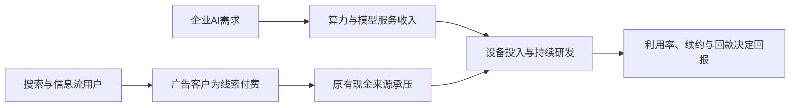
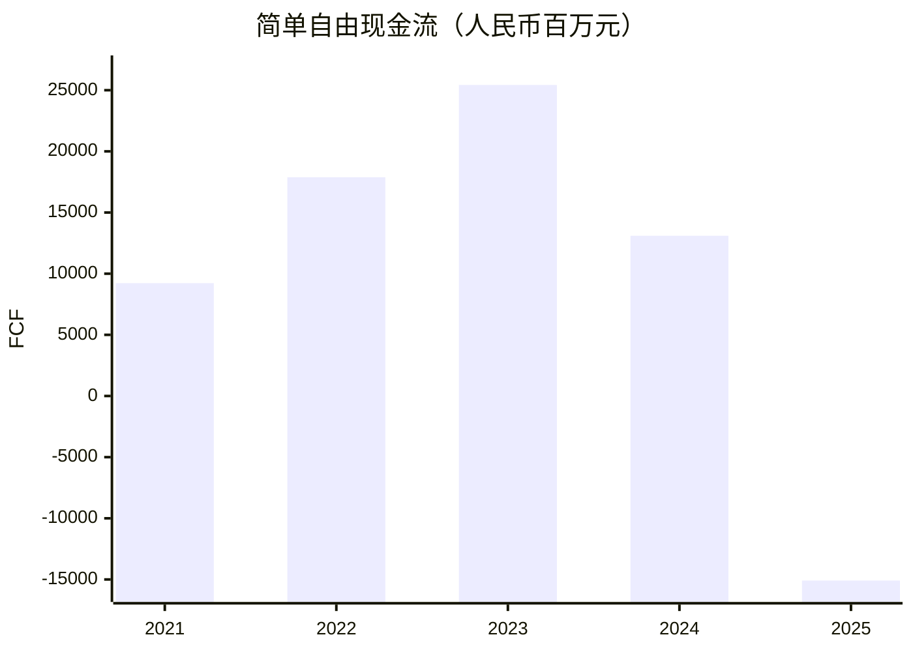

# 百度投资研究：AI收入接棒，现金回报尚未接棒

研究日期及信息截止日：2026-11-28（已执行系统 `date -u`，03:03 UTC）。最新财务期间：2026-09-30；最新正式季报发布日：2026-11-16；美股行情：2026-11-27常规盘收盘。本文用于学习研究。

标的身份：Baidu, Inc.／百度集团股份有限公司，NASDAQ:BIDU、HKEX:09888（港元柜台）／89888（人民币柜台），均属同一开曼上市母公司；1 ADS代表8股A类普通股。沿用既有 `百度-deepseek分析` 目录和监控ID“百度”。

信息丰富度评级：**A（公司层面信息充裕），分业务盈利透明度仅B**。

AI研究局限性声明：公告多不等于商业回报可预测。AI业务是管理层分类，AI云、文心、Apollo及昆仑芯没有完整、可相互对账的独立利润与现金流；母公司可上划资金、最新净经济股数及管理层实际经济权益仍有缺口。事实、计算、推断及假设在下文分开标注。本文不以技术排行榜、用户量或IPO估值替代股东现金回报。

## 一、结论与本次更新

**结论：现价观望新增；已有合理小仓可以持有复检，暂停因“现金硬底”而加仓。** 百度有真实的AI基础设施业务和转型选择权，但目前尚未证明它能用新业务现金流补上广告现金牛的衰退。不是因为十年模型没有通过就否定公司：广告下降、毛利收缩、资本开支超过经营现金流，以及现价缺乏稳健安全边际，共同支持这个判断。

截至11月27日，BIDU收盘价为**63.49美元/ADS**。按最新可核的已发行普通股分母，复算市值为**217.10亿美元**，并非行情首页所示209.6亿美元。三年基准情景对应三年后68.20美元、按人民币资本成本折回今日约54.14美元；完整十年现金压力模型基准今日约62.93美元。**40—45美元/ADS是有经营条件的分批研究带；45—65美元以等待验证为主；高于80美元而经营模型没有增强，应复核估值与过高仓位。** 价格触及本身不构成买入信号，低于40美元先查永久损失，不自动抄底。

股价双源：[StockAnalysis历史价](https://stockanalysis.com/stocks/bidu/history/)、[FT历史价](https://markets.ptc.ft.markitdigital.com/data/equities/tearsheet/historical?s=BIDU%3ANSQ)。11月27日美股提前至美东13:00收市；本文不采用盘后63.56美元。所有美元估值换算统一使用Q3财报的6.7045人民币/美元便利汇率，**不是11月27日即期汇率**；人民币内在价值判断与美元交易结果仍受汇率影响。

### 已有研究与本次更新

这不是首次覆盖。先读的基线为[4月28日完整研究](百度-research-20260428.md)，继而核对[《看懂百度》系列说明](《看懂百度》/00-系列说明.md)、[AI三条赛道](《看懂百度》/03-AI三条赛道-大模型-自动驾驶-AI云.md)、[竞争与管理层](《看懂百度》/04-竞争与风险-四面楚歌与管理层执行力.md)、[旧估值终章](《看懂百度》/05-估值判断-期权还是陷阱（终章）.md)，最后读[9月12日网易与百度财务底稿](../持仓估值分位与未来盈利-20260912/底稿-网易与百度.md)。公司目录没有独立的最新财报精读，故本次直接回到Q3公告。系列文章没有统一可靠的资料截止日，包含晚于4月的内容，只作历史观点而不把其标题日期当数据时点。

同时检索了9月12日跨公司估值研究、AI模型专题、腾讯／阿里竞争研究、看板、台账和触发记录。其他报告对百度的转述不算独立证据；百度不在重点标的看板，也没有既有台账事件，已有触发ID“百度”仅补录了4月90—110美元旧带。

| 旧判断及原时点 | 最新证据 | 本次处理与行动影响 |
|---|---|---|
| 4月研究及系列：2394亿元“净现金”、构成107—112美元硬底 | 此前数字是广义现金／投资，未扣债务，且含长期项目 | **推翻**硬底及相应分部加总；旧价带停止作为当前依据 |
| 4月：FCF转正、AI占比超过50%可加仓 | Q3 AI占一般性业务53%；CFO为正但FCF仍负 | **推翻机械占比条件**；保留现金回报验证 |
| 4月：C端入口已永久丢失、479万用户意味着仅0.7%转化 | 官方2025Q4文心助手MAU为2.02亿，独立App与嵌入式产品范围不同 | **削弱**永久出局论；撤回跨口径转化率，不据此转为看多 |
| 旧系列：百度是中国唯一全栈AI厂商 | 阿里亦有芯片、云、模型与应用 | **推翻**“唯一”；技术优势须检验资本回报 |
| 9月底稿：正常化归母约116亿元 | 最新TTM非GAAP减归母SBC加回约103.43亿元 | **削弱**旧盈利基线，不能把AI持续研发全部加回 |
| 旧系列：AI云只有6.1%、排名第五 | 通用云、AI IaaS、MaaS及存储子市场不是同一市场 | **待验证／撤回旧排名**，不混用市场份额 |
| 旧系列：Apollo海外与昆仑芯IPO将释放价值 | 迪拜已商运、伦敦仍测试；昆仑芯上市时间及稀释未定 | **维持选择权，收紧定价**；基准不另加传闻估值 |

本次资料覆盖2025年20-F、2025Q4至2026Q3正式披露、10月月报及11月26日股本公告、11月19日算力法规、11月23日IDC行业资料和11月27日行情。没有获得当前每一业务完整损益、现金所有权明细或11月27日实时净经济股数；这类缺口保留，不用旧报告填补。

## 二、生意本质：从卖搜索线索，转向卖智能与算力

一句话定义：**百度把信息需求变成广告线索，同时把多年AI研发变成企业算力与软件服务；前者较轻资产，后者更依赖设备投入、利用率和持续研发。**

搜索用户一般不付钱，广告客户为线索和成交机会付钱；云客户为算力、模型调用与解决方案付钱；AI应用靠订阅、企业工具或营销变现；自动驾驶须由乘客、运营方或合作平台形成可覆盖全成本的收入。它们的复购机制不同，不能统称“AI增长”后套一个倍数。

### 收入结构与最近四季

下表金额为人民币百万元。AI子项为公司四舍五入的管理口径，不是独立审计分部；在线营销包含AI原生营销，**不可重复加总**。

| 项目 | 2025Q4 | 2026Q1 | 2026Q2 | 2026Q3 |
|---|---:|---:|---:|---:|
| 集团收入 | 32,740 | 32,075 | 31,325 | 30,807 |
| 一般性业务收入（约数） | 26,100 | 26,000 | 25,200 | 25,000 |
| AI云基础设施（约数） | 5,800 | 8,800 | 7,300 | 8,200 |
| AI应用（约数） | 2,700 | 2,500 | 2,500 | 2,600 |
| AI原生营销（约数） | 2,700 | 2,300 | 2,600 | 2,400 |
| AI业务占一般性业务 | 43% | 52% | 50% | 53% |
| 集团毛利 | 14,463 | 12,486 | 12,227 | 10,915 |
| GAAP经营利润 | 1,483 | 3,193 | 3,024 | 626 |
| GAAP归母净利润 | 1,782 | 3,445 | 2,319 | 1,395 |
| 经营现金流CFO | 2,609 | 2,670 | 3,436 | 2,778 |
| 现金资本开支 | 1,972 | 5,916 | 11,390 | 7,349 |
| 简单FCF＝CFO−现金资本开支 | 637 | -3,246 | -7,954 | -4,571 |

一手：[2025Q4](https://www.sec.gov/Archives/edgar/data/1329099/000119312526076505/d117608dex991.htm)、[2026Q1](https://ir.baidu.com/news-releases/news-release-details/baidu-announces-first-quarter-2026-results)、[Q2](https://www.sec.gov/Archives/edgar/data/1329099/000119312526355431/d112854dex991.htm)、[Q3](https://www.sec.gov/Archives/edgar/data/1329099/000119312526462286/d767848dex991.htm)。独立供应商交叉：[季度利润表](https://stockanalysis.com/stocks/bidu/financials/income-statement/?p=quarterly)、[季度现金流](https://stockanalysis.com/stocks/bidu/financials/cash-flow-statement/?p=quarterly)。AI子项只有公司来源，公告转载不算第二独立验证。



Q3在线营销收入约119亿元、同比下降22%；AI云基础设施约82亿元、增长94%，但仍低于Q1的88亿元；AI应用约26亿元基本持平，AI原生营销约24亿元、下降15%。因此，收入增长主要由基础设施驱动，尚不能认定高利润AI软件已形成第二个现金牛。经营率仅约2.03%，毛利率约35.43%。

经营杠杆已经改变：传统广告流量增长可摊薄成本，而GPU云增长往往先要求设备、机房和电力支出。客户预付款能改善CFO，但同时是未来交付义务，不能等同于已赚利润。简单FCF还没有进一步扣清全部融资租赁、本应归少数股东的现金及现金股权激励替代成本，故负值不存在“口径太严”的解释。

### 五年盈利与现金趋势

金额为人民币百万元；利润按GAAP原文，不使用供应商加回减值后的经营利润。

| 指标 | 2021 | 2022 | 2023 | 2024 | 2025 |
|---|---:|---:|---:|---:|---:|
| 收入 | 124,493 | 123,675 | 134,598 | 133,125 | 129,079 |
| 毛利 | 60,179 | 59,740 | 69,567 | 67,023 | 56,643 |
| 毛利率 | 48.34% | 48.30% | 51.69% | 50.35% | 43.88% |
| GAAP经营利润 | 10,518 | 15,911 | 21,856 | 21,270 | -5,823 |
| GAAP归母净利润 | 10,226 | 7,559 | 20,315 | 23,760 | 5,589 |
| CFO | 20,122 | 26,170 | 36,615 | 21,234 | -3,013 |
| 现金资本开支 | 10,896 | 8,286 | 11,190 | 8,134 | 12,073 |
| 简单FCF | 9,226 | 17,884 | 25,425 | 13,100 | -15,086 |
| 现金及等价物 | 36,850 | 53,156 | 25,231 | 24,832 | 24,606 |

来源：[2025年20-F](https://www.sec.gov/Archives/edgar/data/1329099/000119312526109289/d38065d20f.htm)及[StockAnalysis利润表](https://stockanalysis.com/stocks/bidu/financials/income-statement/)、[现金流量表](https://stockanalysis.com/stocks/bidu/financials/cash-flow-statement/)、[资产负债表](https://stockanalysis.com/stocks/bidu/financials/balance-sheet/)。2021、2022现金资本开支目前仅直接取得供应商序列，当年原始现金流表未补读，列为历史数据缺口；不用于当前估值起点。其他关键口径差异见附录。



2025经营亏损含161.90亿元长期资产减值，不能把它外推为每年发生，也不能因此把资本配置损失视为不存在。最新TTM收入1269.47亿元、GAAP归母89.41亿元，已经因旧减值滚出比较期而转正；这不等于经营突然恢复至减值前水平。TTM CFO114.93亿元、资本开支266.27亿元、FCF负151.34亿元，更能解释当前投资分歧。

**段永平式追问（本报告问题，非引语）**：客户愿意持续为什么付钱，未来多赚的钱需要再投入多少资本？当前答案支持云业务有需求，尚不足以证明它是高回报的好生意。

## 三、护城河：能力存在，定价权尚未证明

| 护城河类型 | 支持证据 | 反面检验与趋势 |
|---|---|---|
| 品牌与定价权 | 百度搜索品牌和企业技术交付经验仍在 | 广告收入下降、AI原生营销也下降，未见持续提价而不失客户的证据；传统护城河变窄 |
| 转换成本 | 企业数据、部署、安全审核和工作流可产生粘性 | 用户换AI助手容易，云客户可多云；没有同口径NDR、续约率与迁移成本披露 |
| 网络效应 | 搜索反馈及地图／自动驾驶数据可能改善产品 | 外部开源模型和其他平台数据可替代；数据量不自动带来不可复制优势 |
| 规模成本 | 云利用率、全栈优化和共享研发可能降本 | 设备迭代和供应许可也会抬高成本；须看单位收入所需资本，而非只看Token量 |
| 技术壁垒 | 文心、飞桨、昆仑芯、千帆与Apollo形成工程积累 | 阿里和其他竞争者同样布局全栈；领先期限与经济租金没有被量化 |

ERNIE 5.5 Flash Preview已有[百度官方模型卡](https://huggingface.co/baidu/ERNIE-5.5-Flash-Preview)，但仍是预览检查点。模型开源能吸引生态，也可能降低同行复制成本。持续研发是维持竞争地位的必要成本，不能把它全部还原成“本来可分配给股东的利润”。

对旧份额结论作纠正：[IDC于11月23日发布的行业资料](https://www.idc.com/resource-center/blog/%E5%A2%9E%E9%95%BF%E6%96%B0%E9%98%B6%E6%AE%B5%EF%BC%9Aai%E4%BA%91%E5%AD%98%E5%82%A8%E5%B4%9B%E8%B5%B7%E4%B8%8E%E6%8E%A8%E7%90%86%E7%94%9F%E6%80%81%E5%88%86%E5%8C%96%E9%87%8D%E5%A1%91%E6%99%BA%E7%AE%97/)显示，2026H1中国AI IaaS约430.3亿元，同比增长97.7%；其中AI云计算约380.8亿元。文中的百度12.3%指AI原生云存储子市场，不能当整体AI云份额。旧“6.1%、第五”没有足够同口径原件支持，本次不延用。

过去五年，搜索优势缩窄；未来五年是否形成云与自动驾驶新优势，取决于可持续单位成本、留存和投入回报。**当前更像有研发与客户资产的转型企业，尚非高确定性复利企业。**

**巴菲特式追问（非引语）**：十年后，客户选择百度的理由能否让它赚到高于资本成本的回报？“全栈”只是候选答案，财务证据还不够。

## 四、逆向思考：怎样才能技术成功、投资失败

以下概率为研究者主观的风险强度判断，事件互相重叠，不能相加；不是统计预测。十年估值另用互斥情景。

| 失败路径 | 主观概率判断 | 影响程度 | 可观察证伪点 |
|---|---|---|---|
| 广告持续萎缩，AI收入毛利不足以替代 | 高 | 高 | 广告降幅收窄、集团毛利与经营利润稳定回升 |
| GPU云扩张但设备回收期长于技术寿命 | 中高 | 高 | 资本开支、折旧、利用率与合同现金回收可对账 |
| 文心获技术认可，应用却缺付费与留存 | 中高 | 中高 | 独立口径付费收入及续费，不仅是MAU |
| Apollo事故、牌照限制或海外运营成本失控 | 中 | 高 | 安全记录、许可范围及含研发／保险的单位经济 |
| 芯片／境外算力受限，国产替代未及时补上 | 中 | 高 | 实际交付与合规路径，许可数量不能代替交付 |
| 新并购、少数权益赎回及持续现金消耗侵蚀安全垫 | 中 | 高 | 现金桥、资本承诺、回购注销及母公司现金可核 |
| VIE或严重监管事件导致经济权益受损 | 低、不可可靠估计 | 极高 | 无法通过低PE消除，单列尾部压力 |

2026年6月10日[联邦公报](https://www.govinfo.gov/content/pkg/FR-2026-06-10/html/2026-11571.htm)确认百度被列入1260H名单；这与OFAC证券交易禁令、自动退市不是同一事项。11月19日生效的[BIS境外先进芯片远程访问规则](https://www.govinfo.gov/content/pkg/FR-2026-11-19/html/2026-23529.htm)增加相关境外算力许可要求，存在特定豁免，不能写成“百度全面断供”。截至本次检索未发现可核的移除名单原件。

历史类比只用来提问题：雅虎提醒我们，既有流量入口不能保证新范式份额；IBM提醒我们，转向企业服务能够维持生存，却未必恢复原有增长与资本回报。百度不必重复它们，但“AI时代不会消失”不足以推出“股东回报会好”。

最强多方论点是外部Token付费、GPU云收入和合同需求已经真实存在，利用率上升可能让新增利润快于收入。最强空方论点是高毛利广告被更重资本的收入替代，利润和FCF证据仍跟不上。两者可以同时为真。推演采用替代效应、规模经济和竞争均衡交叉检查；避免把“股价跌很多”当安全边际，也不把短期监管新闻当必然失败。

**芒格式追问（非引语）**：如果五年后这笔投资失败，最可能误判的是模型能力，还是持续资本投入之后真正留给普通股东的现金？本报告更担心后者。

## 五、管理层：用资本配置结果，代替人格打分

李彦宏为联合创始人兼CEO。技术投入方向有持续性，但不能仅由技术方向判断商业执行优秀，也不能仅因股价表现就判定诚信有问题。

| 时间／决策 | 已可核结果 | 研究评价 |
|---|---|---|
| 长期投入AI、云与自动驾驶 | 已有AI基础设施收入、真实海外合作 | 技术与工程积累有效，经济回报仍待验证 |
| 2025基础设施减值 | 长期资产减值161.90亿元 | 是实际资本损失信号；非每年重复，也非无关紧要 |
| 2025完成YY交易 | 对价152.19亿元，商誉141.97亿元；完整投资回报未单列 | 对可回收性及协同保持审慎；不能误算全部对价为当年新增现金支出 |
| 2026回购授权及首次股息政策 | 新计划最高50亿美元；Q3披露年初以来实际回购3.73亿美元；首次股息金额尚待批准 | 授权不等于支出，政策不等于已支付现金，继续核净股数与现金桥 |
| 昆仑芯分拆申报 | 计划上市后仍为附属公司，稀释、发行定价及时间未定 | 有透明化价值，不能把子公司估值和并表利润再重复相加 |

出处：[2025年20-F](https://www.sec.gov/Archives/edgar/data/1329099/000119312526109289/d38065d20f.htm)、[Q3公告](https://ir.baidu.com/news-releases/news-release-details/baidu-announces-third-quarter-2026-results)、[昆仑芯正式分拆公告](https://www.sec.gov/Archives/edgar/data/1329099/000119312526000097/d63607dex992.htm)。YY此前已付19亿美元、2025另外付款约2.4亿美元并释放16亿美元托管款，交易对价不能直接拿来解释当年CFO或简单FCF。

治理方面：2025年20-F披露，截至2026-01-31，李彦宏SEC受益持股口径为18.6%、投票权59.9%。其中包含员工股51,550,880股的不可撤回投票代理，**18.6%不能直接称为他的经济持股**；扣去代理后仍包括可在规定期限取得的权益，当前真实经济持股比例没有完成第二独立来源核实。不同投票权使控制权集中，技术战略能持续，也降低外部股东纠偏能力。

组织与文化判断置信度有限：未取得足够一手材料量化关键人才流失、研发激励回报及业务负责人继任能力。以未来披露的资本回报、客户留存和净股数衡量，比沿用旧报告“优秀技术家、不优秀CEO”的定性更可检验。

**段永平／巴菲特式追问（非引语）**：如果CEO退休，企业客户、工程体系和资本纪律能否自行延续？工程积累可留存，但资本配置与接班证据目前不足。

## 六、行业与文明趋势：需求大，不保证利润归百度

AI属于生产工具和信息界面的范式变化。百度能同时提供算力、模型、应用和自动驾驶系统，处在真实需求增长的价值链上；但范式变化也使旧搜索入口受损。行业成长和公司超额回报是两项独立判断。

TAM采用IDC可核的AI IaaS已发生收入市场，而不把所有劳动力支出或全球出行支出都当可获取收入。推理成本下降可能扩大调用量，也可能被竞争直接传导给客户；供给紧张时云厂商有议价能力，供给充足时则要靠交付、利用率与工作流粘性。客户和供应商集中度、企业续约与净留存、对受限芯片的实际依赖比例没有充分公开，列为重要缺口。

对比阿里[2026年9月季度官方演示](https://data.alibabagroup.com/ecms-files/1567773279/72cd036e-23ef-47fe-a49a-12053cfb7ec1/September%20Quarter%202026%20Results.pdf)，其AI云与算力服务包含T-Head，披露调整EBITA率14.5%；这证明“全栈”不是百度独有，但其业务范围与百度AI基础设施不同，不能拿该利润率直接填百度利润表。

Apollo的海外价值有独立合作方支持：[Uber于8月20日确认迪拜限定区域正式全无人服务](https://investor.uber.com/news-events/news/press-release-details/2026/Uber-Launches-Baidus-Fully-Driverless-Apollo-Go-in-Dubai-Establishing-the-First-Multi-Partner-Autonomous-Network-Globally/default.aspx)。伦敦仍为测试与未来商业化计划，不能把进入城市数量当盈利城市数量。各方分成、车队资本投入、保险与研发摊销未披露，本次不给“全球第一”或类比Waymo融资估值的额外溢价。

**李录式追问（非引语）**：二十年后AI大概率更重要，但百度股东持有的是哪一段能保留经济利润的产权？目前最清楚的是有需求，最不清楚的是长期可保留的资本回报。

## 七、估值：把股数、现金与利润先对齐

### 7.1 估值输入与口径

股本采用[11月26日翌日披露](https://www1.hkexnews.hk/listedco/listconews/sehk/2026/1126/2026112601103_c.pdf)A类2,211,573,730股，加[10月月报](https://ir.baidu.com/static-files/7f21cb05-4b6e-4901-835d-929d6c888c88)B类524,020,320股，合计2,735,594,050股，折合341,949,256.25 ADS。保留已回购但未注销部分，作为偏保守已发行分母；不是11月27日实时净经济股数，也不是加权平均稀释股数。FT约341.95百万ADS与此相符；StockAnalysis首页330.17百万和报表340.5百万不一致，本次不混用。

| 指标 | 报告采用值 | 解释 |
|---|---:|---|
| 股价（美元/ADS） | 63.49 | 11/27常规盘收盘，双源一致 |
| 市值（亿美元） | 217.1036 | 股价×上述ADS当量；FT显示217.6，差0.23% |
| 同口径市值（人民币亿元） | 1,455.5710 | 固定便利汇率6.7045；非即期换汇市值 |
| TTM GAAP归母（人民币亿元） | 89.41 | 不等于普通股可分配收益或报告稀释EPS |
| 归母利润对应市值倍数 | 16.28x | 市值/GAAP归母；不是行情页报告EPS的PE |
| 正常化归母代理（人民币亿元） | 103.43 | TTM非GAAP归母132.07−其SBC加回28.64 |
| 正常化代理倍数 | 14.07x | 仍含净利息等项目，不另加净现金 |
| PB | 0.5322x | 9/30归母权益2734.87亿元；账面值不是清算值 |
| PS | 1.1466x | TTM收入1269.47亿元 |
| 简单FCF收益率 | -10.40% | TTM负151.34亿元；负P/FCF不具有“便宜”含义 |
| 窄口径EV/收入代理 | 0.5070x | （市值−窄口径净现金）/收入；未完整加回NCI、租赁，不当标准可比EV |

正常化利润计算：各季非GAAP归母为3907、4332、2573、2395百万元，SBC归母加回为681、519、669、995百万元，故13207−2864＝10343百万元。扣回SBC是为保留真实员工成本；它仍不是精确扣非利润、普通股会计EPS或FCF。若扣全部集团税前SBC，则代理为101.76亿元，差异不改变主要判断。未把AI训练、自动驾驶扩张或芯片研发全面加回。

当前市值/归母与行情页19.25倍PE不同，不代表行情页错：普通股收益分配、稀释分母、汇率和期数不同。StockAnalysis `Net Income to Common` TTM为79.18亿元，低于归母89.41亿元；本报告模型用总股数分摊的正常化归母代理，明确不是其报告EPS。因盈利波动及增速符号变化，PEG不具可解释性，记不适用。

历史估值不作伪分位：旧4月约16倍非GAAP PE与本次14.07倍保留SBC代理口径不同，不能直接称历史低位。没有取得可复算的同口径长期PE/PB序列。同行阿里云、腾讯、Alphabet分别涉及不同分部和资本结构，本次不提供未经同期行情、股数及会计口径核验的数值PE排名；只在业务质量和资本强度上比较。

### 7.2 现金安全垫应怎样计算

截至2026-09-30，金额为人民币百万元。

| 项目 | 金额 | 用途与限制 |
|---|---:|---|
| 现金及等价物 | 31,013 | 合并层面，非全部母公司自由资金 |
| 短期投资净额 | 155,331 | 与现金合计186,344 |
| 不含租赁有息负债 | 105,149 | 借款、票据及可转债合计 |
| 窄口径净现金 | 81,195 | 186344−105149 |
| 租赁负债 | 9,454 | 扣后为71,741 |
| 可赎回少数股东权益 | 12,699 | 不混作普通股权益；压力模型另作全额预留 |
| 长期定存／持至到期投资 | 47,357 | 未纳入窄口径，并非不存在价值 |
| 长期投资净额 | 43,127 | 可能含股权，不能视同现金 |
| 公司广义现金与投资（约数） | 276,600 | 含受限、长期及调整后股权投资，不是净现金 |

出处：[Q3资产负债表及定义](https://ir.baidu.com/news-releases/news-release-details/baidu-announces-third-quarter-2026-results)、[StockAnalysis资产负债表](https://stockanalysis.com/stocks/bidu/financials/balance-sheet/)。供应商总债务114603含租赁9454，与本报告105149不矛盾。长期定存、金融投资、现金所属主体和上划税费都影响可用价值，所以既不能说2766亿元全是现金，也不能说窄口径之外的资产一概归零。

### 7.3 三年情景：现价隐含多少修复

起点每ADS正常化代理收益为4.511474美元，等于103.43亿元除上述ADS当量再除6.7045。未来每股增速是**假设**，已包含增长、回购／股权稀释的综合结果，不额外再加回购收益。退出倍数只用于三年定价情景，非十年终值倍数。

| 情景 | 每股年增速假设 | 第三年PE假设 | 第三年每ADS收益 | 第三年美元价格 | 固定汇率下今日值，r为8% |
|---|---:|---:|---:|---:|---:|
| 悲观：广告继续拖累 | -15% | 8x | 2.7706 | 22.16 | 17.60 |
| 基准：AI云逐步补位 | 8% | 12x | 5.6832 | 68.20 | 54.14 |
| 乐观：应用与云形成盈利扩张 | 20% | 18x | 7.7958 | 140.32 | 111.39 |

公式：EPS3＝EPS0×(1+增长率)^3；P3＝EPS3×PE；今日值＝P3/(1.08)^3。人民币现金流、人民币r与固定汇率换算保持一致；若以美元资本成本评价，必须另做汇率及美元r情景，不能把人民币8%直接说成美元要求回报。

基准三年总价格涨幅仅约7.42%，且不含未宣派股息；因此63.49美元未提供稳健安全边际。40—45美元研究带来自对约54美元基准今日值再要求折价，同时必须满足经营条件，不来自旧现金底或乐观目标价。

### 7.4 十年压力测试：先审计，再计算

这部分用于限制仓位与暴露假设，不单独裁决买卖。金额为未来各年名义人民币亿元，2027—2036共十期。

共同假设：现金流币种为CNY，主用r＝8%，允许区间6%—9%；终值g为0／1%／2%，人民币上限2%；稳态增量ROIC取8%，不是当前实测值。按TTM标准化经营利润、15%税率和“权益＋有息债−现金短投”粗算，存量回报代理仅约3.68%；假设成熟业务在2%增长下留存20%利润，隐含增量回报10%，选择8%夹在两者之间，**属于修复假设，而非云已赚到8%的事实**。

先跑 `terminal_value.py audit`，C1、C2、C3均准出。主档r−g分别为8、7、6个百分点；PE只由 `(1−g/ROIC)/(r−g)` 得到，三档均12.5倍。因为这里ROIC恰等于r，增长本身不创造额外超额价值。工具内置的1.70%无风险参考是历史默认参数，未声称为本日国债报价；定价采用上述显式r，不根据该默认值临时调参。

为不把合并现金直接当可分配现金，假设可用于普通股价值的期初剩余资金仅500亿元：窄净现金811.95亿元减租赁94.54亿元、可赎回少数权益126.99亿元，再预留90.42亿元营运／税费等。这个扣减是研究假设，未取得母公司逐项现金证明；未计长期定存及股权潜在释放。资金留至退出时才兑现，期间负现金流先消耗资金，正现金流假设可以分配。经营现金流路径排除该500亿元资金的利息收入，包含必要再投资、税费、债务服务及归母／SBC经济成本；昆仑芯、Apollo和爱奇艺价值已在经营结局内，不再单独相加。

| 情景 | 2027—2036年度可分配经营现金假设（亿元） | 2036经营归母利润假设 | g | 退出经营PE | 完整现金今日值（美元/ADS） | 完整现金IRR |
|---|---|---:|---:|---:|---:|---:|
| 悲观 | -100,-50,-20,0,10,20,20,20,20,20 | 40 | 0% | 12.5x | 19.44 | -4.38% |
| 基准 | -60,-20,10,40,70,90,100,110,120,130 | 150 | 1% | 12.5x | 62.93 | 7.90% |
| 乐观 | -30,10,60,100,150,190,220,250,280,300 | 300 | 2% | 12.5x | 124.25 | 16.42% |

可复算方法：年度支付Dt＝max(现金流t,0)；退出值＝2036经营利润×PE＋500＋各年负现金流合计；今日价值＝各年Dt折现值＋退出值折现值。基准退出值为2295亿元。完整现金IRR由 `-1455.5709708365 + Σ Dt/(1+i)^t + 退出值/(1+i)^10 = 0` 求根，使用Decimal迭代，**不是把股息率直接加在股价年化上**。未来负现金流不重复视作股东另行注资，已扣减退出资金。

反向DCF：固定基准十年现金路径、500亿元资金处理及12.5倍终值，当前价格约要求2036经营归母利润达到**152.21亿元**，接近本报告150亿元基准。这说明现价已经要求相当程度的经营修复，并没有给“不修复”留很宽余地；该反推不是市场唯一隐含预期。

概率压力采用悲观35%、基准45%、乐观15%，另5%为严重监管／权益损害尾部：十年无经营分配，仅退出回收300亿元。概率与回收值均主观，不是违约概率估计；完全归零仍可能发生，300亿元不构成保证底价。加权现金今日值约**54.06美元/ADS**。VIE、算力、监管分别放入情景和尾部，不塞进r或β。

| r敏感性 | 概率加权情景IRR的算术均值 | 加权现金今日值（美元/ADS） | 有效性与压力判断 |
|---|---:|---:|---|
| 6% | 5.94% | 80.80 | r在币种区间内，但乐观g档r−g仅4个百分点，仅作参考 |
| 7% | 4.72% | 65.10 | 三档分母均有效，均值低于r |
| 8% | 3.75% | 54.06 | 主档；均值低于r |
| 9% | 2.96% | 45.86 | 三档分母均有效，均值低于r |
| 10% | 2.31% | 39.53 | 超出CNY主用区间，仅供压力参考 |

这里“加权IRR”只是各情景年化收益率的算术平均，并不等于预期现金流的IRR或投资者实现收益。它用于展示尾部与资本锁定的影响，不能据其单一阈值决定交易。有效r为7%—9%的采样没有压力结论翻转；内在价值对r仍很敏感，不能把“未翻转”称作估值精准。

按技能另外运行 `terminal_value.py irr` 和 `flip`：仅计经营终值、无现金分配的三档十年几何回报约-10.13%／2.56%／9.93%；`flip`主档均值约-0.78%，r7%／9%约0.75%／-2.08%，判定不翻转。此工具结果**故意不含初始资金与中间现金**，仅为较严的终值诊断，不能代替上面的完整模型。模型所需r＝10%输入锚点、所有现金及概率在审计附录保留。

### 7.5 估值分歧对账与仓位含义

三年盈利今日基准54.14美元，十年完整现金基准62.93美元，差别来自十年显式修复、余留资金兑现和再投资路径。两者均与现价接近，较乐观终值并没有消除短期现金压力。十年各情景IRR分散很大，因此只适合较小研究仓位；观望的主要依据仍是当前经营与三年安全边际，**不是“十年IRR低于r所以必须回避”**。

**巴菲特／段永平式追问（非引语）**：资本成本、现金可用性或修复速度错一点，价格还有多少余地？本次答案是40—45美元且现金条件改善，才值得重新算首笔；并不是认为该价格不会亏损。

## 八、综合决策备忘录

| 维度 | 结论 | 信心度 |
|---|---|---|
| 生意质量 | 真实AI需求；高毛利广告向重资本服务切换，尚无稳定高回报证据 | 中 |
| 护城河 | 企业交付及工程积累存在；搜索变窄、全栈不排他 | 中 |
| 管理层 | 技术长期投入有效；减值、并购及回购实际效果需持续检验 | 中低 |
| 最大风险 | 增收不增股东现金，外加算力许可、资本配置和VIE尾部 | 中 |
| 文明趋势 | AI方向明确，公司能留住多少利润不明确 | 行业高、公司中低 |
| 估值 | 三年基准今日54.14美元；十年完整基准62.93、加权54.06美元；有效r压力不翻转，只收紧仓位 | 算术高、假设中低 |

估值解除语：估值是六个并列维度之一；十年折现不能单独否决买入或持有。若未来经营证据增强，应先重建盈利／现金假设，再决定价格与仓位，不能为迎合买入降低r。

| 策略 | 建议 |
|---|---|
| 空仓者 | 当前观望；40—45美元且下列经营、资本、股数条件同时通过，才研究小额分批，不因触价自动入场 |
| 持仓者 | 未知用户仓位及成本，不假定实际持有；合理小仓可持有复检，暂停用旧现金底加仓；若已集中押注转型，应按下行损失重新评估集中度 |
| 加仓信号 | 后续连续两次正式季度披露简单FCF均为正，滚动FCF持续改善；广告降幅收窄、集团毛利不再连续下行；云投入、回款及供应合规可解释；母公司资金与净股数可核，重估仍有安全边际 |
| 卖出／降低风险信号 | 核心盈利与现金假设被证伪、资金无法覆盖必要投入／到期义务、重大治理或安全问题；价格高于80美元而模型未增强则复核超配，价格线本身不是自动卖出指令 |

研究仓位压力参考：若价格及经营条件都通过，仅把首笔约组合0.5%、验证前总参考上限约1%—2%视为风险预算示例，不代表基于用户资产配置的个性化仓位。现金改善不能只靠设备付款推迟或融资维持，须核现金桥。AI收入占比越过50%、助手MAU上升、昆仑芯上市或新回购授权，都不再单独触发加仓。

人工复检节点：2026-12-31检查资本开支、算力合规、首次股息是否实际宣派及昆仑芯进程；2027-03-31检查全年披露日历和完整现金流。两者是研究检查日期，**不是公司确认财报日**；若提前正式披露即提前复核。事件登记仅供人工复核，当前每日流程只扫描价格。

### 四位大师的方法论点评：短引与本报告推演分开

以下均非四人对百度的实际当前投资意见，不声称其买入或卖出百度，也不沿用旧报告无法核实的拟造引语。

- 巴菲特原话：“A moat that must be continuously rebuilt will eventually be no moat at all.” 已读[2007股东信第4页](https://www.berkshirehathaway.com/letters/2007ltr.pdf)。本报告延伸：技术需持续更新，须验证更新之后仍有超额回报；不是因为行业有变化就断言公司无价值。
- 芒格原话：“inversion frequently will solve problems which nothing else will solve.” 已读[2007年USC演讲转录](https://jamesclear.com/great-speeches/2007-usc-law-school-commencement-address-by-charlie-munger)。本报告延伸：先问广告与资本开支怎样损害股东，再检验AI乐观路径。出处为演讲转录转载，非芒格本人针对百度评论。
- 段永平原话：“不懂不做，不要跟消息走，跟着理解走。” 已读[仓库原发言档案](../段永平/段永平雪球全量原发言.md)2011-10-07条及[原帖链接](https://xueqiu.com/1247347556/20416338)。本报告延伸：不能理解云资本回收与现金归属时，不以“已经跌很多”代替理解。
- 李录原话：“股票不仅是一张可交易的纸，它代表了公司的一部分所有权。” 已读[2024年北大演讲存档](../李录/李录-北大演讲-20241207.md)，出处为芒格书院中文传播版，非本次新听原声。本报告延伸：AI扩大社会生产力，不代表特定股票能保住购买力，仍要核产权、竞争和价格。

AI分析置信度：合并财务、已披露股本及算术为较高；企业云经济性、母公司可分配资金和长期情景为中低。**实际投资确定性为中低，低于资料丰富度所营造的确定感。** 需要一手补证的重点是AI云合同回收期与设备寿命、Apollo完整成本、母公司资金可用性、净经济股数及下一完整财报现金桥。

## 附录A：关键数据交叉验证与计算留痕

公司IR、SEC、港交所和PRNewswire转载来自同一原始披露，不按四个独立来源计数。主交叉供应商为StockAnalysis；行情另用FT。Macrotrends正文受限、AAStocks完整财务未取得，故未声称完成指定网站全覆盖。

| 对照字段 | 原始披露 | 独立供应商／调整后可比值 | 结论 |
|---|---:|---:|---|
| 2025收入，百万元 | 129,079 | 129,079 | 一致 |
| 2025GAAP归母，百万元 | 5,589 | 5,589 | 使用Net Income行；普通股4663不同口径 |
| 2025经营利润，百万元 | -5,823 | 10,367−16,190＝-5,823 | 供应商标准化加回减值，已对齐，非两源原值一致 |
| 2021／2022毛利，百万元 | 60,179／59,740 | 60,340−161／59,808−68 | 标准化剔资产减记，按年报还原 |
| 2026Q3现金短投，百万元 | 186,344 | 186,344 | 一致 |
| 2026Q3有息债务，百万元 | 105,149 | 114,603−9,454＝105,149 | 供应商含租赁，已对齐 |
| 已发行ADS当量，百万 | 341.94925625 | FT约341.95 | 取整后差异小于0.001%；不同日期与待注销仍保留缺口 |
| 美股收盘价，美元 | StockAnalysis63.49 | FT63.49 | 同一交易日一致 |
| 市值，亿美元 | 自算217.1036 | FT217.6 | 差异0.23%；不能与StockAnalysis209.6静默拼接 |

`financial_rigor.py`已运行的工具输出摘要：

```text
verify-market-cap: 63.49 × 341949256.25 = 21710358279.3125 USD
FT reported = 21760000000 USD; deviation 0.23%; 验证通过
cross-validate: FY2025 revenue 129079 / 129079 -> 0.00%
cross-validate: FY2025 attributable NI 5589 / 5589 -> 0.00%
cross-validate: Q3 cash + short-term investments 186344 / 186344 -> 0.00%
cross-validate: narrow net cash 81195 / 81195 -> 0.00%
verify-valuation: normalized proxy PE 14.07x; PB 0.53x; PS 1.15x
FCF yield -10.40%; tool EPS/BVPS proxy 3.78%仅为期末账面回报代理，非正式平均权益ROE
three-scenario: Bull 140.3 / Base 68.2 / Bear 22.2 USD at year 3
terminal_value audit: CNY r .08, ROIC .08, g 0,.01,.02, beta 1 -> C1/C2/C3 准出
```

十年 `flip`复算参数：`roic=.08; g=0,.01,.02; p=.35,.50,.15; k=0; g_shift=0`；工具只含三种经营终值诊断，概率与完整现金模型的35/45/15/5不同，不能混算。其 `irr10` 锚点为 `-12.1174478453,0.0189616743,6.8085242477`（百分数），按r＝10%所得PE＝10、9.7222222222、9.375及利润40、150、300，除1455.5709708365亿元市值再开十次方减1后得到。完整现金模型则按正文逐年现金求根、额外含尾部；公式、路径与全部参数已在本报告内给出，不依赖临时JSON才能理解。

尚未解决的来源缺口：历史2021—2022资本开支原件、AI子业务盈利双源、管理层真实经济权益双源、最后一日净经济股数、母公司可自由上划现金、当前同口径同行估值及历史分位。现金模型没有确认新的股息支付，其正现金分配只是情景假设；零回收尾部也未被300亿元回收假设完整覆盖。上述缺口不能被工具“通过”消除。

## 附录B：数据抽检与最终检查

正文落盘后运行 `python3 tools/report_audit.py extract --report reports/百度-deepseek分析/百度-research-20261128.md --ratio 0.15 --seed 20261128`。提取192项、随机抽29项。固定种子用于复现，没有为得到有利抽检而更换种子。表格解析器也会提取日期及假设，以下明确剔除原因。补入本审计记录不改变已核正文的财务数据。

有效双源事实15项，均通过 `report_audit.py verdict`，最大差异小于0.001%；单源核读4项，原文一致但不冒充双源独立验证；派生／模型算术4项，均在1%内；排除6项。分别输出PASS且无警告／失败，但**单源组PASS只代表忠实核读原件，不代表已满足双源标准**。年度源为20-F，季度源为对应SEC／IR公告，独立供应商为正文所链StockAnalysis各表；行情另用FT。

| 抽样ID | 有效项目或处理 | 报告值 | 复核值及出处 | 判决 |
|---|---|---:|---|---|
| 4 | 2025Q4集团收入，百万元 | 32740 | Q4 SEC／StockAnalysis均32740 | 双源通过 |
| 30 | 2026Q2毛利，百万元 | 12227 | Q2 SEC收入31325−成本19098；StockAnalysis12227 | 双源通过 |
| 32 | 2025Q4经营利润，百万元 | 1483 | Q4 SEC／StockAnalysis均1483 | 双源通过 |
| 60 | 2024毛利，百万元 | 67023 | 20-F收入133125−成本66102；供应商67023 | 双源通过 |
| 59 | 2023毛利，百万元 | 69567 | 20-F收入134598−成本65031；供应商69567 | 双源通过 |
| 69 | 2023经营利润，百万元 | 21856 | 20-F／StockAnalysis均21856 | 双源通过 |
| 93 | 2022现金，百万元 | 53156 | 年度原件／StockAnalysis均53156 | 双源通过 |
| 92 | 2021现金，百万元 | 36850 | 年度原件／StockAnalysis均36850 | 双源通过 |
| 100 | 11/27收盘价，美元 | 63.49 | StockAnalysis／FT均63.49 | 双源通过 |
| 106 | TTM归母，亿元 | 89.41 | 四季原件归母合计8941百万元；供应商89.41亿元 | 双源通过 |
| 118 | Q3现金，百万元 | 31013 | Q3 SEC／StockAnalysis均31013 | 双源通过 |
| 124 | Q3租赁负债，百万元 | 9454 | Q3两部分3875＋5579；供应商相同 | 双源通过 |
| 164、165 | 2025收入原件／供应商两列，百万元 | 129079 | 20-F／StockAnalysis均129079；两列属于同一事实，未声称是两种独立指标 | 双源通过 |
| 177 | 已发行ADS当量，百万 | 341.94925625 | HKEX A＋B除8；FT约341.95 | 双源通过，保留时点限制 |
| 15 | Q3 AI云收入，百万元 | 8200 | Q3管理口径8200 | 单源核读通过 |
| 12 | Q4 AI云收入，百万元 | 5800 | Q4管理口径5800 | 单源核读通过 |
| 25 | Q1 AI占比 | 52% | Q1内部管理口径52% | 单源核读通过 |
| 127 | Q3长期定存／持至到期，百万元 | 47357 | Q3 SEC47357；供应商只提供与长期股权等合并类别90484 | 单项双源缺口保留 |
| 49 | Q1简单FCF，百万元 | -3246 | CFO2670−资本开支5916；供应商季度FCF同为-3246 | 派生核算通过 |
| 108 | 正常化代理，亿元 | 103.43 | 四季非GAAP归母13207−归母SBC加回2864百万元 | 算术通过，非外部事实 |
| 154 | 十年完整现金基准今日值，美元 | 62.93 | 正文路径、资金及终值逐年Decimal折现＝62.93069313 | 参数／算术通过，非预测验证 |
| 184 | 市值与FT差异 | 0.23% | 精算0.22813291%，舍入相对误差约0.81% | 算术通过 |
| 188、189、101 | 日期误识别 | — | 将2026年或11/27截成数字；完整日期另已核，不作为财务点计数 | 排除3项 |
| 136、141 | 三年退出PE输入12／18 | — | 明确为研究者假设；只检查模型使用一致，不以外部数据伪证 | 排除2项 |
| 179 | 股数误差小于0.001%的上界 | — | 实算0.000217503%，不等式成立；上界不是点估计 | 排除1项 |

工具判决摘要：`facts 15/15 PASS, warnings=0, failures=0; single 4/4 原文一致; calcs 4/4 PASS; exclusions=6`。未把未取数项目填成零，也未把同公告转载计为独立信源。随机抽检不是对全部数据或长期假设的保证；主要缺口在附录A及正文显式保留。

最终再跑 `terminal_value.py audit --currency CNY --r .08 --roic .08 --g 0,.01,.02 --beta 1 --discrete-risks '算力许可:情景,VIE失效:尾部档,重大事故监管:尾部档,资金不可上划:情景'`，三个硬约束准出。临时参数与日志保存在系统临时目录，必要输入、结果和抽检记录已合并入本报告，不在公司目录新增数据侧文件。

收尾记录：沿用监控ID“百度”，将40—45美元条件研究带、80美元估值复核线及两个人工检查节点登记入 `data/triggers.json`；在非重点标的跟踪表新增 `20261128-BIDU`，主表共183条、待触发84条，计数由主表重算。`trigger_scanner.py --check` 与 `daily_monitor.py --check` 均通过，本报告本地链接均存在。

定点监控只使用临时状态和临时报告目录。在线试跑因行情源没有返回有效报价而为 `DEGRADED/NO_DATA`，未声称在线链路已验证；使用已双源核实的63.49美元收盘价离线回放则为 `OK`，仅验证配置与规则。当前正式日报及运行状态未被覆盖。报告事实行情来自已链接的网络行情源，不来自此次失败的监控试跑。
