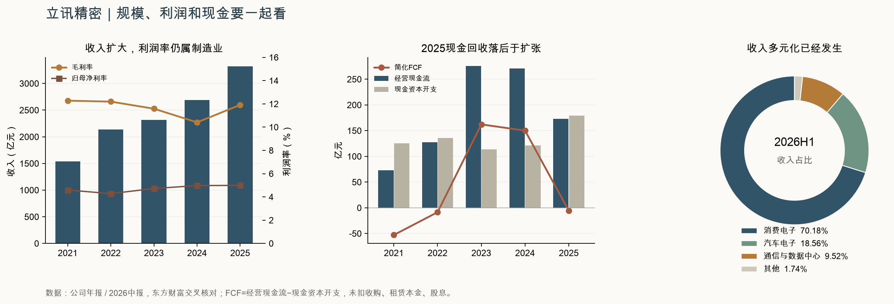

# 立讯精密（002475.SZ / 02475.HK）研究报告

**研究日期：**2026-11-18（Asia/Shanghai）  
**数据截止：**行情截至2026-11-17；财务截至2026-09-30，已纳入10月30日发布的三季报、全年业绩预告，以及11月2日投资者交流和11月6日回购贷款公告。2025年报已审计，2026中期、季度及预告未经审计。  
**价格与估值：**A股收盘47.60元；H股46.160港元为11月17日16:08行情快照。最新总股本77.43337589亿股；A价全股本估值3,685.83亿元，报告归母TTM PE20.32倍，扣非TTM PE24.57倍。  
**研究主线：**立讯的制造平台和客户覆盖仍在扩张，收入多元化已经发生；但分部毛利承压、现金占用上升，使“规模增长转化为每股可分配现金”成为比AI标签更重要的检验。

> 本报告用于学习研究，不构成投资建议。金额无特别说明均为人民币；价格与模型属于研究口径，不是收益承诺。承接[8月3日旧报告](立讯精密-research-20260803.md)，保留原文件，本报告接续其行动条件。

---

## AI研究偏见自觉

**信息丰富度评级：A级。**公告和覆盖丰富，最容易形成的共识是把消费电子、汽车、AI三条叙事叠加后，直接赋予高端连接器公司的盈利质量。真正需要检验的是客户付给立讯的价值，能否超过持续扩产、整合和营运资金的成本。

**AI研究局限性声明：**公司定期报告匿名披露主要客户；不能把“第一客户=苹果”写成年报明示。没有足够独立数据复原各AI产品订单、分部净利润、有机增长和最新完整净债务。本文将管理层产品进展单列为公司陈述，将情景概率、增长与终值参数标为判断，不用它们填补事实空白。东财和公告的交叉核验是两条取数渠道，底层仍主要来自同一套发行人财务数据，不代表两次独立审计。

- [x] 信息量不等于投资确定性；即使资料减半，现金回收仍是核心判断。
- [x] 不把并表收入增长、持股比例增加与有机增长混为一谈。
- [x] 不把通信分部全部视为AI，也不把管理层客户验证当成已实现利润。
- [x] 不把扣非低增速全部视为经营恶化；同时核对汇兑损失和套保收益。

---

## 第一步：核心数据总览

### 身份、股本与两地价格

公司全称为立讯精密工业股份有限公司，英文为Luxshare Precision Industry Co., Ltd.，常用品牌LUXSHARE-ICT。深交所002475和港交所02475是同一法人发行的A、H股，不是两家公司，也不是ADR。[公司中报摘要][S3]

11月5日到期兑付结果公告引用中登11月2日结构：A股7,347,322,889股，其中限售16,778,554股、无限售7,330,544,335股；H股396,014,700股；总计7,743,337,589股。这个最新登记口径与东财、腾讯一致。三季报会计股本和更早H股发行初始股数均不能直接代替最新分母。[股本公告][S6]

A价乘全部A+H股本，是衡量“A股投资者为同等每股盈利付多少”的估值基准，**不是实际两地合计市值**。按同日1港元=0.85562元的官方中间价换算，H价折合39.4954元，较A价低17.03%；两地分别定价后的总市值约3,653.73亿元。汇率中间价用于研究换算，不是可成交汇价，H股报价只核到收市后快照。[行情][S7]、[东财][S8]、[官方汇率][S9]

### 五年经营趋势

单位：亿元；毛利率、营业利润率单位为百分比。营业利润率按中国会计报表“营业利润/营业收入”计算，含投资、公允价值及财务费用影响，不等于剔金融收益的经营EBIT率。

| 年度 | 收入 | 归母净利 | 毛利率 | 营业利润率 | 经营现金流 | 现金资本开支 | 简化FCF | 货币资金 |
|---|---:|---:|---:|---:|---:|---:|---:|---:|
| 2021 | 1,539.46 | 70.71 | 12.28 | 5.31 | 72.85 | 125.67 | -52.82 | 142.05 |
| 2022 | 2,140.28 | 91.63 | 12.19 | 5.21 | 127.28 | 135.84 | -8.57 | 193.67 |
| 2023 | 2,319.05 | 109.53 | 11.58 | 5.55 | 276.05 | 113.87 | 162.18 | 336.20 |
| 2024 | 2,687.95 | 133.66 | 10.41 | 6.01 | 271.17 | 121.11 | 150.06 | 483.60 |
| 2025 | 3,323.44 | 166.00 | 11.91 | 5.76 | 173.25 | 179.04 | -5.79 | 611.59 |

简化FCF=经营现金流−购建固定资产、无形资产及其他长期资产支付现金，未扣收购、租赁本金、股息，也未单独扣股权激励成本，不能等同全部可分配现金。历史财务由公司相应年报与东财结构化三表核对；2021—2024没有逐项重审全部附注。[2021年报][S26]、[2022年报][S27]、[2023年报][S28]、[2025年报][S2]及[东财财务分析][S8]



2025年利润增长没有同步变成现金：简化FCF从2024年的150.06亿元降至负5.79亿元。2026前三季度经营现金流进一步降至负64.34亿元，现金资本开支148.39亿元，前九月简化FCF为负212.73亿元；滚动十二个月经营现金流74.13亿元、资本开支195.40亿元、简化FCF负121.27亿元。旺季备货存在季节性，但同比和滚动口径也转弱，不能仅用季节性解释。[三季报][S1]、[交流记录][S4]

### 最近四个季度

季度值由累计财报相减，金额亿元。

| 季度 | 收入 | 归母净利 | 扣非归母 | 毛利率 |
|---|---:|---:|---:|---:|
| 2025Q4 | 1,114.30 | 50.81 | 46.27 | 11.44% |
| 2026Q1 | 838.88 | 36.60 | 27.76 | 11.92% |
| 2026Q2 | 906.16 | 41.83 | 31.86 | 11.65% |
| 2026Q3 | 1,105.07 | 52.14 | 44.12 | 12.11% |

2026前三季度收入2,850.12亿元（+29.01%）、归母130.57亿元（+13.36%）、扣非103.74亿元（+8.72%）。第三季度单季收入+14.62%、归母+6.98%；公司称若剔除去年莱尼负商誉的比较基数，前三季度归母增速为+18.28%、单三季度为+18.65%。后两项是公司调整口径，不能称为有机增长。[三季报][S1]、[公司说明][S4]

### 业务结构与利润来源

2025年收入占比：消费电子79.52%、汽车11.81%、通信与数据中心7.39%；其余为其他业务。最新具备完整收入与毛利成本表的分部期间为2026H1。[2025年报][S2]

| 2026H1业务 | 收入（亿元） | 占比 | 收入同比 | 毛利率 | 毛利率同比变化 |
|---|---:|---:|---:|---:|---:|
| 消费电子 | 1,224.76 | 70.18% | +19.27% | 10.25% | -0.13pct |
| 汽车电子 | 323.91 | 18.56% | +274.10% | 14.14% | -0.06pct |
| 通信与数据中心 | 166.09 | 9.52% | +49.66% | 17.29% | -2.48pct |
| 其他 | 30.28 | 1.74% | +47.08% | 18.03% | -0.22pct |

综合毛利率11.78%、同比+0.17pct，与三个主要分部毛利率均下降并不矛盾：较高毛利业务的权重提高，抵消了一部分分部压力。到前三季度，公司交流披露汽车收入509.70亿元、毛利率13.27%，进一步低于H1；属于管理层分部说明，不是三季报完整附注。**“收入多元化”证据强，“同一业务盈利能力全面改善”证据弱。**[中报][S3]、[交流记录][S4]

消费电子同比采用2026中报的比较列1026.88亿元作分母；东财2025中报旧“消费性电子”与“电脑互联产品及精密组件”之和等于该比较数，不能只用旧消费项计算可比增速。[东财分部数据][S29]

缺口：未披露可还原最近四个单季的全部分部收入、增速与毛利率，因此不编季度分部表，也不按整体毛利倒推AI毛利。

### 利润、现金和债务要分开看

前三季汇兑损失28.66亿元，而外汇衍生品公允价值及交割收益18.17亿元、定存理财等投资收益12.85亿元。汇兑损失留在扣非中，部分对应套保收益被剔为非经常损益，因此“扣非=真实经营利润”也不成立。本报告以扣非TTM150.01亿元作**保守估值锚**，不把它称为经过完整经济对冲还原的正常利润；也不把31.38亿元的TTM归母与扣非差额一概视为低质收益。[交流记录][S4]

| 资金项目 | 数值（亿元） | 口径与限制 |
|---|---:|---|
| 2026Q3货币资金 | 681.14 | 不是全部均可自由使用的现金 |
| 2026Q3交易性金融资产 | 125.82 | 不保证全部可按面值即时变现 |
| 2026Q3账列债务及租赁相关五项合计 | 1,458.12 | 短借、长借、应债、一年内非流负债、租赁；还漏其他流负中的短期融资项目 |
| 上述债务减货币资金及交易资产差额 | 651.16 | 窄口径差额；不是完整净债，也不是完整净债的单向上下界 |
| 2025年末广义资金资产 | 1,075.85 | 货币、交易资产、一年内定存、流动及非流动存单定存；并非全可分配 |
| 2025年末含短融、租赁等债务 | 1,021.50 | 按年报完整附注汇总 |
| 2025年末广义资金减债务差额 | +54.35 | 未扣受限或战略用途资金，不能外推2026Q3 |

最新完整净债不能从季度简表精确确认。大额定存散落其他流动、非流动资产，同时短期融资散落其他流动负债；只数现金与银行借款会双向失真。因此当前EV/Revenue不给伪精确值，PEG也不以并购及预告增速硬算。[年报资金与债务附注][S2]、[三季报][S1]

> 段永平式追问：公司扩大一块收入，究竟创造了多少股东可以拿走的现金？目前能够确认利润增长，尚不能确认本轮扩张已完成现金回收。

---

## 第二步：生意本质分析

**一句话：全球品牌和工业客户为立讯把复杂设计变成合格、低缺陷、准时交付的量产实物付钱，而立讯需要不断用工程能力、工厂和营运资金换取下一代产品的订单。**

| 经营环节 | 客户为什么付钱 | 立讯如何赚钱 | 投资者应盯的变量 |
|---|---|---|---|
| 消费零件、声学、模组、组装 | 缩短研发到量产的时间，控制良率和交付 | 单件制造附加值乘出货规模 | 新品份额、单件价值量、良率、客户降价 |
| 汽车线束与连接系统 | 满足车规、安全、全球平台交付 | 生命周期供货及工程服务 | 稳定量产、索赔、欧洲成本和整合效率 |
| 通信与数据中心 | 解决高速互连、供电、散热的工程约束 | 客户验证后批产，更多系统价值量 | 认证、量产、毛利与现金回收，而非只看发布产品 |

它是按产品代际重复发生的制造订单，不是订阅收入。客户认证和协同开发形成复购，但客户仍有分单和压价能力；设计、生态入口与品牌溢价更多掌握在下游。原材料、人工、折旧、研发与整合费用构成成本，产线利用率提升可以形成经营杠杆，反过来库存与产能闲置也会放大下行。

2026H1外销占83.70%，不等于83.70%直接出口美国。2025年第一客户销售占56.68%、前五65.04%；第一供应商采购占45.69%。公司未公布最新同口径第一客户占比，汽车占比上升只能提示分散潜力，不能证明2026客户集中风险已经解除。[中报][S3]、[年报客户与供应商表][S2]

同业比较应先比较利润机制。鸿海2025全年毛利率6.15%、营业利润率3.20%，更接近组装规模经济；安费诺2025 GAAP营业利润率25.4%、调整后26.2%，体现连接器组合与专业技术价值。立讯2025毛利率11.91%、报表营业利润率5.76%，尚不能用“有高速连接器”就套用安费诺整个公司的估值。上述营业利润定义、产品和会计准则不完全一致，只作方向比较，不直接作倍数换算。[鸿海官方业绩材料][S15]、[安费诺官方业绩][S16]

> 段永平式追问：这门生意好在哪？好在客户难以短期重建其全球工程和交付体系；需要持续资本投入且定价权有限，使它与轻资产、高复购、高定价权生意仍有距离。

---

## 第三步：护城河评估

| 来源 | 判断 | 支持证据 | 可证伪条件 |
|---|---|---|---|
| 品牌、定价权 | 偏弱 | 客户买的是制造与工程，不是立讯终端品牌；公司承认部分成本难传导 | 不能稳定转嫁材料和汇率变化，毛利长期下行 |
| 转换成本 | 中强 | 联合开发、认证、模具、良率爬坡和交付纪律 | 客户新平台快速切换或持续分单 |
| 网络效应 | 弱 | 客户增加不自动带来终端网络效用 | 不应给平台网络效应溢价 |
| 规模与成本 | 强，但需现金支持 | 零件到系统、全球工厂、采购与自动化协同 | 库存占用、低利用率和整合费用抵消规模收益 |
| 技术与专利 | 分产品看，中等 | 多物理领域工程、224G等产品推进；无法独立量化领先年数 | 验证延后、技术替代、专利限制、研发不能转利润 |

过去五年护城河在业务覆盖和交付能力上变宽；能否在每股自由现金流和增量资本回报上同步变深，证据不足。未来五年最大的增厚机会是汽车客户平台与高端互连认证的复用；最大的侵蚀路径是大客户继续掌握产品定义，同时立讯承担更多固定资产、库存和海外成本。[公司业务说明][S3]、[产品与成本说明][S4]

> 巴菲特式追问：十年后还剩什么？可能仍有全球工程、认证和交付网络；某一代光模块、CPC或终端新品的领先，不能自动视为十年后还在的壁垒。

---

## 第四步：逆向思考与风险清单

最强反方观点是：**投资者正在为一个客户决定价格、扩张需要现金的平台制造商支付AI成长溢价；收入可以继续增长，每股现金回报却可能跟不上。**最强反驳是：新品验证和并购整合确实先投入后回报，现在的营运资金恶化不等于永久损伤，套保口径也会压低表观扣非。判断两边输赢的证据，应是持续披露后的现金与分部回报。

以下概率为未来约三至五年的主观风险等级，非统计预测，风险相互关联，不能相加。

| 失败路径 | 主观概率 | 影响 | 观察信号与模型归属 |
|---|---|---|---|
| 大客户需求、分单或价格不利 | 中 | 高 | 消费毛利、库存、应收和客户集中；进入悲观情景 |
| 莱尼、ODM及后续收购整合不达标 | 中高 | 高 | 汽车毛利、亏损子公司、商誉和继续融资；进入悲观情景 |
| 2027AI量产晚于前置投入 | 中 | 中高 | 验证转量产、产品毛利、研发和capex；进入情景 |
| 营运资金不能回收、资金成本抬升 | 中高 | 高 | 滚动CFO、库存与应收增速、有息债；进入情景 |
| 337专利调查不利于未来电源产品 | 低至中，难量化 | 中至高 | 裁决、和解与产品调整；纳入低端利润情景但未估单独诉讼金额 |
| 战争、全面禁运或多风险共振 | 无法可靠量化 | 极高 | 本模型未建完整尾部档，不通过抬r掩盖 |

美国ITC已于2026年10月9日启动337-TA-1526，涉及Vicor主张的垂直供电系统相关专利，立讯和东莞立讯被列调查方。立案不代表侵权成立或已经禁售。公司称所涉产品仍在客户验证、未量产，预计当期无重大不利影响；这是管理层初评，不能据此排除远期影响。本文不评价诉讼胜负，不把尚未核实的FCC全面禁售传闻写成生效规则。[ITC官方立案][S12]、[公司回应][S13]

历史类比可以提示问题，但不能预测结局：鸿海说明高制造规模可长期存在，安费诺说明专业互连可获取更高利润，二者都有可参考的产业位置，却没有证明立讯一定完成从前者向后者的转型。最可能的分析错误是只用旺季回款解释所有现金下降，或者反过来因短期现金差就假定全部新增投资无回报。

> 芒格式追问：聪明人为什么不买？因为他可能看不清客户、产能、收购和未来AI项目之间，谁最终获得投入资本的回报，而现价尚未提供足够补偿。

---

## 第五步：管理层评估

王来春任董事长、总经理，王来胜为副董事长；两人各持控股股东立讯有限公司50%权益。三季报披露控股股东持有2,731,537,636股、披露比例35.28%，质押1,033,292,000股。按最新总股本重算，控股股东经济权益约35.28%，兄妹各自通过该主体间接约17.64%；这不是个人全部持股或投票权核证，最新个人直接持股缺少双源复核。质押约占该主体所持37.83%，形成应持续观察的融资关联。[年报控制关系][S2]、[三季报股东表][S1]、[最新股本][S6]

| 决策 | 已发生结果 | 评价 |
|---|---|---|
| 从零件向模组、系统和海外交付扩张 | 已建立多产品制造能力 | 执行力强，但现金回报要随规模检验 |
| 莱尼2025取得控制；2026再增持 | 4月29日从50.1%升至74.9% | 增加归母权益，原已并表收入不会再因增持而增加；交易价保密，增量回报难核 |
| 闻泰ODM资产收购 | 2025附注所列二期境内工厂并表收入235.89亿元，净亏3.51亿元 | 不能把所有收购收入视为成熟盈利；不能将这组亏损泛化为全部ODM资产 |
| H股融资 | 初发价63.28港元、初发383,472,800股，绿鞋后H股396,014,700股 | 扩融资渠道，同时稀释；融资现金不计经营创造 |
| A股回购与激励 | 至10月31日累计回购17,665,380股、约10.00亿元 | 用于员工持股或激励，未等于永久注销；18亿元新增贷款承诺不等于已花18亿元回购 |

莱尼增持由[莱尼自身公告][S10]和中报交叉确认；闻泰收购结果来自[年报并购附注][S2]；融资、回购用途见[挂牌公告][S11]及[回购公告][S14]。2025归属年度两次分红实施口径合计约每股0.2990元，对A现价历史归属年度股息率约0.63%；2026H1实施每股0.1099231元，9M董事会另提每股0.06元，后者截至查证仍是方案，不能当成已到账股息。[2025前三季实施][S23]、[2025年末实施][S24]、[2026H1实施][S25]及[9M预案][S5]

诚信与执行力要分开评估。市场监管总局通报，闻泰交易未依法事先申报经营者集中，2026年5月21日罚款90万元；公司主动报告并整改获从轻处理。金额不改变估值，但构成应如实记录的并购合规反例。[监管原文][S17]

本次没有取得可系统复核的全部高管减持、薪酬及人才流动序列，不能宣称“无减持、无关键人才风险”。跨产品体系提供组织基础，跨国资本配置和连续并购仍对创始人团队依赖较强。

> 段永平式追问：CEO退休后还能运转吗？工厂、认证和工程体系可以延续，但多业务资本配置能否脱离个人判断尚未经过充分验证。

---

## 第六步：行业与文明趋势

AI算力、汽车智能化和物理AI会增加高速互连、供电、散热及精密制造的需求。立讯位于把架构变成实物的“实现环节”，受益于复杂度，但芯片架构、品牌和终端生态也分走利润。文明趋势向上并不保证所有供应商拥有相同资本回报。

公司11月交流称224G部分铜互连产品已批产、800G/1.6T光模块获量产订单；CPC/XPO仍处头部客户方案验证，预计2027下半年逐步量产。管理层也承认，当前互连、散热、电源前置投入较大，短期利润超过行业平均存在困难。技术、出货和时间表均属公司披露，订单、单品利润未获客户独立确认。[交流记录][S4]

2025年研发费用114.28亿元；2026前三季度105.50亿元、同比+29.12%，约占同期收入3.70%。投入覆盖声、光、电、热、结构和系统工程，但研发金额不能直接证明某项技术领先年数或新增项目回报。[年报][S2]、[三季报][S1]

不能把“铜、光、电、热”四类产品的市场规模直接相加：产品边界、替代路线与系统采购有重叠。本次未取得口径一致、可由一手信息复核的TAM和公司份额序列，不报伪精确的千亿空间或市占率。更可操作的需求路径是：客户服务器、汽车平台或终端出货量 × 立讯单台价值量 × 份额，随后扣掉降价、良率、研发和资本占用；这些变量仍有重要缺口。

> 李录式追问：二十年后会是基础设施赢家吗？有可能，但需要证明全球制造网络带来可持续资本回报；被选为供应商，只完成了验证的一部分。

---

## 第七步：估值与安全边际

### 当前为多少盈利付钱

TTM按2025全年+2026前三季−2025前三季计算，分母用最新已发行总股本，未减回购库存，避免把未来激励用途回购当成注销。未计尚未行权的全部潜在激励，后续稀释另作压力。

| 指标 | A股 | H股人民币换算口径 |
|---|---:|---:|
| 价格 | 47.60元 | 39.4954元（46.160港元快照） |
| 全股本估值基准 | 3,685.83亿元 | 3,058.26亿元 |
| 归母TTM EPS | 2.3425元 | 同一公司、同一EPS |
| 扣非TTM EPS | 1.9373元 | 同一公司、同一EPS |
| 归母TTM PE | 20.32倍 | 16.86倍 |
| 扣非TTM PE | 24.57倍 | 20.39倍 |
| PS（TTM收入3,964.42亿元） | 0.93倍 | 0.77倍 |
| PB（9月归母权益/最新股数） | 3.06倍 | 2.54倍 |
| 简化FCF收益率 | -3.29% | -3.97% |

PB与部分平台的差异来自股数、更新时间或分母口径，本文统一以9月归母权益1,204.73亿元/最新总股本计算。报告归母与扣非PE均列示，不挑较低一项代替全部盈利质量。当前完整EV/Revenue与有意义的PEG保留缺口。

历史比较只作可核的8月报告锚点：旧报当时发行后2025静态PE约25倍；本次同样以2025全年归母及最新总股本计算约22.20倍，价格降低，但现金证据也变弱。这不是滚动PE的历史分位；没有同口径复权价格与EPS长序列，不报告“处于历史底部”。同业缺少本次同日、同口径估值复核，不提供伪精确PE排名；鸿海和安费诺的经营差异已说明为什么不能直接套倍数。

### 反向DCF：现价要求什么

这是一项反解敏感性：以扣非TTM每股1.9373元为起点，假设其中60%/80%/100%可转成可分配股东现金，前十年保持同一增长率；人民币资本成本8%，第十一年后增长1.5%。结果如下，均为模型假设，不是对已实现FCF的描述。

| 假设利润转现金比例 | A现价隐含前十年年增长 | H折人民币现价隐含年增长 |
|---|---:|---:|
| 60% | +14.17% | +11.71% |
| 80% | +10.38% | +7.93% |
| 100% | +7.45% | +5.01% |

反解说明现金转换的重要性：要求的增长率随着能分配的现金下降而上升。当前滚动简化FCF仍负，所以不能把80%当成已经完成的经营事实。该模型的1.5%永续增长只用于独立反解；下方十年终值压力测试另用更成熟期的0%/0.5%/1%，两套用途与假设明确分开，均满足人民币上限和分母约束。

### 三年情景：今天贵不贵

起点为保守扣非TTM EPS1.93727184元。公司全年预告归母190.90—199.20亿元、扣非155.07—165.37亿元，可作近端交叉检查，未经审计，不自动当成已完成盈利。[全年预告][S18]

下表增速为每股增速，PE为三年定价假设；三年目标价不是今天的合理价。含息现值按8%折现，假设每年每股分红0.20元，低于2025归属年度实施值，属于保守模型输入；折现并非一次性扣掉三年风险。

| 情景 | 每股年增速 | 第三年PE | 第三年EPS | 第三年价格 | 今天含息现值（A元 / H港元） | 相对A现价价格变化 |
|---|---:|---:|---:|---:|---:|---:|
| 乐观 | +20% | 25倍 | 3.348 | 83.69元 | 66.95元 / 78.25港元 | +75.8% |
| 基准 | +12% | 20倍 | 2.722 | 54.43元 | 43.73元 / 51.11港元 | +14.4% |
| 悲观 | -2% | 14倍 | 1.823 | 25.53元 | 20.78元 / 24.29港元 | -46.4% |

基准三年含息现值43.73元/51.11港元。A现价高于基准现值；H快照低于基准现值，但仍需承担现金转换、海外整合和新品验证风险。A股基准三年按期收到假设分红的年化回报约5.0%，低于本报告8%的要求。选择12%基准增长、20倍第三年PE，是对规模、认证与新业务的承认，也保留了客户议价和资本密集的折价；没有把三年PE拿去作十年退出倍数。

### 十年压力测试：仓位可以多重

人民币现金流统一用人民币资本成本。H股先按当日中间价转成人民币，假设长期汇率不变；这回答人民币投资者的购买力问题，不是港元现金流模型，也不能拿8%去冒充港元资本成本。汇率走弱、股息税、交易成本与流动性会使H实际回报不同。

| 参数 | 本次判断 | 理由与局限 |
|---|---|---|
| 资本成本r | 8%人民币 | 11/17中债十年国债1.6055% + β1 × ERP6.3945%；ERP为研究要求，并非可观测精确常数。合理区间6%—9% |
| 稳态增量ROIC | 12% | 对全球制造、持续研发及客户议价的中性判断，低于历史高回报代理；不是把ROE直接改名ROIC |
| 永续g | 悲观0%、基准0.5%、乐观1% | 这是2036年以后成熟期增长，不是未来十年增速；低于人民币基准2%上限，假定成熟制造面临降价与复制竞争 |
| 2036归母利润 | 200 / 400 / 750亿元 | 从保守盈利锚出发，分别代表整合低效、现金和新业务逐步兑现、多个产品成功；非公司指引 |
| 情景权重 | 30% / 50% / 20% | 主观权重，不是假装统计概率；有限不利裁决和客户转单融入低端情景 |
| 股息率−稀释率k | 0 | 以大约0.4%的前瞻股息与0.4%的持续激励稀释互抵作压力假设；工具为加法近似，不是逐年股息XIRR |

ROIC取值的边界检查：以2025年税前利润加利息支出、减利息收入，再按有效税率税后化，除以期末权益加广义债务减资金资产，得到约19.15%的**含投资收益、期末资本代理回报**；它不是标准经营ROIC，容易偏高。按假设分红0.20元、当前保守EPS及成熟期增长0.5%反解“所有留存均继续投入”的隐含回报仅约0.56%，属于把大量留存视作低效投入的低端。12%介于两者之间，但这个区间很宽，不能伪装成精确测量。采用12%主要反映制造业成熟期资本效率判断，置信度中低；即使减小再投资消耗，窄分母也不能用来放大终值。[国债原始数据][S19]、[年报][S2]

退出PE仅由永续公式推导：PE=(1−g/ROIC)/(r−g)。没有引用同业PE来证明十年后的倍数。

| 情景 | 权重 | 2036利润 | 永续g | r−g | 公式退出PE | A十年近似IRR | H人民币近似IRR |
|---|---:|---:|---:|---:|---:|---:|---:|
| 悲观 | 30% | 200亿元 | 0.0% | 8.0pct | 12.50倍 | -3.81% | -2.00% |
| 基准 | 50% | 400亿元 | 0.5% | 7.5pct | 12.78倍 | +3.32% | +5.27% |
| 乐观 | 20% | 750亿元 | 1.0% | 7.0pct | 13.10倍 | +10.30% | +12.38% |

概率加权情景IRR为A **+2.58%**、H人民币口径 **+4.51%**。它们是情景年化回报的加权均值，不是可实现组合现金流的承诺IRR。所有基准r下分母7—8pct，满足至少5pct的准出约束。

### r敏感性与翻转检查

仅改变r，g、ROIC、终值利润和权重不变。

| r | A期望IRR | A是否≥r | H人民币期望IRR | H是否≥r | 使用限制 |
|---|---:|---|---:|---|---|
| 6%（r−2pp） | +5.80% | 否 | +7.80% | 是 | 人民币区间内，最窄分母5pct |
| 8%（基准） | +2.58% | 否 | +4.51% | 否 | 人民币区间内 |
| 10%（r+2pp） | +0.19% | 否 | +2.08% | 否 | 区间外，仅供参考，不参与翻转判定 |

额外用区间内7%/8%/9%复核：A期望IRR分别+4.05%/+2.58%/+1.31%，H分别+6.01%/+4.51%/+3.21%，均未覆盖相应资本成本。A在合理区间内没有翻转；**H在6%与8%之间翻转，对折现率敏感，仓位建议须降级。**不因6%档通过就论证买入，也不因8%档未通过就一票否决持有。

### 估值分歧对账

三年基准含息现值认为H股当前有一定定价折让，十年8%压力测试却认为两地均不足以支持大仓；旧报倾向“好制造平台、持有并等待现金验证”。分歧来自三年模型认可12%的近期每股增长和20倍中期PE，而十年模型要求成熟期收敛到由永续公式导出的约13倍，且计入低端整合结果。

三年是**定价判断**，十年是**仓位压力测试**。综合平台能力、客户与技术壁垒、管理执行、现金风险、产业趋势和定价六项，本文维持“持仓者可持有合理小仓、空仓者等待价格与现金条件”；没有因十年模型单项未过r而改成全面回避。十年压力体现为：满足条件后首笔研究仓约0.5%，A+H同一标的合计参考上限2%，不按两个代码重复分配风险预算。该上限面向分散组合的研究示例，不替代用户实际组合约束。

### 可执行价格带

| 市场与价格 | 研究动作 | 必须同时满足的条件 |
|---|---|---|
| A股35—38元；H股41—44港元 | 评估分批，首笔约0.5%，合计参考≤2% | 下一次正式披露使滚动CFO≥滚动现金capex；库存、应收增速不高于收入；汽车及通信毛利企稳；完整资金与债务可解释；未出现重大客户、减值或专利红线 |
| A股>38且<55元；H股>44且<65港元 | 空仓者观望；持仓者合理小仓持有、暂停加仓 | 价格便宜不能代替现金证据；若基本面实质上修则重新算模型 |
| A股≥55元；H股≥65港元 | 不追高，复核超配部分 | 研究警戒线，不是机械卖出指令；若盈利与现金无上修，降低超出风险预算部分 |
| 跌破A35元/H41港元 | 先查永久损失路径，再评估 | 不能因跌出区间就自动认定更安全 |

区间为向下取整并留安全边际的行动阈值，不是模型精确输出。H区间按当前人民币购买力设置，未来汇率明显变化须重算。旧A≤43元自动进入分批评估的阈值被本次A35—38元条件带接续；旧H≤44港元上沿保留，但补齐下沿及更严格现金条件。

> 巴菲特式追问：r错2个百分点会翻转吗？A不会，H会；因此不能用便宜H股作为放大仓位的理由。段永平式追问：关市五年愿意持有吗？能接受客户集中与整合风险的小仓可以，现价重仓需要尚未取得的现金回报证据。

---

## 第八步：最终决策与行动清单

| 六个维度 | 综合判断 | 信心 |
|---|---|---|
| 生意质量 | 复杂制造平台具持续客户价值，但扩张需要资本和营运资金 | 中高 |
| 护城河 | 工程、规模、认证和全球交付较强，定价权与网络效应弱 | 中高 |
| 管理层 | 执行力已验证；持续并购回报、合规和创始人依赖仍须跟踪 | 中 |
| 最大风险 | 客户与供应链集中、现金占用、海外整合及技术专利节点 | 中高 |
| 文明趋势 | AI、汽车长期需求向上，公司能捕获多少利润尚未充分验证 | 中 |
| 估值 | 三年基准现值A43.73元/H51.11港元；十年仅支持谨慎小仓，H在合理r区间会翻转 | 中 |

估值不是唯一裁决。十年未覆盖资本成本只收紧仓位；当前等待的直接经营理由是滚动现金流仍不足以覆盖资本开支、分部毛利尚未稳定，而不是十年模型单项结果。

| 策略 | 建议 |
|---|---|
| 空仓者 | **观望。**A35—38元/H41—44港元且现金与业务条件同时满足，再研究分批；当前H比A便宜，也不自动触发买入 |
| 持仓者 | **合理小仓可持有，暂停加仓。**超出组合风险预算的部分优先复核；不因一次季度现金弱而机械清仓 |
| 加仓信号 | 滚动CFO覆盖现金capex、营运资金增速回落、汽车与通信毛利企稳，2027关键产品按验证节点转量产，资金债务透明 |
| 卖出或减仓信号 | 大客户转单/持续砍价造成结构性盈利恶化；整合持续烧钱并需重复融资；重大减值或专利不利结果破坏核心假设；估值警戒区且基本面无上修时复核超配 |

复检节点：2026-12-31做资金、库存和专利进展研究检查；2027-04-30前核查2026年报与完整资金附注；2027-08-31前检查中报和量产进展；2027-12-31检查CPC/XPO下半年承诺是否兑现。后面三项是法定披露窗口或自行安排的研究截止点，均非公司已确认的具体财报发布日。

### 四种方法的原文依据与延伸

下列短引均先读取出处。延伸段是本报告作者的方法应用，**不是大师对立讯的公开评价或真实持仓主张**。

| 方法 | 可核验原话 | 本文延伸（非引语） |
|---|---|---|
| 巴菲特 | “A truly great business must have an enduring ‘moat’ that protects excellent returns on invested capital.” | 要验证制造平台能否长期产生资本回报，不能只观察规模。[2007股东信，第4页正文][S20] |
| 芒格 | “All I want to know is where I’m going to die, so I’ll never go there.” | 先研究客户转单、整合与现金耗损的失败路径，再研究新产品上行。[2022股东信收录的芒格观点][S21] |
| 段永平 | “不懂不做，不要跟消息走，跟着理解走。” | 价格触带之前和之后都要理解订单与现金；原话针对当时其他议题，并非对立讯表态。[雪球2011-10-07原帖][S22]，已读[本地存档](../段永平/段永平雪球全量原发言.md)第163条 |
| 李录 | “明确知道自己哪些懂、哪些不懂，能力圈的边界在哪里” | 对客户和技术验证看不清的部分降低下注；产业趋势不能代替企业研究。[2024-12-07演讲存档](../李录/李录-北大演讲-20241207.md)，原始来源见文首 |

没有找到足以确认四位对本公司当前价格直接表态的原文，故不模拟他们会买、会卖或愿意给多少估值。

> 综合追问：如果下一次披露只有收入增长、没有毛利和现金改善，还愿意加仓吗？本报告的答案是不加，先完成现金与资本回报验证。

---

## AI分析置信度与投资确定性

**AI分析置信度：财务与股本中高，长期参数和产品兑现中低。**收入、现金流、毛利、最新登记股数有正式披露和第三方结构化数据；套保经济利润还原、完整最新净债、AI单品利润与有机增长仍有缺口。

**实际投资确定性：中等偏低。**公司有制造平台优势，投资回报仍取决于客户分单、并购现金回收、资本效率和新产品验证。这些变量不会因为资料丰富而自动确定。H估值对合理区间内的r变化敏感，也说明仓位应保守。

未完整建模的尾部风险包括战争或全面禁运，以及多个不利因素同时爆发；337风险只融入低端经营情景，未精算败诉金额和每条产品路线损失。H模型未逐年预测汇率、税费和跨境流动性，终值利润、概率、k均是判断。上述限制不能靠抬高或调低折现率消除。

下一步最有价值的一手核验是：主要客户新品分配与回款条件、莱尼和ODM的可归母现金回报、数据中心量产项目的毛利与再投资、定存受限和短融完整穿透。信息充分的A级公司同样需要这些验证。

---

## 数据来源与审计记录

本次复用了原目录和trigger id“立讯精密”。台账新增20261118-002475事件，旧20260803事件保留并以“新研究接续”关闭，历史触价未独立复核，不据此认定命中。未向重点看板重复新增标的。配置与状态校验通过；以临时状态和报告目录实测，行情及HKEX正常，H股处于评估带上方约4.9%的NEAR状态；CNINFO采集接口连接失败或超时，运行标为DEGRADED。该采集失败不等于无新增公告，也不影响已直接读取的财报核验；未改动正式机器运行状态。

### 计算与交叉验证

全部市值、财务桥接、收益率与情景表由Python十进制计算，并调用仓库`financial_rigor.py`完成市值、多源及估值验算；十年PE、IRR及翻转调用`terminal_value.py`。反向DCF使用十进制二分求根；终值工具的幂次使用其原生数值实现。参数和派生数见[估值记录](立讯精密-valuation-20261118.json)。

关键校验没有发现超过1%的来源偏差。附录原样保留工具输出，其中“CNY默认Rf1.70%”与其对应ERP等为工具内置参考提示；本次实际传入Rf为1.6055%，正文r=8%、β=1、ERP=6.3945%才是采用参数，不能把内置参考误读为本次输入。最新完整净债、EV和PEG属于主动保留缺口，不在表中伪装成验证通过。

抽检结果：固定种子20261118，工具提取106点、随机抽16项，16项数值或文本对应均通过、无警告、无失败，最大舍入偏差0.19%。其中7项为财务事实及派生数，7项为模型输入/输出，2项是规格与日期误提取；模型复算及非财务项目核对不冒充独立事实验证。已额外全面核对关键市值、股本、年度收入利润、货币资金与TTM现金桥接。逐项来源及分类见[抽检记录](立讯精密-audit-20261118.json)。最终终值audit再次通过，战争/全面禁运及风险共振未建模的警告已在限制中保留。

<details>
<summary>关键数据交叉验证与估值准出：工具原始输出</summary>

```text
============================================================
市值验算 (Market Cap Verification)
============================================================
  股价 (Price):       47.6 CNY
  总股本 (Shares):    7.74B
  计算市值:           368.58B CNY
  报告市值:           368.58B CNY
  偏差:               0.00%

  ✅ 验证通过, 偏差仅 0.00%

============================================================
交叉验证: 2025收入 (Cross-Validation)
============================================================
  数据来源数: 2
  参考中位数: 3,323.44 亿元

  ✅ 年报                  : 3,323.44 亿元  (偏差 0.00%)
  ✅ 东财                  : 3,323.44 亿元  (偏差 0.00%)

  ✅ 所有来源偏差 ≤ 1.0%, 数据一致

  共识值 (加权中位数): 3,323.44 亿元

============================================================
交叉验证: 2025归母 (Cross-Validation)
============================================================
  数据来源数: 2
  参考中位数: 166.00 亿元

  ✅ 年报                  : 166.00 亿元  (偏差 0.00%)
  ✅ 东财                  : 166.00 亿元  (偏差 0.00%)

  ✅ 所有来源偏差 ≤ 1.0%, 数据一致

  共识值 (加权中位数): 166.00 亿元

============================================================
交叉验证: 2026Q3货币资金 (Cross-Validation)
============================================================
  数据来源数: 2
  参考中位数: 681.14 亿元

  ✅ 三季报                 : 681.14 亿元  (偏差 0.00%)
  ✅ 东财                  : 681.14 亿元  (偏差 0.00%)

  ✅ 所有来源偏差 ≤ 1.0%, 数据一致

  共识值 (加权中位数): 681.14 亿元

============================================================
交叉验证: 最新总股本 (Cross-Validation)
============================================================
  数据来源数: 2
  参考中位数: 7.74B 股

  ✅ 腾讯                  : 7.74B 股  (偏差 0.00%)
  ✅ 东财                  : 7.74B 股  (偏差 0.00%)

  ✅ 所有来源偏差 ≤ 1.0%, 数据一致

  共识值 (加权中位数): 7.74B 股

============================================================
交叉验证: 9M归母 (Cross-Validation)
============================================================
  数据来源数: 2
  参考中位数: 130.57 亿元

  ✅ 三季报                 : 130.57 亿元  (偏差 0.00%)
  ✅ 东财                  : 130.57 亿元  (偏差 0.00%)

  ✅ 所有来源偏差 ≤ 1.0%, 数据一致

  共识值 (加权中位数): 130.57 亿元

============================================================
估值指标验算 (Valuation Verification)
============================================================
  当前股价: 47.6

  PE (TTM):  47.6 / 1.937271842892397 = 24.57x
  盈利收益率: 4.07%
  PB:        47.6 / 15.558234526968135 = 3.06x
  ROE:       1.937271842892397 / 15.558234526968135 = 12.45%
  P/FCF:     47.6 / -1.5661091731241579 = -30.39x
  FCF Yield: -3.29%
  股息率:    0.2 / 47.6 = 0.42%
  PS:        47.6 / 51.19776650444318 = 0.93x

  ✅ 以上指标均使用精确十进制计算, 无浮点误差

============================================================
三情景估值模型 (Three-Scenario Valuation)
============================================================
  当前股价: 47.6 CNY
  当前EPS:  1.937271842892397
  预测期:   3年

  情景                年增速     目标PE      目标EPS       目标股价      涨跌幅
  ------------ -------- -------- ---------- ---------- --------
  乐观 (Bull)         20%      25x       3.35      83.7   +75.8%
  中性 (Base)         12%      20x       2.72      54.4   +14.4%
  悲观 (Bear)         -2%      14x       1.82      25.5   -46.4%

  ✅ 所有计算使用精确十进制, 结果可审计复现

========================================================================
估值口径准出检查   币种=CNY   r=8.00%   ROIC=12%   g=0.0%/0.5%/1.0%
========================================================================

【C1】币种一致性 — r 与 g 必须用同一个币种
     CNY 口径基准：中国10年期国债 1.70%（观测）/ 2.5-3.0%（合成）+ ERP 5.18%
     r 合理区间 [6.0%, 9.0%]   g 上限 2.0%   Rf 1.70%
     → ✓ 通过

【C2】分母宽度 — r-g 至少 5 个百分点
     悲观  g= 0.0%  r-g= 8.0pct  PE=     12.5x  g+0.5pct → 12.8x (+2%)  
     基准  g= 0.5%  r-g= 7.5pct  PE=     12.8x  g+0.5pct → 13.1x (+2%)  
     乐观  g= 1.0%  r-g= 7.0pct  PE=     13.1x  g+0.5pct → 13.5x (+3%)  
     → ✓ 通过

【C3】离散风险归属 — 退市/VIE/地缘/监管必须归情景，不得进 r 或 β
     ✓ 客户转单 → 情景
     ✓ 并购失败 → 情景
     ✓ 337调查不利裁决 → 情景
     ⚠ 战争或全面禁运 → 未建模
     ⚠ 多项风险同时爆发 → 未建模
     β = 1.0（默认值，无需理由）
     → ✓ 通过

========================================================================
⚠ C3: 「战争或全面禁运」未建模，必须写进报告的「限制」章节
⚠ C3: 「多项风险同时爆发」未建模，必须写进报告的「限制」章节

【准出】三条硬约束全部通过，可以把估值写进报告。
       但上述 2 条警告必须在报告里显式写出。

立讯精密A  |  基准 r = 8.00%   Δr = ±2pp   币种 CNY   g平移 +0.0%   Rf = 1.61%   持有期 10 年
币种合理区间：r ∈ [6.0%, 9.0%]（同 audit C1）；区间外档位仅供参考，不参与翻转判定。
判定规则：期望 IRR ≥ r → 通过仓位压力测试；否则未通过。
角色：十年模型 = 仓位压力测试，不是买入/持有/回避的唯一否决票。

档位               r       期望IRR        相对 r      压力测试
------------------------------------------------------
r−2pp        6.00%      +5.80%     -0.20pp  未通过
基准 r         8.00%      +2.58%     -5.42pp  未通过
r+2pp       10.00%      +0.19%     -9.81pp  未通过（区间外，仅供参考）
------------------------------------------------------

【稳定】Δr±2pp 区间内压力测试始终未通过——相对折现率扰动更稳健。
        未通过仍只约束仓位，不自动等于回避；须与其他五个维度并列决策。

提醒：禁止为迎合买入结论而把 r 调出币种合理区间；敏感性是为了一致性审计，不是为了「调低 r 去买」。

立讯精密A  |  基准 r = 8.00%   Δr = ±1pp   币种 CNY   g平移 +0.0%   Rf = 1.61%   持有期 10 年
币种合理区间：r ∈ [6.0%, 9.0%]（同 audit C1）；区间外档位仅供参考，不参与翻转判定。
判定规则：期望 IRR ≥ r → 通过仓位压力测试；否则未通过。
角色：十年模型 = 仓位压力测试，不是买入/持有/回避的唯一否决票。

档位               r       期望IRR        相对 r      压力测试
------------------------------------------------------
r−1pp        7.00%      +4.05%     -2.95pp  未通过
基准 r         8.00%      +2.58%     -5.42pp  未通过
r+1pp        9.00%      +1.31%     -7.69pp  未通过
------------------------------------------------------

【稳定】Δr±1pp 区间内压力测试始终未通过——相对折现率扰动更稳健。
        未通过仍只约束仓位，不自动等于回避；须与其他五个维度并列决策。

提醒：禁止为迎合买入结论而把 r 调出币种合理区间；敏感性是为了一致性审计，不是为了「调低 r 去买」。

立讯精密H人民币口径  |  基准 r = 8.00%   Δr = ±2pp   币种 CNY   g平移 +0.0%   Rf = 1.61%   持有期 10 年
币种合理区间：r ∈ [6.0%, 9.0%]（同 audit C1）；区间外档位仅供参考，不参与翻转判定。
判定规则：期望 IRR ≥ r → 通过仓位压力测试；否则未通过。
角色：十年模型 = 仓位压力测试，不是买入/持有/回避的唯一否决票。

档位               r       期望IRR        相对 r      压力测试
------------------------------------------------------
r−2pp        6.00%      +7.80%     +1.80pp  通过
基准 r         8.00%      +4.51%     -3.49pp  未通过
r+2pp       10.00%      +2.08%     -7.92pp  未通过（区间外，仅供参考）
------------------------------------------------------

【翻转】结论在币种合理区间内随 Δr±2pp 翻转。报告必须写明：本结论对折现率敏感；不得用单一基准 r 的未通过一票否决买入。
        正确用法：收紧仓位上限，并完成与三年三情景/thesis 的「估值分歧对账」。

提醒：禁止为迎合买入结论而把 r 调出币种合理区间；敏感性是为了一致性审计，不是为了「调低 r 去买」。

立讯精密H人民币口径  |  基准 r = 8.00%   Δr = ±1pp   币种 CNY   g平移 +0.0%   Rf = 1.61%   持有期 10 年
币种合理区间：r ∈ [6.0%, 9.0%]（同 audit C1）；区间外档位仅供参考，不参与翻转判定。
判定规则：期望 IRR ≥ r → 通过仓位压力测试；否则未通过。
角色：十年模型 = 仓位压力测试，不是买入/持有/回避的唯一否决票。

档位               r       期望IRR        相对 r      压力测试
------------------------------------------------------
r−1pp        7.00%      +6.01%     -0.99pp  未通过
基准 r         8.00%      +4.51%     -3.49pp  未通过
r+1pp        9.00%      +3.21%     -5.79pp  未通过
------------------------------------------------------

【稳定】Δr±1pp 区间内压力测试始终未通过——相对折现率扰动更稳健。
        未通过仍只约束仓位，不自动等于回避；须与其他五个维度并列决策。

提醒：禁止为迎合买入结论而把 r 调出币种合理区间；敏感性是为了一致性审计，不是为了「调低 r 去买」。
```

</details>

### 来源索引

[S1]: https://static.cninfo.com.cn/finalpage/2026-10-30/1225645369.PDF
[S2]: https://disc.static.szse.cn/disc/disk03/finalpage/2026-04-15/432e4ce5-d0c6-4085-8b11-c3da131f3bc7.PDF
[S3]: https://static.cninfo.com.cn/finalpage/2026-08-25/1225500221.PDF
[S4]: https://static.cninfo.com.cn/finalpage/2026-11-02/1225651350.PDF
[S5]: https://vip.stock.finance.sina.com.cn/corp/view/vCB_AllBulletinDetail.php?stockid=002475&id=12680878
[S6]: https://vip.stock.finance.sina.com.cn/corp/view/vCB_AllBulletinDetail.php?id=12691571&stockid=002475
[S7]: https://qt.gtimg.cn/q=sz002475,hk02475
[S8]: https://emweb.securities.eastmoney.com/PC_HSF10/NewFinanceAnalysis/Index?type=web&code=SZ002475
[S9]: https://www.chinamoney.com.cn/chinese/bkccpr/index.html?tab=2
[S10]: https://www.leoni.com/press/press-releases/luxshare-increases-shareholding-in-leoni-ag
[S11]: https://disc.static.szse.cn/disc/disk03/finalpage/2026-07-10/20062ab0-989e-4378-a719-743681ba5131.PDF
[S12]: https://www.usitc.gov/press_room/news_release/2026/er1009_69342.htm
[S13]: https://disc.static.szse.cn/download/disc/disk03/finalpage/2026-10-10/28e44960-19b9-42d1-9710-3d01fcc8bf80.pdf
[S14]: https://static.cninfo.com.cn/finalpage/2026-11-06/1225660617.pdf
[S15]: https://www.honhai.com/en-us/press-center/events/foxconn-events/1978
[S16]: https://investor.amphenol.com/news-and-events/news-details/2026/Amphenol-Reports-Record-Fourth-Quarter-and-Full-Year-2025-Results/default.aspx
[S17]: https://www.samr.gov.cn/xw/zj/art/2026/art_c03e928ebcde40ce9a31232d134d06c1.html
[S18]: https://vip.stock.finance.sina.com.cn/corp/view/vCB_AllBulletinDetail.php?id=12680879&stockid=002475
[S19]: https://yield.chinabond.com.cn/cbweb-cbrc-web/cbrc/more
[S20]: https://www.berkshirehathaway.com/letters/2007ltr.pdf
[S21]: https://www.berkshirehathaway.com/letters/2022ltr.pdf
[S22]: https://xueqiu.com/1247347556/20416338

[S23]: https://disc.static.szse.cn/disc/disk03/finalpage/2026-02-06/83ac4e6a-1616-4a48-9c8b-bb98caf0e756.PDF
[S24]: https://disc.static.szse.cn/download/disc/disk03/finalpage/2026-07-11/f4ea4b28-8d1b-4cb3-b1bd-61d7462fe39d.PDF
[S25]: https://static.cninfo.com.cn/finalpage/2026-10-15/1225605405.PDF

[S26]: https://file.finance.sina.com.cn/211.154.219.97:9494/MRGG/CNSESZ_STOCK/2022/2022-4/2022-04-28/8124537.PDF
[S27]: https://file.finance.sina.com.cn/211.154.219.97:9494/MRGG/CNSESZ_STOCK/2023/2023-4/2023-04-28/9136262.PDF
[S28]: https://file.finance.sina.com.cn/211.154.219.97:9494/MRGG/CNSESZ_STOCK/2024/2024-4/2024-04-25/10061835.PDF
[S29]: https://emweb.securities.eastmoney.com/PC_HSF10/BusinessAnalysis/PageAjax?code=SZ002475
