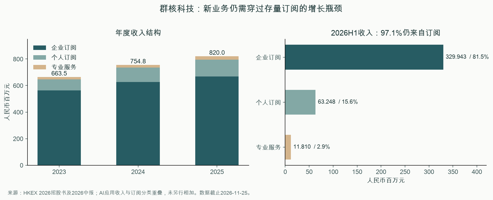
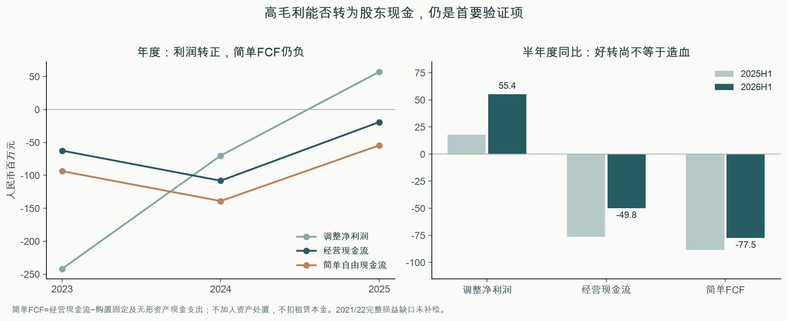

# 群核科技（00068.HK）研究报告

> **数据截止：2026-11-25 21:40（北京时间）**｜股价：2.845港元（11/25收盘）｜总股本：1,729,629,087股（10月底月报，腾讯当日行情一致）｜市值：49.208亿港元，折42.092亿元人民币。
> 估值快照：TTM PS 5.10倍、扣净现金EV/收入3.22倍、调整后PE 44.44倍；保留股份支付经济成本的自定义利润PE为73.32倍，IFRS亏损PE不具意义。财务最新为2026H1，TTM截至2026-06-30；行情更新并不表示财务已更新至11月。
> 研究主线：酷家乐积累了真实的企业工作流和渲染能力，空间智能扩张具有选择权价值；投资判断的关键是客户扩购与每股现金能否改善。

公司身份为开曼注册的 Manycore Tech Inc.，中文通称群核科技，主要产品酷家乐、Coohom；2026-04-17于香港主板上市。2021年美国招股计划不等于现存ADR，本报告不合并任何ADR证券。沿用既有“群核科技”目录和监控ID。本次接续[2026H1财报精读](群核科技-earnings-2026H1.md)，补充完整中报、10月股本及治理公告；旧报告保持原样。

行情由[腾讯快照](https://qt.gtimg.cn/q=hk00068)与[华盛通](https://www.hstong.com/hk/quotes/10000-00068-HK)交叉核实；股本以[港交所10月月报第2页](https://www1.hkexnews.hk/listedco/listconews/sehk/2026/1104/2026110400900.pdf)为准。人民币换算使用11/25港元中间价1港元=0.85539元人民币，来源为[中国外汇交易中心](https://www.chinamoney.com.cn/english/bmkcpr/)当日检索快照及[中间价整理记录](https://currencyapi.com/central-bank-exchange-rates/pboc/hkd)；它是统一估值换算基准，并非可成交汇价，未来汇率固定只是模型假设。

---

## AI研究偏见自觉

**信息丰富度评级：B；空间智能第二曲线单独按C级对待。** 招股书和上市后中报较完整，但上市时间短，独立覆盖有限，AI项目的续约率、净毛利和客户回报尚不足以验证。

AI研究局限性声明：本报告能核对收入、亏损、现金和股本，不能仅凭产品演示证明机器人训练数据有不可替代的价值。未取得2021、2022全年完整的一手损益与独立复核，不能拼成连续五年财务史；也没有季度披露可支持“最近四个单季”分部序列。2026H1现金流已对照富途，收入、净损及现金已对照独立整理；损益股份支付、细分客户留存及素材授权仍有独立第二来源缺口，属于明确的验证限制。公开材料多，不自动等于投资确定性高。

- [x] 不把模型/设计元素总量等同于独占、可无限训练的数据所有权。
- [x] 不把订单、Token调用、注册用户、合作新闻直接转成收入或ARR。
- [x] 不因较招股价下跌约62.66%就认定便宜；比较今天的每股价值与价格。
- [x] 若资料量减半，仍保留两条硬判断：客户愿意付钱有证据，稳定产生股东现金尚待证据。

---

## 第一步：核心数据总览

### 收入地图

金额均为人民币百万元；FY为完整自然年，H1为半年。2025与H1最新数据取自[正式招股书印刷第231—232页](https://www1.hkexnews.hk/listedco/listconews/sehk/2026/0409/2026040900025.pdf)和[完整中报第13—17页](https://www1.hkexnews.hk/listedco/listconews/sehk/2026/0923/2026092300687.pdf)。招股书虽于2026年发布，收入期间仍为2025年。

| 收入类型 | 2025全年 | 2026H1 | H1收入占比 | H1同比 | 收费与利润特征 |
|---|---:|---:|---:|---:|---|
| 企业订阅 | 669.057 | 329.943 | 81.5% | +0.21% | 企业席位、功能与流程；大客深度集成更有黏性 |
| 个人订阅 | 125.730 | 63.248 | 15.6% | +4.19% | 设计师升级付费；替代与流失较高 |
| 订阅小计 | 794.787 | 393.191 | 97.1% | +0.83% | H1毛利率83.8% |
| 专业服务 | 25.207 | 11.810 | 2.9% | +29.3% | 含模型/SpatialVerse等；H1毛利率55.1% |
| **合计** | **819.994** | **405.001** | **100.0%** | **+1.48%** | **综合毛利率82.96%** |



H1海外收入36.932百万元，同比增长11.36%，占总收入9.12%。国内业务接近零增长，海外尚不足以改变整体斜率。AI新应用及新产品收入约31百万元，同比增长177%，约占总收入7.65%，与上述订阅/服务分类存在重叠，**不可再加到405.001百万元之上**。AI Design Factory订单超过20百万元、SpatialVerse订单6.8百万元均是订单口径，不等于当期确认收入。[来源：H1业绩公告第2—4页](https://www1.hkexnews.hk/listedco/listconews/sehk/2026/0827/2026082700656.pdf)。

### 历史盈利与现金

| 指标（人民币百万元，比例除外） | 2021全年 | 2022全年 | 2023全年 | 2024全年 | 2025全年 | 2026H1 |
|---|---|---|---:|---:|---:|---:|
| 收入 | 未取得完整原表 | 未取得完整原表 | 663.540 | 754.830 | 819.994 | **405.001** |
| IFRS净利润 | 缺口 | 缺口 | -646.097 | -513.472 | -427.905 | **-145.780** |
| 调整净利润 | 缺口 | 缺口 | -241.929 | -70.049 | +57.127 | **+55.421** |
| 毛利率 | 缺口 | 缺口 | 76.76% | 80.91% | 82.23% | **82.96%** |
| 经营利润率 | 缺口 | 缺口 | -44.31% | -15.31% | +2.26% | **-2.03%** |
| 经营现金流CFO | 缺口 | 缺口 | -62.568 | -108.188 | -19.217 | **-49.843** |
| 现金购置固定及无形资产 | 缺口 | 缺口 | 31.145 | 30.864 | 35.300 | **27.619** |
| 简单自由现金流 | 缺口 | 缺口 | -93.713 | -139.052 | -54.517 | **-77.462** |
| 期末现金及等价物 | 缺口 | 576.575¹ | 365.823 | 448.818 | 356.927 | **1,114.936** |

¹ 2022现金取2023现金流表期初，可由招股书与ETnet一致核对；它不补足2022全年损益。简单FCF=CFO−购置固定/无形资产现金，不加资产处置收入，不含租赁本金。H1再扣租赁本金5.926百万元后为-83.388百万元。年度收入、净损、毛利、现金及CFO已对照[ETnet损益表](https://www.etnet.com.hk/www/eng/stocks/realtime/quote_ci_pl.php?code=68)、[资产负债表](https://www.etnet.com.hk/www/eng/stocks/realtime/quote_ci_bs.php?code=68)、[现金流表](https://www.etnet.com.hk/www/eng/stocks/realtime/quote_ci_cashflow.php?code=68)；原始现金流见招股书附录I-8、中报第48—49页。H1与2025H1 CFO/Capex已逐列对照[富途现金流量表](https://www.futunn.com/hk/stock/00068-HK/financials-cash-flow)，币种CNY、半年累计；历史Capex及FCF亦对照[StockAnalysis年度表](https://stockanalysis.com/quote/hkg/0068/financials/cash-flow-statement/)，舍入差均在1%内。镜像转载不算独立验证。



2023—2025收入年复合增长11.17%，盈利好转的一部分来自成本收缩：研发费用390.805→290.940百万元，销售费用356.435→274.086百万元。到2026H1，研发回升至160.030百万元，占收入39.51%；销售费用137.018百万元，占33.83%。销售、研发和计算基础设施投入都具有持续性，不能把高毛利全部当作可分配净利。

### 三个不能混用的利润数

H1 IFRS亏损145.780百万元，加回赎回负债变动137.001、上市费29.872、股份支付34.328，得到调整净利润55.421百万元；调整利润另与[证券之星公告摘要](https://stock.stockstar.com/AN2026082700043754.shtml)所列5,542.1万元一致。IPO后赎回负债已转权益，相关费用不应继续外推；股份支付却是员工报酬的经济成本。

本报告把“调整净利润−损益表股份支付”称为**保留股付成本的利润代理**：H1为21.093百万元，2025全年为38.314百万元。它仍包含其他收益、处置和税务影响，也仍加回上市费用，既非IFRS利润，亦非现金利润。权益变动表的股付35.152百万元与损益34.328不是同口径，本文不混用。

| TTM指标（截至2026-06-30，人民币百万元） | 工具重算值 | 解释 |
|---|---:|---|
| 收入 | 825.896 | 2025全年−2025H1+2026H1 |
| IFRS净利润 | -347.545 | 仍受上市前赎回负债会计影响 |
| 调整净利润 | 94.723 | 不能直接当股东现金 |
| 损益股份支付 | 37.312 | 与调整利润桥一致 |
| 保留股付成本的利润代理 | 57.411 | 用于三年估值起点，非公司指引 |
| CFO | +7.076 | 全年/H1季节性后略正，不能写成TTM仍负 |
| 简单FCF | -43.510 | CFO尚不足以覆盖资本开支 |

2025H2的CFO为+56.919百万元，简单FCF为+33.952百万元，故不能将负的2026H1机械翻倍。TTM略正CFO也说明“从未造血”过于绝对；更准确的判断是尚未证明跨周期稳定覆盖投资的能力。

### 资产负债表与数据疑点

6月底现金1,114.936、流动定存461.531、流动FVPL金融资产69.835百万元。排除受限现金，减短债90.037及租赁负债7.886，净流动资金为1,548.379百万元；不计FVPL则为1,478.544百万元。完整口径相当于每股约1.047港元，占当前市值36.79%。这是财务韧性指标，未扣交付预收款对应的成本、未来研发和其他经营负债，**不是清算底价或可立即分红现金**。现金增加主要来自IPO现金净流入1,169.264百万元。

[富途收入构成](https://www.futunn.com/hk/stock/00068-HK/financials-revenue)亦列H1订阅3.93亿元、专业服务1,181万元及海外3,693.2万元，与原件精确数的差异均小于1%。

递延收入从2025年底510.061降至448.387百万元，下降12.09%。招股书解释过三年订阅转一年订阅会压低递延，因此不能全归因于流失；但与NRR同步下降，仍需跟踪新预收、续费及合同期限，不能单用收入确认掩盖获客质量。

中报“半年净增企业1,633家、个人1,189名”的文字实际对应表中同比差额，与招股书年末基数并不相同；本文只用明确同期数据。中报大客订阅179.789百万元占总收入44.39%，占订阅约46%，不得把两种分母混为一谈。

> 巴菲特式追问：如果剔除融资、股付加回和会计赎回变动，今天已经能稳定拿走多少现金？目前只能确认改善，不能确认稳定可分配。

---

## 第二步：生意本质分析

**群核向家居品牌、装修公司与设计师收取持续使用云端空间设计及交付流程的费用，客户付费是为了更快出方案、提高成交与生产衔接效率。**

| 环节 | 客户得到什么 | 群核如何收钱 | 可持续性取决于什么 |
|---|---|---|---|
| 酷家乐/Coohom | 户型、产品素材、参数化设计、渲染与协作 | 订阅、席位及功能升级 | 使用是否能改善成交效率与交付错误 |
| 企业流程集成 | 私有素材、品牌产品、报价/制造等工作流连接 | 企业方案与增购 | 是否成为难替换的流程节点 |
| AI设计/内容 | 更少人工产生可编辑、受约束的方案和内容 | 已有订阅升级及新产品 | 增量付费能否覆盖推理与研发 |
| SpatialVerse | 合成场景、数据与仿真服务 | 早期按项目需求协商 | 任务真实性、复购、标准化与交付毛利 |

订阅模式提供复购机会，但“签了订阅”不保证增长。整体NRR从2023年的106.1%降至2025年98.6%，2026H1进一步为94.4%。同一客户群的收入收缩，需要新客户填补；用户总量增加与收入停滞可以同时发生。

| 客户层级 | 2025H1 NRR | 2026H1 NRR | 2026H1 Logo留存 | 判断 |
|---|---:|---:|---:|---|
| 企业 | 101.6% | 96.4% | 80.6% | 存量客户扩张转弱 |
| 关键客户 | 110.0% | 101.8% | 99.0% | 工作流很黏，扩购明显减速 |
| 个人 | 92.3% | 83.3% | 56.3% | 低转换成本、项目性使用更突出 |
| 整体 | 100.3% | 94.4% | 58.7% | 不能用个人权重较高的整体留存推断大客普遍流失 |

客户数量按公司过去12个月内付费定义，并非期末正在付费的席位，也不是月活。关键客户411家，较上一年同期406家略增、较2025年底424家减少，不能只挑一个比较基期。

经营杠杆有两面：工程和GPU资源利用效率提升，使毛利率逐步提高；销售、研发重新投入后，收入仅增长1.48%仍难覆盖费用。专业服务毛利55.1%，明显低于订阅83.8%，因此空间智能占比上升未必立刻提高总体利润率。好的第二曲线应同时带来收入、复购与现金回收，不能只提高算力消耗。

> 段永平式追问：这门生意好在哪？在企业设计流程中持续节省时间和错误；如果最终只剩更便宜的效果图，生意品质会显著下降。

---

## 第三步：护城河评估

| 护城河来源 | 当前判断 | 支持证据 | 能证伪它的现象 |
|---|---|---|---|
| 品牌与定价权 | 中等，定价权未证实 | 酷家乐在家居场景有分发和认知积累 | 提价后流失、企业NRR持续低于100% |
| 转换成本 | 大客中高、个人低 | 大客Logo99%，私有素材、培训和流程集成 | 大客NRR低于100%、核心客户替换工具 |
| 网络效应 | 中等偏弱的内容效应 | 品牌素材与设计师使用相互促进 | 素材可多平台分发、更多注册不增加付费价值 |
| 规模与成本 | 中等 | 统一渲染工程与资源调度改善毛利 | 推理成本/Capex上升而付费未同步 |
| 技术及数据 | 有积累，领先年数不可核 | 渲染、CAD、场景与约束结合 | 通用/开源工具缩小体验差距，客户自建 |

2025年底披露的479.6百万是“3D模型及空间设计元素”合计，其中公开可用约60.6百万；用户上传素材的所有权仍属用户。展示、推广和使用公开素材的授权，不自动等于排他所有权或任意机器人训练授权。将其统称为“独家数亿物理数据”会高估护城河。[招股书印刷第171—175页相关技术及素材授权说明](https://www1.hkexnews.hk/listedco/listconews/sehk/2026/0409/2026040900025.pdf)。

反面证据来自竞争者自己的产品：[三维家官方帮助文档](https://www.3vjia.com/helpcenter/articles/eb932f36caa?categoryId=bbad21c31d3)已有设计、渲染、报价、下单、拆单和制造流程；[Homestyler官方方案](https://www.homestyler.com/pricing?lang=en_US)有免费渲染与团队素材、AI及接口。闭环和AI功能都不具天然独占性。

过去五年的客户工作流与工程积累可能加深，缺少完整五年经营数据不能给出精确量化评分；可见的近三年成本能力增强、收入留存减弱同时成立。未来五年的关键是把“工具熟练度”升级为“客户系统离不开”，并把数据质量变成任务成功率，而非继续堆素材数量。

> 巴菲特式追问：十年后什么还在？真实产品约束和企业工作流可能仍在；能摧毁它的是设计入口迁移、低价替代，以及AI削弱原有工作流价值。

---

## 第四步：逆向思考与风险清单

最强空方论点是：一家订阅收入几乎不增长、企业客户群收入已收缩、自由现金流仍负的公司，借空间智能进入更不确定且需要持续投入的市场；若增长依赖附赠AI和更多计算，技术领先未必能转化为股东回报。这个论点比“港股没有流动性”更贴近永久损失的来源。

最强多方论点是：公司已有企业分发、素材与工程底座，AI新品可以通过现成渠道变现；当研发与销售重投期结束，收入恢复会释放经营杠杆。当前净现金显著改善，给验证第二曲线留出时间。我们承认这一上行路径，但不把它当已实现事实。

以下概率为定性研究判断，风险可能相关，不能相加为总失败率；与估值情景的主观权重也不是一一对应。

| 失败路径 | 发生可能 | 影响 | 可观察信号 |
|---|---|---|---|
| 家居需求疲弱，续费不足以抵消新增成本 | 中高 | 高 | 企业NRR持续<100%，订阅增长停滞 |
| AI成为免费附赠，算力费用先上升 | 中高 | 高 | AI收入增长而总收入、毛利和FCF不改善 |
| 机器人数据只有试单，没有复购 | 中高 | 高 | SpatialVerse不披露确认收入、复购与项目毛利 |
| 内容/渲染能力被低价替代 | 中 | 高 | 大客NRR跌破100%，替换订单增加 |
| 跨界投入及激励侵蚀每股价值 | 中 | 中高 | 募资用途变化、并购、股数增长快于现金创造 |
| 素材授权、数据或跨境计算限制 | 无可靠概率 | 尾部高影响 | 授权纠纷、受限客户/供应商、重大合规事件 |
| 核心人才流失或技术路线失误 | 无可靠概率 | 中高 | 团队频繁调整、客户交付延误 |

历史类比宜看机制：Autodesk说明专业工作流可以走向高复购和现金创造；低价设计工具也说明漂亮图像本身易于商品化。二者都不能证明群核必然复制某种结局。技术采纳曲线只说明可能有新需求，竞争博弈决定利润归谁；素材量的正反馈也可能被多平台分发稀释。

最可能的分析错误有两个：因当前低增长而错过AI带来的重新加速；或把演示和订单当平台经济，提前支付过高价格。前者通过小规模持续研究弥补，后者需要价格纪律与实际回款证据。

> 芒格式追问：聪明人为什么不买？他们可能认可空间智能方向，却不愿在续费偏弱、经济利润与现金有差距时，先承担商业化不确定性。

---

## 第五步：管理层评估

黄晓煌任董事长，具有GPU/CUDA工程经历；陈航任CEO，朱皓任CTO。持续创始团队是能力积累的信号，但技术履历不能代替资本配置成绩。

| 决策/期间 | 已知行为及结果 | 本报告评价 |
|---|---|---|
| 2023—2025效率调整 | 销售和研发费用明显下降，调整利润转正；留存随后转弱 | 正反面并存；不能把裁减费用全部当成生产率提升 |
| 2025美间业务收缩 | 退出部分2D业务，确认7.464百万元减值 | 愿意止损；也表明延伸产品未必成功 |
| 2026 IPO | 股权融资、优先股转普通股，财务安全改善 | 合理融资；不应再沿用IPO失败/优先股到期的旧风险假设 |
| AI/海外再投资 | 产品、研发、海外销售投入增加 | 回报未定，应以获客、续约及FCF检验 |
| 10/20自愿锁定 | 三创始人与CFO相关权益锁定延长至2027-10-16 | 利益一致性正面，但不等于现金增持或业绩保证 |
| 10/2激励 | 授予3.372百万期权、1.737百万RSU，无业绩目标 | 留人有意义；成本与约束仍需股东监督 |

来源：[招股书](https://www1.hkexnews.hk/listedco/listconews/sehk/2026/0409/2026040900025.pdf)、[10/20锁定公告](https://www1.hkexnews.hk/listedco/listconews/sehk/2026/1020/2026102000087.pdf)、[10/2股权激励公告](https://www1.hkexnews.hk/listedco/listconews/sehk/2026/1002/2026100200067.pdf)。锁定有无现金行权/归属税款处理例外，不覆盖外部投资者出售；本文未取得足够一手文件来判断近期每笔VC减持，不据媒体仓位变动推定经营内幕。

6月底三创始人普通股238、170、65百万股，合计约27.40%的经济权益，单独不足以推定多数控制。CFO披露的3.28%含员工信托视同权益，其个人10.2百万份期权对应约0.59%，不能都写成直接经济持股。章程为每股一票，未发现WVR/AB股差异；经济所有权、代持及法定视同权益须分开。管理层权益原件已核，中报与锁定公告交叉印证数量，但二者均属发行人披露，缺独立穿透确认。

IPO净募集资金约1,334.7百万港元，原计划30%用于海外、20%产品、20%国内销售、20%技术、10%营运。资金将继续投入，不能把账上现金全计作分红余量。尚无足够长的上市回购/分红记录证明资本配置优势；本期不派息。[中报第38—39页](https://www1.hkexnews.hk/listedco/listconews/sehk/2026/0923/2026092300687.pdf)。

> 段永平式追问：CEO退休后是否仍有竞争力？工程与客户系统不会消失，但从家居工具向空间智能延伸仍依赖核心团队判断，现阶段不能按成熟制度型复利公司定价。

---

## 第六步：行业与文明趋势

空间数字化和具身智能可能是长期需求，但群核处在“工具/场景/数据供应商”的价值链环节。机器人整机、基础模型、算力平台和终端客户都可能拿走更多利润。行业变大，只在客户愿意持续购买、供应能力稀缺时才会变成这家公司的现金。

招股书付费行业顾问估计：2024年中国空间设计软件市场33亿元，公司份额23.2%；2029年市场66亿元；全球同期190亿元增至336亿元。这是发行材料中的市场定义与预测，不是独立审计结果，不能把机器人训练总支出直接加进原TAM。[招股书行业概览](https://www1.hkexnews.hk/listedco/listconews/sehk/2026/0409/2026040900025.pdf)。

[NVIDIA Isaac Sim官方说明](https://developer.nvidia.com/isaac/sim/)已覆盖仿真、合成数据、OpenUSD及多来源资产导入，Cosmos可扩充数据。群核可以成为兼容的数据和工具供应商，同时也面临客户自建与标准化工具降低稀缺性。静态家居渲染素材要转为机器人可训练数据，还需要物理参数、传感器、动作交互及真实任务验证，不能直接一比一转换。

现有招股书披露SpatialVerse收入从2024年3.4百万元到2025年5.2百万元、客户从8到16，仍按项目需求协商。新应用在增长，但商业经济还更接近待标准化服务。客户集中度方面，H1没有单一客户超过总收入10%；业务类型和中国家居行业的共同需求暴露，比单一客户风险更突出。计算基础设施/芯片生态有依赖，当前未取得可独立复核的供应商集中度序列，不能给出精确比例。

本次未找到“MVR”“群核万象”等命名的一手支持，报告只使用可核验的SpatialLM、SpatialGen、SpatialVerse、Aholo等产品资料。未将11月硬件联名媒体消息写成已实现增量收入。

> 李录式追问：二十年后是基础设施还是过渡工具？判断点在于能否长期控制不可替代的工作流与任务数据，而非今天被归入哪个AI主题。

---

## 第七步：估值与安全边际

### 今天在付什么价格

| 估值指标 | 结果 | 口径与限制 |
|---|---:|---|
| 股价×股本市值 | 49.2079475亿港元 | 与腾讯49.2079亿、华盛49.21亿一致 |
| 人民币等价市值 | 42.0919862亿元 | 港币市值×0.85539 |
| TTM PS | 5.10倍 | 财务截至6月底 |
| EV/TTM收入 | 3.22倍 | 使用6月底含流动FVPL、扣租赁净现金；非11月实时净现金 |
| TTM调整利润PE | 44.44倍 | 剔除了股份支付，不等于股东现金成本倍数 |
| TTM保留股付成本利润PE | 73.32倍 | 自定义、非IFRS；包含其他收益等 |
| 静态PB | 3.86倍 | 6月底权益÷10月底股数，非最新每股净资产 |
| TTM简单FCF收益率 | -1.03% | 现金投资仍未被CFO覆盖 |
| IFRS PE、PEG | 不适用 | IFRS亏损及低基数利润扭转使常规PEG失真 |

公司上市仅数月，不构造“五年历史估值分位”。相对IPO实际发售价7.62港元，当前价格下降62.66%，但股数、现金和盈利也已变化，不能直接把跌幅当作安全边际。

| 可比对象 | 当前可用估值/经营参照 | 可比性判断 |
|---|---|---|
| 群核 | PS5.10、EV/Sales3.22；H1收入+1.48%，TTM简单FCF负 | 小规模、低增长、AI待验证 |
| Autodesk | 11/24收盘口径PS约6.60、EV/Sales约6.95、GAAP PE约29.10；最新季度收入+17%、GAAP经营利润率26% | 工程/建筑流程更深，已有现金创造，非家居软件直接同质比较 |
| 三维家/Homestyler | 未上市或无可核实时证券估值 | 用作竞争参照，不能编造公开PS |

Autodesk估值为[StockAnalysis当日统计快照](https://stockanalysis.com/stocks/adsk/statistics/)的第三方口径，尚未双源重建其全部市值和EV，只作粗略参照，不作为目标倍数推导输入；最新经营数字取[Autodesk官方FY2027 Q3公告](https://adsknews.autodesk.com/en/pressrelease/autodesk-inc-announces-fiscal-2027-third-quarter-results/)。这组对比至少说明：净现金使群核企业价值倍数更低，但其盈利和现金质量也有明显折价理由。旧报告未经当日核验的同业倍数不沿用。

### 三年三情景：先问贵不贵

采用TTM自定义利润57.411百万元作为起点；预测按正常税负和持续股份支付成本后的经济利润理解，不能将H1零所得税永久外推。三档的增长率是利润增长，不是收入增长；低基数和经营杠杆使二者不同。概率35%/45%/20%均为主观判断，非统计预测。

| 三年后约2029年情景 | 悲观 | 基准 | 乐观 |
|---|---:|---:|---:|
| 主观权重 | 35% | 45% | 20% |
| 收入假设（百万元人民币） | 900 | 1,300 | 2,000 |
| 相对TTM收入年复合增速 | +2.91% | +16.32% | +34.29% |
| 利润年复合增速假设 | +12% | +52% | +94% |
| 工具推导利润（百万元人民币） | 80.658 | 201.616 | 419.180 |
| 隐含经济净利率 | 8.96% | 15.51% | 20.96% |
| 三年退出PE判断 | 12倍 | 18倍 | 25倍 |
| **三年后的价格（港元）** | **0.654** | **2.453** | **7.083** |
| **按8%折回今天（港元）** | **0.519** | **1.947** | **5.623** |
| 从2.845买入的价格年化回报 | -38.74% | -4.82% | +35.53% |

三年PE是中期定价假设，允许反映增长与成熟度；十年终值另用永续公式，禁止把25倍外推为永久倍数。基准收入已需恢复双位数增长，并非维持H1斜率；乐观情景需AI/海外同时规模化。预测没有公司承诺，亦未将订单提前确认为收入。

三年概率加权现值2.183港元，基准现值1.947港元，均低于现价。其作用是提醒买入者已为增长修复支付价格，不能拿乐观7.083港元的潜力替代安全边际。

这里没有另加15.484亿元净现金：模型预测的是全公司净利润及其股权价值，包含资金收益与正常经营资金；当前净现金可继续用于研发、资本开支和客户交付，未视为立即派回。此做法对“现金很快分配”的情形偏保守，也未单列未来留存盈余形成的额外闲置现金。若获得可分配超额现金、回购或资本回报计划，应改做拆分估值并剔除对应利息，不能把净现金和含利息净利润机械双计。现金本身的价值是本模型的重要不确定性。

### 十年压力测试与反向DCF

现金流/利润采用人民币，因此r用人民币口径，最后才换算港币价格；香港上市不意味着必须给人民币现金流套港元折现率。

- r=8%：11/25中债10年国债收益率1.5914%，β取1，股权风险溢价取6.4086个百分点，为研究要求收益率判断；[中债当日曲线](https://yield.chinabond.com.cn/cbweb-cbrc-web/cbrc/showCbrc)。不因AI故事调低r，离散风险不塞入β。
- 稳态增量ROIC=20%：假设软件工作流有一定资本效率、研发现金化后远低于“无限软件回报”。现有ROIC受IPO现金与历史亏损扭曲，尚无可验证成熟ROIC或稳定派息可反推，20%是待验证判断，非已实现事实。
- 永续g为0%/1%/2%，指2036年以后；基准低于人民币2%的上限，反映家居细分市场与技术替代，不能拿前三年的利润跃升作永续增速。敏感性中g不变。

终值唯一来自PE=(1−g/ROIC)/(r−g)，不是同业今天的市盈率。基准为(1−1%/20%)/(8%−1%)=13.5714倍。

| 2036年压力情景 | 主观概率 | 收入假设（百万元人民币） | 净利润假设（百万元人民币） | 永续g | r−g | 公式终值PE | 十年IRR |
|---|---:|---:|---:|---:|---:|---:|---:|
| 悲观 | 35% | 1,000 | 80 | 0% | 8个百分点 | 12.50 | -13.39% |
| 基准 | 45% | 2,500 | 450 | 1% | 7个百分点 | 13.57 | +3.79% |
| 乐观 | 20% | 5,000 | 1,200 | 2% | 6个百分点 | 15.00 | +15.64% |

十年工具的概率加权IRR为+0.15%，是情景IRR的加权平均，不是把期望终值再年化的另一个统计量，不能当作保证收益。十年未单列中途分红和额外融资：k=股息率−额外稀释率=0；股份支付已作为持续经济成本预留，以现金薪酬/抵销股付的等价方式理解，避免对同一笔薪酬重复扣减。若须额外融资、股付抵销成本显著高于预留，实际每股回报更低，须重算。

反向DCF采用相同r、ROIC和基准g，前十年可分配现金暂设零，终值法要求2036净利润约669.594百万元才能让今天42.092亿元市值获得8%回报；按18%净利率，需要收入约3,719.965百万元，较当前TTM收入十年复合增长16.24%。这是“零中途分配”的简化反向DCF压力测试，低估提前分红和闲置现金返还的价值，不是精确市场共识；即便如此，也揭示现价需要持续复苏，而非长期延续1.48%的增长。

| r敏感性 | 工具期望IRR | 是否覆盖该r | 可用于结论的范围 |
|---|---:|---|---|
| 6%（r−2pp） | +3.59% | 未通过 | 币种区间内，但乐观档r−g仅4个百分点，整档仅作情景参考 |
| **8%（基准）** | **+0.15%** | **未通过** | **币种与分母约束均通过** |
| 10%（r+2pp） | -2.34% | 未通过 | 区间外，仅供参考，不参与翻转判断 |
| 7%（补充r−1pp） | +1.71% | 未通过 | 合理区间内，各档分母至少5个百分点 |
| 9%（补充r+1pp） | -1.18% | 未通过 | 合理区间内，各档分母至少7个百分点 |

**在有效的人民币7%—9%检验档位，仓位压力测试不翻转，均未覆盖资本成本。** 6%虽在币种区间内，乐观档分母过窄，不用它论证买入。10%只是r=10%的工具锚点与敏感性参考，不能用作人民币基准要求收益率。

离散风险处理：AI商业化失败、地产及客户流失放入经营情景；VIE/素材与数据监管、跨境算力限制、额外融资及重大人才流失没有可靠概率，仍未建模。中报已确认美间50:50股权与ICP/EDI牌照调整完成，不能把招股前整改状态写成尚未完成，也不能从美间推出全集团核心订阅均依赖VIE。这些未建模风险会限制可信度与仓位。

### 估值分歧对账与机会成本

方向上，本次三年定价、十年压力及8月旧论文均偏谨慎，无需靠十年模型改变买卖方向。分歧在于：大客黏性、净现金与AI机会支持继续研究，尚不支持按成熟复利公司重仓。三年模型回答2.845港元是否便宜，十年模型只限制仓位；**十年未覆盖r不是独立的买入否决票**。

即使删除十年模型，企业NRR低于100%、简单FCF仍负、三年基准与加权现值缺安全边际，也足以支持本次不新增的判断。反之，若未来留存与现金改善，即使十年压力仍弱，也应重新比较价格并允许小仓研究，而不能机械回避。

以当前仓库常用的长期、无杠杆、分散组合为研究场景，更确定的现金创造者和保留现金都构成机会成本；本次不宣称已经完成所有替代标的当日横评，也不为了买AI主题调低r。

> 巴菲特式追问：r错2个百分点会怎样？已跑±2pp与补充±1pp，有效档位没有翻转，但结论仍依赖增长、ROIC和现金分配假设，不能因“不翻转”就说价值精确。
> 段永平式追问：股市关闭五年是否愿按此价持有？以当前可核的经营证据，还不足以给出高确定性肯定回答。

---

## 第八步：最终决策与行动清单

| 六个并列维度 | 综合结论 | 信心度 |
|---|---|---|
| 生意质量 | 企业流程订阅有价值，但收入扩张弱、个人留存差 | 中高 |
| 护城河 | 大客户工作流中等偏强；数据独占和定价权未证实 | 中 |
| 管理层 | 有技术积累、融资与锁定正面；资本回报纪录不足 | 中 |
| 最大风险 | AI收入无法抵消主业疲弱，投入继续侵蚀每股现金 | 中高 |
| 文明趋势 | 空间数字化长期向上，公司获利份额仍待验证 | 中低 |
| 估值 | 三年现值基准1.947、加权2.183港元；十年压力未通过、有效r内不翻转，后者仅约束仓位 | 中低 |

**最终判断：现价观望，不新增；具备可研究的生意基础，尚无足够安全边际升级为长期重仓。** 这个结论由经营、护城河、资本配置、风险和价格共同产生，不由十年IRR单独裁决。

以下仓位仅是上述研究组合场景的风险预算参考，未掌握读者总资产、其他持仓和风险承受度。

| 策略 | 具体行动 |
|---|---|
| 空仓者 | 2.845港元继续观望；在1.40—1.70港元且经营条件全部满足后，才研究首笔约0.25%—0.5%的组合仓位，合计参考不超过1% |
| 已有研究小仓 | 若能承受本金显著损失且核心数据未恶化，可条件式持有至下一披露；暂停加仓，每次披露复核，不将跌幅当加仓理由 |
| 原按高增长逻辑重仓者 | 原增长前提未成立，复核降低至研究风险预算；不能只因为账上现金多就无限摊低成本 |
| 加仓信号 | 后续至少两个连续半年报告期，收入增速恢复≥10%、企业NRR≥100%；滚动CFO为正且简单FCF转正；AI确认收入、回款、复购与毛利可核，股份支付后每股价值改善；价格也须通过重估 |
| 减仓/卖出信号 | 大客NRR持续跌破100%、授权/治理重大红线、现金显著消耗却无复购证据；或股价≥4.00港元而本次基准盈利与现金假设未增强时复核超配，非自动卖出 |

| 港元价位 | 研究含义 |
|---|---|
| <1.40 | 先排查永久损失与融资/数据问题，不默认更便宜就更好 |
| **1.40—1.70** | **条件式小仓研究带**；相对概率加权三年现值留折让，但财务及经营门槛必须通过 |
| >1.70且<4.00 | 等验证或等价差；不是无条件持有/买入带 |
| ≥4.00 | 若模型未上调，复核估值与已有仓位；上涨本身不是卖出理由 |

1.40—1.70是为低留存、现金及模型不确定性留出的研究折让，不是公司指引或价格预测；4.00是仓位复核阈值，不是把乐观目标价改成卖出线。监控在价格≤1.70时触发，也会捕获低于1.40的情况，届时仍先排查风险。

### 复检安排

| 日期/节点 | 性质 | 要核验的内容 |
|---|---|---|
| 2026-12-31 | 本报告自行设定的人工研究检查，非公司财报预约 | 新付费客户、AI项目复购、股本/激励、资本用途；若有新公告提前查 |
| 2027-03-31 | FY2026业绩研究兜底，非已确认发布日 | 收入/留存、完整现金流、递延与合同期限、分业务毛利、SBC及资本配置；按官方披露提前复核 |
| 下一份中期正式披露 | 日期待官方确认 | 第二个半年报告期是否持续满足经营门槛，不能只凭一份全年累计数宣布验证完成 |

2026H1完整中报缺口已补，保留原8/27已完成事件。本报告价带与两个具体人工节点登记到原“群核科技”target；事件仅供人工复核，当前每日监控只扫描注册价格，不自动提醒事件。

### 四位大师方法论点评

以下原话均先读取出处；后面的应用是本报告推论，**不是四位本人针对群核科技的评价或推荐**。

| 方法论 | 可核验短引与出处 | 对本报告的延伸 |
|---|---|---|
| 巴菲特 | “knowing its boundaries, however, is vital.”——[1996股东信](https://berkshirehathaway.com/letters/1996.html) | 理解订阅不等于能同等把握机器人商业化；能力圈外的上行应留作选择权 |
| 芒格 | “inversion will help you solve problems”——[2007 USC演讲转录](https://jamesclear.com/great-speeches/2007-usc-law-school-commencement-address-by-charlie-munger) | AI也会降低竞争对手成本，先研究失败路径，再谈数据溢价 |
| 段永平 | “不懂不投，哪天搞懂了，看见便宜的还是可以投的。”——[2011-07-14原帖](https://xueqiu.com/1247347556/20317351)，[仓库原文第28条](../段永平/段永平雪球全量原发言.md) | 保留未来搞懂并重估的机会；不懂和永远否定是两回事 |
| 李录 | “One common problem for investors is that they tend to swing too often.”——[喜马拉雅资本官网署名投资理念](https://www.himcap.com/) | 长期趋势不是必须立即下注；一旦出现真正可理解的机会，也不能机械不行动 |

> 四位方法论共同追问：下一次付出资本前，有什么新增事实证明客户会留下、付更多钱，并让每股现金增加？

---

## AI分析置信度与投资确定性

AI分析置信度：历史收入、净损、现金、股本及H1 CFO/Capex为中高；利润桥原件可核，但H1损益股付仍缺独立第二源；留存含义与治理为中；三年盈利、十年ROIC/概率和空间智能商业化为中低或低。原始文件正确不意味着预测正确。

实际投资确定性：当前中低。企业工作流有黏性是较有据的判断；空间智能是否成为高回报第二曲线、成熟净利率及现金分配是有限证据下的推理。不能把“AI能写出完整报告”理解成“公司已具确定复利”。

空间智能子业务仍按C级处理，需要一手验证：

1. 访谈实际付费设计/家居企业：最近一次续约、替代选择、AI增购价格与真实节省的工时；区分新品试用与付费使用。
2. 让机器人客户提供对照实验：相同训练预算下，群核数据对真实任务成功率改善多少，能否重复，第二单是否已付钱。
3. 核验素材来源、再训练与下游转授权边界；公开可见不等于商业训练授权。
4. 获取AI业务项目毛利、计算资源现金支出和回款周期，确认规模扩张后是否仍有正贡献。
5. 询问递延下降中合同期限变短与真实流失各占多少，解释中报客户“半年净增”基期疑点。
6. 核验募资资本预算、股付现金等价成本、最新股本及闲置现金返还意愿，重做每股而非总额模型。

---

## 数据来源与审计记录

### 来源层次与缺口

| 数据组 | 一手来源 | 交叉来源 | 验证状态 |
|---|---|---|---|
| 身份、发行与年度损益 | 4/9正式招股书，印刷231—232页及附录I | ETnet损益 | 2023—2025核心历史一致 |
| H1收入/净损、现金/权益 | 9/23完整中报13、44—45页 | ETnet损益/资产负债 | 数值一致，非仅公告镜像 |
| 历史CFO/现金 | 招股书附录I-8 | ETnet现金流 | 数值一致 |
| H1 CFO/Capex及订阅/专业服务收入 | 完整中报15、48—49页 | 富途现金流/收入构成 | 现金流精确一致，订阅3.93亿为舍入值、差异小于1% |
| H1损益股付、企业/个人留存 | 完整中报13—14页 | 暂缺完整独立第二源 | 仅一手可核，保留缺口；模型派生不算独立取证 |
| 股价/股本 | HKEX月报、腾讯当日快照 | 华盛通 | 价格一致；17.30亿是四舍五入 |
| 高管利益与授权边界 | 中报、招股书、10/20及10/2公告 | 文件之间复核，非独立发行人证据 | 缺穿透所有权及客户独立访谈 |
| 2021/2022完整损益、四个单季 | 未取得 | 不使用旧文无出处数字拼补 | 显式留空 |

AAStocks未取得可用财务页，本公司无可匹配ADR，因此未机械套用Macrotrends ADR；替换为HKEX+ETnet、富途及StockAnalysis。其中富途现金流表“购买固定资产”金额与原件“购置固定及无形资产”逐列一致，映射后统一为现金Capex。H1全表转载站虽便于逐字定位，不视为新增独立来源。所有估值金额由共享financial_rigor及terminal_value工具执行，并用Decimal保存更高精度；calc子命令内部存在浮点尾差，报告以Decimal复核后的合理小数位呈现，不把尾数当精确信息。

### 关键数据交叉验证记录

以下为共享工具的原始输出节选；币种和单位保留。完整输出含计算、三情景、十年锚点与flip，见[验算附录](群核科技-validation-20261125.md)，最终参数见[模型JSON](群核科技-model-20261125.json)。

```text
股价 (Price):       2.845 HKD
总股本 (Shares):    1.73B
计算市值:           4.92B HKD
报告市值:           4.92B HKD
偏差:               0.00%
✅ 验证通过, 偏差仅 0.00%
```

```text
交叉验证: FY2025收入 (Cross-Validation)
============================================================
  数据来源数: 2
  参考中位数: 819.99 百万元CNY

  ✅ HKEX原件              : 819.99 百万元CNY  (偏差 0.00%)
  ✅ ETnet独立整理           : 819.99 百万元CNY  (偏差 0.00%)

  ✅ 所有来源偏差 ≤ 2.0%, 数据一致

  共识值 (加权中位数): 819.99 百万元CNY

交叉验证: FY2025净利润 (Cross-Validation)
============================================================
  数据来源数: 2
  参考中位数: -427.90 百万元CNY

  ✅ HKEX原件              : -427.90 百万元CNY  (偏差 -0.00%)
  ✅ ETnet独立整理           : -427.90 百万元CNY  (偏差 -0.00%)

  ✅ 所有来源偏差 ≤ 2.0%, 数据一致

  共识值 (加权中位数): -427.90 百万元CNY

交叉验证: H1现金及等价物 (Cross-Validation)
============================================================
  数据来源数: 2
  参考中位数: 1,114.94 百万元CNY

  ✅ HKEX原件              : 1,114.94 百万元CNY  (偏差 0.00%)
  ✅ ETnet独立整理           : 1,114.94 百万元CNY  (偏差 0.00%)

  ✅ 所有来源偏差 ≤ 2.0%, 数据一致

  共识值 (加权中位数): 1,114.94 百万元CNY
```

工具交叉验证默认容差为2%，以上实测差异均为零，满足本项目1%的要求。

交叉验证完整结果以及抽样核验清单随报告保存；算术与取证是两道检查，前者不能替代独立来源。未建模限制包含素材/数据监管、跨境算力、额外融资与重大人才风险；不虚构其概率，也不把它们藏进折现率。

随机抽检与最终估值口径复检均已完成，数值及参数检查通过。随机清单中“半年”标签内的数字及年份被解析器误识别，已保留记录并剔除；模型假设与历史事实分别标注。完整清单见[抽检记录JSON](群核科技-source-check-20261125.json)。工具“准出”只表示有效抽样数值与参数算式相符，不解除上表的一手单源、历史缺口及预测风险。

监控收尾已完成，原ID保留并新增有效价带；触发配置、每日监控校验及临时状态定点运行通过。跟踪台账新增本次建议事件并接续原事件，相关本地链接已核验。未提交或推送。

本文供学习与研究，不构成投资建议。
