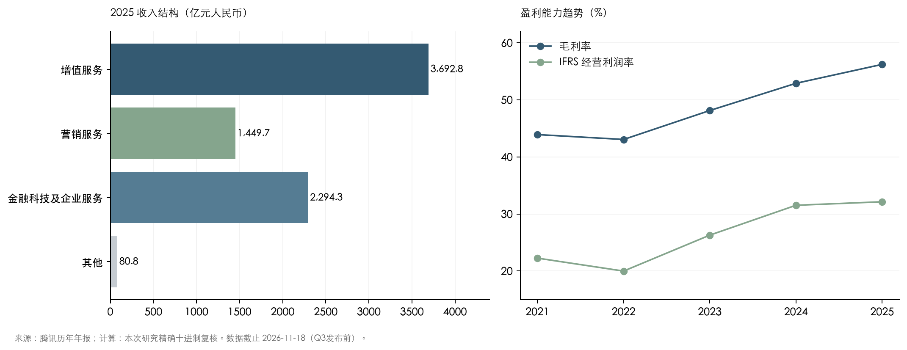

# 腾讯控股（0700.HK）研究报告

> **研究与数据截止：2026-11-18 凌晨，Asia/Shanghai；三季报发布前版本。** 行情为 2026-11-17 收盘后快照；最新已核财务为 2026H1/Q2。腾讯官网日历列今日 20:00 HKT 三季度业绩发布会，报告不预填尚未披露的三季度结果。
>
> **价格：376.00 港元；验算市值：3.418834 万亿港元；TTM IFRS PE：12.42 倍；扣股权激励经济盈利 PE：12.15 倍。** 经营与估值现金流统一人民币，换算采用 11/17 中间价 HK$1＝RMB0.85562。一句话命题：微信关系链让游戏、广告和交易反复变现，但 AI 投入能留下多少每股现金，决定便宜的利润能否成为便宜的资产。

公司身份：腾讯控股有限公司，Tencent Holdings Limited，港交所 00700 港元柜台与 80700 人民币柜台属于同一公司；场外 ADR TCEHY 亦属同一发行人，不能重复加总市值。继续复用 `reports/腾讯/` 和监控 ID“腾讯”。[公司投资者入口](https://www.tencent.com/investors/) · [11/17 行情](https://content.etnet.com.hk/content/cpyrevamp/eng/stock_quote.php?code=00700) · [人民币中间价](https://www.safe.gov.cn/AppStructured/hlw/RMBQuery.do?COLLCC=546877760)

## AI研究偏见自觉

**信息丰富度评级：A。** 腾讯披露充分，真正的盲区不在搜不到收入，而在搜不到每笔新算力投资的现金回报。大量券商覆盖可能放大“好公司自然值得买”的共识，不能提供额外安全边际。

**AI研究局限性声明：** 微信、云和新 AI 产品未单列完整利润及现金流；管理层公布的模型性能与市场领先地位，并非本研究独立实测。部分季度分部毛利、历史公司定义 FCF 与研发仅取得原始披露，尚缺独立副源。下文将历史事实、计算口径和情景假设分开，不把资料多等同于未来确定。

- [x] 确定性来源：现有关系链与复购有经营证据；未来 AI 盈利是判断。
- [x] 资料减半：对生意机制的判断大体不变；对未来增速、终值与仓位的信心会下降。
- [x] 共识反检：重点检验“利润在涨、可分配现金却减少”的空方论点。
- [x] 锚定排除：不以历史最高股价、卖方目标价或旧报告成本作为价值依据。

---

## 第一步：核心数据总览

除注明外，金额均为**亿元人民币**；百分比由原始百万元金额精算。IFRS 为国际财务报告准则，Non-IFRS 为公司调整口径；后者排除了股权激励等真实经济成本。

### 五年盈利与现金

| 财年 | 收入 | 毛利率 | IFRS经营利润率 | IFRS归母 | Non-IFRS归母 |
|---|---:|---:|---:|---:|---:|
| 2021 | 5,601.18 | 43.91% | 22.26% | 2,248.22 | 1,237.88 |
| 2022 | 5,545.52 | 43.05% | 19.98% | 1,882.43 | 1,156.49 |
| 2023 | 6,090.15 | 48.13% | 26.28% | 1,152.16 | 1,576.88 |
| 2024 | 6,602.57 | 52.90% | 31.52% | 1,940.73 | 2,227.03 |
| 2025 | 7,517.66 | 56.21% | 32.13% | 2,248.42 | 2,596.26 |

| 财年 | 经营现金流 | 公司定义FCF，约数 | 总现金 | 净现金，负数为净债 | 研发费用 |
|---|---:|---:|---:|---:|---:|---:|
| 2021 | 1,751.86 | 1,081.00 | 2,812.86 | -202.43 | 518.80 |
| 2022 | 1,460.91 | 884.00 | 3,195.31 | -148.32 | 614.01 |
| 2023 | 2,219.62 | 1,670.00 | 4,033.58 | 547.40 | 640.78 |
| 2024 | 2,585.21 | 1,553.00 | 4,154.13 | 767.98 | 706.86 |
| 2025 | 3,030.52 | 1,826.00 | 4,948.78 | 1,071.45 | 857.47 |

总现金包括现金等价物、定存与其他库务资金；净现金扣借款和票据，**未扣租赁负债**。公司 FCF 按各期公开定义列示，金额四舍五入，不能与“经营现金流减固定资产采购”数据库口径混用。利润与毛利原件来自[2025年报财务摘要](https://static.www.tencent.com/uploads/2026/04/09/62d786fcf3d3c8cb7e54791ee95439ac.pdf)，现金构成及研发补读[2024年报](https://static.www.tencent.com/uploads/2025/04/08/1132b72b565389d1b913aea60a648d73.pdf)、[2023年报](https://static.www.tencent.com/uploads/2024/04/08/e95c902973fc282be3b3e285c6245281.pdf)、[2022年报](https://static.www.tencent.com/uploads/2023/04/06/214dce4c5312264800b20cfab64861ba.pdf)；FCF历史见[公司投资者演示](https://static.www.tencent.com/uploads/2026/03/27/c8736de5d9eb9f55aaa90c99212ca9a8.pdf)。收入、归母和经营现金由 [StockAnalysis损益表](https://stockanalysis.com/quote/hkg/0700/financials/)及[现金流表](https://stockanalysis.com/quote/hkg/0700/financials/cash-flow-statement/)交叉核对。

2021、2022 的 IFRS 利润受投资收益影响，不能将后来的利润变化全解释为主业衰退或复苏。五年毛利率改善有事实支持；2026 新算力支出是否能复制这一回报，尚无同等证据。



### 收入结构与最近四季

2025 全年增值服务收入 3,692.81，营销服务 1,449.73，金融科技及企业服务 2,294.35，其他 80.77；增值服务包括游戏和社交内容，不能再把游戏收入叠加为集团收入。

下表每格为“收入 / 分部毛利率”；金融科技与企业服务仍是合并分部，不能把它的毛利率称作“腾讯云毛利率”。

| 季度 | 增值服务 | 营销服务 | 金融科技及企业服务 | 其他 | 总收入 |
|---|---:|---:|---:|---:|---:|
| 2025Q3 | 958.60 / 61.15% | 362.42 / 56.70% | 581.74 / 50.21% | 25.93 / 15.97% | 1,928.69 |
| 2025Q4 | 899.20 / 59.54% | 411.16 / 59.73% | 608.18 / 50.74% | 25.17 / -26.46% | 1,943.71 |
| 2026Q1 | 961.10 / 62.56% | 381.71 / 54.99% | 598.85 / 52.06% | 22.92 / -44.85% | 1,964.58 |
| 2026Q2 | 984.14 / 63.94% | 435.65 / 57.31% | 602.86 / 52.12% | 25.20 / -35.08% | 2,047.85 |

| 季度 | IFRS归母 | Non-IFRS归母 | 公司FCF，约数 | 权责资本开支 |
|---|---:|---:|---:|---:|
| 2025Q3 | 631.33 | 705.51 | 585.00 | 129.83 |
| 2025Q4 | 582.60 | 646.94 | 340.00 | 196.32 |
| 2026Q1 | 580.93 | 679.05 | 567.00 | 319.36 |
| 2026Q2 | 560.22 | 684.15 | -138.00 | 527.84 |

来源：[2025Q3公告](https://static.www.tencent.com/uploads/2025/11/13/e63656944030f90a5e4c8f1718d8bdd6.pdf)、[2025Q4业绩](https://static.www.tencent.com/uploads/2026/03/18/e6a646796d0d869acc76271c9ee1a6a5.pdf)、[2026Q1业绩](https://static.www.tencent.com/uploads/2026/05/13/47382ae415a209fd161bc19a1f9b3704.pdf)、[2026中报](https://www.tencent.com/wp-content/uploads/2026/08/E700_IR.pdf)。Q1分部毛利由中报半年值减Q2复算，季度分部毛利仍有独立副源缺口。

Q2 国内游戏收入约 473 亿元、同比 +17%；国际游戏约 186 亿元，人民币同比 -0.8%，固定汇率 +4%；广告同比 +22%，金融科技与企业服务 +9%。微信及 WeChat 合并月活账户 14.39 亿，是账户数，并非去重人口。收费增值服务订阅账户约 2.59 亿，同比 -2%，说明大用户基础也会有成熟业务压力。[Q2公司发布稿](https://www.tencent.com/wp-content/uploads/2026/08/Tencent-Announces-2026-Second-Quarter-Results.pdf)

### 现金桥：为什么不能只看利润

2026-06-30 总现金为 5,111.54，借款 2,989.42、票据 1,540.21，净现金 581.91；再计入租赁负债会更低。公司Q2 FCF约 -138，剔除算力采购预付款后约 +376。两者之差解释付款时点，不能把已经付出的钱永久加回。权责资本开支与现金采购额也不是同一指标。[中报现金及现金流章节](https://www.tencent.com/wp-content/uploads/2026/08/E700_IR.pdf)

近十二个月截至2026年6月的现金代理按下表搭桥；此表统一使用**百万元人民币**，保留底层精度。

| 现金桥项目 | 金额 | 口径 |
|---|---:|---|
| 合并经营现金流 | 305,848 | 已扣经营税款 |
| 减固定资产及预付款 | 137,539 | 现金支出，非权责capex |
| 减无形资产与土地现金支出 | 25,048 | 包含内容等，不再另扣一遍媒体支出 |
| 减租赁本金 | 7,154 | 融资现金流中的必要支付 |
| 现金余量 | 136,107 | 仍不是归母FCFE |
| 减现金利息 | 12,585 | 本公司列于融资现金流 |
| 减合并股权结算SBC经济成本 | 23,309 | 使用现金流加回的范围 |
| 加收到的利息 | 15,599 | 投资现金流，前述CFO未包含 |
| 加收到的股息 | 7,395 | 只加真实收到的投资现金 |
| 减支付少数股东股息 | 2,169 | 现金分配近似，未完全剥离少数股东再投权益 |
| **股东现金代理** | **121,038** | **约1,210.38亿元，仍属近似** |

不能从合并CFO减去后文“归母调整表SBC 307.56亿元”：后者还包含联营等归属和结算范围，可能重复扣费。上表用合并股权结算SBC 233.09亿元；现金结算费用已通过CFO支付。这个代理没有扣全部并购和财务投资，也未完整分割各子公司少数股东的保留现金，因此不是公司披露的严格归母FCFE。[年报现金流表](https://static.www.tencent.com/uploads/2026/04/09/62d786fcf3d3c8cb7e54791ee95439ac.pdf) · [半年现金流表](https://www.tencent.com/wp-content/uploads/2026/08/E700_IR.pdf)

10月公司又发行18亿美元及260亿元人民币票据，已于10月22日上市。这证明融资渠道仍在，不能据此推断11月净现金增加同等金额。**即将公布的Q3资产负债表截止9月30日，也不能包含10月融资**；需要在期后事项中另行桥接。[发债定价公告](https://www.tencent.com/wp-content/uploads/2026/10/Notes-pricing-press-release-EN_1014.pdf) · [上市公告](https://www.tencent.com/wp-content/uploads/2026/10/e700_Joshua-PS-Publication-Announcement.pdf)

> 段永平式追问：如果盈利增长却长期留不下每股现金，自己看懂的是生意，还是报表上的调整利润？

---

## 第二步：生意本质分析

**腾讯把高频关系与交易场景变成低获客成本，再向玩家卖内容、向商家卖转化、向企业卖支付与技术服务；复购来自关系、体验和实际效果。** 微信并不直接向大多数用户收“社交租金”，不能把全部使用时长都当成可变现广告库存。

| 业务 | 谁付款、为何重复 | 关键利润变量 | 成本与替代 |
|---|---|---|---|
| 游戏 | 玩家为长期娱乐、道具、社交体验付费 | 常青游戏留存、付费深度、新品补充 | 研发与IP、渠道分成、运营；网易和全球游戏产品 |
| 社交内容 | 用户买音乐、视频等会员或虚拟服务 | 续费、版权效率、内容周期 | 版权与分成；短视频及其他内容 |
| 广告 | 商家为有效转化持续投放 | 每次展示回报、负载、闭环成交 | 用户体验、内容与推理成本；字节及快手 |
| 支付及企业服务 | 商家付交易费，企业买云与工具 | 交易活跃、费率、资源利用率 | 通道、服务器与电力；阿里、华为等 |

真正推动未来利润的三个变量：游戏能否持续用新品补老品，广告能否提高商家转化而不过度消耗体验，以及新增算力的毛利能否覆盖折旧、采购和持续推理。总用户数更接近成熟底盘，不能成为未来高速增长的主要假设。

Q2分部毛利率显示内容与广告具有较强毛利能力，支付与云混合业务受通道和资源成本影响。作为参考，网易同日数据库显示集团毛利率约67.15%，高于腾讯；这反映业务组合，不能据此断言腾讯游戏竞争力更差，也不能声称腾讯集团毛利率高于游戏为主的网易。[网易同日统计](https://stockanalysis.com/quote/hkg/9999/statistics/)

经营杠杆正在分化：核心业务毛利增加，但新AI产品投入压住利润。Q2 Non-IFRS经营利润为756.36亿元，剔除新AI产品后约861亿元；差额约104.64亿元只说明该剔除口径下的影响，不能全部叫训练成本或等同AI资本开支。Q2研发272.78亿元，约占收入13.32%，研发费用与资本化算力也不能相加后都从利润再扣。[Q2业绩及中报费用附注](https://www.tencent.com/wp-content/uploads/2026/08/E700_IR.pdf)

> 段永平式追问：只能用一句话说明好在哪里——关系和工作流降低获客成本，用户和商家因有效服务重复付钱；新增AI业务要重新证明这句话。

---

## 第三步：护城河评估

| 护城河 | 判断 | 证据与边界 | 未来变窄的信号 |
|---|---|---|---|
| 网络效应 | 强 | 好友、群、商家、小程序、支付相互增强；关系网最难复制 | 聊天仍在，但搜索、交易和商业决策被外部代理截流 |
| 转换成本 | 强但可多栖 | 迁移整套关系和工作流困难，用户仍可同时用其他应用 | 商家和用户在重要场景共同迁移 |
| 规模效应 | 中强 | 游戏运营、广告系统、基础设施复用 | 推理成本与硬件更新吃掉规模收益 |
| 品牌与定价权 | 中 | 好游戏与广告效果有差异化；支付费率有约束 | 广告靠加负载、游戏靠透支付费，留存恶化 |
| 技术与专利 | 中，基础模型未证实 | 产品工程、广告算法、游戏运营有积累 | 模型迅速商品化，新增算力缺乏超额回报 |

过去五年，微信交易与内容生态加深，毛利结构改善；同时外部短视频分走注意力，不能把全公司的护城河概括为单向变宽。未来五年更可能是“关系链保持，利润入口重新争夺”。竞争者花大钱复制软件界面比较容易，复制一整套关系和交易习惯很难；但绕过商业入口比复制微信本身更值得防。

这也是不把“最新模型表现领先”直接写成护城河的原因。11月4日公司发布Hy4，提及视觉、计算机操作及多产品接入，性能和领先地位主要来自公司测试。产品发布是事实，可持续独占利润尚待证明。[Hy4官方发布](https://www.tencent.com/tencent-launches-hy4-joining-the-ranks-of-the-worlds-leading-open-source-ai-models/)

> 巴菲特式追问：十年后仍在的可能是关系网络；最可能摧毁回报的，是关系还在而利润池迁移，以及为守入口投入过多资本。

---

## 第四步：逆向思考与风险清单

聪明人不买腾讯，可以提出一个比“游戏和广告要完了”更强的论点：**现有业务继续增长，但新增AI收益不足以补偿算力、人才和补贴成本，利润增长与股东现金长期脱节。** 这种情况下，低PE也可能合理。

| 失败路径 | 主观可能性 | 影响 | 可观察预警 |
|---|---|---|---|
| AI资本回报长期不达标 | 中高 | 持续消耗现金，压缩股东回报 | 预付款续增、资源利用与增量毛利不明 |
| 游戏新品不能补老品 | 中 | 高毛利业务增长和估值同降 | 长青游戏留存走弱，新品净流水不足 |
| 广告增长透支用户体验 | 中 | 利润释放不可持续 | 负载提升但转化、时长及商家续投下降 |
| AI助手重构商业入口 | 中，时间不确定 | 微信保留通信却丢失部分广告与交易价值 | 真实跨应用交易迁移，非下载量排名 |
| VIE合同或监管重击 | 低频、极高影响 | 经济权益和许可受损 | 正式监管、合同执行与治理变化 |
| 地缘限制扩大 | 中低、极高影响 | 算力供给、海外游戏与资本渠道受压 | 官方名单、出口许可或资产审查决定 |
| 资本配置与继任失误 | 中 | 错买资产、高估新增资本回报 | 净股数、现金和每股价值背离 |

上述定性概率不能相加，也不是统计频率。AI投入和业务减速进入经营情景；VIE失效与重大制裁未纳入三档概率模型，其永久损失不能靠温和悲观档覆盖。

美国2026年6月正式通知仍列腾讯，公司对此有争议。美国CMC指定与CMIC证券投资限制属于不同制度，不能据前者直接断言“美国投资者已被禁止持有腾讯”；应持续读正式更新。[美国正式通知](https://www.govinfo.gov/content/pkg/FR-2026-06-10/pdf/2026-11571.pdf) · [公司10月风险披露](https://www.tencent.com/wp-content/uploads/2026/10/e700_Joshua-PS-Publication-Announcement.pdf)

历史类比只用于检验机制：门户和通信产品可以继续存在，却失去下一代入口的超额利润；AOL等案例提醒“仍有用户”与“资本持续高回报”并非同义。微信拥有支付和商家工作流，不能机械照搬历史失败结局。网络效应理论解释存量黏性，技术采纳曲线解释迁移可能缓慢，竞争博弈则提示各家可能同时增投、共同压低行业回报。

最容易犯的分析错误，是把微信的高存量回报直接赋予每一笔新GPU采购；其次是锚定旧高价，或只挑成功工作室而忽略失败投资。

> 芒格式追问：若公司主业判断正确却赚不到钱，最可能错在资本开支、买入价，还是对尾部损失的承受能力？

---

## 第五步：管理层评估

马化腾仍任董事长兼CEO，刘炽平任总裁，微信、游戏及云有各自经营负责人。创始人体系与长期产品团队能提供组织连续性；对重大资本配置与继任效果仍不能假设无风险。[官网管理团队](https://www.tencent.com/who-we-are/our-team/)

| 决策 | 结果与评价 | 研究评分 |
|---|---|---|
| 将社交网络延展至内容、支付、商家工作流 | 多业务共同降低分发和获客成本；并非每个业务都成功 | 高 |
| 收购并长期经营全球游戏工作室 | Supercell等形成全球资产；缺完整逐笔收购IRR | 中高，回报验证不完整 |
| 向股东分派投资资产 | 曾将美团股权直接返还，表明资本可退出集团资产池 | 正面 |
| 2025年约800亿港元回购 | 回报股东有实绩，但要扣新发股、奖励与股权激励的效果 | 正面，须逐股核算 |
| 2026年加大AI采购并融资 | 既可能保住入口，也可能降低资本回报 | 待证，不能提前打高分 |

历史交易与回报事实见[Supercell收购公告](https://static.www.tencent.com/storage/uploads/2019/11/09/ce24bf41302512c8787a1415419e87d5.pdf)、[Prosus业绩原文中的美团分派](https://prosus-ir.com/results/2023/Prosus-annual-results-2023/pdf/booklet.pdf)及[腾讯年报](https://static.www.tencent.com/uploads/2026/04/09/62d786fcf3d3c8cb7e54791ee95439ac.pdf)。未计算收购IRR，也未证明回购发生在全年最优时点。

截至2026年6月，马化腾按证券披露归属权益804,859,700股、8.85%；其中709,859,700股为相关公司直接持有，95,000,000股为基金会相关间接权益，**不能全部当成个人可自由消费的经济权益**。Prosus约22.60%。普通股不是创始人AB超级投票结构；创始人有影响力，但没有仅凭8.85%即获绝对控制的结论。[中报股东章节](https://www.tencent.com/wp-content/uploads/2026/08/E700_IR.pdf) · [ETNet同日持股资料](https://content.etnet.com.hk/content/cpy/eng/company_info.php?code=700)

人才激励有必要，股权激励仍是成本。研发绝对额、回购金额和管理层持股均不能单独证明资本配置优秀；要看投入后每股盈利、现金和净股数是否共同改善。报告不将回购金额直接加为收益率，以免和每股增长重复计算。

> 段永平式追问：CEO退休后关系网络大概还在；组织是否还能克制地投AI、拒绝低回报项目，才是“对的人”能否转成“对的制度”。

---

## 第六步：行业与文明趋势

AI具有通用技术属性，但基础模型、算力供给和应用分发未必由同一层获得超额收益。腾讯位于应用、分发与企业基础设施的交界：可以用AI提高现有广告和游戏效率，也可能需要向上游支付更多成本来守住现有收益。

| 利润池 | 机会 | 必须验证的经济性 |
|---|---|---|
| 存量广告与游戏 | 提升推荐、制作和运营效率 | 净增毛利超过推理、研发和体验代价 |
| 办公、编码与消费代理 | 新订阅及付费使用 | 价格恢复后的付费留存、单位推理毛利 |
| 企业云与算力 | 需求扩张、资源利用提升 | 收入不靠低回报硬件转售，折旧后仍创造现金 |
| 微信内代理与交易 | 关系与商家网络降低获客成本 | 隐私合规、交易转化和用户信任 |

Hy4于11月才发布，公司所述部分免费窗口已在11月15日结束。**Q3财务不能验证Hy4上线后的付费留存**，需要Q4及之后数据。当前可判断它加入竞争，无法判断最终商业赢家。[Hy4发布及活动条款](https://www.tencent.com/tencent-launches-hy4-joining-the-ranks-of-the-worlds-leading-open-source-ai-models/)

本次未取得同口径、双源可核的全球游戏、数字广告与AI软件TAM，以及腾讯在各自市场的最新统一份额；不相加出一个巨大的“总TAM”。需求侧玩家和广告主广泛分散，但利润可能集中在少数游戏与场景；供应侧高端算力、基础硬件和IP具有集中风险，具体厂商依赖程度未完整披露。长期最重要的不是行业名义规模，而是需求增长能否留在每股现金里。

> 李录式追问：二十年后值得拥有的是掌握关系、交易与信任的基础设施，还是今天某个模型排名？腾讯更接近前者，但这不能免除对新增资本回报的检验。

---

## 第七步：估值与安全边际

### 当前市场定价与口径

采用官方10月底已发行普通股9,092,644,829股，库存股为零；Renavon/Webbsite的10月15日记录相同。该数是最新核到的正式股本，**不假装成11月17日逐笔实时股数**。乘376港元得3,418,834,455,704港元，与ETNet的3,418.834十亿港元一致。[官方月报](https://www.tencent.com/wp-content/uploads/2026/11/e_THL_monthly-return-October-2026.pdf) · [独立股本历史](https://webbsite.renavon.com/dbpub/outstanding.asp?i=3601)

| 指标 | 本报告验算 | 说明 |
|---|---:|---|
| 市值，万亿港元 | 3.418834 | 价格乘正式股本 |
| 市值，亿元人民币 | 29,252.23 | 声明中间价换算 |
| TTM收入，亿元 | 7,884.83 | FY2025＋H12026－H12025 |
| TTM IFRS归母，亿元 | 2,355.08 | 同上 |
| TTM Non-IFRS归母，亿元 | 2,715.65 | 尚含被加回的SBC |
| TTM经济盈利，亿元 | 2,408.09 | 减归母调整表SBC307.56亿元 |
| PE：IFRS / Non-IFRS / 经济盈利 | 12.42 / 10.77 / 12.15 | 都是市值除对应归母盈利 |
| PS / PB | 3.71 / 2.58 | PB用6月归母权益，非11月实时净资产 |
| EV/收入，简化 | 3.64 | 仅扣6月公司定义净现金，不是最新完整EV |
| 公司TTM FCF收益率 | 4.63% | 约1,354亿元，四季约数相加 |
| 现金代理收益率 | 4.14% | 约1,210.38亿元 |
| 已宣派年度现金股息收益率 | 1.41% | 每股5.30港元，未来股息未保证 |

这些每股盈利是为估值用当前正式股数还原的等价值，不能冒称公司披露的历史加权稀释EPS。PEG取决于选取利润口径和增长假设，单列一个平台PEG会制造虚假可比性，本报告不以其定价。

作为校验排除项，[StockAnalysis统计页](https://stockanalysis.com/quote/hkg/0700/statistics/)股本8.99B及市值3.382T与官方/ETNet相差约1.13%和1.08%，供应商调整原因未核明，不能猜成奖励股剔除；其FCF定义也较宽。采用已对上的正式股本组，保留异常而不混算。

历史比较：[同一数据库的年末IFRS PE](https://stockanalysis.com/quote/hkg/0700/financials/ratios/)2023、2024、2025分别约21.63、18.44、21.63倍，当前同库12.80倍，足见压缩；该序列的历史价格经过调整，不与未复权历史最高价混算，也不据三年样本宣称“十年最低分位”。同日第三方PE参考：网易16.31、阿里19.90倍；[网易](https://stockanalysis.com/quote/hkg/9999/statistics/)现金更充裕且业务集中，[阿里](https://stockanalysis.com/quote/hkg/9988/statistics/)受其他投入和业务结构影响。此为单一数据库横截面，未逐家公司双源重建，不能证明腾讯应回归某个同行倍数，更不能拿它确定十年终值。

### 三年三情景：利润价格是否有吸引力

从TTM Non-IFRS归母减同范围SBC，得到经济盈利2408.09亿元；以正式股本及声明汇率还原，当前经济EPS约30.9529港元。该口径仍含联营收益，**不另全额加回投资资产和现金**；未来增长不另附回购收益。以下增速和三年交易PE均为判断，三年交易倍数不用于十年终值。

| 情景 | 年EPS增速 | 三年交易PE | 三年EPS，港元 | 三年股价，港元 | 按8%折至今日 | 股价累计回报 | 加股息近似年化 |
|---|---:|---:|---:|---:|---:|---:|---:|
| 悲观 | 0.00% | 12.00 | 30.95 | **371.43** | 294.86 | -1.21% | +0.99% |
| 基准 | 8.00% | 16.00 | 38.99 | **623.87** | 495.25 | +65.92% | +19.38% |
| 乐观 | 12.00% | 20.00 | 43.49 | **869.73** | 690.42 | +131.31% | +33.05% |

基准假设游戏、广告和支付稳步增长，新AI不形成长期净拖累；乐观要求新AI产生经济回报，悲观为利润停滞但网络仍能经营。最后一列把三年每年5.30港元股息在期末一次计入，没有做实际现金时点IRR，也未扣税费或假设股息增长。若发生永久性权益损坏，损失可大于悲观档。

**三年利润视角：现价相对基准折现值有吸引力，但这个判断依赖利润转成现金；不能把623.87港元的三年终点当今日内在价值。**

### 现金DCF与反向定价

将近十二个月现金代理1210.38亿元圆整为**可持续归母FCFE假设1200亿元**；这是假设，非公司披露FCFE，也不是宣布AI开支已见顶。公司合并与归母的剩余差异、未来维持和增长投入的现金消耗，都会改变它。FCFE已经扣必要再投资和SBC经济成本，年度全额进入价值模型，**不再留一笔资金重复扣增长投入**。

模型：V＝ΣFCFEₜ/(1+r)ᵗ＋FCFE₁₁/((r−g)(1+r)¹⁰)。基准前十年现金增速6%，其后g为1%，r为人民币8%。终值若写成利润PE，则E₁₁＝FCFE₁₁/(1−g/ROIC)，PE＝(1−g/ROIC)/(r−g)，与现金戈登式严格等价；直接预测FCFE时ROIC在转换中抵消，不能再声称ROIC给DCF额外增加价值。

| 情景 | 起点FCFE假设，亿元 | 前十年增速 | 永续g | 今日现值，港元/股 |
|---|---:|---:|---:|---:|
| 悲观 | 1,000.00 | 0.00% | 0.00% | **160.67** |
| 基准 | 1,200.00 | 6.00% | 1.00% | **323.99** |
| 乐观 | 1,900.00 | 10.00% | 2.00% | **769.32** |

基准现金现值约**323.99港元**，376港元较之高约16.05%；在同一现金起点、永续g和r下，现价隐含前十年现金年增约**7.97%**。市场并未要求不可实现的增速，但要求可分配现金增长，而不只是调整利润增长。现金基准对r同样敏感：r为7%、8%、9%时约382.91、323.99、280.03港元，不能把323.99当无误差的单点真值。

### 十年仓位压力测试

本节回报为人民币名义口径，港元价格仅按当前声明汇率换算；未来汇率变化会改变港元实际回报。

人民币现金流配人民币r。基准r＝8%，合理区间6%—9%；11/17十年国债收益率1.6055%，β规范化取1，余下约6.3945个百分点为研究者选择的权益风险补偿，非市场直接报价。VIE、制裁等离散风险不塞入r或β。[中债曲线](https://yield.chinabond.com.cn/cbweb-pbc-web/pbc/more?locale=cn_zh)

稳态增量ROIC取20%：这是对平台与AI混合投入的判断，不把早期微信的高存量回报无限外推。缺少分业务增量ROIC，故不伪称已实测；低派息反推且把所有留存视作再投资时只构成宽泛下界，亦非AI真实回报。未来十年经济利润增长悲观0%、基准6%、乐观10%；永续g另取0%、1%、2%，基准低于人民币2%上限。情景权重30%/50%/20%为主观建模权重，不是预测概率的客观统计。

| 情景 | 权重 | 十年利润增速 | 终年经济盈利，亿元 | 永续g | r−g | 退出PE | 工具近似年化IRR |
|---|---:|---:|---:|---:|---:|---:|---:|
| 悲观 | 30.00% | 0.00% | 2,408.09 | 0.00% | 8.00pp | 12.50 | +1.29% |
| 基准 | 50.00% | 6.00% | 4,312.52 | 1.00% | 7.00pp | 13.57 | +8.18% |
| 乐观 | 20.00% | 10.00% | 6,245.97 | 2.00% | 6.00pp | 15.00 | +13.34% |

退出倍数只来自永续增长公式，三档分子分别为1、0.95、0.90；分母为8、7、6个百分点，基准准出检查满足约束。该工具约定以终年盈利直接乘PE，未再乘下一年增长因子，属于其保守的期末倍数惯例；现金DCF则按下一年现金流计算终值，二者时点已明确区分。

工具的“IRR”实际为终值资本利得几何年化加k，k取1%作为保守股息增量；因盈利已扣SBC，**不再扣同一笔稀释，不另加回购收益**。它不是逐年股息折现求根的严格现金IRR。三档近似年化的加权均值为**+7.15%**，不是期望终值再年化的组合收益，也未纳入VIE失效/重大制裁尾部，不能当承诺。

| 折现率敏感性 | 近似年化加权值 | 相对本档r | 有效性 |
|---|---:|---|---|
| r−2pp：6% | +10.79% | 工具显示通过 | 币种内，但乐观档r−g仅4pp，违反分母约束；仅情景参考，不作合格估值依据 |
| 基准：8% | +7.15% | 未通过 | 币种及分母均合格 |
| r+2pp：10% | +4.51% | 未通过 | **币种区间外，仅供参考** |
| 补充r−1pp：7% | +8.80% | 通过 | 币种内，所有分母至少5pp |
| 补充r+1pp：9% | +5.74% | 未通过 | 币种及分母均合格 |

**结论在合法的7%—9%区间内翻转，对折现率敏感，仓位建议须降级。** 不为了买入而选择7%，也不用8%未通过单独否决买入或持有。十年表只做仓位压力测试，不能替代生意与定价判断。

另以完全主观的5%尾部概率、十年末仅收回今日市值20%作现金模型示意，基准现金现值从323.99降至约309.53港元；这只是说明尾部不能忽略，未声称5%是可证实概率，也未充分覆盖各种制裁/VIE损失。

### 估值分歧对账

| 分歧来源 | 结果 | 实际回答 |
|---|---|---|
| 三年经济盈利 | 基准今日值495.25港元 | 现价按盈利定价有吸引力 |
| 现金DCF | 基准323.99港元 | 按当前现金兑现能力，安全边际不足 |
| 十年压力 | 加权近似年化7.15%，合法区间内随r翻转 | 新增或集中仓位应收紧 |
| 既有thesis | 对关系网络、生意质量长期正面 | 不能因一次折现测试抹去经营证据 |

本报告的现价“观望新仓、持有复检”来自**现金兑现差距、财报前尚未验证的AI资本回报，以及价格缺少稳健现金安全边际**，不是十年模型的一票否决。若Q3及后续数据证明归母现金提升，可以在同一r下上修现金起点与价值，而非先降r迎合买入。

### 可执行的价格带

| 港元价格 | 研究动作 | 必要条件 |
|---|---|---|
| 低于300 | 先排查永久损失，再评估机会 | 不因跌破下沿自动买入 |
| **300—330** | **有条件小额分批研究** | 正式披露后现金与经营条件通过；不是保证底价 |
| 330—500 | 现价376属此带，已有合理仓位持有复检 | 新仓等待现金确认，不能只看非准则PE |
| 500—550 | 不追高，重新核算兑现程度 | 现金模型未上修时检查集中度 |
| **550及以上** | **估值与超配警戒** | 经营仅达基准时评估减仓；不自动卖出 |

300—330处于现金基准约324港元附近，仅适合研究性小仓，**并无足以支持重仓的宽安全边际**。本次替换旧330—370带，原因是明确补入股权激励、利息、少数股东现金和现金兑现对照，并非新发现Q3经营恶化。旧报告保留，监控只保留一个有效下行评估带。

> 巴菲特式追问：r变动会翻转仓位测试，所以不能把单点估值当事实。段永平式追问：若关闭股市五年，我愿继续拥有这门生意；在现金回报未核明前，不愿仅凭低PE扩大集中仓位。

---

## 第八步：最终决策与行动清单

| 维度 | 结论 | 信心度 |
|---|---|---|
| 生意质量 | 高频关系、内容与商家复购，存量经济性好 | 高 |
| 护城河 | 关系与工作流强；商业入口和AI利润分配待证 | 中高 |
| 管理层 | 长期产品与资本返还实绩，AI新增资本回报未证 | 中高 |
| 最大风险 | 高利润不能变成现金，叠加入口与制度尾部 | 中，损失分布不完整 |
| 文明趋势 | AI扩大可服务需求，也提高资本消耗和入口竞争 | 中 |
| 估值 | 三年盈利视角有吸引力；现金基准约324；十年7.15%且合法r内翻转 | 中低 |

估值维度不是最终决策的唯一裁决。保留对优质生意的正面判断，同时要求价格或现金证据补足差距；十年测试只压低仓位建议。

| 投资者/信号 | 建议 |
|---|---|
| **空仓者** | **376港元观望，不在披露前扩大新仓。300—330且条件通过时，才考虑研究首笔约总资产0.5%；验证期研究总仓参考不超过2%。** 该上限是假设性研究纪律，不基于用户实际资产或风险偏好 |
| **持仓者** | **合理仓位持有、现价不加；过度集中者先评估分散。** 不能因十年未覆盖r机械清仓，亦不以旧成本价锚定 |
| 加仓信号 | Q3正式披露后公司FCF转正，滚动现金代理不再恶化且预付款/新增承诺可解释；游戏与广告继续正增长；净股数及SBC可核；随后一次正式披露再次验证才评估更大仓位 |
| 卖出或降仓信号 | 关系或交易入口实质流失、两次正式披露现金恶化且看不到回收、治理或VIE权益风险触红线；或≥550而价值模型未增强、仓位过重 |

这里“FCF转正”“滚动不恶化”是研究门槛，不是公司指引；同时满足价格与经营条件才形成研究动作。跌破下沿不豁免基本面核验。

### 下一步检查

| 日期/窗口 | 事项 | 需回答 |
|---|---|---|
| 2026-11-18 | 正式Q3披露；20:00 HKT业绩会 | 实际FCF和预付款、AI投入、游戏广告、股本；不预设结果 |
| 2026-11-19 | 研究复检日 | 重建9月底现金、十月融资期后桥，更新估值；非新的公司财报预约 |
| 2026-12-31 | 研究检查日 | Hy4免费/优惠后付费留存、资源回收信息；不是承诺公司当日披露Q4 |

### 四种原则的应用：研究者模拟

以下先给已读原话，再说明本研究如何应用。除段永平历史腾讯发言外，原文没有对腾讯现价表态；不代表本人持仓或交易建议。

**巴菲特：**“A truly great business must have an enduring ‘moat’ that protects excellent returns on invested capital.” [2007年股东信，第6页](https://www.berkshirehathaway.com/letters/2007ltr.pdf)。本报告应用：微信关系链有价值，但每笔AI投入仍需证明资本回报；有护城河不豁免价格检验。

**芒格：**“Wisdom acquisition is a moral duty.” [USC法学院2007年演讲官方报道](https://gould.usc.edu/news/300-graduate-from-usc-law/)。本报告应用：持续更新证据，主动寻找“用户还在、现金却减少”的反例，不让对老业务的熟悉替代对新投入的研究。

**段永平：**“想想10年后腾讯能赚多少钱吧。” [2026-02-04雪球原URL](https://xueqiu.com/1247347556/374768304)；已读[仓库原文存档](段永平雪球发言-腾讯相关.md)第3115—3121行。本报告应用：长期赚钱能力是主线，十年折现是研究者的仓位压力测试，不能反过来把他的历史正面立场改写为看空。雪球在线正文本次未能复现，存档截至4月，不冒称11月最新全部观点。

**李录：**“In making investments, I have always believed that you must act with discipline whenever you see something you truly like.” [本人机构官网署名引文](https://www.himcap.com/)。本报告应用：看懂、价格与风险承受共同达到条件才行动；不替他推断腾讯已是值得重仓的机会。

---

## AI分析置信度 vs 投资确定性

历史收入、归母利润、股本及市值的分析置信度较高；季度分部毛利、现金代理与未来增速的置信度依次降低。对微信关系链和现有复购机制的投资确定性相对高，对AI新增资本回报、十年利润池、退出估值与尾部损失的确定性明显低于财务数据的完整度。

即使所有算术都正确，未来仍可能偏离情景。最有价值的一手补充是新AI产品价格恢复后的留存与单位毛利、算力预付款交付和收入匹配、以及少数股东和联营资产到集团股东的真实现金通道。

## 数据来源与审计记录

原始数据、逐项URL与独立复核保存在[财务底稿](证据-20261118/财务底稿-独立联网.json)、[业务核验](证据-20261118/业务核验.md)、[引语核验](证据-20261118/引语核验.md)；最终参数和精算结果见[十年参数](证据-20261118/十年参数.json)、[计算结果](证据-20261118/计算结果.json)及[补充精算](证据-20261118/补充精算记录.json)。

### 关键数据交叉验证记录

| 字段 | 原始来源 | 独立副源 | 差异及处理 |
|---|---|---|---|
| 2025收入，百万元 | 腾讯751766 | StockAnalysis751766 | 一致 |
| 2025归母，百万元 | 腾讯224842 | StockAnalysis224842 | 一致 |
| 6月总现金，百万元 | 腾讯511154 | StockAnalysis分项同定义重组511154 | 一致；不采用平台不同净现金定义 |
| 正式股本，股 | 10月月报9092644829 | Renavon9092644829 | 一致 |
| 价格/市值，港元 | 正式股本乘376 | ETNet3418834000000 | 四舍五入后差异可忽略 |
| 马化腾归属权益 | 中报8.85% | ETNet8.85% | 一致，仍为6月口径 |
| 标准化经营利润 | 公司IFRS口径 | StockAnalysis重分类 | 2023、2025偏差超过1%；报告采用原始IFRS，不混用 |
| 公司FCF、季度分部毛利、研发 | 公司原始报告 | 部分缺独立副源 | 明示缺口，不宣称全部双源验证 |

AAStocks直接访问受限；其公告镜像仍是同一公告，不能算独立来源。Macrotrends可核到美元年度收入索引，但更新滞后且需财期换汇；不把美元值按当前即期换成另一份“人民币确认”。替代用StockAnalysis人民币财表、ETNet与Renavon，不隐去来源限制。

工具原始输出节选如下，完整记录见[金融严谨性工具输出](证据-20261118/工具核验记录.txt)与[财务多源核验](证据-20261118/财务底稿-工具核验.txt)：

```text
股价 (Price):       376.0 HKD
  总股本 (Shares):    9.09B
  计算市值:           3.42T HKD
  报告市值:           3.42T HKD
  偏差:               0.00%
  ✅ 验证通过, 偏差仅 0.00%

交叉验证: FY2025收入 (Cross-Validation)
  ✅ 腾讯原始披露              : 751,766.00 CNY百万元  (偏差 0.00%)
  ✅ 独立结构化副源             : 751,766.00 CNY百万元  (偏差 0.00%)

交叉验证: FY2025归母净利润 (Cross-Validation)
  ✅ 腾讯原始披露              : 224,842.00 CNY百万元  (偏差 0.00%)
  ✅ 独立结构化副源             : 224,842.00 CNY百万元  (偏差 0.00%)

交叉验证: 总现金20260630 (Cross-Validation)
  ✅ 腾讯原始披露              : 511,154.00 CNY百万元  (偏差 0.00%)
  ✅ 独立结构化副源             : 511,154.00 CNY百万元  (偏差 0.00%)

交叉验证: 官方股本 (Cross-Validation)
  ✅ 腾讯原始披露              : 9.09B 股  (偏差 0.00%)
  ✅ 独立结构化副源             : 9.09B 股  (偏差 0.00%)

交叉验证: 马化腾SFO权益百分比 (Cross-Validation)
  ✅ 腾讯原始披露              : 8.85 %  (偏差 0.00%)
  ✅ 独立结构化副源             : 8.85 %  (偏差 0.00%)

  PE (TTM):  376.0 / 30.271539589671708 = 12.42x
  PB:        376.0 / 145.99936756945573 = 2.58x
  FCF Yield: 4.63%
  股息率:    5.3 / 376.0 = 1.41%
```

输出中的“独立结构化副源”逐项对应上表：收入、归母、总现金为StockAnalysis；股本为Renavon；管理层权益为ETNet，具体URL、日期见底稿。现金DCF及衔接比例另由精确十进制逐项计算，并用共享计算工具及独立复算交叉核对。共享终值工具的近似IRR定义、币种区间和分母约束均已在正文说明。

抽检与准出：已按默认比例固定随机种子抽检，所抽样本的数值、计算和参数一致性全部通过，见[抽检样本](证据-20261118/抽检样本.json)及[判决记录](证据-20261118/抽检判决.txt)。模型假设仅验证计算与参数一致性，不作外部事实认证；少数股东派息、公司定义FCF及部分分部数据的独立副源缺口仍保留，不能把工具准出解读为全报告每项数据都已双源。最终终值口径复检及[独立模型复核](证据-20261118/模型复核.md)通过。

监控与台账：已沿用“腾讯”既有ID更新价位和复检事件，并更新重点标的看板；普通建议台账不重复建行，统计已从主表重核。触发配置与每日监控检查通过；使用临时状态和报告目录完成腾讯定点扫描，结果OK、行情与HKEX来源正常。该次验证未写正式运行状态或每日监控报告。

*本报告用于学习与研究，不构成投资建议。*
