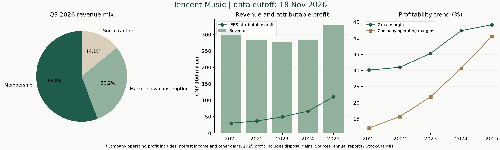

# 腾讯音乐（TME）研究报告

**研究与数据截止：2026年11月18日（北京时间）；最新财务期为2026年9月30日，Q3于11月17日公布。** 行情固定使用11月17日11:14 EST盘中9.29美元；对应北京时间11月18日00:14，并非当日收盘。按保守股本代理复算市值153.36亿美元，TTM IFRS PE约11.53倍，正常化PE约11.42倍。一句话论文：腾讯音乐靠听众持续付费和音乐IP多次变现赚钱，当前现金创造能力仍强，但新收入没有同步变成更快的每股利润增长。

公司身份：腾讯音乐娱乐集团，Tencent Music Entertainment Group；NYSE:TME与HKEX:01698属于同一家公司，1 ADS代表2股A类普通股。沿用本目录及触发target“腾讯音乐”。本报告接续[10月8日论文复核](腾讯音乐-thesis-drift-20261008.md)和[8月31日研究](腾讯音乐-research-20260831.md)，保留旧文作为历史判断。用户持仓、成本、总资产和风险预算未知，后文仓位仅为研究组合参考。本文用于学习研究，不构成个别投资建议。

---

## AI研究偏见自觉

**信息丰富度：A；关键经营透明度：B。** 年报和合并财务充分，原业务有机增长、喜马拉雅独立利润与现金流、最新库存股桥接仍不足。AI研究局限性：资料多只能提高对已披露数字的把握，不能证明竞争优势稳固。

- [x] 不把低PE等同于低风险，也不把被腾讯控制等同于拥有腾讯的全部护城河。
- [x] 不把并购贡献认作内生增长；Q3没有披露喜马拉雅独立收入，不能重复Q2残差算法后声称已验证Q3。
- [x] 不将季度加权ADS、已发行普通股与扣库存后的在外股本混用。
- [x] 不将Non-IFRS加回、数据库FCF和可分配给股东的现金混为一谈。

最容易犯的错，是以为“增长可以以后再看，现金已足够便宜”。如果新增内容、收购和流量竞争持续消耗现金，今天的现金收益率并不会自动成为股东回报。

---

## 第一步：核心数据总览

### 最近四季：收入结构在变，会员人数仍不透明

金额为人民币百万元；会员采用2026年新分类，2025Q4已重述，不能与旧“音乐订阅收入”直接拼接。音乐相关收入包括会员和营销消费，二者不可与音乐相关收入重复相加。

| 指标 | 2025Q4 | 2026Q1 | 2026Q2 | 2026Q3 |
|---|---:|---:|---:|---:|
| 总收入 | 8,641 | 7,895 | 8,933 | 8,941 |
| 音乐相关服务 | 7,099 | 6,514 | 7,605 | 7,682 |
| 其中会员服务 | 4,625 | 4,568 | 4,792 | 4,985 |
| 其中营销及消费 | 2,474 | 1,946 | 2,813 | 2,697 |
| 社交娱乐及其他 | 1,542 | 1,381 | 1,328 | 1,259 |

来源：[Q4及2025全年公告](https://ir.tencentmusic.com/2026-03-17-Tencent-Music-Entertainment-Group-Announces-Fourth-Quarter-and-Full-Year-2025-Unaudited-Financial-Results)、[Q1公告及重述分类](https://ir.tencentmusic.com/2026-05-12-Tencent-Music-Entertainment-Group-Announces-First-Quarter-2026-Unaudited-Financial-Results)、[Q2公告](https://ir.tencentmusic.com/2026-08-11-Tencent-Music-Entertainment-Group-Announces-Second-Quarter-2026-Unaudited-Financial-Results)、[Q3公司发布的完整报表](https://www.prnewswire.com/news-releases/tencent-music-entertainment-group-announces-third-quarter-2026-unaudited-financial-results-302941810.html)。Q1会员4,568与营销1,946由Q2披露的半年累计减当季追溯推算；Q4营销2,474由音乐相关减重述会员推算。细分季度主要依据公司，尚非全部双源认证；全年和TTM总量另经独立数据库核对。

Q3总收入同比+5.6%；会员收入+9.22%，营销消费+12.1%，社交及其他-15.7%。三个收入来源约占55.75%、30.16%、14.08%。会员收入增长可能来自人数、价格、分层及并表；公司停止季度MAU、付费人数、ARPPU披露后，不能反推出会员人数已经恢复。

### 五年：利润率改善真实，2025利润有特殊收益

金额为人民币百万元。经营利润采用公司IFRS列报，含利息收入和其他净收益，不能直接与数据库标准化Operating Income比较。

| 指标 | 2021 | 2022 | 2023 | 2024 | 2025 |
|---|---:|---:|---:|---:|---:|
| 收入 | 31,244 | 28,339 | 27,752 | 28,401 | 32,902 |
| IFRS归母净利润 | 3,029 | 3,677 | 4,920 | 6,644 | 11,056 |
| 毛利率 | 30.10% | 30.96% | 35.29% | 42.34% | 44.18% |
| 公司列报经营利润率 | 12.16% | 15.68% | 21.83% | 30.67% | 40.62% |
| 经营现金流 | 5,239 | 7,481 | 7,337 | 10,275 | 10,231 |
| 广义现金资本开支 | 2,758 | 1,053 | 1,164 | 1,032 | 1,188 |
| 简化自由现金流 | 2,481 | 6,428 | 6,173 | 9,243 | 9,043 |

简化FCF=经营现金流减固定/无形资产等现金资本开支，不扣收购对价，不等于可无条件分红的资金。2025年资本开支包含固定资产305及无形资产883；数据库仅扣305得到9,926，不能与本表9,043混用。2025归母利润包含视同处置收益影响，Non-IFRS归母为9,588，不能把11,056直接当经常性基数。

来源：[2023年报，覆盖2021—2023](https://www.hkexnews.hk/listedco/listconews/sehk/2024/0419/2024041900003.pdf)、[2025年报，覆盖2023—2025](https://www.sec.gov/Archives/edgar/data/1744676/000119312526160257/tme-20251231.htm)；收入、净利、毛利与[StockAnalysis损益表](https://stockanalysis.com/stocks/tme/financials/)，CFO与[现金流表](https://stockanalysis.com/stocks/tme/financials/cash-flow-statement/)，广义资本开支与[Stockopedia现金流表](https://www.stockopedia.com/share-prices/tencent-music-entertainment-NYQ:TME/cashflow/)交叉核对。Macrotrends已尝试但未能访问，不声称完成其验证。



### Q3真正需要重视的变化

| 项目 | Q3已核事实 | 对10月论文的影响 |
|---|---|---|
| IFRS归母 | 2,154，上年2,153，约+0.05% | 合并收入增长没有形成净利加速 |
| Non-IFRS归母 | 2,450，上年2,405，+1.87% | 不能用合计Non-IFRS净利替代归母 |
| 毛利率 | 42.8%；Q1为44.9%、Q2为44.2% | 低于旧加仓条件43%；并非已触旧卖出红线40% |
| 毛利减销售行政费用 | 2,291，上年2,371，-3.37% | 研究计算的核心经营代理，非公司定义指标 |
| 经营现金流 | 5,200，上年3,683，+41.19% | 明显增强，但会员预收、应付与结算时点需复检 |
| 基本加权ADS | 1,569.24百万，上年1,537.26百万，+2.08% | 回购后同比仍被稀释；不等于期末股数 |
| 基本每ADS盈利 | 人民币1.37，上年1.40，-2.14% | 每股经济性比总量更弱 |

Q3成本组合变化和并购摊销均有影响，不能把全部毛利下降归咎于喜马拉雅：Q2公告曾说明喜马拉雅并表对毛利率有正贡献。需要按版权、演出、周边和长音频分别解释。[Q3官方公告](https://ir.tencentmusic.com/2026-11-17-Tencent-Music-Entertainment-Group-Announces-Third-Quarter-2026-Unaudited-Financial-Results)

> 段永平式追问：数据证明的是收入变大，还是每一股能拿到的钱变多？当前证据更偏向前者。

---

## 第二步：生意本质分析

**听众为反复听喜欢的内容付费，平台用同一内容关系卖会员、广告、门票和周边；长期利润取决于扣完版权与流量成本后能留下多少。**

| 收入机制 | 钱为什么会重复 | 主要成本与风险 |
|---|---|---|
| 会员与SVIP | 曲库、歌单、音质、粉丝权益及使用习惯 | 版权续约、折扣、免费竞品；权益升级未必提高毛利 |
| 广告 | 听众注意力和可衡量转化 | 流量被短视频分流，宏观预算下降 |
| 演出和周边 | 粉丝愿意为艺人稀缺体验反复付费 | 分成、履约、库存和艺人档期；增长更依赖运营 |
| 社交娱乐 | 打赏、K歌互动 | 用户偏好与监管，收入已持续收缩 |
| 长音频 | 连载、有声书、播客的连续消费 | 内容投入、版权、付费转化及整合成本 |

利润最敏感的变量是会员净收入、版权及收入组合、获取和留住用户的成本。规模能摊薄研发和服务成本，却无法消除上游头部IP议价权。Q3销售行政费用升至1,532，收入只温和增长，核心经营代理反而下降，说明当下经营杠杆没有继续放大。

技术侧有推荐、搜索、音频处理、AI创作与版权识别；Q3还披露喜马拉雅播放器及AI助手升级。未取得可独立验证的本期研发支出拆分，不将行政费用全部当研发，更不能据此宣称技术领先几年。相比算法本身，授权内容、用户资产和跨产品分发更难在短期复制。

> 段永平式追问：这门生意好在哪？高频需求带来持续付费；还不够好的地方，是用户的音乐需求不必只在这一家满足。

---

## 第三步：护城河评估

| 来源 | 强度及趋势判断 | 可以证伪的证据 |
|---|---|---|
| 品牌与定价权 | 中等；SVIP提供分层，但尚不能证明普遍提价不流失 | 会员收入增长同时利润率持续下降 |
| 转换成本 | 中等偏低；歌单、收藏和习惯有效，用户仍可多平台使用 | 免费产品替代日常听歌，会员只为个别艺人保留 |
| 网络效应 | 中等偏弱；艺人和听众互相吸引，内容授权不天然排他 | 上游同时覆盖竞品，更多用户未改善单位盈利 |
| 规模与生态 | 中等偏强；采购、营销、技术及腾讯分发有优势 | 为守份额需更高内容成本和补贴 |
| 技术与专利 | 中等；提升体验，缺乏不可复制证据 | 字节以分发和推荐复制使用场景 |

过去五年，商业化和成本纪律改善的证据强于独占曲库的增强证据。未来五年能否变宽，要看微信生态带来的新流量是否能留存、付费和产生现金，而非只看入口已经接通。

竞争证据要标日期：QuestMobile经行业媒体转述，2026年3月汽水MAU约1.56亿；这是单App、第三方口径，不是付费用户，也不能将QQ、酷狗、酷我MAU相加当独立用户。它足以证明入口受到挑战，不能单凭此断言TME利润会崩塌。[行业媒体对QuestMobile的报道](https://www.musicbusinessworldwide.com/tencent-music-investors-see-bytedances-soda-as-a-major-threat-what-is-it-and-why-are-they-so-worried/)

> 巴菲特式追问：十年后护城河还在吗？音乐消费大概率还在；真正可能摧毁超额利润的是版权方和新流量入口共同提高平台留住用户的成本。

---

## 第四步：逆向思考与风险清单

最强反方：腾讯音乐正在用内容投入、收购和更重运营的IP业务，补偿原有用户入口变弱。现金流看起来很好，可能部分来自预收和付款节奏；低PE反映的不是市场没发现现金，而是股东不确定现金最终会如何使用。

下表概率是主观等级，非统计估计；风险可以相关，不能相加。

| 失败路径 | 主观概率 | 影响 | 应观察什么 |
|---|---|---|---|
| 免费算法入口削弱会员付费基础 | 中高 | 定价权、广告及终值下降 | 会员收入、可比用户披露、营销费用、版权成本 |
| 演出周边增长但利润率下降 | 中高 | 营收增长低质量化 | 毛利率、核心经营代理、库存及预付款 |
| 喜马拉雅未赚回收购成本 | 中 | 现金、摊销及商誉受损 | 独立收入、现金贡献、减值及整合进展 |
| 大额再投资吞噬股东回报 | 中 | 净现金减少且回购抵不过稀释 | 期末在外股数、现金对价、债务及回购桥接 |
| 版权或内容监管重击 | 低至中 | 利润池和经营模式变化 | 正式监管文件与授权条款 |
| VIE、跨境资金或极端退市事件 | 无法可靠量化 | 可严重损害持有人权益 | 合同执行、审计和跨境资金可达性 |

历史类比只能用于机制：音乐平台的规模不等于拥有音乐版权；社交打赏业务过去的收缩也提醒我们，今天的高现金流可能来自有生命周期的产品。平台竞争可同时表现为收入温和增长和盈利权被侵蚀。

最可能的分析错误是仍把当前业务当作纯订阅轻资产，而忽略泛IP扩张的分成、履约和收购再投资。与之相对的上行风险是：会员分层和腾讯生态能以低成本恢复用户增长，使本报告5%的基准利润增速过低。

> 芒格式追问：聪明人为什么不买？因为他们要求看到每股现金回报，而不是只相信合并收入、现金余额和回购金额。

---

## 第五步：管理层评估

CEO梁柱（Ross Liang）与执行董事长彭迦信（Cussion Pang）延续腾讯体系的运营能力；内容和分发依赖组织与生态，非创始人个人不可替代。对资本配置的评分应落在结果上。

| 决策 | 已见结果 | 判断 |
|---|---|---|
| 音乐付费、SVIP与IP多次变现 | 收入结构改善，长期毛利率提高；Q3又出现压缩 | 方向有效，边际回报需再证实 |
| 喜马拉雅收购 | 业务范围扩大、发行新股，商誉升至29,773百万元 | 尚不能确认创造超额回报 |
| Q3回购 | 34.7百万ADS、约3亿美元、公司披露均价约8.6美元 | 有利于抵消稀释；不等于已完成同比净缩股 |
| 发行美元债 | 现金与债务同时增加 | 不能只把融资计作现金增长的利好 |
| 季度用户指标停止披露 | 仅剩收入与定性描述判断会员经济性 | 降低外部验证能力，治理扣分 |

控制权必须分开：2025年报截至2026年3月31日，腾讯实际经济权益约52.1%，投票权约93.6%；57.2%的beneficial ownership含其他股东投票授权，不能当纯经济权益。梁柱beneficial约4.49百万普通股、表列0.1%，还包含限期内可取得股份。上述持股仅核年报，缺独立同口径第二来源，也不是本次最新持股。不能将母公司高投票权写成管理层高经济持股。[2025年报股权章节](https://www.sec.gov/Archives/edgar/data/1744676/000119312526160257/tme-20251231.htm)

本轮未完成管理层全年减持及个人薪酬激励逐笔核查，不据缺失记录声称“没有减持”或“完全与小股东一致”。目前更可靠的正向证据是实际回购、现金分红，反向证据是换股收购、指标透明度和回购后仍有同比稀释。

> 段永平与巴菲特式追问：CEO退休后还行吗？曲库、产品与生态会延续；最需要监督的是继任者和控股股东如何使用现金。

---

## 第六步：行业与文明趋势

数字音频是长期需求，付费、推荐和AI会改变服务方式；这不是一家公司的独占文明红利。用户时间受到短视频竞争，上游头部创作者及版权方也会分走价值。AI增加普通内容供给，可能降低生产成本，也可能增加侵权治理和获客竞争；不能简单推成版权全部失效或平台利润必然增加。

没有获得口径一致、可独立验证的最新中国音乐及长音频TAM预测。仅作量纲检查：假设6亿独立听众、30%付费、每月15元，年会员市场为324亿元；这些都是假设，不是现有用户或市场预测，且不含广告、演出和周边，不用于给公司套市场份额。

网易云音乐在社区和内容上形成差异，汽水在分发上形成竞争，Spotify证明全球订阅平台可扩大规模；它们的地区、内容成本和业务组合不同，不能把Spotify倍数直接移植给TME。网易11月19日拟披露Q3，可作为相关竞争检查点；这不是腾讯音乐财报日。[网易正式日程](https://ir.netease.com/node/15911)

> 李录式追问：二十年后它是标准石油还是3Com？更可能是一家仍有用户的音频服务商；能否成为好投资，要由资本回报和买入价格回答。

---

## 第七步：估值与安全边际

### 先处理现金、股本和币种

金额为人民币百万元。Q3广义资金51,492来自资产行加总，正文51.49十亿元为舍入；“短投”没有独立余额，流动其他投资55不按现金认定。

| 项目 | 金额 |
|---|---:|
| 现金及等价物 | 22,633 |
| 流动定存 | 12,719 |
| 非流动定存 | 16,140 |
| 广义资金 | 51,492 |
| 借款：流动及非流动 | 11,733 |
| 应付票据 | 10,034 |
| 租赁负债 | 329 |
| 含租赁总债务 | 22,096 |
| 广义净现金 | 29,396 |
| 排除非流动定存后的净现金 | 13,256 |

与[StockAnalysis资产负债表](https://stockanalysis.com/stocks/tme/financials/balance-sheet/)对账：其短期资金35,407=22,633+12,719+55，总债务22,096一致；广义资金仍需加入长期定存并剔除55。不能把数据库短期资金与公司广义资金直接比较后报错，也不能把长期定存全部当即用现金。报告没有把权益投资和商誉当现金。

**股本限制：** 最新可靠已发行股本为2026年6月30日3,301,604,303普通股，折合1,650,802,151.5 ADS，与数据库概览约1.65十亿相符。但它含库存等口径差别，并非已核11月净在外股数。数据库资产负债页1,569百万接近Q3基本加权数，也不用于替换期末股数。本报告用六月已发行股本作偏保守的估值分母；尚未取得最新净在外股数的双源确认，市值和每ADS价值均为代理估计。[半年报股本附注](https://www.sec.gov/Archives/edgar/data/1744676/000119312526378354/R46.htm)

行情交叉：StockAnalysis 9.29美元（11:14 EST）与Yahoo 9.265美元（11:16:58 EST）相差0.27%，属非同步快照，不能当同一时刻成交验证。估值冻结9.29；市值153.36亿美元与同价数据库153.30亿美元差0.04%，证明算式和单位一致，不能证明数据库股本定义正确。[StockAnalysis行情](https://stockanalysis.com/stocks/tme/)、[Yahoo行情接口](https://query1.finance.yahoo.com/v8/finance/chart/TME?range=5d&interval=1d)

下面以Q3公告便利折算率1美元=6.7045元人民币统一计算；它不是11月实时汇率。模型假设未来汇率不变，人民币贬值会降低美元盈利与估值。若未来人民币兑美元贬值10%，三年基准终值价由10.35降至约9.41美元。

| 指标 | 本报告计算 | 说明 |
|---|---:|---|
| 代理市值 | 153.36亿美元 | 保守股本分母 |
| TTM收入 | 34,410百万元人民币 | 2025全年+2026年前九月-2025年前九月 |
| TTM IFRS归母 | 8,919百万元人民币 | 与数据库同值 |
| TTM Non-IFRS归母 | 9,894百万元人民币 | 不直接视为股东盈利 |
| TTM经营现金流 | 12,787百万元人民币 | 不等同FCF |
| IFRS EPS代理 | 0.80585美元/ADS | 非公司季度加权EPS |
| IFRS PE | 11.53倍 | 与数据库加权及折算口径不同 |
| 正常化PE | 11.42倍 | 假设归母9,000百万元 |
| PB | 1.32倍 | 归母净资产77,742；普通股已换ADS |
| PS | 2.99倍 | 同币种计算 |
| EV/收入 | 2.13—2.60倍 | 广义至仅短期净现金口径，不再另加现金到PE估值 |
| 静态股息率 | 2.58% | 已付0.24美元/ADS，非未来承诺 |

与数据库概览约0.84美元EPS相比，本报告0.80585低约4.1%（以数据库值为分母）；差异超过1%，主要来自已发行股本代理与加权股本、便利折算率与数据库美元折算口径不同，未将二者当作同口径验证通过。仅作分母敏感性：若改用Q3基本加权ADS，基准价格现值约8.07美元，仍低于9.29美元；这项敏感性不证明该加权股数就是期末股数。

**不报精确TTM FCF收益率。** 数据库TTM FCF12,482=12,787减305；305仍为年度固定资产开支，而本期简式现金流没有完整更新资本开支及无形投入。因此不能据此宣称当期精确FCF收益率已达某水平。

### 三年情景回答贵不贵

正常化归母采用90亿元：接近TTM IFRS89.19亿元，低于Non-IFRS98.94亿元，保留股权激励等真实成本。该基数是研究判断，既不将Non-IFRS全部加回，也不认为一次性投资收益可以持续。固定股数，不预支未来回购增厚；不另加净现金，避免将利息与现金价值重复计入。

| 情景 | 每股利润年增速 | 三年PE | 三年后价格 | 对9.29美元价格回报 | 以10.5%折现的价格现值 |
|---|---:|---:|---:|---:|---:|
| 悲观 | -3% | 8倍 | 5.94美元 | -36.09% | 4.40美元 |
| 基准 | +5% | 11倍 | 10.35美元 | +11.46% | 7.67美元 |
| 乐观 | +10% | 14倍 | 15.15美元 | +63.11% | 11.23美元 |

这些是三年后的价格，不能直接当今天价值。表内未计分红；若每年仍付0.24美元，三年基准未折现总回报约+19.21%，仍须承担经营与汇率风险。6.5—7.5美元条件评估带相对不含分红的基准现值折让约15.3%—2.3%，上沿缓冲较薄，不能标成“深度安全边际”。

同行与历史仅作定价背景：StockAnalysis同期TME数据库PE约11倍，Spotify约37.41倍、网易云约10.03倍；TME的2023—2025年末数据库PE为20.55/19.31/17.18倍。这些为单一数据库观察，非逐项独立重算，也不是合理倍数证明。TME较历史便宜，但增长、资本配置和竞争也已改变；相对网易云并无明显PE折价。[TME历史](https://stockanalysis.com/stocks/tme/financials/ratios/)、[Spotify](https://stockanalysis.com/stocks/spot/statistics/)、[网易云](https://stockanalysis.com/quote/hkg/9899/statistics/)

反向DCF：若未来十年每ADS每年现金股息固定0.24美元、不再增发，退出PE按下述永续模型9.150倍，则9.29美元要覆盖10.5%的美元资本成本，需要约+11.09%的十年每股利润复合增长。该算式未另外加净现金，亦未假设大幅提高分红；高于本报告+5%的基准增长，因此不能只凭约11倍PE认定安全边际充足。

### 十年模型只约束仓位

全程采用美元口径，使用Q3折算率作恒汇率转换。r=10.5%：参考已核FRED/H.15的11月13日十年美债5.15%，β=1，研究要求的ERP为5.35%；ERP是取值判断，不是声称观测到的市场数值。美元合理区间9%—11.5%，永续基准g上限4%。[FRED利率序列](https://fred.stlouisfed.org/series/DGS10)

稳态增量ROIC取9%为判断：[数据库当前会计ROIC约9.54%](https://stockanalysis.com/stocks/tme/statistics/)，现金、商誉和投资资产影响很大，只作上沿参考。以已付股息0.24除本报告EPS0.80585，派息率约29.78%；在g=2%、保留利润均用于投资的简化假设下，反解增量ROIC约2.85%，作为偏低参照。9%夹在二者之间，且没有假定并购能复制早期平台回报。这些是代理口径，不是已测量的喜马拉雅回报。终值g悲观/基准/乐观为0%/2%/3%，既不外推十年增长到永远，也不随r调整。

所有终值PE仅来自 `(1-g/ROIC)/(r-g)`，没有采用同行类比。净股息减稀释k=+2%为年化近似假设：分红回报约2.5%、未来净稀释约0.5%，不再把回购金额当额外收益相加。

| 情景 | 主观权重 | 十年利润年增速 | 2036利润，百万美元 | 永续g | r-g | 终值PE | 工具十年回报近似 |
|---|---:|---:|---:|---:|---:|---:|---:|
| 悲观 | 30% | -3% | 989.90 | 0% | 10.5pct | 9.524倍 | -2.75% |
| 基准 | 50% | +5% | 2,186.60 | 2% | 8.5pct | 9.150倍 | +4.70% |
| 乐观 | 20% | +10% | 3,481.79 | 3% | 7.5pct | 8.889倍 | +9.27% |

ROIC假设低于r时，更高永续增长需要留存更多资金而回报不足，故乐观档的终值PE反而较低；不是将成长性再奖励一次。若稳态ROIC提高到15%，同参数加权十年回报约4.33%，仍未覆盖10.5%的资本成本。

工具采用终值几何收益加k，不是逐年现金流XIRR；下表“期望IRR”为情景回报算术加权近似，不是概率保证。权重未经统计校准，未计极端尾部。

| r | 加权十年回报近似 | 是否覆盖该档r | 合法性 |
|---|---:|---|---|
| 8.5% | +6.06% | 未通过 | 区间外，仅供参考 |
| 10.5% | +3.38% | 未通过 | 基准 |
| 12.5% | +1.31% | 未通过 | 区间外，仅供参考 |
| 9.5% | +4.62% | 未通过 | 区间内补测 |
| 11.5% | +2.28% | 未通过 | 区间内补测 |

±2pp两侧均在币种区间外，故另跑±1pp。**币种合理区间内压力测试未随本次Δr翻转，均未覆盖资本成本。** 这只能收紧仓位，不能单独把买入或持有改成回避。未建模的VIE失效、跨境资金中断及极端退市/监管风险保留为限制；竞争和整合失败进入悲观情景，不通过抬高β重复惩罚。

### 估值分歧对账

旧论文允许7.5—8.5美元小仓；当前三年基准终值仍高于现价，若误将终值当现值，看起来会继续支持买入。三年折现后的基准价格约7.67美元、十年回报近似只有3.38%，与旧论文的小仓倾向存在分歧。

三年模型负责今天的价格判断：9.29美元对基准现值缓冲不足。十年模型负责仓位：不支持核心仓。实际决策还包含订阅现金能力、护城河、管理层、竞争和趋势；本轮不新增的独立经营依据，是毛利率低于旧加仓门槛、核心经营代理下降、有机增长尚不可验证。不是用十年未过资本成本一票否决。

持有小仓的理由仍在：现金流强、融资后净现金尚可、会员收入增长。因此不机械要求清仓；研究组合参考总仓位不高于2%，且现金无法对账、毛利再恶化或新大额收购时重新下调。2%是风险预算示例，不是模型精确解。

> 巴菲特式追问：r错2个百分点会翻转吗？本次±2pp仅有基准合法，补测9.5%—11.5%仍未通过；没有靠降低折现率制造买点。
>
> 段永平式追问：市场关闭五年愿意持有吗？可以承受的小仓有理由留下；现价和现有透明度不足以支持扩大到核心仓。

---

## 第八步：最终决策与行动清单

| 维度 | 结论 | 信心度 |
|---|---|---|
| 生意质量 | 会员复购与现金创造较好，泛IP混合业务质量不同 | 中高 |
| 护城河 | 内容、用户资产和规模有效，免费入口竞争限制定价 | 中 |
| 管理层 | 运营可认可；并购回报、披露和每股资本回报待验证 | 中 |
| 最大风险 | 收入扩大而每股盈利和可分配现金不能同步增长 | 中高 |
| 文明趋势 | 数字音频持续，利润池由平台、版权方、流量入口分享 | 中 |
| 估值 | 三年基准现值7.67美元，现价缓冲薄；十年加权3.38%，合理r内补测未翻转，仅限仓 | 中 |

**最终研究建议：空仓者现价观望；已有小仓可持有，暂停加仓。** 从旧“小仓分批”转为现价不新增，来自价格较10月锚点上涨约16.27%、毛利未达到旧门槛和盈利证据不足的综合判断。并未将所有旧卖出红线判为触发。

| 策略或价位，美元/ADS | 动作与条件 |
|---|---|
| 低于6.5 | 先查永久损坏；价格更低不自动加仓 |
| 6.5—7.5 | 条件式研究首笔约0.5%；毛利回到≥43%、可比会员收入增长≥8%、融资后广义净现金≥150亿元、无重大商誉减值，且能对账资本开支和股数后才执行 |
| 7.5—10.8，含当前9.29 | 空仓观望；现有小仓持有、不补，等待经营证据 |
| ≥10.8 | 估值及超配复核线；不代表自动卖出，新增盈利证据可改模型 |
| 原有核心仓 | 先按实际集中度复核；本文不支持以“现金多”继续扩大仓位 |
| 加仓升级信号 | 连续后续披露支持原业务增长≥5%、会员增长≥8%、毛利≥43%，喜马拉雅独立现金贡献或等价可核证据、净在外股数与资金用途可解释 |
| 减仓或退出信号 | 毛利跌破40%、广义净现金低于150亿元且不能合理解释、并购减值暴露实质损失、持续补贴也无法稳住会员，或再有超过50亿元未证明回报的大额收购 |

43%是加仓门槛，40%是更严重的旧红线；Q3的42.8%触发的是前者未满足，不能写成后者已突破。合并会员增长9.22%达到数字条件，也不能据此声称原业务≥5%已经通过。

复检安排：2026年12月15日人工检查喜马拉雅、现金流和股数桥接；2027年3月1日检查全年业绩日历（研究检查日，非已确认财报日）；2027年3月21日检查旧回购授权两年窗口。Q3已发布事件记完成，资金去向与整合复检仍保留，不能因拿到资产负债表就假装已完成全部融资现金流对账。

### 四位大师：原文与研究延伸分开

以下不是任何大师对TME的当前评级。

| 大师 | 已读可核验短引 | 本报告的延伸理解 |
|---|---|---|
| 巴菲特 | “buy a wonderful company at a fair price” | 约11倍PE只是起点，仍须确认未来每股盈利质量。出自[1989股东信](https://www.berkshirehathaway.com/letters/1989.html) |
| 芒格 | “New subsidiaries would usually be bought with cash, not newly issued stock.” | 应检查收购付出的股份与拿回的经济价值，不以合并规模判断成功。出自本人署名的[2014年回顾，第40印刷页](https://www.berkshirehathaway.com/letters/2014ltr.pdf) |
| 段永平 | “霸主地位为什么不可以跌得很惨？” | 直接讨论腾讯音乐的原话，提醒行业位置不保证股价或价值判断；不能用其名义替本报告买入背书。[2022年3月8日雪球原文](https://xueqiu.com/1247347556/213357580)，[本地存档](../段永平/段永平雪球全量原发言.md)第4408条 |
| 李录 | “如果发现自己犯了错，会第一时间卖出。” | 有无犯错要依据长期竞争力和资本回报，不以一次报价变化定性；同一问答也强调理解后的长期持有。出自[2024北大演讲存档问答一](../李录/李录-北大演讲-20241207.md)，原始传播与官方英文稿在该文来源栏 |

> 四位大师方法追问：同样的资金，如果可以买更容易理解、回报证据更清楚的生意，为什么此刻一定要增加腾讯音乐？

---

## AI分析置信度与投资确定性

已披露合并财务及主要年度交叉值：AI分析置信度较高。股本分母、收购独立回报、真实有机增长、最新严格FCF和管理层最新持股：置信度中低。投资确定性仅为中等偏低，不能因为信息评级A就提高到高确定性。

充分数据支持：会员收入增长、归母利润近乎持平、毛利率下降、经营现金流增强、现金债务存量。有限信息支持的推理：免费竞争的长远影响、并购是否赚回资本成本、未来利润增长和价格带。模型概率、ROIC、ERP、增长率及仓位上限均为研究假设。

关键缺口：最新在外股份和库存股的完整双源桥接；Q3资本开支、无形投入和股东可分配现金；喜马拉雅独立收入/利润/现金流；会员人数与续费价格；管理层现时持股、薪酬和减持；VIE及资金中断尾部风险。报告不宣称所有字段已双源认证。

---

## 数据来源与审计记录

年度、季度公告与独立来源已逐段附链。IR、SEC及PRNewswire上的同一公司公告只算一个原始来源；独立数据库才用于交叉验证。部分官方网页受访问限制，Q3完整表已从公司在PRNewswire发布的版本读取，未将全文存入仓库。

金融严谨性工具的直接输出摘录：

```text
市值验算：股价9.29 USD；ADS等值1.65B；计算15.34B；报告15.33B。
✅ 验证通过, 偏差仅 0.04%
交叉验证：2025收入32902 / 32902；2025归母11056 / 11056。
✅ 所有来源偏差 ≤ 1%, 数据一致
交叉验证：Q3短期资金（含55其他投资）35407 / 35407；总债22096 / 22096。
✅ 所有来源偏差 ≤ 1%, 数据一致
PE：9.29 / 0.8058509878 = 11.53x；PB：9.29 / 7.024158257 = 1.32x。
股息率：0.24 / 9.29 = 2.58%。
```

完整程序输出见[数值验证记录](腾讯音乐-validation-20261118.txt)，输入和精确派生值见[模型数据](腾讯音乐-model-20261118.json)。股数代理与独立数据库约数相近只作口径核查，不冒充最新期末在外股份的双源验证。

抽检记录：固定种子20261118，按15%抽样，从136个识别点抽21项，数值核对全部通过、零警告、零失败、零跳过。其中13项为财务事实或其派生值：7项完成双源，6项仅核到公司原始披露；另外8项为日期、旧阈值、模型假设和算术一致性核对，不能算作外部事实认证。明细见[抽检证据](腾讯音乐-audit-20261118.json)。

最终terminal_value审计三条硬约束通过；两项未建模尾部风险已在正文保留。触发配置、每日监控校验与使用临时状态的腾讯音乐定点运行通过、无运行异常。临时扫描还保留两项历史论文解析GAP（重点看板覆盖、论文节点字段）；本次建议已在非重点台账与触发配置登记，不宣称这些历史GAP已修复。新报告已新增跟踪事件并接续关闭10月旧事件；沿用原target，无重复公司条目。

**审计边界：本报告完成数值一致性与估值口径检查；季度细分、最新净在外股份等第二来源仍有缺口，属于已注明限制的研究稿，不宣称完整双源发布认证。**
