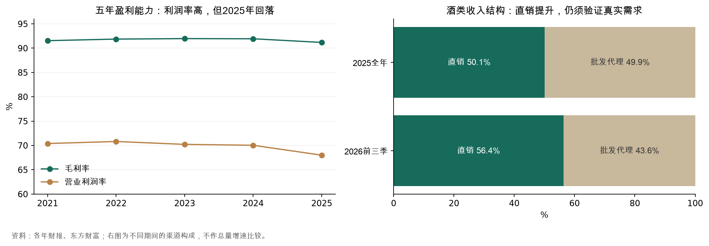

# 贵州茅台（600519.SH）研究报告

**研究与信息截止日：2026-11-27，北京时间，含当日盘后已公开公告。** 最新完整财年为2025年，最新财务期为2026年前三季度，三季报未经审计。证券身份：上海证券交易所A股，贵州茅台酒股份有限公司，Kweichow Moutai Co., Ltd.；研究对象为上市公司，不是茅台集团。

**收盘价1,472.36元；最近公告确认股本1,250,081,601股；复算市值18,405.70亿元；TTM归母PE 22.40倍、PB 6.79倍、PS 10.74倍。** 行情为11月27日正规收盘，腾讯与新浪一致；股本经三季报、东方财富及最新分红公告核对，最近确认时点为10月31日。[腾讯行情](https://qt.gtimg.cn/q=sh600519)、[新浪行情](https://quotes.sina.cn/hs/company/quotes/view/sh600519)、[长桥行情](https://longbridge.com/zh-CN/quote/600519.SH)。

**研究命题：茅台仍是一门把长期酿造、品牌信任和社交认知转为重复消费的好生意；现在的投资问题，是终端需求较弱时，温和利润增长能否补偿当前价格。** Q3有恢复，尚不足以确认强复苏；新增分红支持现金回报，但不能代替增长。

**信息丰富度评级：A。AI研究局限性声明：** 报表和新闻充分，真实开瓶、社会库存、排除转售后的复购及代际需求缺少连续独立数据。公开资料可以验证已确认收入，不能证明酒已被消费者喝掉。本文将披露事实、历史观点、本次计算和情景假设分开；仅供学习研究，不构成投资建议。

## AI研究偏见自觉

- [x] 不从“品牌强”直接推出“利润持续增长”；关注提价后的总收入、毛利与回款。
- [x] 不把i茅台收入增长当作全公司新增需求，不把金融子公司本金变动当作卖酒现金改善。
- [x] 不因资料丰富提高长期需求预测的信心；也不因年轻人偏好变化直接断言品牌消失。
- [x] 不用历史高PE给今天定价，不通过下调折现率制造买入理由。

---

## 已有研究与本次更新

本次沿用`reports/茅台`主体目录和触发标的ID“茅台”。已按600519、贵州茅台及Kweichow Moutai检索公司报告、同行专题、触发配置与两个台账；[相关文件索引](../../research_notes/茅台研究-20261127/baseline-index.md)保留检索结果。七公司合集中的茅台文件属于专题副本，没有另建同公司目录。

| 既有研究 | 日期与旧资料截止 | 本次用途 |
|---|---|---|
| [用户指定的完整研究](贵州茅台-research-20260928.md) | 9月28日；财务至2026H1 | 旧价1,243.88元，950—1,050元研究带，检验Q3能否企稳 |
| [最近完整研究](茅台研究报告-20261020.md) | 10月20日；财务至H1、行情10月19日 | 基准现金增长+4%；采用1,100—1,200元观察带 |
| [最新财报精读](贵州茅台-earnings-2026Q3-20261031.md) | 10月31日；财务至9月30日、行情10月30日 | Q3恢复、现金与渠道拆分；延续1,100—1,200元观察带 |
| [年轻需求与长期利润](贵州茅台-investment-team-年轻需求与2036利润-20260925.md) | 9月25日；财务至H1，公开资料至9月24日 | 青年用户与真实复购不可混同；旧2036基准利润约1,100亿元 |
| [产能专题](茅台-基酒产量与5年后销量-2036可售量推导-20260925.md)、[吨价专题](茅台-吨价倍数与2036年利润推导-20260926.md) | 9月25—26日；2025年产销为基准 | 供应能力与需求预算的约束；吨价专题旧2036利润约1,270亿元 |
| [长期模型的反证](茅台-白酒消费下降与10年20年利润推演-20260814.md) | 8月14日；其正文财务实际只至Q1、批价至1月 | 提醒“基酒产量机械锁定未来销量”不成立，不以文件日期冒充最新数据 |

旧结论并不一致，不能简单挑选最乐观或最近的数值。9月28日报告的2036中性利润约1,386.90亿元、9月25日专题约1,100亿元、吨价专题约1,270亿元，都是条件模型。本次从新TTM利润重建，基准未来十年利润增速假设+4%，不把任何旧预测当成事实。

| 待验证旧判断 | 最新证据 | 本次判定及行动影响 |
|---|---|---|
| H1利润承压，Q3能否恢复？ | Q3归母+3.78%、扣非+2.96%；前三季归母仍-0.25% | **削弱悲观判断**：从持续下滑转为局部修复，尚非高速增长 |
| 直销增长不能直接代表新增消费 | Q3直销+40.31%，茅台酒收入仅+0.79% | **强化**：平台增长继续不能等同终端增长 |
| 提价应带来利润率修复 | Q3总毛利率89.64%，低于上年同期91.28%；税金及附加减少也支持利润 | **待验证**：毛利环比略稳，但提价尚未形成全面盈利改善 |
| 批发渠道毛利是否企稳？ | 季报未更新分渠道毛利率 | **待验证**：不得用总毛利替代批发毛利；等待年报 |
| 预收大降、应收增加可能意味着信用恶化 | 11月10日解释代售/直营不形成预收，平台清分D+0改为T+1 | **修正**：风险须继续观察，不能把会计余额变化全算需求恶化 |
| 高分红支持持有 | 11月27日盘后公开中期每股25.60元方案 | **强化当期回报**：尚未支付；2027年之后政策仍待确认 |
| 950—1,050元还是1,100—1,200元？ | 10月20日完整报告与10月31日财报已采用后者，监控仍停在9月旧带 | **修正监控滞后**：本次采用1,100—1,200元条件式研究带，下文给出独立估值依据 |
| 部分旧文称半年报未披露渠道毛利 | H1原件附注可核对渠道收入和成本；Q3才缺该细项 | **推翻该资料判断**：明确各期可用性，不重复旧错误 |

最新证据覆盖：2025年报、2026半年报及Q3报告/经营数据、7月18日调价、11月10日官方说明会，以及截至11月27日盘后的公告检索。今日分红董事会审议日为11月26日、盘后公开日为11月27日、文件落款及索引日为11月28日，三个日期分别保留。未取得可靠11月27日批发成交价、全渠道库存和完整现场问答；11月10日网页公布六问，另提及现场交流，没有完整披露全部回答。检索不能保证不存在尚未索引的新材料。[三季报][q3]、[说明会][meeting]、[中期分红][newdiv]。

> 数据追问：如果把平台增长、金融本金回流和“转正”三个标题拿掉，真实消费恢复还剩多少证据？目前是低个位数收入与收现改善，证据尚有限。

---

## 第一步：核心数据总览

### 五年利润率与现金

金额为人民币亿元。营业收入不含财务公司利息收入；营业利润率为报表营业利润÷营业收入，包含金融业务影响，不是纯酒业EBIT率。简单FCF=合并CFO－购建长期资产现金；货币资金与现金流量表“现金及现金等价物”不同，不可互换。

| 年度 | 营业收入 | 归母净利 | 毛利率 | 营业利润率 | CFO | 现金资本开支 | 简单FCF | 货币资金 |
|---|---:|---:|---:|---:|---:|---:|---:|---:|
| 2021 | 1,061.90 | 524.60 | 91.54% | 70.39% | 640.29 | 34.09 | 606.20 | 518.10 |
| 2022 | 1,241.00 | 627.17 | 91.87% | 70.81% | 366.99 | 53.07 | 313.92 | 582.74 |
| 2023 | 1,476.94 | 747.34 | 91.96% | 70.22% | 665.93 | 26.20 | 639.73 | 690.70 |
| 2024 | 1,708.99 | 862.28 | 91.93% | 70.03% | 924.64 | 46.79 | 877.85 | 592.96 |
| **2025** | **1,688.38** | **823.20** | **91.18%** | **68.00%** | **615.22** | **31.28** | **583.95** | **516.91** |

来源为各年原始年报及本次重新获取的东方财富数据库。[2025年报][fy25]、[2024年报][fy24]、[2022年报][fy22]、[2021年报][fy21]、[东方财富利润表][emi]、[现金流量表][emc]、[资产负债表][emb]。2021表中采用当年未追溯归母524.60亿元，9月报告采用后来追溯的524.36亿元，属于口径差异，不是本次经营变化；2022数据库归母627.17亿元为后续调整口径，当年原报627.16亿元，两者偏差远小于1%；不据此计算跨口径增长。



### 最新季度：恢复是真实的，力度需要分解

| 指标 | 2026前三季 | 同比 | Q3单季 | 同比 |
|---|---:|---:|---:|---:|
| 营业收入 | 1,309.71 | +1.96% | 402.67 | +3.08% |
| 归母净利 | 644.67 | -0.25% | 199.51 | +3.78% |
| 扣非归母 | 643.25 | -0.55% | 198.61 | +2.96% |
| 综合毛利率 | 89.58% | -1.71个百分点 | 89.64% | -1.64个百分点 |
| 销售商品及劳务收现 | 1,435.23 | +3.41% | 451.01 | +3.19% |
| 合并CFO | 840.59 | +120.07% | 133.68 | -46.69% |

前三季营业总收入为1,332.84亿元，含金融利息；不把它与1,309.71亿元营业收入混用。毛利率及单季现金项由报表计算。Q3收入增长并非仅由主品牌拉动，系列酒占较多增量；扣非增长低于归母增长，税费节奏也有贡献。[三季报][q3]、[东方财富][emi]、[每经财报报道][q3news]。

| 期间 | 营业收入 | 归母净利 | 茅台酒收入 | 系列酒收入 |
|---|---:|---:|---:|---:|
| 2025Q4 | 403.84 | 176.93 | 359.86 | 43.90 |
| 2026Q1 | 539.09 | 272.43 | 460.05 | 78.81 |
| 2026Q2 | 367.94 | 172.74 | 317.20 | 50.53 |
| 2026Q3 | 402.67 | 199.51 | 352.01 | 50.34 |

公司季度经营公告提供分部收入，未提供可比的季度分部毛利；2025Q4由全年减前三季，Q2由半年减Q1；产品基数与东方财富分部数据库复核。季节性使环比不能直接代表增长趋势。[2025年报][fy25]、[2025Q3经营数据][ops25]、[2026Q1][q1]、[半年报][h1]、[Q3经营数据][ops]。

| 产品/渠道 | 2025年收入 / 毛利率 | 2026前三季收入 | Q3单季收入及同比 |
|---|---:|---:|---|
| 茅台酒 | 1,465.00 / 93.53% | 1,129.25 | 352.01，+0.79% |
| 系列酒 | 222.75 / 76.11% | 179.69 | 50.34，+22.14% |
| 直销 | 845.43 / 94.58% | 737.74 | 218.12，+40.31% |
| 批发代理 | 842.32 / 87.86% | 571.20 | 184.24，-21.60% |
| 其中i茅台 | 包含于直销 | 585.62 | 182.99，+847.48% |

上述产品与渠道是同一收入的不同拆分，不能纵向相加；i茅台包含于直销。前三季直销占主营酒类收入56.36%。2025分渠道采用年报附注，季度拆分采用主营业务经营公告；不把其他业务混入季度比较。2025直销由[新华网报道](https://app.xinhuanet.com/news/article.html?articleId=20260418b3b6931edc7d48fab67ca5716eceb6be)复核，Q3渠道由[澎湃独立报道](https://www.thepaper.cn/newsDetail_forward_34370441)复核；报道仍基于同一公司原始披露。[年报][fy25]、[经营数据][ops]。

### 现金充足，现金归属仍有边界

9月末货币资金499.27亿元，拆出资金1,560.56亿元，财务公司吸收存款及同业存放负债172.72亿元；传统银行借款和应付债券无余额，但有租赁等负债。现金流量表现金及现金等价物1,959.91亿元已是不同范围，不能再加货币资金或拆出资金。[三季报][q3]、[东方财富资产负债表][emb]、[现金流表][emc]。

以现金及现金等价物扣除上述存款负债、租赁负债1.96亿元及一年内到期非流动负债0.66亿元，得到**净流动现金代理1,784.57亿元**。该值仍属合并口径，包含少数股东利益和经营必需资金，不是母公司可随时派发现金。Q3未披露完整受限明细，不沿用H1准备金余额冒充当前数。

合并CFO减资本开支为826.09亿元，不能直接资本化。公司说明同业存款到期和成员存款变动是CFO大增的重要原因；销售收现仅+3.41%，更符合经营温和恢复。合同负债20.84亿元、较年初大降，既有模式变化，也不能排除需求因素。应收账款3.65亿元的T+1解释降低了“赊销拉收入”的疑虑，仍需年报核对账龄与清分。[三季报][q3]、[说明会][meeting]。

> 段永平式追问：这门生意能赚很多现金，但其中多少真正属于普通股东，又有多少可以持续分出来？合并余额只能回答一部分。

---

## 第二步：生意本质分析

**客户为可信品质、宴请礼赠的识别度和自愿饮用付钱，公司用难以速成的品牌与储酒体系反复交付。** 消费和送礼会重复发生，购买不是订阅；收藏和转售需求可能放大出货，最终仍需真实消费承接。

| 经济环节 | 钱如何产生 | 本次需验证什么 |
|---|---|---|
| 茅台酒主品牌 | 长期酿造、勾调和共同认知支撑单价 | 飞天提价能否覆盖组合变化、费用及需求压力 |
| 系列酒 | 更广泛价位和场景扩大销量 | 收入回升是否伴随毛利和渠道利润恢复 |
| 直销/i茅台 | 公司取得原由渠道保留的部分零售价值 | 增量毛利能否覆盖服务、履约和获客成本 |
| 经销及代售 | 提供触达、服务和本地消费者连接 | 经销商有无合理利润；库存和货权如何分担 |
| 财务公司 | 金融服务与资金运用产生利息 | 本金流入流出、关联资金与酒业经营分开 |

7月18日当年飞天53度500ml i茅台零售价从1,539升至1,639元，销售合同价从1,269升至1,369元。这是公司定价动作，不能等同所有产品实际售价同步上升。提价后Q3茅台酒收入只+0.79%，不能单独反推出销量下降，因为单品销量、产品组合与投放节奏没有完整披露。[调价公告][raise]、[经营数据][ops]。

经营杠杆并非只有固定成本摊薄。主品牌和系列酒的毛利不同，产品组合变化、消费税、渠道服务费用都能改变利润。Q3销售费用约16.24亿元，同比+33.34%，快于收入；税金及附加减少约6.09亿元支持税前利润改善，不能假设每季重复。2025研发总投入8.03亿元、占收入0.48%，包括进入生产成本的研发投入，不能与利润表研发费用等同；它有助工艺和品控，不能用科技公司的研发回报框架估算品牌价值。[年报][fy25]、[季度报表][q3]、[财报精读计算记录](../../research_notes/茅台财报-20261031/calculations.txt)。

> 段永平式追问：一句话说，好在哪？消费者仍愿为难以复制的信任付溢价，且重复购买所需的增量资本不高；未来增长取决于这种付费意愿能否延续。

---

## 第三步：护城河评估

| 类型 | 强度判断 | 验证与反证 |
|---|---|---|
| 品牌/定价权 | 强，但有需求边界 | 2025茅台酒毛利率93.53%；今年标品提价，但总毛利同比仍降 |
| 产区、工艺与储酒时间 | 强 | 年报生产、储存及品质体系；资本投入难以立即复制时间和历史信任 |
| 消费者转换成本 | 低 | 可以换酒、少喝或不喝，无技术迁移成本 |
| 网络效应 | 间接、有限 | 品牌共同认知方便宴请礼赠识别；不能照搬支付或社交平台模型 |
| 规模与渠道 | 中强 | 全国服务和直销触达优势；规模也带来库存与利益分配复杂性 |
| 技术/专利 | 辅助 | 微生物、勾调、品控需积累，但不宜声称“领先竞争者若干年” |

过去五年，品牌和直接触达能力仍强，面对竞争者的壁垒没有明显消失；面对行业需求下降，保护程度有限。11月10日公司强调产区和酿造的稀缺性，同时承认过去囤积炒作造成“买不到”。买酒更便利与产品丧失特色是不同事情；便利也会减少投机性稀缺溢价。未来五年的重点是实际消费和经销服务的健康，而非抢购人数。[说明会][meeting]。

> 巴菲特式追问：十年后壁垒还在吗？品牌、工艺和时间积累有延续基础；真正可能削弱回报的是场景减少、支付意愿下降、质量事故和资本配置失误。

---

## 第四步：逆向思考与风险清单

最强反方观点是：茅台会长期保持行业第一，但过去渠道加价和社会藏酒积累的利润支持正在收缩；直营只是把零售责任搬回上市公司。若真实消费不增长，公司仍可盈利丰厚，股票却可能长期回报一般。这一观点需要用真实动销、每瓶利润和现金分配反驳，品牌知名度本身不够。

下表可能性是主观定性判断，不是统计概率，也不与估值情景权重混同。

| 失败路径 | 可能性 / 影响 | 可观察警讯 |
|---|---|---|
| 社交场景减少、消费者转向少喝 | 中高 / 高 | 主品牌收入长期弱、复购与开瓶弱、连续毛利下行 |
| 社会库存去金融化，压制新增订单 | 中 / 高 | 可比成交价走弱、经销商去库困难；本次缺可靠库存序列 |
| 渠道迁移带来收入，却不带来净增利润 | 中高 / 中高 | 直销增长快，总毛利及扣非利润跟不上、费用上升 |
| 消费税及监管重击 | 无可靠概率 / 高 | 政策原文及税基、税率、消费场景改变 |
| 集团关联交易侵蚀可分配现金 | 中 / 中高 | 资金占用、许可费用、低回报投资及财务公司集中风险 |
| 品质/食品安全或品牌信任受损 | 低但不可排除 / 极高 | 召回、监管调查和持续消费者流失 |
| 高价买入成熟品牌 | 当前相关性高 / 中 | 利润低增长、PE收缩抵消股息 |

历史类比有两种：2013年白酒调整提醒需求与库存能穿透品牌；成熟国际消费品牌的经历提醒份额上升可以与行业数量下降并存。两者都不能直接提供本轮恢复时间。出生队列、收入、社交习惯和转售动机的影响也不能由一张年龄用户表识别。本次最可能犯错的地方，是把Q3小幅恢复外推为十年+4%，或反过来因为行业弱而低估茅台的份额和价格韧性。

> 芒格式追问：聪明人为何不买？他们可能接受好生意判断，却不愿在真实需求尚未验证时，为温和增长支付22倍以上盈利；也可能有回报更清楚的替代机会。

---

## 第五步：管理层评估

最新正式资料显示陈华为公司负责人/董事长，王莉在上市公司为董事、代总经理，余思明为财务总监及董秘。区分集团与上市公司职务。没有足够独立材料证明个人持股是主要激励，不能把国有控股直接算作管理层经济权益。[三季报][q3]、[11月10日说明会][meeting]。

| 时间与资本配置 | 已知结果 | 评价：五分制主观判断 |
|---|---|---|
| 2024—2026现金分红规划 | 每年不低于归母利润75%，分年度及中期两次 | 4：承诺清楚；有效期之外不能自动延伸 |
| 最近一轮注销式回购，5月完成 | 总方案约30亿元，股本降至12.50081601亿股 | 4：有利每股权益；不把回购资金全部当作本年支出 |
| 2026价格与渠道改革 | Q3收入利润恢复；全公司毛利同比仍弱 | 3：改革方向可解释，盈利效果仍需检验 |
| 11月26日通过中期派息 | 每股25.60元，总额320.02亿元，11月27日盘后公开 | 4：支持回报兑现，登记日与支付日尚未公告 |
| 11月10日解释应收与预收 | 提供结算与货权机制说明 | 4：有具体回应；仍需账龄、复购和库存数据 |

来源：[分红规划][policy]、[回购公告][buyback]、[新分红公告][newdiv]、[说明会][meeting]。评分仅评价已观察行为，不是人格或未来业绩评级。

集团直接持股54.50%，集团技术开发公司持股2.23%，为普通A股、无AB股表决权差异；高管个人集中持股及最新薪酬激励未完成独立双源核验，列为治理数据缺口。国有控股使关联交易、商标许可和集团金融业务边界尤其重要。2025前五客户销售占比10.10%，前五供应商采购占比38.12%，其中关联供应商采购占比15.22%；客户分散不能消除供应及关联定价风险。[2025年报][fy25]、[2026半年报][h1]。

酿造、品牌和渠道体系可以跨越个人任期，资本配置与管理诚信仍受人影响。集团新产业活动未证明一定进入上市公司，也未证明能产生可观股东回报，本次估值不计入。

> 段永平式追问：CEO退休还行吗？酒的体系能持续运转；股东能否持续分享价值，还要看继任者如何用钱、如何处理关联关系。

---

## 第六步：行业与文明趋势

白酒是成熟消费品，健康意识、饮用自愿性和社交方式改变，比“新技术替代酿酒”更直接。不能把AI等技术革命的高增长框架套在白酒上；数字化可以改善触达和库存反馈，无法自动创造消费预算。可寻址市场应分行业总额、高端支付场景和茅台可获取的价量；本次没有足够同口径数据给出2026年TAM、精确高端份额或长期行业增速。

| 公司 | Q3收入同比 | Q3归母同比 | 11月27日收盘 / 行情源TTM PE |
|---|---:|---:|---|
| 贵州茅台 | +3.08% | +3.78% | 1,472.36元 / 22.40倍 |
| 五粮液 | -37.68% | -48.25% | 72.55元 / 23.10倍 |
| 泸州老窖 | -37.14% | -57.03% | 78.63元 / 20.17倍 |

财报来自各公司原件；同行价格、PE为同一时点腾讯行情字段，本次未独立重建同行TTM利润，PE只能作辅助，不能据此判断三家公司内在价值排序。季报披露的同比与数据库显示并非独立产生的事实；同行关键数字未全部完成双源审计。[五粮液三季报][wly]、[泸州老窖三季报][lz]、[同日行情](https://qt.gtimg.cn/q=sh600519,sz000858,sz000568)。

茅台明显更抗压，是品牌韧性的证据；同行著名品牌的利润大幅下降，也说明好品牌不能免疫需求和产品组合变化。前三季茅台境外收入16.41亿元、同比-57.84%，海外尚不能承担基准第二增长曲线。供应端长期酿造形成上限，需求端决定能否按合理价格卖出；不能把几年前基酒数量直接当作未来实际销量。[Q3经营数据][ops]。

> 李录式追问：站在二十年后回看，哪些需求会留下？可信品质和重要场合可能仍有价值；无法保证的是相同的饮用频次、社会库存和增长速度。

---

## 第七步：估值与安全边际

### 当前定价与口径

TTM归母利润=2025全年＋2026前三季－2025前三季，为821.61亿元；TTM营业收入1,713.55亿元。用当前股本归一的EPS为65.72430656元，不是把前三季EPS乘以年化系数。[年报][fy25]、[季报][q3]、[东方财富][emi]。

| 指标 | 本次计算 | 解释 |
|---|---:|---|
| 市值 | 18,405.70亿元 | 实际收盘价×最近公告确认股数 |
| 归母TTM PE | 22.40倍 | 页面21.41倍接近前三季利润年化，不能混用 |
| PB | 6.79倍 | 9月末归母权益2,712.05亿元 |
| PS | 10.74倍 | TTM营业收入，不含金融利息 |
| 已付TTM每股股息 | 51.98123元 | 2025年12月23.957元＋2026年6月28.02423元 |
| 已付TTM股息率 | 3.53% | 税前；本报告按实施公告逐笔相加，不以平台归一股息替代实际派付 |
| 2025简单FCF收益率 | 3.17% | 金融本金扰动明显，不是常态股东现金收益率 |
| EV/Revenue代理 | 9.70倍 | 市值减净流动现金代理后除TTM收入；金融资产与少数权益使可比性弱 |
| PEG | 不采用 | 累计利润仍负增长，以短期反弹作分母会失真 |

11月27日新中期方案每股25.60元，尚未发放，不加入已付TTM股息，也不叠加为长期额外收益。未来年度整体分红须结合末期方案与利润；分红除息会影响股价，不能把派息当作无代价的新增财富。[2025中期实施公告][div25]、[2025末期实施公告][div26]、[新中期方案][newdiv]。

历史比较只作各时点PE快照：9月28日约19.09倍、10月30日更新财务后约21.18倍、本次22.40倍；基准利润期和价格均变化，这不是统一历史PE分位。本次未取得双源、全历史且统一口径估值序列，不报告“历史最低”或百分位。同行表也不支持用平均倍数直接倒算茅台价值。

### 三年：现价便宜吗

以现有TTM EPS起算、固定股本。三年增长-2%/+4%/+7%，对应需求收缩、温和修复、量价共同改善；第三年15/20/24倍为市场定价情景，不是十年基本面终值。每年利润分别分配65%/75%/80%，年末到账，税费忽略，不把回购重复计入。未来分红率为模型假设，2027年后尚无本次可核验的新承诺。

| 三年情景 | EPS年增速 | 第三年PE | 第三年股价 | 三年累计股息 | 逐年现金流IRR | 以8%折现的今日价值 |
|---|---:|---:|---:|---:|---:|---:|
| 悲观 | -2% | 15倍 | 927.89元 | 123.10元 | -11.01% | 842.45元 |
| 基准 | +4% | 20倍 | 1,478.62元 | 160.03元 | +3.76% | 1,310.97元 |
| 乐观 | +7% | 24倍 | 1,932.36元 | 180.87元 | +13.22% | 1,688.81元 |

该IRR按逐年股息与最后出售现金流求解，不是“股价涨幅年化＋股息率”。现价接近基准第三年股价，说明温和增长主要用于消化倍数收缩，回报主要来自股息。乐观情景有吸引力，但目前尚未取得连续的主品牌增长和毛利恢复证据。因此现价新增仓位的主要约束是三年定价和经营证据，而非仅由十年折现裁决。

### 十年：仓位压力测试与反向预期

所有现金流为名义人民币。主档r=8%，为投资者要求回报假设，位于技能规定的6%—9%区间。11月27日中债十年国债曲线约1.5972%，仅作机会成本参照；股票并不因股息率高于国债就便宜，不用国债利率直接折现风险现金流。[中债收益率曲线](https://yield.chinabond.com.cn/cbweb-cbrc-web/cbrc/showCbrc)。

稳态增量ROIC取20%，是判断，不是已披露指标。以+4%增长、75%派息反解的增量回报为16%；以2025年末归母权益扣现金等价物构造的粗略资本回报代理约70%，口径不等同规范经营ROIC，受金融资产、少数权益和年末取样影响。20%放在隐含增量回报与明显更高的存量回报之间，避免复制历史品牌回报；ROIC精确值不足以决定投资结论。[年报][fy25]、[既有ROIC口径讨论](../7公司10年投资价值横评-确定性调整后回报-20260814.md)。

未来十年的利润增长与三年同档取-2%/+4%/+7%，终值年之后永续g为0%/1%/2%，上限2%；g不随r移动。第十年按当前TTM起算，约对应2036年持有期末，不能冒充2036自然年指引。终值倍数仅按 **PE=(1−g/ROIC)/(r−g)** 计算。终值公式隐含届时可分配率100%/95%/90%，与前十年65%/75%/80%的路径不同；这是一项成熟后释放多余留存资金的假设，若届时仍低比例分配且留存无回报，价值会更低。没有另加现金，避免含金融收益的利润估值与现金重复。

| 十年情景 | 第十年归母利润 | 永续g | r−g | 终值PE | 第十年每股终值 | 逐年股息现金流IRR |
|---|---:|---:|---:|---:|---:|---:|
| 悲观 | 671.31亿元 | 0% | 8个百分点 | 12.50倍 | 671.27元 | -3.87% |
| 基准 | 1,216.18亿元 | 1% | 7个百分点 | 13.57倍 | 1,320.34元 | +3.25% |
| 乐观 | 1,616.23亿元 | 2% | 6个百分点 | 15.00倍 | 1,939.34元 | +7.34% |

主档所有r−g均满足至少5个百分点约束。以主观30%/50%/20%作压力情景权重，情景IRR加权均值+1.93%，并非可统计的预期收益，也不是先加权现金流再求IRR。未给重大质量事故等尾部精确概率，因此该均值不能理解为已扣除全部尾部损失。

| 折现率r | 逐年分红情景IRR加权均值 | 工具固定股息近似均值 | 有效性 |
|---|---:|---:|---|
| 6% | +4.70% | +4.63% | 人民币区间内；乐观r−g仅4个百分点，仅作情景参考 |
| 7% | +3.17% | +2.80% | 区间内，三档分母均有效 |
| 8% | +1.93% | +1.28% | 主档，三档分母均有效 |
| 9% | +0.89% | -0.01% | 区间内，三档分母均有效 |
| 10% | +0.01% | -1.14% | 区间外，仅参考，不用于论证买入 |

已执行工具flip的±2个百分点及补充±1个百分点复核。区间内采样点均未覆盖对应r，判定不翻转；6%乐观档分母过窄，所以尤其以7%—9%的有效档位复核。工具采用“终值几何年化＋固定股息率3.53%”，本报告另外用逐年变化股息求解实际现金流IRR，两者区别公开保留，不能挑较高者当精确结论。r变化改变的是终值定价及模型回报，不代表企业真实经营会随着分析师折现率变化。

**反向估值：** 固定75%分红、r=8%、g=1%、ROIC20%，使十年股息与终值现值等于1,472.36元，所需前十年利润年增约+8.79%。这是有明确模型条件的隐含增长，不是市场只有这一种预期。若承认更低要求回报、更高分红或更高终值，所需增长会下降；本次不为了买入修改这些参数。

### 估值分歧对账

三年基准今日价值约1,311元，十年基准压力现值约1,014元，差异主要来自第三年市场PE20倍与成熟终值PE13.57倍、增长延续及分配路径假设。三年用于判断眼前价格，十年用于限制对终值的乐观程度和仓位。不能因为十年IRR低于8%就单独改成回避；本次观望新增还来自三年基准回报有限、主品牌增长弱、毛利未全面恢复。好生意判断支持合理仓位继续持有。

1,100—1,200元约对应16.74—18.26倍当前TTM PE；按75%分红假设的收益率约4.48%—4.11%。这个区间低于三年基准现值，适合在经营条件验证后研究小笔分批，仍不是十年模型下的“稳获8%”保证。相比9月旧950—1,050元带，采用较新的Q3修复证据和三年价格框架；十年压力仍收紧仓位，不因此恢复大仓买入。1,600元对应约24.34倍当前TTM PE，登记为不追高及超配复核线，并非自动卖出价。

**估值限制：** 监管重击、重大治理冲击和品质事故未定量建模，均未放进r或β；不声称三档已穷尽永久损失。ROIC和增长属于假设，未来分红政策、终端库存及维护性资本支出不完整。期末存量资本回报代理不能替代严格分部ROIC。工具近似与逐年现金流IRR均不预测市场一定按模型PE交易。

> 巴菲特式追问：r错两个百分点会翻转吗？有效采样内没有翻转，便宜程度却明显变化；更值得验证的是实际需求与资本分配，不能只优化折现率。

---

## 第八步：最终决策与行动清单

| 维度 | 综合结论 | 信心度 |
|---|---|---|
| 生意质量，段永平 | 高利润率、重复购买、较低资本强度；消费非合同性 | 高 |
| 护城河，巴菲特 | 品牌、产区与时间积累强；对总需求下降保护有限 | 中高 |
| 管理层，段永平与巴菲特 | 回购及当期分红正面，改革效果和集团边界须继续核验 | 中 |
| 最大风险，芒格 | 真实需求偏弱，渠道迁移不能转为可持续每股利润增长 | 中 |
| 文明趋势，李录 | 成熟消费资产，健康与社交变化是长期约束，海外尚非第二引擎 | 中 |
| 估值，巴菲特与段永平 | 三年：基准含息IRR+3.76%，现价缓冲有限；十年：基准+3.25%、情景均值+1.93%，flip采样不翻转，只约束仓位 | 中低 |

**研究建议：空仓者现价观望；合理仓位的持仓者有条件持有，暂停因分红或平台高增长而追买。** 结论由六个维度共同形成，十年折现没有独立否决买入或持有。

| 投资者/状态 | 价格与证据 | 研究动作 |
|---|---|---|
| 空仓者 | 当前1,472.36元 | 观望新增，等待价格补偿或更强经营证据；不把今日分红当作追价理由 |
| 首次条件式分批 | **1,100—1,200元**，且下一正式财报验证下列经营门槛 | 研究性首笔可参考可投资金融资产0.5%—1%，不是适合所有人的固定仓位 |
| 更低价格 | 低于1,100元 | 先排查盈利中枢、质量及治理破坏；满足同样门槛后才讨论后续分批 |
| 持仓者 | 品牌未受损、分红兑现、个人流动性允许 | 合理小仓持有；在十年回报压力下，本报告示例总仓上限3%—5%，集中持有人复核超配 |
| 上行警戒 | **≥1,600元且盈利证据未增强** | 不追价、复核超配和机会成本，不自动卖出 |
| 论文证伪 | 品质/治理严重损害，或连续正式报告核心盈利与回款恶化且无法解释 | 不论价格先复核减仓/退出，不因“已跌很多”自动补仓 |

经营门槛作为下一次复核的研究规则，不是公司指引：最近可比单季扣非利润保持正增长，主品牌收入由接近持平转向持续正增长；综合毛利率不再继续环比下台阶，年报分渠道数据能解释改革的净收益；销售收现不持续弱于收入，应收清分与代售库存可解释；分红有经营现金和必要资本开支后的支持，关联资金无新增红线。若财报无法提供终端库存，需补可靠渠道走访，不以数据缺失视作门槛已通过。

复检节点：2026年12月31日人工检查中期分红实施、年末经营与后续回报政策；2027年4月30日前以2026年报和2027Q1作正式财务复检。后者是信息检查兜底日，并非公司预约披露日；提前公布即提前复核。价格进入区间只触发研究，事件登记供人工复核，当前每日监控不会自动提醒事件。

### 四位大师原话与方法论延伸

以下已读取原始出处或本人发言存档。短引是真实原话，后续为本报告的方法论延伸；除段永平历史评论外，不表示本人对贵州茅台作出过这些评价，更不表示认可今天的价位。

- **巴菲特**：1991年股东信谈经济特许权，短引“no close substitute”。延伸：茅台在特定场景的难替代性有价值，但仍须核验消费者是否持续愿意付款，不能仅以生产难复制证明需求不变。[原信](https://www.berkshirehathaway.com/letters/1991.html)。
- **芒格**：2014年年报亲笔署名《Vice Chairman’s Thoughts》，短引“seek to pay a fair price for a good business”。延伸：好生意与合理价格可以并重；等待补偿风险的价格不等于否定品牌，也不要求买到理论最便宜。[原文，纸面第40页](https://www.berkshirehathaway.com/2014ar/2014ar.pdf)。
- **段永平**：2018年9月16日谈茅台：“用10年的眼光看，茅台依然不贵啊”。这是当时的具体立场，不能转写成他支持本次观望，也不能把2018年价格判断平移到2026年。延伸：本报告认可长期看生意；今日估值和仓位由本报告独立负责。[雪球原帖](https://xueqiu.com/1247347556/113841814)、[已读取的本地本人发言存档](段永平雪球发言-茅台相关.md)。
- **李录**：2026年10月5日哥大官方访谈，第3页：“the market is there to serve you, not to instruct you”。延伸：股价上涨不能替代生意证据，市场提供机会而非经营结论。[哥大原始实录](https://business.columbia.edu/sites/default/files-efs/imce-uploads/36th%20Annual%20Graham%20%26%20Dodd%20Luncheon%20Transcript%20%2820261005%29%20CBS.pdf)。

> 四位大师方法论追问：如果没有价格上涨和品牌口号，仅凭可分配现金、实际复购与买入成本，我是否愿意持有这门生意？

---

## AI分析置信度与投资确定性

对证券身份、已披露收入利润、股本及本次精确算术，AI分析置信度较高；对渠道真实库存、终端复购、未来ROIC、十年需求和派息政策，置信度中低。资料丰富度A不等于投资确定性A。茅台的品牌延续性高于许多消费品，但任何价格上的回报都不是确定的。

最有价值的一手补充是不同地区的开瓶及复购、经销服务收益、代售货权与库存、年轻购买者排除转售后的持续消费。未取得这些证据，所以不把情景增速当成预测承诺，也不把模型价带当作下跌保护。

## 数据来源与审计记录

关键报表以巨潮原始披露和东方财富独立编制的结构化数据库交叉核对；两个渠道共享公司披露这个原始事实来源，交叉主要验证转录和口径，不等于存在两套独立审计。公告镜像、媒体转述同一公告不算新增独立事实。现金代理、股息IRR及情景用高精度十进制计算，另运行项目金融严谨性工具；模型不是对未来数据的验证。

### 关键数据交叉验证记录

下列为工具输出核心记录的直接摘录，完整日志见[金融验算](../../research_notes/茅台研究-20261127/verification.txt)，详细结果见[计算记录](../../research_notes/茅台研究-20261127/calculations.json)。

| 检验项 | 输入与结果 |
|---|---|
| 市值验算 | 股价1,472.36 × 1,250,081,601股 = 1,840,570,146,048.36元；行情市值1,840,570,000,000元；工具通过，差异为市值显示精度 |
| 2025营业收入 | 东方财富168,838,102,514.79元；巨潮168,838,102,514.79元；一致 |
| 2025归母净利 | 东方财富82,320,067,101.68元；巨潮82,320,067,101.68元；一致 |
| 2026前三季收入 | 东方财富130,970,743,649.04元；巨潮130,970,743,649.04元；一致 |
| 2026前三季归母 | 东方财富64,467,425,981.95元；巨潮64,467,425,981.95元；一致 |
| 2026Q3货币资金 | 东方财富49,926,813,769.81元；巨潮49,926,813,769.81元；一致 |
| 总股本 | 东方财富、三季报、10月31日口径的新分红公告均为1,250,081,601股 |

**最终判决：准出。** 随机样本分别核验实际数据、模型算术与非事实项目，没有把预测假装成可从网站验证的实际业绩。[抽检分类](../../research_notes/茅台研究-20261127/audit-classified.json)、[实际数据判决](../../research_notes/茅台研究-20261127/audit-results-verdict.txt)、[模型算术判决](../../research_notes/茅台研究-20261127/audit-model-results-verdict.txt)、[最终终值口径检查](../../research_notes/茅台研究-20261127/terminal-audit-final.txt)。

```text
固定种子2711；总提取129点，按15%随机抽样20点。
实际数据及其算术派生：14/14通过，偏差均不超过1%。
模型公式：2/2通过，只验证算术，不验证预测能否实现。
其余4点：日期误抽1、主观评分1、显式估值假设2，逐项人工标注。
最终terminal_value audit退出码0；未建模监管/治理/品质风险已列入限制。
``` 治理个人持股、单季分部利润、同行TTM重建及可靠批价为已声明缺口，不因工具准出而声称完成全量独立验证。


<details>
<summary>金融工具原始输出节选</summary>

```text
市值验算 (Market Cap Verification)
  股价 (Price):       1472.36 CNY
  总股本 (Shares):    1.25B
  计算市值:           1.84T CNY
  报告市值:           1.84T CNY
  偏差:               0.00%
  ✅ 验证通过, 偏差仅 0.00%

交叉验证: 2025营业收入 (Cross-Validation)
  ✅ 东方财富数据库             : 168.84B 元  (偏差 0.00%)
  ✅ 巨潮原始披露              : 168.84B 元  (偏差 0.00%)

交叉验证: 2025归母净利 (Cross-Validation)
  ✅ 东方财富数据库             : 82.32B 元  (偏差 0.00%)
  ✅ 巨潮原始披露              : 82.32B 元  (偏差 0.00%)

交叉验证: 2026Q3货币资金 (Cross-Validation)
  ✅ 东方财富数据库             : 49.93B 元  (偏差 0.00%)
  ✅ 巨潮原始披露              : 49.93B 元  (偏差 0.00%)

估值指标验算 (Valuation Verification)
  PE (TTM):  1472.36 / 65.7243065618482 = 22.40x
  盈利收益率: 4.46%
  PB:        1472.36 / 216.94962978791173 = 6.79x
```

</details>

[fy25]: https://static.cninfo.com.cn/finalpage/2026-04-17/1225114741.PDF
[fy24]: https://www.moutai.com.cn/mtgf/articleFileDir/2025-04/08/8055b7bed7db41bdbc617f4c9b9ec591.pdf
[fy22]: https://vip.stock.finance.sina.com.cn/corp/view/vCB_AllBulletinDetail.php?id=8941228&stockid=600519
[fy21]: https://vip.stock.finance.sina.com.cn/corp/view/vCB_AllBulletinDetail.php?id=7946578&stockid=600519
[h1]: https://static.cninfo.com.cn/finalpage/2026-08-15/1225475868.PDF
[q1]: https://static.cninfo.com.cn/finalpage/2026-04-25/1225187851.PDF
[q3]: https://static.cninfo.com.cn/finalpage/2026-10-31/1225649896.PDF
[ops]: https://vip.stock.finance.sina.com.cn/corp/view/vCB_AllBulletinDetail.php?id=12685264&stockid=600519
[ops25]: https://vip.stock.finance.sina.com.cn/corp/view/vCB_AllBulletinDetail.php?id=11561250&stockid=600519
[emi]: https://datacenter.eastmoney.com/securities/api/data/v1/get?reportName=RPT_F10_FINANCE_GINCOME&columns=ALL&filter=(SECUCODE%3D%22600519.SH%22)&pageSize=40&sortTypes=-1&sortColumns=REPORT_DATE
[emb]: https://datacenter.eastmoney.com/securities/api/data/v1/get?reportName=RPT_F10_FINANCE_GBALANCE&columns=ALL&filter=(SECUCODE%3D%22600519.SH%22)&pageSize=40&sortTypes=-1&sortColumns=REPORT_DATE
[emc]: https://datacenter.eastmoney.com/securities/api/data/v1/get?reportName=RPT_F10_FINANCE_GCASHFLOW&columns=ALL&filter=(SECUCODE%3D%22600519.SH%22)&pageSize=40&sortTypes=-1&sortColumns=REPORT_DATE
[meeting]: https://www.moutai.com.cn/mtgf/2026-11/10/article_2026111021184532076.html
[raise]: https://static.cninfo.com.cn/finalpage/2026-07-18/1225431263.PDF
[newdiv]: https://static.cninfo.com.cn/finalpage/2026-11-28/1225692801.PDF
[buyback]: https://money.finance.sina.com.cn/corp/view/vCB_AllBulletinDetail.php?id=12357694&stockid=600519
[policy]: https://www.moutai.com.cn/mtgf/attachDir/2024/11/2024112812512867790.pdf
[div25]: https://money.finance.sina.com.cn/corp/view/vCB_AllBulletinDetail.php?id=11694571&stockid=600519
[div26]: https://money.finance.sina.com.cn/corp/view/vCB_AllBulletinDetail.php?id=12402962&stockid=600519
[wly]: https://static.cninfo.com.cn/finalpage/2026-10-28/1225630063.PDF
[lz]: https://static.cninfo.com.cn/finalpage/2026-10-30/1225639079.PDF
[q3news]: https://www.nbd.com.cn/articles/2026-10-30/4631527.html
