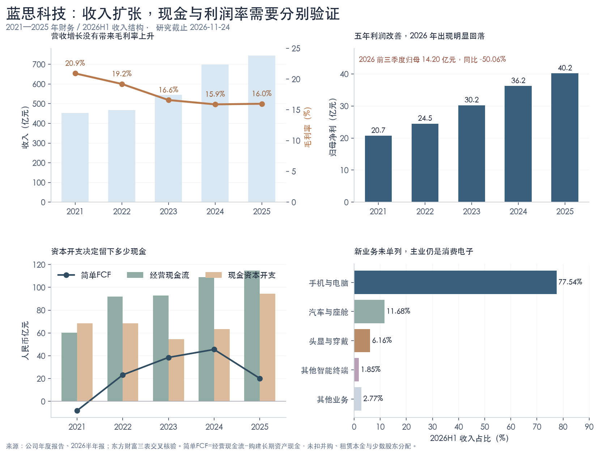

# 蓝思科技（300433.SZ / 06613.HK）研究报告

**研究日／数据截止日：2026-11-24（北京时间）**  
**证券身份：**蓝思科技股份有限公司，Lens Technology Co., Ltd.；深交所创业板 A 股与香港主板 H 股属于同一家公司，无 ADR 换算关系。沿用既有「蓝思科技」目录及触发配置 ID。  
**行情锚：**11 月 24 日 A 股收盘 23.98 元、H 股收盘 11.97 港元；腾讯收盘后快照分别为 16:14:27、16:08:15，与 Investing 历史行情交叉核对。总股本 5,278,740,870 股；A 股同价全股本价值 1,265.84 亿元，H 股同价全股本价值 631.87 亿港元。  
**估值快照：**滚动归母 PE 为 A 股 48.79 倍／H 股 20.84 倍；PB 为 2.38 倍／1.02 倍；滚动简单自由现金流为负，P/FCF 不适用。  
**研究主线：**蓝思能把头部客户的复杂设计变成大规模、可交付的精密硬件，但股东回报仍由订单、良率、产能利用率与再投资共同决定。H 股价格已经显著降低预付增长的程度，现金兑现仍未完成验证。

财务最新至 2026 年三季报，未经审计；分部最新至半年报。公告和公司披露核至研究日。本文更新[8 月研究](蓝思科技-research-20260803.md)，保留旧报告作为历史记录。所有模型均以人民币现金流估值；H 股按当日中间价 **1 港元＝0.85587 元人民币**折算，未预测汇率、税费及交易成本。本文用于学习研究，不构成投资建议，未假定读者持仓或成本。[行情 A](https://cn.investing.com/equities/lens-technology-co-ltd-historical-data)、[行情 H](https://cn.investing.com/equities/lens-tech-historical-data)、[外汇局中间价](https://www.safe.gov.cn/AppStructured/hlw/RMBQuery.do)。

---

## AI研究偏见自觉

**信息丰富度评级：A。**上市年限长、财报和机构调研丰富；客户具体项目的份额、定价、良率及新业务独立现金回报，信息质量只有 B 级。报道多，容易把「客户认证」「具备产能」「产线下线」连续升级成「确定订单、高利润、可分红」。

**AI研究局限性声明：**本次没有取得客户合同原件、银行受限资金清单、维持性资本开支拆分、机器人／服务器独立利润或单厂投资回报。研究中的增长率、稳态回报率、概率与价位带均为作者假设；管理层前瞻陈述不会进入历史事实栏。

- [x] 确定性感主要来自报表与订单机制，而非题材出现频次。
- [x] 即使资料减少一半，仍能保留「制造壁垒真实、定价权有限」的判断。
- [x] 用穿戴毛利下降、现金开支和无最低采购承诺反验市场共识。
- [x] 保留 AI 硬件业务成功的可能，同时承认暂时不能精确估计利润。

> 研究追问：如果删除所有「AI、机器人、TGV」字眼，只看客户与现金，这家公司值多少钱？

## 第一步：核心数据总览

### 收入结构与分部经济性

金额为人民币亿元；毛利率为 A 股报表口径，毛利不等于净利润。分部收入、成本已与东方财富经营分析数据交叉核对。

| 产品类别 | 2025收入 | 2025毛利率 | 2026H1收入 | H1占比 | H1收入同比 | H1毛利率 |
|---|---:|---:|---:|---:|---:|---:|
| 手机与电脑 | 611.84 | 15.41% | 223.82 | 77.54% | -17.67% | 16.17% |
| 汽车与座舱 | 64.62 | 7.22% | 33.72 | 11.68% | +6.56% | 12.53% |
| 头显与穿戴 | 39.78 | 19.91% | 17.77 | 6.16% | +7.95% | 12.72% |
| 其他智能终端 | 10.51 | 16.84% | 5.34 | 1.85% | +46.92% | 7.51% |
| 其他业务 | 17.34 | 59.68% | 8.01 | 2.77% | +33.34% | 54.22% |
| **合计** | **744.10** | **15.99%** | **288.66** | **100.00%** | **-12.42%** | **16.43%** |

来源：[2025年报第24—25页](https://static.cninfo.com.cn/finalpage/2026-03-31/1225064958.pdf)、[2026半年报第16页](https://disc.static.szse.cn/disc/disk03/finalpage/2026-08-22/61a3b9cf-12ad-42b8-96a1-61d9cc179c79.PDF)、[东方财富经营分析](https://emweb.securities.eastmoney.com/PC_HSF10/BusinessAnalysis/PageAjax?code=SZ300433)。四舍五入可能造成尾差。

最有信息量的组合是：汽车毛利改善，但头显／穿戴毛利率同比下降 10.55 个百分点；其他智能终端收入增长很快，毛利率仍只有个位数。机器人只是「其他智能终端」的一部分，AI 眼镜只是「头显与穿戴」的一部分，不能把整类收入直接冠以热门产品名称。公司没有按季度披露完整分部收入和毛利，因此不能补出「四个季度机器人收入曲线」。

### 五年财务趋势

单位：人民币亿元。简单 FCF＝合并经营现金流－购建固定资产、无形资产及其他长期资产支付的现金，未扣并购、股权投资、融资租赁本金和少数股东分配，不等于股东可自由提取现金。

| 年度 | 收入 | 归母净利 | 毛利率 | 营业利润率 | 经营现金流 | 现金资本开支 | 简单FCF | 货币资金 |
|---|---:|---:|---:|---:|---:|---:|---:|---:|---:|
| 2021 | 452.68 | 20.70 | 20.92% | 4.78% | 60.39 | 68.43 | -8.04 | 102.17 |
| 2022 | 466.99 | 24.48 | 19.21% | 6.35% | 91.81 | 68.52 | 23.28 | 116.86 |
| 2023 | 544.91 | 30.21 | 16.60% | 6.01% | 93.00 | 54.43 | 38.57 | 105.19 |
| 2024 | 698.97 | 36.24 | 15.89% | 5.54% | 108.89 | 63.32 | 45.57 | 109.88 |
| **2025** | **744.10** | **40.18** | **15.99%** | **6.19%** | **114.65** | **94.43** | **20.22** | **98.15** |

主源为[2022年报更新版](https://disc.static.szse.cn/disc/disk03/finalpage/2023-06-14/7ae8a609-72d6-4bb6-ae43-671ebe18a5df.PDF)、[2023年报](https://static.cninfo.com.cn/finalpage/2024-04-22/1219702530.PDF)、[2024年报](https://static.cninfo.com.cn/finalpage/2025-03-28/1222928897.PDF)及2025年报，第二源为[东方财富财务分析](https://emweb.eastmoney.com/PC_HSF10/NewFinanceAnalysis/Index?code=SZ300433&type=soft)三表数据库。2023 毛利率采用质量保证支出转列营业成本后的比较口径，纠正旧稿的 16.63%；2021 归母保留原比较期数，后续微小重列不改变表内两位小数。早期毛利率未重建不可得的全面历史重述，不宜把每个基点都解释为经营变化。



### 最近四个季度与滚动盈利

以下为累计财报相减得到的单季数，金额为亿元；Q4 与各年 Q1 存在显著季节性。

| 单季 | 收入 | 归母净利 | 扣非归母 | 经营现金流 | 现金资本开支 | 简单FCF |
|---|---:|---:|---:|---:|---:|---:|
| 2025Q4 | 207.47 | 11.75 | 11.32 | 56.21 | 29.32 | 26.89 |
| 2026Q1 | 141.40 | -1.50 | -1.74 | 20.14 | 25.34 | -5.20 |
| 2026Q2 | 147.27 | 7.26 | 4.52 | -0.03 | 26.55 | -26.58 |
| **2026Q3** | **190.35** | **8.43** | **7.20** | **27.02** | **24.92** | **2.10** |

Q3 环比现金改善是支持证据，不能省略；Q3 归母同比仍下降 50.42%、扣非同比下降 59.13%，不能把环比改善误写成全年恢复。前三季度收入 479.02 亿元、归母 14.20 亿元、扣非 9.98 亿元，同比分别为 -10.74%、-50.06%、-63.07%。[正式三季报第1—2、13—14页](https://static.cninfo.com.cn/finalpage/2026-10-26/1225620808.PDF)、[东方财富独立整理](https://finance.eastmoney.com/a/202610253907197697.html)。

| 滚动十二个月项目 | 金额／指标 |
|---|---:|
| 收入 | 686.49亿元 |
| 归母净利 | 25.95亿元 |
| 扣非归母净利 | 21.30亿元 |
| 经营现金流 | 103.34亿元 |
| 现金资本开支 | 106.13亿元 |
| **简单FCF** | **-2.78亿元** |
| 归母利润／当前总股本 | 0.49153元/股 |

滚动值＝2025 全年＋2026 前三季度－2025 前三季度。每股数使用最新总股本便于估值，不是把各期加权平均 EPS 直接相加；股权激励未来摊薄另作压力假设。

### 现金与债务桥

| 2026年9月末项目 | 人民币亿元 |
|---|---:|
| 货币资金 | 85.54 |
| 一年内到期大额存单 | 1.06 |
| 短期借款 | 18.24 |
| 一年内到期非流动负债 | 40.54 |
| 长期借款 | 83.17 |
| 非流动租赁负债 | 2.81 |
| **上述债务及租赁合计** | **144.76** |
| **债务减货币资金及到期存单** | **58.16** |

一年内到期非流动负债已含当期租赁部分，不再重复加一次；三季报未细拆其构成，故这是含租赁的保守近似。交易性金融资产 1.49 亿元未拆结构性存款与衍生资产，不全视为现金。货币资金也未全部确认为可分配资金，真实可动用净债可能更高；其他长期存款和非现金金融投资另有口径缺口。上述 58.16 亿元不能称为净现金。[三季报第7—10页](https://static.cninfo.com.cn/finalpage/2026-10-26/1225620808.PDF)、[新浪资产负债表公告转载](https://money.finance.sina.com.cn/corp/view/vCB_AllBulletinDetail.php?id=12658794&stockid=300433)。

> 段永平式追问：收入和会计利润增长之后，为什么股东能拿走的现金仍可能减少？

---

## 第二步：生意本质分析

**一句话定义：客户为复杂材料、精密加工和准时量产付钱，蓝思靠认证、良率与工厂协同重复获得订单，但每一代产品都要重新证明交付能力和资本回报。**

付款方是消费电子与汽车等品牌及其供应链，消费者并不直接因为「蓝思」品牌额外付费。收入由终端销量、每台搭载产品数量、单件复杂度及价值量、客户采购份额共同驱动。玻璃、金属、陶瓷、模组和组装提高一站式交付能力，也可能引入低毛利收入，单看营收放大容易误判利润质量。

| 环节 | 蓝思创造的价值 | 股东需要承担的成本 |
|---|---|---|
| 设计协作、打样与认证 | 材料和工艺与客户新品共同开发，缩短客户量产风险窗口 | 研发先发生，订单未必全量兑现 |
| 精密加工与功能集成 | 复杂曲面、外观一致性、耐用性和批量良率 | 设备、厂房、模具、折旧与报废 |
| 多基地量产与交付 | 同期大批量供货及跨区域服务 | 备货、用工、海外管理与汇率敞口 |
| 客户下一代产品 | 已有合作降低沟通和再次认证成本 | 客户仍可多源采购、降价或更改设计 |

招股书指出，框架协议通常没有最低采购量，实际数量以采购订单确定。合作具有重复性，但不具备订阅合同式锁量。2025 年第一、第二大客户分别贡献 45.01%、27.71%，前五合计 81.64%；原表匿名，不把第一名的全部金额直接实名为某一家品牌。[招股书印刷第45—46页](https://www1.hkexnews.hk/listedco/listconews/sehk/2025/0630/2025063000031.pdf)、[2025年报第26页](https://static.cninfo.com.cn/finalpage/2026-03-31/1225064958.pdf)。

利润的三个核心变量是**高附加值项目占比、产能利用率与良率、资本开支回收**。固定折旧和技术团队在订单转弱时仍需支出，解释了收入下降时利润可能更快下降。公司在三季度交流中披露，前三季度汇兑损失 6.54 亿元，收入规模下降也减少约 7 亿元毛利，研发及管理费用另有增加；不能只加回汇兑损失就宣称主业已完全恢复。新品节奏后移、存储涨价压制终端需求，是管理层解释，仍待后续销量与回款验证。[10月25日电话会记录第1—5页](https://static.cninfo.com.cn/finalpage/2026-10-26/1225621950.PDF)。

> 段永平式追问：这门生意好在可靠量产；但这种可靠能否换来持续的超额资本回报，而不只是更多订单？

## 第三步：护城河评估

| 来源 | 判断 | 可验证证据 | 什么会削弱它 |
|---|---|---|---|
| 品牌／定价权 | 偏弱 | 终端品牌掌握消费者，缺少无损提价证据 | 客户年度降价、竞标及产品降规格 |
| 转换成本 | 中等 | 研发协作、认证和良率爬坡令短期切换有风险 | 新一代产品重新分单，多源供应成熟 |
| 网络效应 | 未发现 | 增加一个客户不会直接令其他客户产品更有用 | 不应给平台型估值溢价 |
| 规模与成本 | 中等偏强 | 大批量交付、多工序及多基地协同 | 利用率下降，海外重复建设推高成本 |
| 技术／工艺 | 中等偏强 | 材料、加工、自动化与品质控制长期累积 | 替代材料、新工艺扩散，竞争对手追赶 |

2025 年研发费用 28.71 亿元，2026 前三季度为 24.35 亿元；投入真实，无法仅凭费用或专利数量估计领先年数。新技术要依次经过客户认证、稳定良率、订单、回款和资本回报，完成最后一步才证明护城河产生了股东价值。[2025年报](https://static.cninfo.com.cn/finalpage/2026-03-31/1225064958.pdf)、[三季报](https://static.cninfo.com.cn/finalpage/2026-10-26/1225620808.PDF)。

过去五年，综合制造和产品覆盖能力扩大，毛利率没有同向上行；这更接近「能力边界扩大，经济租金尚未同步扩大」。未来五年的关键不是无人能复制工厂，而是竞争者即使投入大量资金，是否仍难以复制客户协作、品质及跨工序成本。比亚迪电子已披露服务器及液冷等业务，歌尔也覆盖 AI 眼镜的声学、光学、结构件和整机，说明新市场并非蓝思独占。[比亚迪电子2025年报印刷第12页](https://www1.hkexnews.hk/listedco/listconews/sehk/2026/0422/2026042200748.pdf)、[歌尔2025年报第11页](https://disc.static.szse.cn/disc/disk03/finalpage/2026-05-30/ad7546b3-5194-4163-a2bf-94f222f0dad2.PDF)。

> 巴菲特式追问：十年后，客户仍需要蓝思的工厂；但是否仍愿意让蓝思赚到超过资本成本的钱？

## 第四步：逆向思考与风险清单

最强空方论点是：蓝思用高强度再投资维持客户资格，终端品牌保留大部分议价权；市场却按新业务的远期成功预先给钱。收入扩大、产能下线、技术验证都可能成立，普通股回报仍然平庸。反方也必须承认：Q3 简单 FCF 已转正，汽车毛利改善，新业务并非完全停留在概念阶段。

下表概率为主观风险等级，互相重叠，不能相加为统计概率。

| 失败路径 | 主观可能性 | 影响 | 后续可观察证据 |
|---|---|---|---|
| 核心客户降价、减份额或产品延后 | 中高 | 利用率、收入和利润同时受压 | 消费电子收入持续下降，存货与应收回收恶化 |
| 机器人／服务器收入增长但回报低 | 中高 | 增长不能兑现高估值 | 分部毛利不改善，扩产后现金仍不覆盖投资 |
| 资本开支超出经营现金能力 | 中高 | 借款上升、股息或每股价值承压 | 滚动CFO低于现金CapEx、净债上行 |
| 汇率与海外产能重复建设 | 中 | 收入折算和财务费用波动 | 币种敞口、套保与海外产线利用率 |
| 并购客户条件未满足或整合失败 | 中 | 项目延期、现金损失与减值 | PMG交割前提、巨腾审批及投后披露 |
| 永久性断供、极端治理或合规事故 | 低频、不可可靠量化 | 可能重大永久损失 | 制裁、正式调查、资金占用或资产限制 |

历史类比采用招股书及调研中「客户切换与产线投资」的机制，而不拿某家制造商后来的成功作必然结局。伯克希尔 2007 年股东信所述航空业，是资本投入增长却难留下股东回报的历史反例；其行业结构与蓝思不同，提醒仅限于「需求增长不自动等于资本回报」。[原信有关航空业的讨论](https://www.berkshirehathaway.com/letters/2007ltr.pdf)。

跨学科看，这是规模学习曲线与买方集中博弈同时作用：良率爬坡会降低成本，强势客户也可能通过年度议价分享这部分收益。技术采纳曲线证明市场会放量，无法单独证明供应商保留利润。最可能的分析错误，是低估新品交付延迟后的恢复速度；另一个方向则是把恢复性利润当成高增长年金。

> 芒格式追问：如果新业务收入都增长，但工厂回报率没有上升，今天的投资依据还剩多少？

## 第五步：管理层评估

周群飞与郑俊龙及控制实体长期主导公司。9 月 30 日正式公告确认，控股股东及一致行动人持股合计 3,095,088,573 股、58.63%；这是经济持股口径，没有 A/B 超级投票结构。控制集中支持长期投入，也限制少数股东制衡，不能仅凭高持股判断所有资本配置合理。[增持结果公告](https://static.cninfo.com.cn/finalpage/2026-09-30/1225591345.PDF)、[独立新闻核验](https://finance.sina.com.cn/jjxw/2026-09-30/doc-initrmyr6739976.shtml?cref=cj)。

| 时期 | 决策 | 截至研究日的结果／评价 |
|---|---|---|
| 长期制造平台建设 | 跨材料、工序与客户扩张 | 制造能力得到收入规模支持；现金及资本回报仍需分开评分 |
| 2025—2026扩产 | 增加新项目与海外产线投入 | 营运投入真实；2025简单FCF下降，滚动值已为负，资本配置暂评中性偏谨慎 |
| 2026股份回购与激励 | 回购股份用于员工持股／激励等 | 不能将全部回购当作永久注销；须看净股数及授予条件 |
| 2026控制人增持 | 约1.00亿元购入A股 | 利益一致性支持；资金可含最高90%的专项贷款，增持价格不是内在价值底 |
| 2026PMG交易 | 拟现金购买59.7805%股权 | 已签协议，交割附带客户订单、供应商代码及交货收款等条件，未当成确定并表利润 |
| 2026巨腾交易 | 拟扩大机壳和制造协同 | 截至11/6仍有先决条件未达成，不提前并表 |

PMG 来源为[10月16日公告](https://static.cninfo.com.cn/finalpage/2026-10-16/1225608611.PDF)；巨腾状态来自[11月6日联合公告](https://www.hnlens.com/upload/file/2026/11/06/56b19b11-866b-4b7d-8366-f53822d1834e.pdf)。2025 年报也披露部分募投项目延期，部分效益无法单独核算；这要求继续追踪投后现金，而非按项目数评分。

2026 年中期 A 股每股派息 0.10 元于 10 月实施；2025 年度方案每股 0.45 元，两项合计 0.55 元只能作为已公布历史分配参考，不能直接外推下一年。[中期实施公告](https://static.cninfo.com.cn/finalpage/2026-10-13/1225603411.PDF)、[年度分配方案与业绩核验](https://finance.eastmoney.com/a/202603313690137269.html)。未取得足以完整判断薪酬、减持动机及关键人才稳定性的证据，不给诚信作最高等级背书。

技术、交付和组织经验已形成团队能力，但创始人的客户关系、资本判断与文化影响仍很重要。假设其退休后竞争力不变，证据不足；假设必然崩溃，同样没有依据。

> 段永平式追问：如果创始人不再亲自推动扩张，管理团队能否主动放弃低回报项目？

## 第六步：行业与文明趋势

AI 从屏幕走向眼镜、机器人与汽车，会增加材料、外观件、散热与复杂组装需求。蓝思处于「让新设备能够被稳定制造」的位置，有参与技术扩散的资格；模型、芯片、终端品牌和制造商如何分配利润，仍需通过合同和报表回答。

| 方向 | 已找到的事实 | 尚未成为事实的部分 |
|---|---|---|
| 汽车及座舱 | H1收入增长、毛利率改善 | 更高利润率能否延续，新增产线完整周期回报 |
| AI眼镜及穿戴 | 有整机交付进展，所属大类有收入 | AI眼镜独立收入、利润及售后成本 |
| 机器人 | 10/30调研称昆山已日产百台 | 月产万台等为产能目标；实际客户订单、销量和利润未完整披露 |
| 服务器 | 松山湖Q3投产、公司称完成客户验厂 | 不等于获得可量化、不可撤销的大额订单 |
| TGV与玻璃基板 | 英特尔合作备忘录、客户测试与设备安装 | 联合验证不是长期采购合同，年底跑通为预期 |

最新进度采用[10月30日调研记录（11/1披露）第2—4页](https://pdf.dfcfw.com/pdf/H2_AN202611011831297334_1.pdf)，并与半年报的披露状态区分。机器人用于自身工厂还可能创造成本节约，而非外部销售收入，两种价值不能重复计算。

招股书引用的第三方行业研究估计，2024 年蓝思在消费电子精密结构件／模组综合方案市场占比 13.0%，在汽车交互系统综合方案市场占比 20.9%；后者不是全球汽车玻璃市场份额。AI 眼镜／XR 相关结构件模组 2029 年市场规模 17 亿美元，是 IPO 时预测，不能当成今天已实现的订单。这里保留出处及窄口径，不用整个机器人或半导体市场规模乘一个想象份额估收入。[招股书印刷第105、108、113页](https://www1.hkexnews.hk/listedco/listconews/sehk/2025/0630/2025063000031.pdf)。

技术路线风险包括材料替代、设备集成方式变化、客户自研与认证标准变化。上游原材料并非唯一瓶颈，客户是否愿意付足工艺复杂度、公司能否在放量中保持良率，才决定增量利润。未取得最新统一口径的供应商集中度，不把客户集中度替代为供应商数据。

> 李录式追问：二十年后，蓝思留下的是难以替代的制造体系，还是每隔几年都要重新投入才能续约的产能？

---

## 第七步：估值与安全边际

### 当前定价与历史口径桥

A、H 估值均用当前总股本和同一滚动财务分母；H 股先折人民币。法定总股本含少量库存股，采用该口径较谨慎；尚未授予或归属的激励另在长期模型预留摊薄。

| 指标 | A股 | H股 | 口径 |
|---|---:|---:|---|
| 价格 | 23.98元 | 11.97港元 | H股相当于10.2448元人民币 |
| 同价全股本价值 | 1265.84亿元 | 540.79亿元人民币 | 两个估值分母，不能相加 |
| TTM归母PE | 48.79倍 | 20.84倍 | 归母25.95亿元 |
| TTM扣非PE | 59.42倍 | 25.39倍 | 扣非21.30亿元 |
| PB | 2.38倍 | 1.02倍 | Q3归母权益531.26亿元 |
| PS | 1.84倍 | 0.79倍 | TTM收入686.49亿元 |
| 简化EV/收入 | 1.93倍 | 0.87倍 | 同价股权＋含租赁净债；少数股东影响很小 |
| 简单FCF收益率／P/FCF | 负／不适用 | 负／不适用 | 不将负现金流的算术倍数当作便宜 |
| 历史0.55元分配参考收益率 | 2.29% | 5.37% | 税前、按当前汇率映射，不是未来保证 |

PEG 暂不适用，近期利润下降，且没有已验证的稳定长期增长分母，不能用乐观预测增速凑出一个便宜的 PEG。

2025 年报 EPS 0.79 元是加权股本口径；按今天全股本重算 2025 利润，则 A 股静态 PE 约 31.51 倍。旧稿用 7 月末价格和 2025 EPS 得到约 40 倍，今天滚动盈利下降后约 49 倍。**价格下降与盈利变便宜不是同一件事。**这是一条口径桥，不是经过统一复权验证的长期估值分位，本文不据此计算历史投资收益。

同业比较中，比亚迪电子、歌尔和立讯的组装、零部件、新业务及并购结构不同，不能把较高 PE 直接转成蓝思合理 PE。本次未建立同行同日股本与正常化盈利的完整双源快照，故不提供伪精确的 PE 排名；这一缺口降低相对估值置信度。A／H 则是同一公司同一盈利的直接价格比较：H 股折人民币较 A 股低约 57.28%，同时存在市场准入、流动性与汇率风险，价差不构成无风险套利。

两地各自股份按实际交易价格相加，集团混合市场价值约 1,224.42 亿元人民币；不能把 H 股每股价格只乘约 3.02 亿股，就声称买下整家公司仅需几十亿港元。[10月证券变动月报表第1—2页](https://www.hnlens.com/upload/file/2026/11/04/23709fe4-7e1c-46f0-b92a-c7fb0fb11913.pdf)、[中财网独立呈现](https://www.cfi.net.cn/newspage.aspx?client=phone&id=20261103001189)。

### 三年三情景：当前价格贵不贵

以每股滚动归母 0.49153 元为起点。悲观假设 EPS 每年下降 10%、退出 14 倍；基准增长 10%、退出 22 倍；乐观增长 20%、退出 28 倍。三年退出倍数用于相对定价情景，**不是十年稳态终值倍数**。基准要求主业恢复且新项目有盈利，并不属于不付代价的自然增长。

| 三年情景 | EPS年增速 | 第三年EPS | 退出PE | 第三年价格CNY | 映射价格HKD | 含假设股息总回报A | 含假设股息总回报H |
|---|---:|---:|---:|---:|---:|---:|---:|
| 悲观 | -10% | 0.3583 | 14倍 | 5.02 | 5.86 | -79.08% | -51.03% |
| 基准 | +10% | 0.6542 | 22倍 | 14.39 | 16.82 | -38.73% | +43.42% |
| 乐观 | +20% | 0.8494 | 28倍 | 23.78 | 27.79 | +1.68% | +138.00% |

股息假设分别为每年每股 0、0.10、0.20 元人民币，均非公司承诺；回报为三年累计，非年化、未扣税费。按人民币 8%折现，含息今日价值分别为 **3.98／11.68／19.39 元**，映射 **4.65／13.65／22.66 港元**。不能直接拿三年后价格与今天相比，漏掉等待所需回报。

反推三年定价：若三年后仍为 22 倍、要求 8%年回报且暂不计股息，A 股需要 EPS 年增约 40.84%，H 股约 6.07%。这解释了为什么同一家公司，两地买入判断可以不同；低价也不能替代现金验证。

### 现金流对照与反向DCF

滚动简单 FCF 已为负，不能把利润全当作可分配现金。另作人民币股权现金流情景：第一年恢复后的所有者现金取 10／25／35 亿元，随后十年显式期内分别增长 0／8%／12%，第十一年起永久增长 0／1%／2%，折现率 8%。这些现金须已扣利息、完整必要再投资、租赁本金与少数股东分配；维持性开支未拆，属于低置信度恢复假设，绝不是已经实现的 FCF。

| 现金情景 | 首年所有者现金（亿元） | 显式期增速 | 永续g | 今日每股CNY | 映射HKD |
|---|---:|---:|---:|---:|---:|
| 悲观 | 10 | 0% | 0% | 2.37 | 2.77 |
| 基准 | 25 | +8% | 1% | 10.71 | 12.52 |
| 乐观 | 35 | +12% | 2% | 21.75 | 25.41 |

模型采用第一年现金起算，终值＝第十年现金×(1＋g)/(r−g)，没有套用同业退出倍数。既然现金定义为股权可分配现金，不再重复扣一次净债；但该路径隐含净债可控，不依赖新增借款维持派息。没有额外加回全部货币资金，因为其中需要营运资金且公司并非净现金状态。

在基准现金增长路径下，反向 DCF 对应的首年可分配现金要求：A 股约 **55.96 亿元**，H 股约 **23.91 亿元**。相比滚动简单 FCF 为负，A 股要求的修复更大；H 股价格接近一条合理恢复路径的价值，但这条路径本身尚未兑现。

### 十年折现：仓位压力测试

三年模型回答价格贵不贵；十年模型用于决定能否加大仓位，不能一票否决买入／持有。

| 输入 | 本次判断与理由 |
|---|---|
| 币种与r | 全部为CNY现金流，r＝8%；2%正常化无风险锚＋β1.0×6%权益风险溢价。2%是模型锚，未声称为今日国债实时报价 |
| 稳态增量ROIC | 7%；给成熟制造平台中等回报，低于按2025利润、利息、正常税率及期末投入资本粗估的约7.5%代理值；不假定每块新投资复制历史最好项目 |
| g | 悲观0%、基准1%、乐观2%；均为第十年之后永久增长，基准不高于人民币2%上限，敏感性中保持不变 |
| 2036归母利润 | 20／55／100亿元；分别代表旧业务承压、恢复并温和扩张、新业务显著成功，非公司指引 |
| 主观概率 | 30%／50%／20%；只是情景权重，未用历史频率校准 |
| 股息减稀释k | 假设每年每股0.20元持续分配，减每年0.30%摊薄；A为0.5340%、H为1.6522%。现金恢复前未必能兑现 |

ROIC 下界无法可靠地由派息反解，因为缺少维持性／增长性 CapEx 拆分；因此 7%是保守判断而非已验证增量回报。现金模型与十年模型不是两份独立证据，二者共享恢复、再投资和折现假设。极端永久断供和重大治理损失未建模，不能认为悲观 20 亿元利润已覆盖资产归零风险。

终值倍数只按 **PE＝(1−g/ROIC)/(r−g)** 产生，未使用同业类比：

| 十年情景 | g | 留存率g/ROIC | r−g分母 | 稳态退出PE | A近似IRR | H近似IRR |
|---|---:|---:|---:|---:|---:|---:|
| 悲观 | 0% | 0% | 8个百分点 | 12.50倍 | -14.44% | -5.77% |
| 基准 | 1% | 14.29% | 7个百分点 | 12.24倍 | -5.58% | +3.87% |
| 乐观 | 2% | 28.57% | 6个百分点 | 11.90倍 | -0.08% | +9.86% |

ROIC低于资本成本时，增长需要留存现金，g提高不必然提高终值倍数。工具 IRR 采用终值几何回报直接加 k，是近似回报压力指标，不是逐笔股息再投资的精确资金IRR，也不是概率加权财富的几何收益。H 股以今日汇率折人民币入场；结果不等于已预测未来港元回报。

| r敏感性 | A期望近似IRR | H期望近似IRR | 是否覆盖各档r／有效性 |
|---|---:|---:|---|
| 6%（r−2pp） | -3.96% | +5.63% | 两者未通过；乐观g分母仅4个百分点，仅作情景参考 |
| 7%（补充复核） | -5.70% | +3.74% | 两者未通过；三档分母均达到5个百分点 |
| **8%基准** | **-7.14%** | **+2.18%** | **两者未通过** |
| 9%（补充复核） | -8.36% | +0.84% | 两者未通过 |
| 10%（r＋2pp） | -9.43% | -0.32% | 两者未通过；超出CNY合理区间，仅供参考，不参与翻转判定 |

**结论在人民币合理区间的有效采样点没有随折现率翻转。**已同时跑 ±2pp 与 ±1pp；后者避开 6%乐观档的窄分母问题。不能拿区间外、或窄分母结果论证买入。若未来不派息且无摊薄，k归零时，8%下 A／H期望指标约 -7.67%／+0.52%，仍不支持加大仓位。

### 估值分歧对账

H 股存在方向分歧：三年基准含息今日价值 13.65 港元、现金恢复基准 12.52 港元，都略高于 11.97 港元；十年压力测试却未覆盖 8%。前两项是**定价判断**，依赖增长和现金恢复；后一项是**仓位压力测试**，用较低的成熟制造业资本回报约束终值。

因此，H 股的合理小仓可以继续等待验证，不能仅因十年未通过就机械清仓。本次暂停新增，另有经营依据：收入和扣非仍同比下滑、滚动 FCF 为负、净债及新业务独立回报待核。若后续现金条件成立，H 股在研究价带内可以启动小额分批，即使十年结果届时仍偏低，也应收紧仓位而非自动否决。A 股则连三年与现金基准的安全边际也不足。

> 巴菲特式追问：r错两个百分点会怎样？有效区间采样不翻转，但长期结果受利润终值和再投资质量影响更大。  
> 段永平式追问：若股市关闭五年，愿意按今天价格持有吗？A股缺少足够现金补偿；H股只适合愿意承受恢复不及预期的小额持仓，暂不承担核心仓职责。

---

## 第八步：最终决策与行动清单

| 六个并列维度 | 结论 | 信心度 |
|---|---|---|
| 生意质量 | 高门槛制造，订单可重复；现金与资本需求削弱复利质量 | 中高 |
| 护城河 | 客户协作、良率与规模真实；锁量和定价权有限 | 中 |
| 管理层 | 高持股及长期制造执行支持；扩产和并购回报须继续核验 | 中 |
| 最大风险 | 核心客户集中、重资本、新业务量增未必利增 | 高 |
| 文明趋势 | AI终端、机器人、汽车带来制造机会，利润捕获未确认 | 中 |
| 估值 | 三年：A缺少安全边际，H接近基准价值；十年：两地均未覆盖资本成本，有效区间未翻转，只限制仓位 | 中 |

**估值维度不是最终决策唯一裁决。**本次综合判断为：**A 股观望新增；H 股观望新增、合理小仓有条件持有，不加仓。**这来自经营、护城河、管理与价格的共同约束，不是十年模型的单项结论。

| 投资者／策略 | 具体动作 |
|---|---|
| 空仓者 | 先等现金恢复。A股9—11元、H股10.5—12.5港元仅是条件研究带；H股现价虽在带内，经营条件仍未满足，不等于现在买入 |
| 持仓者 | 合理小仓可持有复检，暂停按题材加仓；明显超出风险预算者分散客户和制造业敞口，不依据未知成本提出强制清仓 |
| 分批／加仓信号 | 后续连续两次正式财务披露：滚动CFO覆盖现金CapEx，扣租赁本金及少数股东分配后现金为正；消费电子降幅收窄或恢复、穿戴毛利止跌；存货回款可解释，净债无失控；新业务至少有可核收入、毛利或客户兑现证据 |
| 仓位约束 | 条件通过后首笔仅参考权益0.25%—0.5%，A＋H合计研究上限约1%；若要提高至核心仓，必须重新评估长期现金回报。这是研究风控示例，非用户实际配置 |
| 卖出／降低风险信号 | 关键客户实质失单、连续两次正式披露现金门槛落空且净债继续恶化、穿戴及主业毛利持续下行、重大减值／资金占用；须判断永久损失而非机械看单季波动 |
| 估值警戒 | A股≥28元、H股≥20港元而盈利与现金模型未上修时，复核超配和减仓；警戒触发不等于自动卖出 |
| 跌破研究带下沿 | 先查永久损失、债务与现金，不自动加码摊低成本 |

价带相对旧 A 股 18—24 元带下调，原因是滚动盈利和现金状态变化，而不是因为股价已经下跌。旧带已经失去原有业绩前提，不能作为独立买入依据。H 股单列估值与条件，不能把 A 股价带直接当成港元价带使用。

复检安排：**2026-12-31**检查 Q4经营线索、TGV年底目标、PMG／巨腾进展及正式财报日历；**2027-04-30**作为全年及一季报信息的兜底研究检查日，均不是已确认的预约披露日。若实际正式披露更早，应在披露后即复检。事件仅登记供人工跟踪，当前每日自动流程只扫描价格。

### 四位大师原话与方法延伸

以下原文已读取；没有证据表明四位对蓝思或本次价格发表过意见。延伸均为作者应用其方法，不模拟其本人荐股立场。

- 巴菲特：「A truly great business must have an enduring ‘moat’ that protects excellent returns on invested capital.」[2007年股东信，印刷第6页](https://www.berkshirehathaway.com/letters/2007ltr.pdf)。方法延伸：制造壁垒必须最后保护资本回报，不能用收入增长替代验证。
- 芒格：「He wanted decisions that maximized long-term results」。[2014年度评论，印刷第40页](https://www.berkshirehathaway.com/letters/2014ltr.pdf)，上下文评价巴菲特及承担决策长期后果。方法延伸：把扩产和并购按完整周期现金回报评分。
- 段永平：「未来现金流折现不是公式，是思维方式。」[2011年雪球原帖](https://xueqiu.com/1247347556/20386904)，已读[仓库原发言存档第79条](../段永平/段永平雪球全量原发言.md)。方法延伸：把利润、再投资、股本与可分配现金接起来，不因现价接近模型就跳过经营门槛。
- 李录：「微观层面才是我们可以有所作为的。」[北大演讲授权实录](https://news.qq.com/rain/a/20241226A03XAF00)，已读[仓库存档](../李录/李录-北大演讲-20241207.md)。方法延伸：对宏观汇率保持克制，把核验重点放到合同、工厂和资金。

> 综合追问：下一次正式披露，哪一条现金或客户证据会使本次判断改变？应先核对这些证据，再调整仓位。

---

## AI分析置信度与投资确定性

**AI分析置信度：财务及证券身份较高，估值中低。**五年财务、三季报、股本、控制权与两地价格已有来源和程序复核。订单归因属于管理层解释；未来每股利润、股东现金、概率和永久增长均为判断，不能与审计数据同等看待。

**实际投资确定性：中低。**即使所有历史数字准确，未来回报仍取决于客户分单、良率、资本开支和新增项目回报。H 股降低了为增长预付的价格，没有消除生意风险。应一手验证：新品实际订单是否只是后移；头显穿戴毛利下滑是爬坡还是定价；机器人／服务器单台毛利与售后；新厂净新增而非重复产能；受限现金、租赁现金及收购后真实净债。

极端永久断供、重大治理事故、未披露担保、未来汇率路径未建模；也未验证完整历史复权估值分位及同行同日正常化PE。遇到这些证据缺口，应降低仓位与结论精度，不能填入看似精确的数字。

## 数据来源与审计记录

### 关键数据交叉验证记录

公司公告与东方财富／新浪等数据发布方交叉核对，验证的是取数、传输与口径一致性；两家网站转载同一财报不等于两次独立审计。现金、债务拆分另读公告附注；未来模型参数无外部「事实值」。

| 核验项 | 主源 | 第二源 | 结果 |
|---|---:|---:|---|
| 2025收入（亿元） | 744.097317 | 744.10 | 偏差小于1% |
| 2025归母（亿元） | 40.178274 | 40.18 | 偏差小于1% |
| Q3累计收入（亿元） | 479.018256 | 479.02 | 偏差小于1% |
| Q3累计归母（亿元） | 14.197719 | 14.20 | 偏差小于1% |
| Q3货币资金（亿元） | 85.544814 | 85.544814 | 一致 |
| Q3累计现金CapEx（亿元） | 76.807016 | 76.807016 | 一致 |
| 总股本（股） | 5278740870 | 5278740870 | 月报表与腾讯／新浪一致 |
| 控股方及一致行动人 | 58.63% | 58.63% | 9/30公告与独立新闻一致 |

补充核验入口：[东方财富2025年报数据](https://finance.eastmoney.com/a/202603313690137269.html)、[东方财富H1数据](https://finance.eastmoney.com/a/202608213849650311.html)、[新浪现金流数据库](https://vip.stock.finance.sina.com.cn/corp/go.php/vFD_CashFlow/stockid/300433/ctrl/part/displaytype/4.phtml)。五年三表及分部的完整精确输入、来源与模型见[估值参数](蓝思科技-research-20261124-model.json)。

金融严谨性工具的关键输出节录如下；完整结果保留在[验算记录](蓝思科技-research-20261124-validation.txt)，不把模型输出冒充额外财务来源。

```text
A同价股权价值：23.98 × 5,278,740,870 = 126,584,206,062.60 CNY
H同价股权价值：11.97 × 5,278,740,870 = 63,186,528,213.90 HKD
估值验算：A PE 48.79x / PB 2.38x；H折人民币 PE 20.84x / PB 1.02x
终值口径：CNY，r 8%，ROIC 7%，g 0%/1%/2%
终值分母：8/7/6个百分点；离散风险未计入折现率或β
```

本次工具提取 166 个候选点，按固定随机种子抽取 25 项。日期年份和「偏差小于百分之一」门槛属于两项非财务误识别，透明剔除后，以质保重述后的历史毛利率和全年自由现金流补检；保留的随机项目及补充项目合计 25 项，数据、模型公式与假设口径全部通过，零警告、零失败。模型假设核验仅确认参数和算式一致，不验证未来预测成立。另将五年三表的 35 项原始输入逐一与年报文本及东方财富字段核对。详见[抽检清单及排除说明](蓝思科技-research-20261124-audit.json)、[准出判决](蓝思科技-research-20261124-audit-verdict.txt)。

定稿参数再次通过[终值口径准出](蓝思科技-research-20261124-terminal-audit.txt)；两项未建模离散风险已在正文列明。触发配置与每日监控只读校验均通过，并以临时状态／报告目录验证两地价格，未发送通知。价格区间和复检节点更新到既有「蓝思科技」target；非重点标的台账新增本次建议，历史建议保留并接续关闭。价格到达只是启动研究，事件仍须人工复检。
