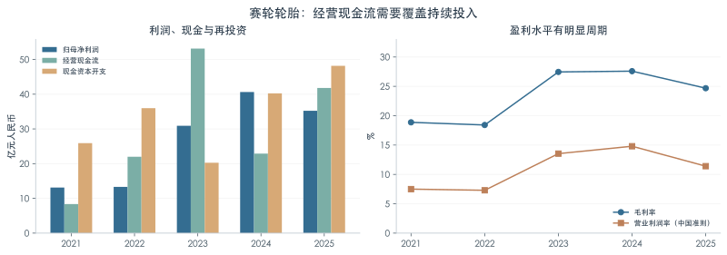
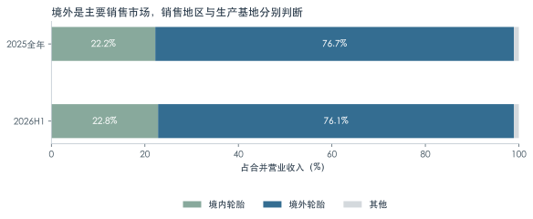

# 赛轮轮胎（601058.SH）研究报告

> **研究及信息截止日：2026-11-18（Asia/Shanghai）**；行情采用 2026-11-17 收盘后快照，最新财务为 2026-09-30，三季报公告日为 2026-10-31。  
> **公司：**赛轮集团股份有限公司，Sailun Group Co., Ltd.；上海证券交易所 A 股，证券简称赛轮轮胎，曾用简称赛轮金宇。本报告研究该 A 股普通股。  
> **价格与估值：12.50 元；总股本 3,288,100,259 股；总市值 411.01 亿元；TTM PE 12.22 倍，PB 1.82 倍。**  
> **研究主线：**赛轮的全球制造能力已通过销量验证；股东回报仍要通过提价、回款与扩产回报验证。  
> **信息丰富度评级：A 级。** AI 研究局限性：报表丰富，单厂资本回报、液体黄金独立利润及同规格定价资料不足；公开资料数量不能替代未来现金流确定性。本文用于学习研究，不构成投资建议。

价格、股本由[东方财富行情接口](https://push2.eastmoney.com/api/qt/stock/get?secid=1.601058&fields=f43,f84,f86,f116)与[腾讯行情](https://qt.gtimg.cn/q=sh601058)交叉核验，腾讯快照为 11 月 17 日 16:14:49。财务采用公司正式披露与东方财富独立取数。用户提供的[半年报精读](赛轮轮胎-earnings-2026H1.md)作为研究起点，结论更新至三季报。

## AI研究偏见自觉

市场容易接受“全球扩产、技术升级、低 PE”的完整故事。最需要反证的是：新增销量能否创造高于资金成本的每股可分配现金，以及海外生产优势能否经得住同行复制与贸易政策变化。

- [x] 将公开事实、报表推导、预测假设分别注明。
- [x] 同时保留 Q3 利润下降与单季现金改善两组证据。
- [x] 不将产品测试认证直接折算成品牌溢价。
- [x] 不以单一十年折现结果决定买卖。

即使资料减少一半，轮胎替换需求、制造成本竞争与重资本扩张这三个判断仍成立；新厂未来回报和终值利润的可信度则会明显下降。

---

## 第一步：核心数据总览

### 五年增长背后的现金成本

下表金额为亿元人民币，比率另注。FCF 代理值＝经营现金流减购建固定资产、无形资产及其他长期资产的现金支出；没有扣除企业收购、租赁本金与股东分配，也没有把维持性投资从扩产中拆出。

| 年度 | 收入 | 归母净利 | 毛利率 | 营业利润率 | 经营现金流 | 现金资本开支 | FCF代理值 | 货币资金 |
|---|---:|---:|---:|---:|---:|---:|---:|---:|
| 2021 | 179.98 | 13.13 | 18.87% | 7.49% | 8.37 | 25.91 | -17.54 | 48.41 |
| 2022 | 219.02 | 13.32 | 18.42% | 7.29% | 21.99 | 35.98 | -13.99 | 49.03 |
| 2023 | 259.78 | 30.91 | 27.45% | 13.54% | 53.13 | 20.26 | +32.87 | 52.16 |
| 2024 | 318.02 | 40.63 | 27.58% | 14.80% | 22.89 | 40.24 | -17.36 | 55.17 |
| **2025** | **367.92** | **35.22** | **24.68%** | **11.40%** | **41.79** | **48.18** | **-6.39** | **45.79** |

营业利润率使用中国会计准则“营业利润/收入”，包含财务费用、投资收益及部分其他损益。2023 成本采用后来年报重列口径；2022 利润采用追溯调整后口径。来源：[2022 年报含 2021 比较数](https://file.finance.sina.com.cn/211.154.219.97:9494/MRGG/CNSESH_STOCK/2023/2023-4/2023-04-29/9161696.PDF)、[2023 年报](https://static.cninfo.com.cn/finalpage/2024-04-27/1219854483.PDF)、[2024 年报](https://www.sailungroup.com/upload/file/20250807/1754570828658063150.pdf)、[2025 年报](https://static.cninfo.com.cn/finalpage/2026-04-28/1225201460.PDF)，与[东方财富财务数据](https://emweb.securities.eastmoney.com/PC_HSF10/FinanceAnalysis/Index?type=web&code=SH601058)逐项核对。



五年经营现金流合计 148.17 亿元，为归母利润的 1.11 倍；但现金资本开支合计 170.56 亿元，简单 FCF 累计 **-22.40 亿元**。这组数据支持“利润有一定现金基础”，同时要求投资者验证持续投入的回报。仅用 CFO/利润评估这家公司，会漏掉最重要的资本需求。

### 最新四季：量增与利润受压同时出现

| 单季度 | 收入（亿元） | 归母（亿元） | 毛利率 | CFO（亿元） | 现金资本开支（亿元） | FCF代理（亿元） |
|---|---:|---:|---:|---:|---:|---:|
| 2025Q4 | 92.05 | 6.51 | 24.53% | 16.73 | 19.23 | -2.50 |
| 2026Q1 | 94.61 | 10.56 | 26.86% | 1.76 | 14.10 | -12.34 |
| 2026Q2 | 105.66 | 11.03 | 27.10% | 8.57 | 11.89 | -3.32 |
| **2026Q3** | **108.58** | **5.52** | **20.98%** | **10.61** | **10.82** | **-0.21** |

Q2、Q3、Q4数据由对应累计数相减；季度分部收入和分部利润未完整披露，无法补出全钢、半钢、非公路轮胎的连续季度利润表。[Q1 正式报告](https://static.cninfo.com.cn/finalpage/2026-04-28/1225201459.PDF)、[H1 正式报告](https://static.cninfo.com.cn/finalpage/2026-08-31/1225534298.PDF)、[Q3 正式报告](https://static.cninfo.com.cn/finalpage/2026-10-31/1225646273.PDF)及上述东方财富三表构成计算基础。

前三季收入 308.85 亿元，同比增长 +11.96%；归母 27.12 亿元，同比 -5.56%；扣非归母 25.95 亿元，同比 -8.06%。Q3 单季收入 +8.58%，归母 **-46.94%**。公司将下滑归因为原料上涨较快、提价传导滞后及外币相对人民币贬值。[三季报第 1—3 页](https://static.cninfo.com.cn/finalpage/2026-10-31/1225646273.PDF)

经营数据提供了更直接的利润解释：Q3 自产胎销量 2,433.79 万条，同比 +14.25%；自产胎收入 +8.62%；均价同比 -4.93%，四项主要原料综合采购价同比 +19.35%。均价含产品结构影响，不能全部理解为同规格降价；采购指数也不等于当期已结转成本涨幅。但两者共同说明当前成本传导承压。[公司 Q3 经营数据公告](https://epaper.cs.com.cn/zgzqb/html/2026-10/31/nw.D110000zgzqb_20261031_2-B108.htm)

### 收入结构与地区盈利

| 销售地区/其他 | 2025收入（亿元） | 2025毛利率 | 2026H1收入（亿元） | 2026H1毛利率 |
|---|---:|---:|---:|---:|
| 境内轮胎 | 81.77 | 20.77% | 45.70 | 25.63% |
| 境外轮胎 | 282.26 | 25.75% | 152.42 | 27.33% |
| 其他业务 | 3.89 | 未单列比较 | 2.16 | 未单列比较 |
| 合并收入 | 367.92 | 24.68% | 200.27 | 26.99% |

地区毛利率由各地区收入减成本计算。销售地区与生产基地并非同一划分，不能把境外毛利全部归给海外工厂。H1 境外轮胎收入占合并收入 76.11%；若以轮胎主业为分母则约为原报告所列 76.93%。[2025 年报营业收入附注](https://static.cninfo.com.cn/finalpage/2026-04-28/1225201460.PDF)、[2026H1 附注七、61，第 148 页](https://static.cninfo.com.cn/finalpage/2026-08-31/1225534298.PDF)



**对旧报告的修正：**原半年报精读称没有地区毛利拆分，表述不准确；原报提供了地区收入与成本，足以计算地区毛利率。全钢、半钢、非公路和液体黄金的独立财务贡献仍缺失。本次保留历史报告，在此明确修正。

### 现金、债务与营运资金

| 项目（亿元） | 2025末 | 2026H1末 | 2026Q3末 |
|---|---:|---:|---:|
| 货币资金＋交易性金融资产 | 47.16 | 53.37 | 55.40 |
| 短期借款 | 59.57 | 69.91 | 82.46 |
| 一年内到期非流动负债 | 15.54 | 17.08 | 17.46 |
| 长期借款 | 43.47 | 57.82 | 54.10 |
| 非流动租赁负债 | 1.96 | 1.91 | 1.98 |
| **统一净债务代理** | **73.38** | **93.36** | **100.60** |
| 应收账款 | 61.47 | 74.23 | 80.83 |
| 存货 | 71.39 | 81.85 | 85.73 |

净债务代理＝短借＋全部一年内到期非流动负债＋长借＋非流动租赁负债－货币资金－交易性金融资产；当前租赁部分包含在一年内项目，不重复添加；应付票据及经营应付款未计入借款。该数未剔除受限现金，低估流动性压力的可能性仍在。Q3 现金及等价物实际为 49.78 亿元，季度没有完整受限资金附注，不能将 H1 的受限额机械沿用。[Q3 合并资产负债表和现金流量表](https://static.cninfo.com.cn/finalpage/2026-10-31/1225646273.PDF)

旧报告年末 70.92 亿、H1 90.82 亿采用一年内到期长借且未含长期租赁。本报告改用统一口径，避免将口径变化误当成新增债务。应收及存货较年末分别 +31.50%、+20.08%，高于前三季收入同比增幅，但存量环比与收入同比不能直接证明坏账，仍须检查账龄、库存库龄和回款。

**本期现金判断：**前三季 CFO 20.94 亿元、现金资本开支 36.80 亿元、简单 FCF -15.87 亿元；Q3 单季 FCF 已接近平衡。现金恢复是真实改善，累计资金缺口及净债上行也是真实约束。简单 FCF 尚未扣除股息、利息分类差异及租赁本金，因此单季持平还不能确认股东现金盈余。

> 段永平式追问：如果只能保留一个经营指标，我会看销量，还是扣完必要投入后的每股现金？

---

## 第二步：生意本质分析

**一句话：**车主、车队和矿山为安全可靠、每公里成本有竞争力的轮胎付钱，赛轮依靠配方、制造效率和全球供货网络争取持续替换订单。

| 环节 | 钱如何流动 | 投资含义 |
|---|---|---|
| 替换市场 | 经销商采购，消费者磨损后再次购买 | 需求重复，品牌和渠道仍须每次竞争 |
| 整车配套 | 主机厂认证、定点、批量采购 | 认证增加粘性，大客户议价较强 |
| 车队与矿山 | 轮胎寿命、故障停机、服务影响总成本 | 可靠性与服务更有价值，单独盈利未披露 |
| 生产 | 橡胶、炭黑、钢帘线、人工、能源与折旧构成主要成本 | 原料采购与售价调整有时间差 |
| 扩张 | 工厂和库存先投入，再等待利用率、回款 | 必须同时看固定资产和营运资金回报 |

利润由三个变量主导：**每条轮胎的售价与材料成本差、工厂利用率、增长占用的资本。** 前三季收入基数下，毛利率每变动一个百分点，对应税前毛利约 3.09 亿元，假定其他因素不变；收入增长未必足以抵消价差收窄。海外工厂还增加汇率、税制和物流变量。

2025 年费用化研发 11.47 亿元、占收入 3.12%，资本化为零。液体黄金的液相混炼路线有技术与产品证据；公司宣传第三方测试及认证，但本次没有独立取得完整证书、测试工况及同规格竞品对照，更缺少溢价、销量和独立毛利。因此判断“技术值得跟踪”，不将其先计入品牌垄断利润。[2025 年报研发及经营说明](https://static.cninfo.com.cn/finalpage/2026-04-28/1225201460.PDF)、[公司技术品牌资料](https://www.sailungroup.com/brand/item_285.html)

经营杠杆具有双向性：成熟厂利用率提高可摊薄折旧，新厂爬坡和售价压力则会放大利润下滑。Q3 原料与汇率冲击同时出现，本次没有足够数据将利润下降精确分配给原料、汇兑、新厂和促销，不能把全部降幅都解释成一次性损失。

> 段永平式追问：这门生意好在哪？重复磨损提供长期需求，能否留住回报取决于制造成本与资本纪律。

---

## 第三步：护城河评估

| 来源 | 判断 | 可验证证据与反证条件 |
|---|---|---|
| 品牌与定价权 | 偏弱至中等，培育中 | 原料上涨时 Q3 均价仍降；须看到同规格溢价与成本传导 |
| 转换成本 | 替换胎低，配套和矿山中等 | 主机厂/矿山验证与服务增加粘性；缺少客户留存及独立利润数据 |
| 网络效应 | 未见实质证据 | 销量增加可改善渠道效率，但不自动提高每位用户的产品价值 |
| 规模与制造成本 | 中等 | 当前毛利相对同行有韧性；同业出海证明工厂地理优势可复制 |
| 技术与专利 | 有积累，持续领先年限难量化 | 配方工艺和巨胎产业化有基础，缺少竞争对手同工况与财务检验 |
| 全球组织与服务 | 中等 | 多地建设与运营经验需要积累；贸易措施、劳工和低利用率可侵蚀回报 |

| 关键生产资产 | 披露口径与状态 | 回报验证重点 |
|---|---|---|
| 中国、越南及柬埔寨等成熟产能 | 2025 年全公司可实现产能：全钢 1,556 万条、半钢 7,380 万条、非公路 23.80 万吨 | 相应产能利用率 92.94%、91.08%、80.25%；属于当年可实现能力 |
| 墨西哥 | 项目规划半钢 600 万条；H1 披露工程进度 95% | 已首胎下线，实际利用率与现金回报仍待披露 |
| 印尼 | 2026 年调整后项目：半钢 600 万条、全钢 75 万条、非公路 1 万吨；H1 工程进度 85% | 规划调整后的产品组合、投产及回款 |
| 埃及 | 全部规划完成后：半钢 3,600 万条、全钢 330 万条、非公路 2 万吨；H1 相关在建项目进度 20% | 分期资金需求、审批、需求吸收与成熟后回报 |

这些口径不能相加成“当前在产产能”。埃及六月单次新增投资预算为 11.4131 亿美元，属于重大后续资本承诺；H1 在建附注预算与全部规划覆盖范围也不同。[2025 年报产能表](https://static.cninfo.com.cn/finalpage/2026-04-28/1225201460.PDF)、[H1 在建及经营附注](https://static.cninfo.com.cn/finalpage/2026-08-31/1225534298.PDF)、[印尼调整后公司 IR 说明](https://www.sailungroup.com/upload/file/20260202/1769995550225064352.pdf)、[埃及六月投资公告](https://static.cninfo.com.cn/finalpage/2026-06-18/1225375195.PDF)

过去五年，规模、产品覆盖和全球组织能力增强；未来五年，同行复制和政策变化会检验这些能力的超额回报。当前更适合将其看成“需要持续投入维护的制造优势”，不能据工厂数量推定永久高资本回报。

> 巴菲特式追问：十年后哪些优势仍在？配方、质量、渠道和组织可能仍在；若只剩更大的固定资产，护城河就没有兑现。

---

## 第四步：逆向思考与风险清单

**最强空方论点：**中国轮胎企业海外扩产共同增加供给，贸易壁垒再分走一部分原有成本优势。赛轮为保份额持续投入，销量与会计利润增长最终不能转成每股自由现金流。液体黄金有效，也可能让消费者、渠道或材料供应方获得大部分增益。

**最强多方反驳：**材料、巨胎认证、数字化制造与全球运营经验构成复合能力；成本领先者有机会在洗牌中扩大份额。Q3 现金改善及相对同行更高的毛利，说明竞争力并未被一季利润下滑推翻。

下表概率为未来三年的主观研究区间，事件可重叠，不是统计预测，也不与估值情景概率相加。

| 失败路径 | 主观概率 | 影响 | 领先观察指标 |
|---|---|---|---|
| 原料涨价与价格竞争同时挤压 | 高，40%—60% | 中高，盈利中枢下移 | 同规格售价、原料采购价、季度毛利 |
| 新产能利用率不足、融资继续替代现金回报 | 中高，30%—50% | 高，债务增加、估值折价 | 项目支出、单厂利用率与回报、净债 |
| 贸易措施侵蚀某产地优势 | 中，20%—40% | 高，订单或利润迁移 | 按原产地、税号及公司区分的最终措施 |
| 关联采购或控制权安排损害小股东 | 低中，10%—20% | 高 | 公允比价、承诺变更、质押与担保 |
| 流动性冲击迫使融资或削减高回报项目 | 低，5%—15% | 很高 | 债务到期、授信、现金可调度性及新支出 |

贸易风险应按程序和产地读取。美国 2026 年 10 月越南乘用/轻卡胎 CVD 日落复审列出 Sailun (Vietnam) 的相关补贴率；该数不能直接当作新增税率或综合进口税负。欧盟 2026 年 7 月公布中国乘用/轻卡胎最终反倾销措施，属于中国原产地范围，本次未核实赛轮个别最终税率，也不自动套给所有海外厂。[美国商务部原文](https://www.govinfo.gov/content/pkg/FR-2026-10-05/html/2026-20377.htm)、[欧委会公告](https://policy.trade.ec.europa.eu/news/commission-imposes-anti-dumping-duties-passenger-car-and-light-lorry-tyres-china-2026-07-09_en)

历史类比可参考巴菲特在 2007 年股东信对需要大量追加资本的生意的讨论：需求增长可能与股东回报分离。赛轮与航空业有资产、竞争和资本需求方面的相似性，产品、供需和融资结构差异也很大；这个类比用于提醒资本纪律，不预测相同结局。[巴菲特 2007 年股东信](https://www.berkshirehathaway.com/letters/2007ltr.pdf)

本报告最可能犯的错，是低估新厂成熟后的现金改善，或把原料和汇率的阶段性冲击当成永久衰退；反方向的错误，是过早假定所有扩产最终都能获得良好回报。用下一批实际现金和净债数据，持续检验这两种解释。

> 芒格式追问：聪明人为什么不买？因为份额和产能容易验证，每股现金复利仍缺乏足够证据。

---

## 第五步：管理层评估

袁仲雪为名誉董事长、董事和实际控制人；刘燕华为董事长，谢小红为总裁。专业管理团队已承担日常经营，不能把所有决策简化为一位创始人的判断。袁在产业组织、材料和技术协同上的作用仍需纳入关键人风险。[2025 年报人员及控制关系](https://static.cninfo.com.cn/finalpage/2026-04-28/1225201460.PDF)

| 决策 | 已见结果 | 资本配置评价 |
|---|---|---|
| 提前布局越南、柬埔寨 | 已形成生产、市场和运营积累 | 先发执行能力强，未来须持续承受贸易措施检验 |
| 长期投入液相混炼与巨胎 | 产品与工艺已有落地 | 技术执行可肯定，增量财务回报未单列 |
| 墨西哥、印尼扩张 | 建设与首胎下线已有兑现 | 建设成绩明确，盈利与现金成绩待验证 |
| 埃及继续扩大规划 | 潜在市场覆盖增加，后续资金需求也增加 | 对当前资本纪律保持审慎 |
| 中期分红 | 每股 0.15 元方案并已发布实施安排 | 有回报股东意愿，需与负 FCF 和债务一起评估 |

Q3 袁仲雪直接持有 224,690,895 股，约 6.83%；瑞元鼎实持有约 16.92%。2025 年末正式披露的可控制股份为 26.30%，包含一致行动人，**不能当成个人经济持股**。刘燕华、谢小红年报披露直接持股分别为 950 万、850 万股，体现一定利益一致性；持股并不自动消除错误扩张的可能性。

Q3 瑞元鼎实与袁仲雪分别质押 2.163 亿股、0.80 亿股；这是股东质押，与上市公司借款分开。10 月一致行动人拟捐赠 3,786 万股，Q3 仍称办理中，本次未核到完成公告，不提前变更控制比例。[Q3 股东表](https://static.cninfo.com.cn/finalpage/2026-10-31/1225646273.PDF)、[捐赠公告](https://static.cninfo.com.cn/finalpage/2026-10-01/1225590008.PDF)

材料、设备及软控体系协作可能提高效率，也带来关联采购公允性问题。原 H1 报告已提出关注；本次没有完成独立市场比价，不作利益输送指控。更有用的后续证据是新增项目的投后回报、完整资金预算、关联采购比价与董事会约束。[H1 关联方及采购附注](https://static.cninfo.com.cn/finalpage/2026-08-31/1225534298.PDF)

管理评价为“战略与执行有成绩，新增资本回报仍待证明”。未取得足够证据判断薪酬是否过高，也没有将所有治理风险归结为不诚信。

> 段永平式追问：如果袁仲雪退出，专业团队能继续运营；材料协同、重大投资纪律与关键客户关系能否同样稳定，还要验证。

---

## 第六步：行业与文明趋势

存量车队磨损提供耐久需求；电动车的载荷、扭矩、滚阻和静音要求带来产品升级。价值可能分配给高性能材料、可靠制造、品牌渠道与终端客户，赛轮要证明自身能留住足够利润。电动化本身不能保证轮胎公司的高回报。

本次未取得同口径、可独立交叉验证的最新全球轮胎市场规模与长期增长预测，因此不沿用旧报告的 TAM 点值，也不给伪精确的未来行业规模。经营假设采用成熟轮胎需求温和增长、公司通过份额和产品改善实现增长；利润情景并不依赖全行业高速扩张。

### 同行检验：赛轮有相对韧性

| 公司 | 2026Q3毛利率 | 2026前三季毛利率 | Q3归母同比 | 11/17价格 | TTM PE |
|---|---:|---:|---:|---:|---:|
| **赛轮** | **20.98%** | **24.87%** | **-46.94%** | **12.50元** | **12.22倍** |
| 玲珑 | 12.68% | 14.70% | -111.95% | 10.33元 | 56.92倍 |
| 森麒麟 | 14.84% | 18.02% | -69.65% | 12.34元 | 20.17倍 |

单季毛利率由原报累计收入成本相减，并与东方财富核对；估值用同日腾讯价格、股本及各公司年度和累计利润复算。玲珑的 TTM PE 被利润低谷显著抬高，不能解释成市场给了更强的护城河。森麒麟尚有可转债，表中为基础股本 PE，未替其模拟全转换稀释。产品、贸易占比、区域和材料库龄不同，毛利差不能直接全部归因于制造效率。[玲珑 Q3](https://big5.sse.com.cn/site/cht/www.sse.com.cn/disclosure/listedinfo/announcement/c/new/2026-10-31/601966_20261031_ERWI.pdf)、[玲珑 2025 年报](https://static.cninfo.com.cn/finalpage/2026-04-28/1225207707.PDF)、[森麒麟 Q3](https://static.cninfo.com.cn/finalpage/2026-10-28/1225628785.PDF)、[森麒麟 2025 年报](https://static.cninfo.com.cn/finalpage/2026-04-29/1225245129.PDF)、[同行行情](https://qt.gtimg.cn/q=sh601966,sz002984)

上述比较反对“赛轮竞争力已完全失效”的判断，也提醒投资者行业面临共同冲击。玲珑在塞尔维亚的量产与中策在印尼的投产，则说明海外制造路径可以被其他有资金和组织能力的企业复制。[玲珑官方说明](https://www.linglong.cn/content/details34_298435.html)、[中策印尼投产](https://www.zc-rubber.com/index.php/news/news_info/27/311)

2025 年前五客户占销售 16.79%，前五供应商占采购 22.79%，没有显示单一客户决定全部命运；材料、能源和多法域经营的共同风险仍在。二十年视角下，赛轮更像全球制造效率提升的潜在受益者，成为长期优质资产需要持续的资本回报验证。[2025 年报客户与供应商](https://static.cninfo.com.cn/finalpage/2026-04-28/1225201460.PDF)

> 李录式追问：文明趋势会增加更好的轮胎需求，赛轮每追加一元资本，能否为小股东留下超过一元的价值？

---

## 第七步：估值与安全边际

### 当前定价与口径

| 指标 | 计算结果 | 解释 |
|---|---:|---|
| 股价×总股本 | 411.01亿元 | 使用全部普通股，未用流通股替代 |
| TTM收入 | 400.90亿元 | 2025全年＋2026前三季－2025前三季 |
| TTM归母 | 33.63亿元 | 与收入同期间 |
| TTM EPS | 1.02276元 | TTM归母/现有总股本，区别于加权平均EPS |
| PE / PB / PS | 12.22 / 1.82 / 1.03倍 | PB采用归母权益 |
| EV/TTM收入 | 1.32倍 | EV含上述净债及少数股东权益，属研究代理口径 |
| TTM简单FCF | -18.37亿元 | 维持性FCF缺少可靠拆分，不能据此算稳定正收益率 |
| 已发生每股现金分红参考 | 0.33元，收益率2.64% | 2025末期0.18＋2026中期0.15，非未来承诺 |
| PEG | 不采用 | 当前利润下降，无法用短期预测增长给出稳健解释 |

分红方案见[H1 分配实施公告](https://epaper.cs.com.cn/zgzqb/html/2026-09/05/nw.D110000zgzqb_20260905_3-B008.htm)及[东方财富分红融资记录](https://emweb.securities.eastmoney.com/PC_HSF10/BonusFinancing/Index?type=web&code=SH601058)。Google 页面市值及股数与两家直接行情不一致，弃用其市值、股本及派生估值。东方财富部分行情字段是动态年化 PE，本文统一自行计算 TTM。

与仓库 4 月报告的 PE 约 12.49 倍相比，当前 12.22 倍并没有形成显著倍数折价。该历史值只作旧报告锚点，不宣称处于历史低分位；本次未建立可靠的前复权历史估值分位序列。[原研究](../赛轮轮胎-deepseek分析/最终报告.md)

### 三年三情景：回答当前贵不贵

起点采用已发生的 TTM EPS 1.02276 元；未来股本暂固定。增长、目标 PE、概率均为研究判断。悲观假设价差和资本回报承压；基准假设利润温和修复；乐观需要提价、新厂爬坡与产品组合共同兑现。退出 PE 用于有限期盈利估值，十年终值另按永续模型计算。

| 情景 | 主观概率 | 每年EPS增速 | 三年后PE | 三年后股价 | 三年分红代理 | 含息三年总回报 | 按8%折现的现值 |
|---|---:|---:|---:|---:|---:|---:|---:|
| 悲观 | 30% | -5% | 8倍 | 7.02元 | 0.69元 | -38.34% | 6.17元 |
| **基准** | **50%** | **+5%** | **11倍** | **13.02元** | **0.85元** | **+10.96%** | **11.06元** |
| 乐观 | 20% | +15% | 14倍 | 21.78元 | 1.02元 | +82.38% | 18.16元 |

分红按各年利润的 25%估算、于年末支付，尚未考虑个人税费；总回报未年化。目标价是三年后价格，现值同时折现退出价和期间分红，不能把三年后 13.02 元当成今天的合理买价。概率加权现值约 **11.01 元**。基准采用 11 倍，考虑周期、资本强度与当前现金缺口；没有照搬受利润低谷抬高的同行 PE。

因此，12.50 元需要比基准更好的修复，安全边际有限。扩产投入中有多少是维持性支出尚不可核，将其直接全部加回利润会抬高可分配现金；本报告没有据这种加回再造一个“高 FCF”估值。

### 反向DCF：价格要求什么

采用简化股权现金流模型：起始 TTM 归母 33.63 亿元，未来十年保持相同利润增速，每年支付利润的 25%；第十年退出 PE 12.7778 倍，由下文人民币永续模型产生；r=8%。回代当前 411.01 亿元市值，要求利润年增约 **+5.41%**。

这说明现价包含温和恢复，尚未要求连续高增长；但其前提是低分配之外的留存资本有效、债务无需大幅牺牲股东权益来清偿。该模型用分红代理股权现金流，未逐年建立借款、营运资金与单厂投资表，也未另给滞留现金加值，属于解释价格的简化模型。不能把 +5.41% 当成市场一致预期。

### 十年折现：约束仓位

全部以人民币名义口径计算。**r=8%=长期无风险锚2%＋β1.0×权益风险溢价6%。** 2%是长期研究假设，非当日国债报价；人民币合理压力区间为 6%—9%。不把关税、治理或融资断裂塞进 r。

稳态增量 ROIC 取 **12%**。用2025年“营业利润加财务费用、按实际税率税后化”，除以期初期末“全部权益加统一净债”的均值，存量资本回报代理约14.18%；用下文十年基准利润增速4.05%与75%留存率反推，留存权益增量回报代理约5.39%。两者分别受非经营损益、净现金扣除和股债结构影响，只是判断边界，不能视作同口径测量。12%位于两者之间且靠近上沿，要求成熟制造效率能延续、新厂回报改善，这也加强了限仓必要性。[2025年报三表](https://static.cninfo.com.cn/finalpage/2026-04-28/1225201460.PDF)与东方财富表内源值已对照，计算保存于模型文件。

成熟制造竞争与新厂爬坡难以复制最好的历史利润率。本报告没有假称已测得各新厂实际回报；ROIC 与权益回报口径并不完全相同，直接映射终值 PE 是仓库统一模型的简化限制。

终值年以后 g 取 **0% / 0.5% / 1%**，基准低于人民币 2%上限，反映成熟需求和价格竞争；这些数与未来十年利润增速相互独立。固定 g 做 r 敏感性，不随要求回报调整增长假设。

退出 PE＝(1－g/ROIC)/(r－g)。十年期 2036 年归母利润假设为 20 / 50 / 85 亿元，对应相对当前 TTM 的利润年增约 -5.06% / +4.05% / +9.72%。概率沿用 30% / 50% / 20%。

| 情景 | 2036归母（亿元） | g | r−g | 永续模型退出PE | 十年回报代理 |
|---|---:|---:|---:|---:|---:|
| 悲观 | 20 | 0% | 8.0个百分点 | 12.50倍 | -3.35% |
| 基准 | 50 | 0.5% | 7.5个百分点 | 12.78倍 | +6.01% |
| 乐观 | 85 | 1% | 7.0个百分点 | 13.10倍 | +11.98% |

例如基准留存率 0.5%/12%=4.1667%，分子 95.8333%，分母 7.5个百分点，退出 PE 为 12.7778 倍。三档分母全部通过至少 5 个百分点的约束。

工具的回报算法是“终值/当前市值的几何年化＋股息率－稀释率”。本次净回报附加项 k=1.5%，解释为未来平均现金收益率2%减潜在稀释0.5%的研究假设。它与逐笔现金流求根的严格 IRR 有差异，也不保证分红或稀释将如此发生。r=10% 的三档重算锚点为 -5.44976% / +3.56828% / +9.23412%，仅供换算，未把10%当成人民币主估值率。

#### 必做敏感性与结论翻转

| 折现率r | 期望十年回报代理 | 期望回报≥r | 参与人民币区间判断 |
|---|---:|---|---|
| 6%（r−2pp） | +7.63% | 通过 | 是；最低分母为5个百分点 |
| 7%（补充r−1pp） | +5.88% | 未通过 | 是 |
| **8%（基准）** | **+4.40%** | **未通过** | **是** |
| 9%（补充r+1pp） | +3.12% | 未通过 | 是 |
| 10%（r+2pp） | +2.00% | 未通过 | 区间外，仅供参考 |

**在人民币合理区间内，压力测试结论随折现率翻转。** ±1pp 复核时三档均未通过。本结论对折现率敏感，仓位建议须降级；不能靠选择 6%证明适合重仓，也不能用基准 8%未通过单独否决买入。

#### 估值分歧对账

旧 4 月研究对激进型提出 12—14 元分批；H1 已因现金及负债暂停。当前三年定价显示安全边际有限，十年模型在8%下又不支持加大仓位；但6%压力档通过，且当前价格隐含的恢复要求并不夸张。模型间差别主要来自持有期限、分配与终值假设。

本报告的定价判断来自三年现值、每股现金约束和六维证据；十年测试负责限制投入规模。最终空仓者观望、合理小仓持有者有条件持有的依据，是定价、利润传导与资本回报尚未同时满足要求。即使未来进入研究买价带，十年敏感性也将参考总仓位压至约1%，首笔约0.25%—0.5%；这些是通用研究限额，未结合用户实际组合。

### 价格如何转成行动

| 价格范围 | 研究动作 | 必须满足的经营条件 |
|---|---|---|
| 低于8.5元 | 先查永久损失原因，再估值 | 跌价不能代替基本面验证 |
| **8.5—9.5元** | **有条件研究小额分批** | 后续连续两次正式披露核实毛利、现金、净债与项目预算，详见下一节 |
| 9.5—15元 | 空仓者等待，持有者按现金与仓位复核 | 当前12.50元落在此区间 |
| 15元及以上 | 不追高；若盈利现金假设未增强，复核超配 | 警戒线本身不代表自动卖出 |

8.5—9.5 元约较基准含息现值低14.13%—23.17%，只是误差缓冲的研究起点，仍可能高于悲观价值。它替代旧10—12元参考带及已暂停的12—14元框架。

> 巴菲特式追问：r 错两个百分点，压力测试会翻转；这要求更轻的仓位和更多经营证据。  
> 段永平式追问：以12.50元买入后关闭市场五年，现金回报与新增资本回报尚不足以令本报告给出有把握的肯定。

---

## 第八步：最终决策与行动清单

| 维度 | 结论 | 信心度 |
|---|---|---|
| 生意质量 | 替换需求耐久，资本与材料周期削弱可预测性 | 中高 |
| 护城河 | 全球制造和工艺有积累，定价权仍待证明 | 中 |
| 管理层 | 战略与执行有成绩，新增资本纪律需验证 | 中 |
| 最大风险 | 价差收窄、扩产资金与贸易措施叠加 | 中高 |
| 文明趋势 | 制造升级和产品性能受益，长期价值取决于留住回报 | 中 |
| 估值 | 三年基准现值11.06元、安全边际有限；十年基准期望4.40%，对r翻转，限制仓位 | 中低 |

估值维度与其余五个维度共同形成决策；十年未覆盖 r 只收紧仓位，不单独改变空仓者或持仓者策略。

| 策略 | 建议 |
|---|---|
| **空仓者** | **现价观望。** 8.5—9.5元且后续经营条件满足后，研究首笔约0.25%—0.5%，参考总仓位不高于约1% |
| **持仓者** | **已有合理小仓可持有复检，暂停加仓；超配者优先降低集中度。** 不因单季利润下降机械清仓，也不继续把它当高确定性复利仓 |
| 卖出/减仓信号 | 毛利与现金持续恶化、净债上升且项目资金无可信覆盖；重大融资、治理或贸易事件破坏税后回报；均须基于正式披露复核 |
| 加仓信号 | 后续连续两次正式披露季度毛利率约≥23%；滚动CFO覆盖全部现金资本开支、CFO/归母约≥90%；统一净债连续下降；新厂预算、利用率及资金来源可核，且价格仍有安全边际 |

上述23%、90%及连续两次属于未来研究门槛，非公司指引。全年报告与Q1相邻、季节性不同，应同时比较滚动全年，避免把季节性回款当永久改善。

### 对原论文的裁决与检查日

**论文较4月进一步削弱，维持H1暂停建仓；暂不判定永久破坏。** 新证据同时包含盈利承压、净债继续增加，以及单季现金接近平衡、同行相对韧性。旧报告“Q3净债与负FCF继续恶化则减仓”的组合条件只部分满足：净债增加，单季FCF反而改善，不能声称旧减仓条件已完整兑现。

| 日期 | 性质 | 核查事项 |
|---|---|---|
| 2026-12-31 | 自定研究检查点，非公司承诺披露日 | 埃及融资与分期预算、墨西哥/印尼爬坡、欧盟及美国最终措施、股权捐赠状态 |
| 2027-04-30 | 年报与Q1披露检查窗口，非确认财报日 | 2026全年及2027Q1价差、滚动FCF、统一净债、关联采购及单厂投后回报 |

2026Q3事件已完成复核，后续窗口登记到既有“赛轮轮胎”target；价格触发只提示重读条件，不是自动买卖信号。公司不在重点标的看板，本次在标的跟踪表新增独立建议事件，保留历史行。

### 四位大师原话与框架延伸

以下延伸均为本报告作者的分析，不代表四人研究、持有或评价过赛轮，也不捏造公司观点。

| 人物 | 已阅读的可核验短引 | 据此作出的研究延伸 |
|---|---|---|
| 巴菲特 | “A truly great business must have an enduring ‘moat’” | 应证明全球制造优势能保护资本回报，单看规模不足 |
| 芒格 | “problems frequently get easier”／“if you turn them around in reverse” | 先检查哪些扩产和融资路径会永久损害股东，再讨论增长 |
| 段永平 | “未来现金流折现不是公式，是思维方式。” | 利润、留存资金和资本开支需要形成可解释的现金链条 |
| 李录 | “微观层面才是我们可以有所作为的。” | 以真实贸易规则检验单厂回报，不将出海愿望当作政策保证 |

出处分别为：[巴菲特2007年股东信第6印刷页](https://www.berkshirehathaway.com/letters/2007ltr.pdf)、[芒格2007年USC演讲实录第6页](https://finmasters.com/wp-content/uploads/2022/02/2007-USC-Law-School-Commencement-Address-by-Charlie-Munger-Transcript.pdf)、[段永平2011-09-07雪球原帖](https://xueqiu.com/1247347556/20386904)（[仓库原发言第79条](../段永平/段永平雪球全量原发言.md)）、[李录北大演讲实录“基本态度”](../李录/李录-北大演讲-20241207.md)。芒格来源为公开演讲转载文本，李录中文为仓库已注明首发与转载来源的实录；均不推称已独立听录全部音视频。

> 四框架共同追问：如果价格再低一些，现金和资本纪律仍没有改善，研究结论该改变多少？本报告要求先重新估值与核实损失路径。

---

## AI分析置信度与投资确定性

**AI分析置信度：财务事实较高，经营归因中等，预测与估值中低。投资确定性：中等偏低。** 年度、季度三表、股本与市值有两条采集来源和工具核验；技术溢价、各新厂实际增量ROIC、维持性投资、贸易措施综合到岸成本与逐年资本预算仍依赖有限资料。

主观情景概率未包含完整极端尾部。再融资突然断裂、重大治理失真尚未建立独立损失与概率模型；这些风险没有藏进折现率。两条采集来源能检查转录错误，不能发现公司财务原始披露本身的潜在问题。

需要一手补证的是：液体黄金同规格售价与利润；成熟厂/新厂分开回报；埃及逐期支出和融资约束；全部原产地税后现金回报；经销商库存账龄与终端动销。未取得这些证据，资料丰富仍不等于适合重仓。

---

## 数据来源与审计记录

### 关键数据交叉验证记录

| 字段 | 公司原报/直接行情 | 第二采集来源 | 偏差 |
|---|---:|---:|---:|
| 总股本（股） | 3,288,100,259 | 腾讯/东方财富3,288,100,259 | 0.00% |
| 2025收入（元） | 36,792,433,957.12 | 东方财富36,792,433,957.12 | 0.00% |
| 2025归母（元） | 3,522,493,083.51 | 东方财富3,522,493,083.51 | 0.00% |
| Q3末货币资金（元） | 5,493,223,488.91 | 东方财富5,493,223,488.91 | 0.00% |
| 前三季CFO（元） | 2,093,678,281.22 | 东方财富2,093,678,281.22 | 0.00% |
| 前三季现金CapEx（元） | 3,680,405,510.85 | 东方财富3,680,405,510.85 | 0.00% |
| 袁仲雪直接股份（股） | 224,690,895 | 东方财富股东数据224,690,895 | 0.00% |

全文与摘要属于同一披露源，未当成两个独立来源。五年和最新累计三表共56项源值交叉核验偏差均为0.00%。2022利润依解释16号追溯，2023成本依解释18号重列；来源不同版本时先统一口径，再判断误差。净债由表内各项推导，其期末对照值与计算定义均保存在证据中。

工具原始市值验算与关键交叉验证输出摘录附后；完整数值、来源和运算文件为[结构化数据与来源](赛轮轮胎-data-20261118.json)、[模型参数](赛轮轮胎-model-20261118.json)、[估值验证原始输出](赛轮轮胎-validation-20261118.txt)、[三表交叉核验原始输出](赛轮轮胎-crossvalidation-20261118.txt)。货币运算另用Decimal独立复算；十年回报沿用工具的几何回报代理口径。

本次15%随机抽检共21项全部通过（14项事实及其派生值、6项模型一致性、1项抽取器识别出的年份元数据），最大偏差低于1%；最终终值口径审计通过。结果见[抽检记录](赛轮轮胎-audit-20261118.json)。抽检中的预测与研究门槛只验证输入和计算一致性，不代表未来会兑现。

工具输出节选（原样；交叉工具默认提示阈值为2%，本次原值均为0偏差，另按1%标准抽检）：

```text
============================================================
市值验算 (Market Cap Verification)
============================================================
  股价 (Price):       12.5 CNY
  总股本 (Shares):    3.29B
  计算市值:           41.10B CNY
  报告市值:           41.10B CNY
  偏差:               0.00%

  ✅ 验证通过, 偏差仅 0.00%

============================================================
交叉验证: 2025收入 (Cross-Validation)
============================================================
  数据来源数: 2
  参考中位数: 36.79B CNY元

  ✅ 公司正式披露或其逐项合计        : 36.79B CNY元  (偏差 0.00%)
  ✅ 东方财富独立采集或其逐项合计      : 36.79B CNY元  (偏差 0.00%)

  ✅ 所有来源偏差 ≤ 2.0%, 数据一致

  共识值 (加权中位数): 36.79B CNY元

============================================================
交叉验证: 2025归母 (Cross-Validation)
============================================================
  数据来源数: 2
  参考中位数: 3.52B CNY元

  ✅ 公司正式披露或其逐项合计        : 3.52B CNY元  (偏差 0.00%)
  ✅ 东方财富独立采集或其逐项合计      : 3.52B CNY元  (偏差 0.00%)

  ✅ 所有来源偏差 ≤ 2.0%, 数据一致

  共识值 (加权中位数): 3.52B CNY元

============================================================
交叉验证: 2026Q3广义现金 (Cross-Validation)
============================================================
  数据来源数: 2
  参考中位数: 5.54B CNY元

  ✅ 公司正式披露或其逐项合计        : 5.54B CNY元  (偏差 0.00%)
  ✅ 东方财富独立采集或其逐项合计      : 5.54B CNY元  (偏差 0.00%)

  ✅ 所有来源偏差 ≤ 2.0%, 数据一致

  共识值 (加权中位数): 5.54B CNY元
```
