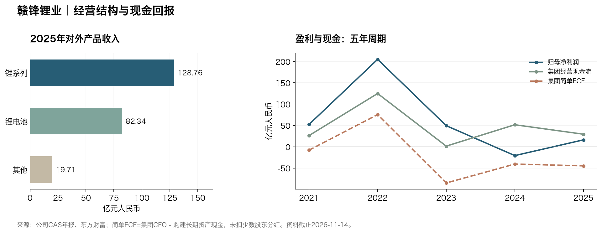

# 赣锋锂业（002460.SZ / 01772.HK）研究报告

> **研究日与资料截止：2026-11-14，北京时间。** 已执行date核对；最新财务期2026Q3，季度未经审计。A股11月13日收盘35.82元；H股同日16:08快照23.00港元，未将其冒充已另核最终收市价。真实A/H混合市值673.11亿元人民币；按H价统一全部股份价值412.82亿元，TTM PE6.26倍。
> 一句话论文：客户反复购买合格锂材料，但股东能留下多少钱，取决于锂价、自有资源成本和扩张资金纪律。

## AI研究偏见自觉

信息丰富度A级。公开披露很多；矿山、盐湖、固态电池故事会使人高估利润可复制性。AI研究局限性声明：无法独立核验各项目完整维持成本、客户净实现价、矿权可执行性及担保实际代偿概率；部分最新业务结构仍只到H1。

- [x] 区分股价便宜与利润处于正常水平。
- [x] 区分并表产量、经济权益与真正归母现金。
- [x] 承认资本支出覆盖改善，同时检查债务和其他投资。
- [x] 不给尚未形成可持续利润的固态业务确定性溢价。

---

## 第一步：核心数据总览

### 财务趋势与季度转折

金额均为亿元人民币，使用中国会计准则CAS；归母净利润与合并净利润严格区分。年报及最新季度与东方财富数据库逐项核对。[S1][S2][S3][S4][S5][S20][S21]

| 年度（亿元） | 收入 | 归母净利润 | 毛利率 | CAS营业利润率 |
|---|---:|---:|---:|---:|
| 2021 | 111.62 | 52.28 | 39.81% | 51.23% |
| 2022 | 418.23 | 205.04 | 49.50% | 54.43% |
| 2023 | 329.72 | 49.47 | 13.68% | 15.83% |
| 2024 | 189.06 | -20.74 | 10.82% | -12.14% |
| 2025 | 230.82 | 16.13 | 15.72% | 5.14% |

CAS营业利润包含投资收益、公允价值变动等，不能视为纯锂盐EBIT。2023营业成本采用2024年报比较数，毛利率13.68%；原2023年报列报对应13.88%。属成本内部列报差异，尚未确认具体原因，未任意归因为运费。[StockAnalysis标准化财务](https://stockanalysis.com/quote/she/002460/financials/)的2025毛利约33.74亿元、营业利润约7.62亿元，与CAS的36.29亿元、11.87亿元不一致，本报告不混用。

简单FCF=经营现金流−购建固定、无形及其他长期资产现金，不含收购、金融投资和必要融资支付，亦未剔除少数股东权益。

| 年度（亿元） | 经营现金流 | 现金资本支出 | 简单FCF | 期末货币资金 |
|---|---:|---:|---:|---:|
| 2021 | 26.20 | 34.13 | -7.93 | 63.32 |
| 2022 | 124.91 | 49.50 | 75.41 | 99.14 |
| 2023 | 1.46 | 86.46 | -85.00 | 94.82 |
| 2024 | 51.61 | 92.21 | -40.60 | 59.44 |
| 2025 | 29.45 | 74.22 | -44.77 | 84.22 |

| 单季（亿元） | 收入 | 归母净利润 | 经营现金流 | 现金资本支出 |
|---|---:|---:|---:|---:|
| 2025Q4 | 84.57 | 15.87 | 33.74 | 20.41 |
| 2026Q1 | 91.96 | 18.37 | 7.87 | 8.23 |
| 2026Q2 | 139.01 | 24.20 | 5.42 | 9.77 |
| 2026Q3 | 130.62 | 7.55 | 9.66 | 2.93 |

最近四季是FY2025减9M2025，以及2026累计值逐期相减；没有把累计当单季。Q3归母7.55亿元，环比-68.80%，扣非7.88亿元仍为正。9M归母50.12亿元、扣非46.36亿元，经营恢复与单季降温同时成立。[S1][S5]

### 收入、资产与资金

| 对外产品 | 2025收入（亿元） | 2026H1收入（亿元） | H1毛利率 |
|---|---:|---:|---:|
| 锂系列 | 128.76 | 141.97 | 42.44% |
| 锂电池 | 82.34 | 78.31 | 12.43% |
| 其他 | 19.71 | 10.69 | 26.05% |

以上为抵消后的对外产品收入；不可把未抵消矿山、材料和电池分部收入直接相加。H1锂系列占收入61.47%，电池33.90%。最近四季逐季分产品收入、毛利率没有完整披露，本文保留缺口，未用半年均值填季度。[S2][S3]

| 关键资产 | 权益与已知经营证据 | 价值实现条件 |
|---|---|---|
| Cauchari-Olaroz | 46.67%；H1全项目产碳酸锂1.9万吨，一期设计4万吨/年 | 稳定产出、全成本与实际分红 |
| Goulamina | 65%；H1全项目产精矿23.38万吨，一期设计50.6万吨/年 | 物流、品位、非洲政策与爬坡 |
| Mount Marion | 50%；升级工程延续 | 现金成本与后续投入回报 |
| Mariana | 100%；一期设计氯化锂2万吨/年 | 实际销量和达产成本 |
| Sonora | 名义100%；特许权取消争议处于仲裁 | 矿权恢复尚不确定，基准估值不给价值 |

产量均为100%项目口径，不能直接相加为赣锋权益产量。上述项目进度主要来自H1，未虚构11月新产量。[S3]

| 2026年9月末资金桥（亿元） | 数值 | 含义 |
|---|---:|---|
| 货币资金 | 89.58 | 不等于全额可分配现金 |
| 现金及交易性金融资产 | 100.21 | 含价格波动与资金性质差异 |
| 广义债务 | 409.10 | 短借、到期非流动、长借、债券、长应付、租赁合计 |
| 广义净债务 | 308.89 | 与数据商同口径；不是公司附注净债口径 |
| 9M经营现金流 | 22.95 | 集团口径 |
| 9M现金资本支出 | 20.94 | 简单FCF为2.01亿元 |
| 减少数股东股利后的现金桥余量 | 0.22 | 仍非规范归母FCF |
| 简单FCF扣全部股利、利润及利息后余量 | -9.74 | 总支付已含少数股利，不重复扣；尚未加投资收益现金或扣其他投资 |

公司附注净债务口径仅明确到H1的292.51亿元；Q3没有同等拆分，不能把它当最新净债。上述六项与数据商口径一致，但未把其他流动负债14.52亿元整行作为融资债务加入，其中若含短期融资会令可识别融资负担更高，因此也不是完整纯有息债务结论。广义净债同比或环比必须使用一致科目，不能与292.51直接混比。9M另有投资支付51.24亿元，含投资滚动等项目，不能全部称扩产；但足以说明简单FCF转正不等于资本配置已由经营自给。[S1][S3][S5][S6]

> 数据追问：扣非利润已经转正，现金为何仍不足以同时覆盖扩产、融资支付和投资？

## 第二步：生意本质分析

**这是一门通过资源、加工和客户认证供应锂材料的生意，复购稳定，价差不稳定。** 电池、汽车和材料企业付钱购买纯度、交付和合格产品；持续订单主要来自电池生产需求与认证，通常仍按商品价格及合同公式结算。

原料成本、库存采购与锂盐售价存在时间差；锂价下降时，旧库存可能比新采购昂贵。自有矿和盐湖降低对外采购依赖，却增加前期资本和国家风险。电池业务可以增加客户联系，也把公司放入毛利更低、竞争更激烈的制造环节。

利润最重要的三个变量是实现价与单位资源成本之差、项目实际利用率，以及每年为维持和增长支付的现金。9M资本开支覆盖是正面证据；Q3盈利下降则提醒不能把H1利润线性外推。

> 段永平式追问：若锂价长期停在供给成本附近，公司还能靠哪些环节赚取合理回报？

## 第三步：护城河评估

| 来源 | 强度 | 可检验证据与失效条件 |
|---|---|---|
| 品牌、定价权 | 弱 | 合格供应商可获订单，难独立于商品行情提价 |
| 客户转换成本 | 中 | 纯度、验证和交付构成阻力；并非永久锁定 |
| 网络效应 | 无明显证据 | 客户增加不自动令每单位产品更有价值 |
| 规模及成本 | 中 | 自有资源有意义，需全成本与现金回报证明 |
| 技术、专利 | 中 | 加工、回收和电池技术有价值；未证实多年排他收益 |
| 资源与许可 | 中，有尾部风险 | 储量和矿权寿命形成门槛，政策可削弱可实现价值 |

过去五年资源组合扩大，但净债务和扩张现金需求也增加。经营能力变强与股东经济护城河变宽不是同义词。未来五年若低价仍能产生归母现金、单位全成本下降且不持续增发，才能确认护城河变宽；若项目靠融资维持，规模优势可能被资金成本抵消。

> 巴菲特式追问：十年后仍在的，是成本优势，还是只剩必须持续投入的产能？

## 第四步：逆向思考与风险清单

| 失败路径 | 定性可能性 | 影响 | 应观察的证据 |
|---|---|---|---|
| 高锂价诱发供给重启，价差再压缩 | 中高 | 高 | 实现价、库存减值、单吨利润 |
| 高负债叠加低归母现金 | 中 | 高 | 到期债、净债、融资利息、现金受限 |
| 参股项目担保转为现金代偿 | 概率不可可靠量化 | 高 | 被担保人回款、担保履行、正式代偿 |
| 海外矿权或物流受损 | 中、国别差异大 | 高 | 许可、仲裁、税费、交付 |
| 固态和电池投入未达资本回报 | 中 | 中高 | 客户付款、毛利与新增投入 |
| 股东质押与弱市相互强化 | 中 | 中高 | 补仓、展期及强平公告 |

10月15日董事会拟将香港鲁源担保额度23亿元升至32亿元，并为深圳鲁源新增7亿元，合计39亿元；新增16亿元，11月19日股东会待审。公告披露截至10月15日实际担保7亿元。**额度、实际余额与代偿是三件事**，39亿元不是当前亏损，也不能因尚未代偿就忽略风险。[S7]

最强空方论点是：股东买到的可能是一组持续需要投入的项目，而非能把利润分给股东的矿山。历史上本公司的2022高利润随后显著回落，就是“商品短缺—扩产—价格回落”的反身性案例。这里不以锂需求上行否定供给反应。

最可能的分析错误，是把利润正常化假设仍定得太高，同时低估担保与海外项目的现金占用。没有可靠数据为上述每条风险赋精确概率；后文30/50/20只是估值情景权重。

> 芒格式追问：假如未来锂需求继续增长，什么资金链仍会让普通股永久受损？

## 第五步：管理层评估

李良彬、王晓申在9月末分别持普通股18.06%、6.75%，官方Q3与东方财富、同花顺股东资料相互核对；同股同权，无AB股投票放大。11月12日披露王晓申累计质押7,351万股、占其持股51.96%；是个人融资风险，公告未表示已经违约。[S1][S8][S9]

| 决策 | 已见结果 | 评价 |
|---|---|---|
| 多国资源与加工布局 | 资源自给能力增强，资金需求也大 | 能力中上，回报仍待验证 |
| 电池、固态与回收延伸 | 形成收入和客户连接，利润率明显分化 | 用现金而非技术叙事考核 |
| 鲁源担保扩额议案 | 增加或有现金责任，待11/19表决 | 需折价和持续尽调 |
| 11月2—4亿元A股回购提议 | 尚待审批，资金含自筹/贷款可能 | 后续拟出售，并非即刻注销回报 |

回购方案拟在完成12个月后出售、三年内售完，未售部分依法处理；不能写成已经永久减少股本。10月董事调整为内部职责变化，两名辞董事者继续其他职务，不能误写成创始人离场或诚信事件。[S10][S11][S22]

管理层技术和项目能力有长期积累；资本配置评分中等，受负债、对外支持和股东回报约束。未经统一口径复核，不报告研发投入精确值或“研发回报率”。如果创始人退休，产线和认证仍能运转，但复杂海外资本配置与治理质量仍需制度证明。

> 段永平式追问：低回报的扩张何时能够停下，管理层愿不愿以每股现金回报取代项目数量？

## 第六步：行业与文明趋势

电动车和储能延续电气化趋势，锂有长期需求基础。IEA 2026的STEPS情景预计锂需求至2040逾三倍，但不是确定短缺。澳洲2026年9月REQ预计需求至2031年年增超过11%、供给约7.3%，同时仍判断短期过剩、锂辉石均价由2026年预计2,410美元/吨向2031年约1,500美元/吨回落。[S12][S13]

2026修复已经发生，不能继续照抄2025低价背景。Albemarle Q3实际实现价同比明显提高，同时预警Q4价格环比下行与高价库存压毛利。价值捕获取决于成本曲线和扩产纪律，终端装机增长可能主要让利给消费者和电池买方。[S14]

LFP仍使用锂；钠电并非当前全面替代品，但高锂价会提升替代路线吸引力。IEA认为2025钠电产量不足锂电的1%；固态路线也不能简单等同无锂或赣锋独占利润。[S15] 未取得最新客户/供应商集中度的双源完整表，不给集中度数字。

> 李录式追问：电气化提高社会效率之后，哪些利润能在供给扩张后仍留给赣锋股东？

---

## 第七步：估值与安全边际

### 当前定价与反向检验

官方10月月报总股本2,096,694,404股，A股1,613,593,699股、H股483,100,705股，与东方财富和腾讯总股数核对一致。H股报价23.00与新浪相同；部分第三方缓存的22.98/旧日35.86未采用。11月13日官方中间价为1港元=0.85604元人民币，估值固定该汇率，不计账户税费和交易成本。[S5][S16][S17][S18]

| 指标 | A股 | H股 |
|---|---:|---:|
| 股价 | 35.82元 | 23.00港元 |
| 本市场价格×全部股本（亿元人民币） | 751.04 | 412.82 |
| TTM归母PE | 11.38倍 | 6.26倍 |
| 最新归母PB | 1.56倍 | 0.86倍 |
| TTM PS | 1.68倍 | 0.93倍 |

A股相对H股人民币等值溢价81.93%。上表两行全股本价值是不同市场的“同一股份统一报价”估值代理，不能相加；真实混合市值为673.11亿元。TTM收入446.16亿元、归母66.00亿元，由2025全年+9M2026−9M2025重建，EPS按当前全部A+H股本摊算3.1477元。数据商按部分股数给出的EPS3.90不采用。PEG在强周期利润低基数下不具稳定经济意义；EV/Revenue受少数股东与联营权益影响，不给缺少调整的伪精确值。

反向DCF只作直觉检查：假设起始每年可分配股东现金20亿元、未来十年均匀增长，r=8%、其后g=2%，A价隐含年增长约12.29%，H价约4.52%。**20亿元本身是正常化假设，尚未被当前归母现金证明**；这个计算没有证实股价便宜。

历史上2022盈利峰值和2024亏损使PE在低价周期失去稳定含义；没有统一前复权估值序列，不报告历史PE分位。同日同口径天齐A/H PE约10.07/5.69倍，均低于赣锋11.38/6.26倍；同行差异仍须由资产成本、归母现金和治理解释。[横向报告](../天齐锂业/天齐锂业-research-20261114.md)

### 三年三情景：判断贵不贵

起点采用研究假设正常化EPS1.90元，折合年度归母39.84亿元，低于TTM。基准增长6%代表资源投产但价差回落；悲观-15%反映供给扩张和现金成本压力；乐观18%需要成本、产销同时改善。10/12/14倍为三年周期重新定价假设，未伪装成终值永续倍数。所有情景以2029年末为三年近似持有期，并以8%折现为今天参考。[模型记录](赣锋锂业-model-20261114.json)

| 三年情景 | EPS年增速 | 退出PE | 2029归母（亿元） | 2029价格A元/H港元 | 折现现值A元/H港元 | 至2029年化A/H |
|---|---:|---:|---:|---:|---:|---:|
| 悲观 | -15.00% | 10倍 | 24.47 | 11.67 / 13.63 | 9.26 / 10.82 | -31.19% / -16.00% |
| 基准 | +6.00% | 12倍 | 47.45 | 27.16 / 31.72 | 21.56 / 25.18 | -8.82% / +11.31% |
| 乐观 | +18.00% | 14倍 | 65.45 | 43.70 / 51.05 | 34.69 / 40.53 | +6.86% / +30.45% |

回报为价格回报、未计股息、税费和未来净稀释。没有把未来目标价直接当今天内在价值。基准现值为A21.56元/H25.18港元，现价A明显缺安全边际，H也仅有有限折价。正常化假设还未扣无法量化的重大担保代偿。

### 十年折现：仓位压力测试

全部现金流与利润按人民币建模，H价格先转人民币，因此采用CNY资本成本区间6%—9%，并非用人民币r折港币现金流。r=8%=11月13日中债十年1.6123%+β1×研究ERP6.3877%。ERP是长期要求回报的判断，不是已测市场共识。稳态增量ROIC取10%，反映重资产商品企业；不借用2022峰值回报。g为0%/1%/2%，基准不超人民币2%上限；三档分母r−g为8/7/6个百分点。[S19]

终值PE完全来自(1−g/ROIC)/(r−g)。2036归母10/55/110亿元分别对应弱价差、项目成熟和强需求/低成本；概率30/50/20是主观研究权重。未对固态或争议矿权另加确定性价值。k=0，未假设未来净股息收益率，也没有假设永久不分红；如以后净分红与稀释之差为正，回报可提高，但须有现金证明。

| 十年情景 | 研究权重 | 2036归母（亿元） | 永续g | 终值PE | A股十年回报 | H股十年回报 |
|---|---:|---:|---:|---:|---:|---:|
| 悲观 | 30% | 10 | 0% | 12.50倍 | -16.42% | -11.26% |
| 基准 | 50% | 55 | 1% | 12.86倍 | -0.60% | 5.53% |
| 乐观 | 20% | 110 | 2% | 13.33倍 | 6.92% | 13.52% |

工具IRR为终值价格几何回报加假设净分配的近似，本文净分配为零；概率加权的是各情景回报，不是完整逐年股息现金流IRR。r=10%的出数仅作工具换算锚点，不是合法的人民币基准r，未用来裁决买卖。

| 市场 | r | 概率加权回报近似 | 覆盖r判断 |
|---|---:|---:|---:|
| A股 | 6% | -0.52% | 未通过；乐观档分母4pct，仅作情景参考 |
| A股 | 8% | -3.84% | 未通过 |
| A股 | 10% | -6.23% | 未通过；区间外，仅供参考 |
| A股 | 7% | -2.34% | 未通过 |
| A股 | 9% | -5.12% | 未通过 |
| H股 | 6% | 5.61% | 未通过；乐观档分母4pct，仅作情景参考 |
| H股 | 8% | 2.09% | 未通过 |
| H股 | 10% | -0.45% | 未通过；区间外，仅供参考 |
| H股 | 7% | 3.69% | 未通过 |
| H股 | 9% | 0.73% | 未通过 |

r=6%时乐观g=2%的分母仅4pct，整档只作情景参考；已额外在7%/8%/9%复核，各档分母均至少5pct。A/H均未覆盖对应r，**合理、满足分母约束的区间内没有翻转**。这收紧仓位，不单独否决投资；排序扫描6%—9%中，天齐H始终优于赣锋H，再优于天齐A、赣锋A。该排序仍依赖所声明盈利假设。

### 估值分歧对账

H股三年基准现值高于23港元，三年基准价格回报近似年化11.31%；十年概率加权仅2.09%，未覆盖8%。前者是中期正常化定价，后者加入长期弱周期权重，并压低永久增长与倍数，是仓位压力测试。最终观望来自安全边际偏薄、资金与担保风险及归母现金证据不足的共同判断；不能把十年未通过当唯一理由。

未建模离散风险包括担保连锁代偿、海外资源权永久损伤和到期融资失败；均未塞入r或β。概率权重和正常化现金会显著影响结果，不应据此建立重仓。

> 巴菲特式追问：降低r两点能否改变结论？有效7%—9%复核仍未通过，不能靠调低要求回报买入。
>
> 段永平式追问：市场关闭五年时，是否愿意承受当前债务、项目和担保对现金的争夺？

## 第八步：最终决策与行动清单

| 六个并列维度 | 结论 | 信心度 |
|---|---|---|
| 生意质量 | 需求复购，但商品利润与资本需求波动 | 高 |
| 护城河 | 加工认证和资源组合有用，定价权弱 | 中 |
| 管理层 | 项目能力较强，资本配置与股东支持待检 | 中 |
| 最大风险 | 净债、担保、矿权与高价库存 | 中高 |
| 文明趋势 | 电气化有利，供给反应限制利润捕获 | 中高 |
| 估值 | 三年A贵/H安全边际薄；十年限仓，有效区间不翻转 | 中低 |

**当前结论：A/H均观望；相同价格条件下优先研究天齐H股。** 估值维度不构成唯一裁决，十年未覆盖r仅限制仓位。

| 策略 | 价格与行动 | 必要条件 |
|---|---|---|
| 空仓者 | A15—17元 / H17.5—20港元才研究分批；现价不新增 | 最新及随后一次正式披露扣非为正；滚动CFO覆盖现金capex；同口径净债下降；鲁源资金用途/回款与海外红线可解释 |
| 持仓者 | 合理小仓可观察，不机械摊低；超配者先降低集中度 | 在11/19核担保表决与回购资金，不预设用户已有持仓 |
| 加仓信号 | 价格到带且完整经营条件兑现 | 首笔参考0.25%—0.5%，研究总仓参考≤1%，两只锂股合计原则≤2% |
| 重审/减仓 | A≥40元 / H≥47港元且盈利模型未增强时复核超配；或任意价触红线 | 担保代偿、流动性失衡、矿权永久损失优先于价格 |

这些价带是风险折价后的研究阈值，不是技术支撑位；低于下沿先查永久损坏。旧A30—38/H34.6—43.8的配置含义由本文替代，历史报告保留；本次加入正常化利润、三年现值与现金风险折价，价带变化不等于经营全面恶化。旧报告错误的H1 CFO单位不再沿用。

后续节点：11月19日已确认临时股东会；12月31日研究检查资金与实际担保；2027年4月30日为取得全年披露的检查窗口，不是已确认财报日，若提前披露即提前复核。

### 四位大师的原文与方法延伸

以下是方法论推演，不是四位本人对这两只股票的观点，也不是拟造的本人发言。

| 原文短引与出处 | 本报告的延伸判断 |
|---|---|
| 巴菲特：“a cost advantage that is both wide and sustainable”。[1982致股东信，商品企业段](https://www.berkshirehathaway.com/letters/1982.html) | 要买的是能够穿越低锂价的成本优势，并核对实际归属权益。 |
| 芒格：“But he has no magic wand”。[Wesco 2009股东信，第5页](https://www.berkshirehathaway.com/wesco/cm2009.pdf) | 管理者再努力，也不能用能力叙事消除行业过剩和低回报投资。 |
| 段永平：“有社会意义的东西未必能赚钱”。[2011-11-22雪球原帖](https://xueqiu.com/1247347556/20522344)，已读[仓库原发言汇编](../段永平/段永平雪球全量原发言.md)，第328条 | 原话讨论航空业和微博。延伸到锂业，能源转型的社会价值仍须通过每股现金回报检验。 |
| 李录：“preserve and increase your purchasing power”。[2024北大演讲官方英文稿，第17页](https://cdn.prod.website-files.com/5ef3c7300432b40ed865991a/67a4f75703627bd3a927077e_Global%20Value%20Investing%20in%20Our%20Era%20(2024-12-07).pdf) | 产业增长是背景，维持和增加购买力要同时考察企业竞争力与买入价格。 |

## AI分析置信度与投资确定性

官方历史财务、股本和已公告资本事项置信度高；海外项目全成本、担保代偿与正常化盈利置信度中低。AI分析置信度来自资料充分，投资确定性取决于生意能否持续产生股东现金，两者不能等同。本报告用于学习研究，不构成投资建议。

## 数据来源与审计记录

关键财务采用官方CAS与东方财富独立整理渠道交叉核对，底层仍是一套公司报表，不称第二套独立审计。项目经营部分仅公司一手披露，已明确局限。数值抽检、精确计算与最终估值硬约束见[审计记录](赣锋锂业-audit-20261114.md)；工具原始交叉验证节选保存在该附录，报告内的预测均标为研究假设。

[S1]: https://static.cninfo.com.cn/finalpage/2026-10-16/1225607211.PDF "2026Q3 CAS"
[S2]: https://static.cninfo.com.cn/finalpage/2026-03-31/1225059953.PDF "2025年报"
[S3]: https://static.cninfo.com.cn/finalpage/2026-08-29/1225528829.PDF "2026H1"
[S4]: https://static.cninfo.com.cn/finalpage/2025-03-29/1222949700.PDF "2024年报及2023比较数"
[S5]: https://emweb.securities.eastmoney.com/PC_HSF10/NewFinanceAnalysis/Index?type=web&code=SZ002460 "东方财富财务数据库"
[S6]: https://stockanalysis.com/quote/she/002460/financials/balance-sheet/ "StockAnalysis债务分类对账"
[S7]: https://static.cninfo.com.cn/finalpage/2026-10-16/1225607212.PDF "担保额度议案"
[S8]: https://basic.10jqka.com.cn/002460/holder.html "同花顺持股"
[S9]: https://www.cfi.net.cn/p20261111001673.html "11月质押公告镜像"
[S10]: https://static.cninfo.com.cn/finalpage/2026-11-07/1225661701.PDF "回购提议"
[S11]: https://www.hkexnews.hk/listedco/listconews/sehk/2026/1030/2026103001378_c.pdf "11月19日股东会通知"
[S12]: https://www.iea.org/reports/global-critical-minerals-outlook-2026/outlook "IEA 2026"
[S13]: https://www.industry.gov.au/publications/resources-and-energy-quarterly-september-2026 "澳洲REQ 2026年9月"
[S14]: https://www.albemarle.com/us/en/news/albemarle-reports-third-quarter-2026-results "Albemarle Q3"
[S15]: https://www.iea.org/commentaries/sodium-ion-battery-momentum-grows-but-challenges-remain "IEA钠电专题"
[S16]: https://static.cninfo.com.cn/finalpage/2026-11-03/1225652489.PDF "10月股本月报"
[S17]: https://qt.gtimg.cn/q=sz002460,hk01772 "腾讯报价；已与新浪快照核对"
[S18]: https://www.safe.gov.cn/AppStructured/hlw/RMBQuery.do?COLLCC=546877760 "外汇局11月13日中间价"
[S19]: https://yield.chinabond.com.cn/cbweb-cbrc-web/cbrc/showCbrc "中债11月13日曲线"
[S20]: https://www.hkexnews.hk/listedco/listconews/sehk/2022/0330/2022033002896_c.pdf "2021年报"
[S21]: https://static.cninfo.com.cn/finalpage/2024-03-29/1219453182.PDF "2023年报，原成本列报"
[S22]: https://www.cfi.net.cn/p20261021001881.html "10月21日董事调整公告镜像"
