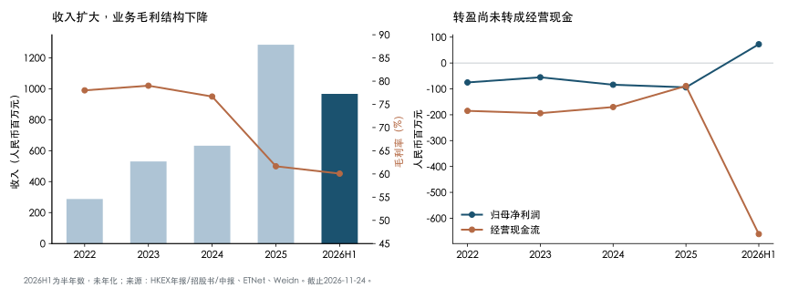
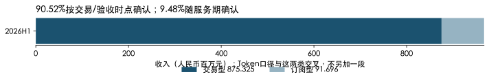

# 迅策科技（03317.HK）研究报告

> **研究与数据截止日：2026-11-24，Asia/Shanghai。** 公司：深圳迅策科技股份有限公司，Shenzhen Xunce Technology Co., Ltd.，简称迅策、XUNCE；香港主板 H 股，无已核实 ADR。收盘价 **43.54 港元**，最新披露总股本 330,835,596 股，对应全股本市值 **144.0458 亿港元／122.3237 亿元人民币**。TTM PS **5.96 倍**、归母口径 PE **180.22 倍**。最新财务期间为 2026H1，不能把十一月行情与六月资产负债表拼成实时净现金。
>
> 研究主线：客户的数据治理和实时决策需求真实存在；迅策能否把项目增长转化为股东现金，取决于回款、交付标准化，以及新增算力资本的回报。股价下跌降低了价格，却没有自动完成这三个验证。

金额除股价、市值及另注外均为人民币百万元。行情来自[腾讯快照][quote]与[ETNet中期损益表][plh]，股本来自[十月证券变动月报][monthly]并与腾讯核对。汇率采用腾讯 11/24 20:34 的 1 港元＝0.8492 元人民币，与[Investing 当日日内数据][fx]核对；取数时点不同，属于换算输入，不是实际结售汇价格。本文用于学习研究，不构成投资建议。

本次复用 `reports/迅策/`，沿用触发标的 ID「迅策」；以用户指定的[10/8复核报告](迅策科技-earnings-refresh-20261008.md)为历史基线，保留原文，不覆盖旧报告。

---

## AI研究偏见自觉

**信息丰富度评级：B。** 公司上市未满一年，正式报表、招股书和资本运作文件可得；但可观察的上市后经营历史短，匿名大客户、项目验收、续费队列、算力合同和实际资金安排仍有明显空白。资料页数多，并不代表商业确定性高。

**AI研究局限性声明：** 本报告未访问客户、未体验生产系统、未取得贷款合同或服务器逐项利用率。Token 业务、留存及模块数量主要是管理层披露，不能等同于经独立验证的订阅经济。三年及十年模型均为研究假设，尤其未能准确计量未来算力投资、融资和坏账的联合分布。

- [x] 将收入增长、账面利润、回款、股东现金分开；不以 Token 标签推定高质量 SaaS。
- [x] 不以资料不足否定产品价值，也不以行业热度填补合同空白。
- [x] 先核对公司身份、旧报告目录与登记 ID，避免中英文重复建档。
- [x] 将最强反面论点写完整，同时保留产品平台化成功的上行情景。

> 本报告自拟追问：若少读一半宣传材料，仅看客户付钱和资本回收，结论是否仍成立？目前仍是业务有价值、股东现金尚待证明。

---

## 第一步：核心数据总览

### 规模增长和现金增长尚未同步

| 指标（百万元；毛利率除外） | 2022 | 2023 | 2024 | 2025 | 2026H1 |
|---|---:|---:|---:|---:|---:|
| 收入 | 287.899 | 530.458 | 631.978 | 1,284.657 | 967.021 |
| 毛利 | 224.614 | 419.178 | 484.627 | 792.082 | 580.909 |
| 毛利率 | 78.02% | 79.02% | 76.68% | 61.66% | 60.07% |
| 归母净利润 | -75.141 | -55.267 | -84.011 | -94.061 | 72.505 |
| 经营现金流 CFO | -184.965 | -193.980 | -170.223 | -88.840 | -661.209 |
| 银行现金余额 | 748.569 | 596.968 | 343.818 | 1,083.856 | 633.828 |

来源：[2025年报][annual]财务摘要及现金流量表、[招股书][prospectus]历史现金流、[ETNet年度损益][ply]、[ETNet资产负债][bs]及[现金流][cf]；最新半年数见[正式中报][interim]和[ETNet中期表][plh]，H1 CFO 第二源实际是 [Weidn][weidn]，ETNet该项仍空。只取得四个完整财年，2021年缺口保留；H1不是全年，不作年化替代。公司未提供可独立核实的最近四个单季及分部利润序列，不将半年数拆造成季度数。经营利润率也未在主表独立列示，本文不把净利率换名为经营利润率。



2026H1收入同比 **+388.78%**，但毛利率低于2025全年，也低于上年同期。规模扩张主要靠多元行业的大项目，而非原有高毛利资管业务占比上升。增长是事实，轻资产经营杠杆已经全面兑现则仍是待证命题。

### 收入到底怎样确认

| 2026H1收入口径 | 数值 | 经济含义 |
|---|---:|---|
| 交易型专业技术产品 | 875.325 | 验收时点确认；并非全部可重复年费 |
| 订阅型专业技术产品 | 91.696 | 服务期内确认，占总收入9.48% |
| 资管行业 | 约12.4% | 管理层披露毛利率81.9%，原有优势场景 |
| 多元行业 | 约87.6% | 管理层披露毛利率57.0%，已主导收入 |
| Token业务 | 超过总收入10% | 公司未披露精确金额；与上述分类交叉，不可相加 |
| 最大客户A收入 | 240.862 | 占总收入24.91%，单项目变化足以影响半年业绩 |

来源：[中报][interim]印刷第11、15–16、53–55页；行业毛利率另与[观点网业绩报道](https://www.guandian.cn/m/show/588943)核对。订阅与交易划分为会计收入确认方式，Token属于产品/商业描述，不能把 Token 收入全算成订阅。客户A匿名，不能凭合作新闻猜测身份。



### 利润、现金和融资分三本账

| 2026H1检验项 | 数值 | 判断 |
|---|---:|---|
| 集团净利润／经调整净利润 | 66.998／66.998 | 本期调整只处理上市费用，不剔除投资重估收益 |
| 归母净利润 | 72.505 | 包含少数股东亏损的归属影响，与集团利润不可混用 |
| 金融资产公允价值收益 | 101.422 | 高于归母利润，非经营回款 |
| 税前利润减上述收益 | -34.404 | 仅敏感性计算，不是公司披露的扣非净利润 |
| CFO | -661.209 | 营运资金消耗明显扩大 |
| 设备及无形资产现金支出 | 1.023 | 不能据此认定算力扩张几乎不耗现金 |
| 简单FCF＝CFO减上述支出 | -662.232 | 算力存货、预付款已在CFO中；并非漏算一次再重复扣除 |
| 应收账款净额 | 983.291 | 等于半年收入的101.68%，非逾期率 |
| 应收毛额／减值准备 | 1,240.868／257.577 | 准备占毛额20.76%，不能直接解释为本期坏账率 |
| 银行借款／租赁负债 | 296.234／25.346 | 银行借款含流动171.434、非流动124.800 |

现金流的变化有明确机制：应收增加消耗374.980，存货增加消耗175.664，预付款及其他资产增加消耗224.269；应付增加只是部分对冲。它支持「增长需要垫资」的判断，尚不足以断言项目最终无法回收。[中报现金流及附注][interim]

六月银行现金633.828，加受限存款1.590后，现金流表期末等价物为635.418。狭义现金减银行借款为337.594，连租赁也扣除后为312.248；这是**六月历史口径**，未计入投资资产，且早于七月配售与发债。不能拿它减今天市值，宣称已获得十一月真实EV或净现金。

本次订正旧报告的银行借款296.227为296.234，依据中报第68及71页。另发现正式中报上年H1研发主表168.099与附注107.908不一致；本期396.590一致。本文引用主表和管理层讨论口径，避免用存在冲突的附注计算历史研发增速。

> 段永平式追问（本报告自拟）：这笔利润能否变成不用再投入的现金？现有证据只能证明收入交付扩大，尚未证明现金自养。

---

## 第二步：生意本质分析

**迅策向重数据、强合规的企业出售实时数据处理和行业工作流，把客户内部异构数据转成可供业务系统及AI调用的信息；复购最终依赖系统持续有用，而不只是模型调用次数。**

```text
客户私有数据 → 清洗与标准化 → 实时计算及行业语义 → 风控、运营与AI应用
                   ↓                   ↓
              数据治理/模块交付      维护、订阅与可能的用量收费
新增算力中心 → 设备、供电及资金投入 → 必须另证利用率、合同期限与资本回报
```

[招股书][prospectus]第209–210页解释：交易合同通常在客户验收时确认，付款一般在验收后约三个月到期；含一年基础维护。订阅通常一年可续，付款可在合同开始后十二个月内到期。因此，留存高不自动意味着预收年费，项目客户继续留在名单中也不等于收入按相同比例重现。

公司的有利条件是行业模块可复用、客户系统迁移麻烦；不利条件是私有化部署、异构系统和验收流程可能要求持续工程服务。中报称留存超过90%、ARPU约556万元、模块超过400个，均为公司经营指标；缺少NRR、同客同产品提价、续约收入和人天交付数据，不能据此把它估为已经成熟的订阅平台。

| 真正影响股东收益的变量 | 好转应看到什么 | 当前证据 |
|---|---|---|
| 标准化与交付效率 | 同类客户部署成本下降，毛利和回款同步改善 | 研发占收入降至41.01%，但收入结构变化及外购服务也会影响比率 |
| 客户重复付费 | 可核订阅/用量收入、续约队列与NRR | 订阅额增长，但占比仍低；Token精确拆分不足 |
| 资金占用 | CFO改善、应收账龄回落、预付款获得合同保障 | CFO与应收压力上升 |
| 算力回报 | 资本支出、利用率、单价、维护更新、融资成本形成完整闭环 | 只有授权上限与部分宣传，缺足够财务验证 |

研发396.590包括第三方技术服务、服务器管理、存储及非核心开发，不能全部视为内部研发人员创造的独占知识产权。[中报第17页][interim] 增加模块和扩大市场有价值，但还要检验这些投入是否让下一个客户更便宜地交付。

> 段永平式追问（本报告自拟）：这门生意好在哪里？若行业知识可以低成本重复嵌入客户关键流程，生意会很好；若每个新客户都需要大额垫资和定制，收入高增也未必产生高资本回报。

---

## 第三步：护城河评估

| 来源 | 判断 | 可观察证据与证伪方式 |
|---|---|---|
| 转换成本 | 中等，最可信的来源 | 本地/私有云部署、风控与运营流程嵌入；须用续费、替换率和迁移案例检验，客户留存不能单独定论 |
| 品牌与定价权 | 偏弱，未充分证实 | ARPU也可能由大项目结构拉高；需要同客同产品提价且留存稳定 |
| 网络效应 | 尚未证实 | 客户数据不天然跨企业流动；TokenRouters尚缺活跃买卖方、成交与复购数据 |
| 规模/成本优势 | 可能形成，当前证据混合 | 行业模块有复用价值，毛利率却随多元行业扩张下行；应看交付人天与现金回收 |
| 技术与专利 | 领域工程优势强于独家底层能力 | 实时处理、数据语义和客户适配有积累；未取得领先年数或独立性能对比，不能声称不可复制 |

阿里云官方产品文档已列出[实时ETL、CDC与AI流水线][aliflink]及[模型调用、Token计费][aliai]等能力。因此，实时计算加Token不是独占证明。巨头即使投入大量资金，也仍需积累行业语义、客户流程和交付信誉；迅策的机会在这里，但不存在被验证的「巨头无法进入」结论。

过去可见数年，应用场景和模块变多，可能加深局部转换成本；收入向低毛利、多垫资业务迁移，也降低了整体股东经济性的确定性。未来五年护城河能否变宽，取决于软件复用及可重复付费跑赢工程复杂度；自持服务器本身容易被折旧和价格竞争侵蚀。

> 巴菲特式追问（本报告自拟）：十年后什么还能保护超额回报？是客户难以替换的业务知识和流程；可能摧毁它的是通用数据栈、低价云服务，以及客户换供应商就能省下的大量成本。

---

## 第四步：逆向思考与风险清单

最强反面论点是：**收入在验收时增长，利润又受投资重估支持，现金却沉在应收、库存和采购预付中；若再通过短期资金和母公司担保扩大算力投资，小公司的交付风险会升级为流动性风险。** 智慧的非买家无需否定AI需求，只需认为股东无法稳定拿到需求增长产生的钱。

| 失败路径 | 概率判断（主观，非统计） | 影响 | 应观察的信号 |
|---|---|---|---|
| 大项目回款慢、坏账上升 | 中高 | 高，利润和现金双受损 | 应收账龄、减值、客户A回款、CFO |
| 算力投入先行、合同及利用率不足 | 中 | 很高，固定成本和设备贬值放大损失 | 绑定订单期限、预付款、资产投入、单价、设备更新周期 |
| 转债到期、银行融资与经营垫资相撞 | 中，尚无法可靠量化 | 极高，可能被迫低价融资 | 2027年到期资金安排、受限资金、银行授信条件 |
| Token增长未带来付费与复购 | 中 | 中高，平台倍数回落 | 单独收入、付费客户、净留存、毛利和实际回款 |
| 巨头或开源方案降低技术溢价 | 中 | 高，毛利及赢单率承压 | 同类项目报价、竞标胜率、客户替换案例 |
| 金融及企业数据合规事件 | 无法量化 | 极高，可能停业或失去客户 | 权限治理、合同责任、监管处理；本次未发现可据以认定已违规的证据 |

这些风险可能同时发生，不能把表中定性概率相加。十年模型的三档概率只是财务路径权重，也不等于每项风险的发生率。

历史机制类比可参考[伯克希尔2007年股东信][buffett]讨论的航空业：需求持续增长、资本持续投入，股东回报仍可能很差。这不是把迅策等同航空公司，而是提醒「行业扩大」与「稀缺资本获得超额收益」之间缺少必然关系。对迅策，现金转换周期和客户/供应商议价权比采用曲线更接近利润机制；技术普及可能扩大需求，也可能降低单价。

最可能的分析错误有两个方向：把所有现金占用都看成永久坏账，错过标准化拐点；或把早期资金占用当作必然会回收的成长投入，忽略反复融资。本文用未来正式披露中的回款和资本回报来区分二者，不用股价涨跌代替验证。

> 芒格式追问（本报告自拟）：最可能在哪里犯错？在尚未读到合同、回款和融资条件时，先决定它是一家高质量平台，再为这个结论挑选指标。

---

## 第五步：管理层评估

董事长兼CEO为**刘志坚**。招股书列示其金融行业经历；耿大为、杨阳、宣然分别参与业务关系、技术和经营财务管理。行业经验帮助理解客户，但不能替代资本配置成绩。[招股书第255–257页][prospectus]

| 时间 | 已执行或已批准的决策 | 结果与评价 |
|---|---|---|
| 2025年末上市 | 补充研发、市场与运营资金 | 获得资本支持；上市后持续回报记录仍短 |
| 2026年7月 | 配售与零息可转债 | 增强融资能力，也形成稀释与到期赎回责任；零票息不等于零资本成本 |
| 2026年9月 | 五年不超过120亿元算力投资，融资及担保上限100亿元获授权 | 授权不代表资金已全部投入；规模大，单位回报和母公司责任需先验证 |
| 2026年10–11月 | TokenRouters、海外组织及渠道拓展 | 产品方向有逻辑，暂无足够新增财务贡献证明配置成功 |

9/9[通函][circular]与9/28[表决结果][vote]是资本配置的核心证据：投资约90%拟用于固定资产，通函拟议安排包括母公司连带责任、子公司股权、设备和应收抵质押；利率待协商。投资授权约相当于六月归母权益的 **4.95倍**。这提高验证门槛，并非仅凭金额大就断言管理层失信。通函截至9/7未签绑定协议；截至本次检索未找到后续实际签约/提款披露，**不能把未找到公告写成确认没有贷款**。

### 家族控制不等于CEO个人持股

中报披露，董事及CEO没有须登记的相关证券权益；刘志坚之父**刘呈喜**通过持股平台被视作拥有86,571,841股。按6/30股本复算约 **26.83%**，属于SFO视作拥有/控制口径。富前平台持36,252,848股，约当六月股本11.23%，与同花顺持股展示可衔接。[中报第26–30页][interim]、[HKEX权益申报][holding]、[同花顺股东表][ths]

刘呈喜对恩圆、富前和普通合伙人持有的权益，与股温其他合伙人的经济权益并不相同。不能把86,571,841股全部写成其实际经济收益，更不能写成CEO个人持有26.83%。本次未取得完整收益分配条款，不给伪精确的个人经济持股比例；六月股数也不冒充十一月最新权益申报。

治理判断为**经营经验可见，股东导向的资本回报仍待证明**。研发回报尚未体现在持续FCF；没有足够长的并购/回购/分红周期可评高分。451名员工和产品模块说明已有组织基础，但未取得高管流失与继任安排的独立证据。

> 段永平式追问（本报告自拟）：CEO退休后还能维持竞争力吗？模块、客户部署和技术团队可能延续；大客户关系、融资与新资本项目仍依赖核心团队，尚不能认定已经形成自运转系统。

---

## 第六步：行业与文明趋势

AI从演示走入企业工作流，需要实时、可追溯、有权限的数据。迅策处于企业数据与应用之间，可能受益；利润也可能流向云基础设施、模型、原有行业软件，或直接通过开源和降价留给客户。趋势成立，只完成了需求判断。

招股书引用的Frost & Sullivan研究中，2024年中国实时数据基础设施及分析服务的厂商实际收入市场约187亿元，2029年预测505亿元；另列的2024年5,252亿元理论TAM属于潜在预算，不能当成已发生收入。迅策2024年按该口径排名第四、份额3.4%。研究由公司委托，属于有来源的行业估计，非独立普查；2029年数字是预测，不能当作当前市场。[招股书行业章节][prospectus]

| 10/8以后新增证据 | 能说明什么 | 尚不能说明什么 |
|---|---|---|
| 10/26德国活动及接洽 | 海外销售渠道在拓展 | 奔驰、空客等同会企业不因此成为客户，未见新增金额合同 |
| 10/28发布TokenRouters | 尝试连接数据、模型、应用与场景 | 无付费用户、成交额、抽佣和复购数据，网络效应待证 |
| 11/20指数纳入公告 | 12/7生效，有利于市场可见度 | 指数资金需求不直接改善CFO、融资成本或资产回报 |

来源分别为[公司德国活动供稿][germany]、[TokenRouters公司供稿][routers]、[HKEX公司公告][index]及[恒指公司公告][hsi]。公司供稿可证明其已发布相关主张，不能作为客户独立确认。成立海外子公司与已形成规模海外收入也应区分。

公司没有披露完整供应商、算力设备来源、绑定年限及价格保障的最新独立验证；不能推定其已锁定长期低成本供给。客户集中和供应采购融资叠加后，关键问题从「谁最懂实时数据」扩展成「谁承担需求不及预期的设备与信用损失」。

> 李录式追问（本报告自拟）：二十年后它会是基础设施赢家吗？若长期掌握行业语义和工作流入口，有这种可能；若主要依靠垫资采购与项目交付，行业增长未必变成股东复利。

---

## 第七步：估值与安全边际

### 先把当前价格算对

| 当前估值口径 | 工具重算值 | 使用限制 |
|---|---:|---|
| 全股本市值（亿港元） | 144.0458 | 全部股份按H股同价估值，非H股可流通市值 |
| 人民币换算市值（亿元） | 122.3237 | 汇率0.8492，非实际兑换金额 |
| TTM收入（百万元） | 2,053.833 | FY2025减2025H1加2026H1 |
| TTM归母净利润（百万元） | 67.873 | 重估收益影响明显，不是标准化盈利 |
| TTM PS | 5.96倍 | 不是按年化H1收入估值 |
| TTM PE | 180.22倍 | 不宜据此判断主业已廉价 |
| PB（六月归母权益基准） | 5.04倍 | 七月融资前权益，非实时PB |
| TTM简单FCF（百万元） | -778.722 | CFO减购建设备及无形资产，尚未扣融资类租赁本金 |
| TTM简单FCF收益率 | -6.37% | 非可分配收益率 |
| EV/Revenue、PEG | 不作可信点值 | 最新净债务缺失；盈利接近零且受重估影响，PEG失去稳定含义 |

所有换算和情景运算使用 `financial_rigor.py` 与Decimal复核，原始参数见[模型记录](证据/迅策科技-20261124-model.json)。TTM现金CapEx为156.787，来自年报147.125设备加9.925无形资产，减上年H1的1.286，加本期1.023；未将采购存货从CFO中再扣一次。

与自身历史相比，公司上市历史不足以提供有意义的多年PE分位；IPO价格或跌幅都不是价值锚。与同行相比，云平台、行业软件、项目交付商及算力运营商的毛利、预收、SBC和资本开支差别很大，不能用统一PS排名就断言便宜。本次未取得同一截止日、双源且按相同债务/收入口径处理的可比估值组，**不把未经核实的同业倍数填入表格**；因此横向定价结论低置信度，三年退出倍数直接列为假设。

### 三年三情景：价格仍要求兑现

TTM实际盈利不能代表稳态。为满足可复算而不把投资重估利润外推，模型从TTM收入2,053.833出发，假设可达到**10%税后归母利润率**，并先将三年末股数设为当前股数的1.10倍，即363,919,155.6股，作为稀释缓冲。这不是已发行股数，也不是公司利润指引。

对应的工具输入标准化EPS为0.6645845274港元，**不是实际EPS0.2416港元**。三档收入和标准化利润分别按50%、30%、10%增长，三年末PE为30、22、12倍，前两者已给予成长溢价；无中途股息，汇率不变。该10%利润率须在坏账、研发、设备折旧、税和融资成本之后实现，尚无证据保证。这里是约三年后的盈利能力截面，不冒充正式2029财年预测。

| 条件情景 | 收入年增速 | 三年末收入（百万元） | 三年末归母（百万元） | 退出PE | 三年末价（港元） | 按人民币8%折回的今日价（港元） |
|---|---:|---:|---:|---:|---:|---:|
| 乐观：模块与用量商业化成功 | +50% | 6,931.686 | 693.169 | 30倍 | 67.29 | **53.42** |
| 基准：增长延续、项目化仍明显 | +30% | 4,512.271 | 451.227 | 22倍 | 32.12 | **25.50** |
| 承压：增速下降但仍盈利 | +10% | 2,733.652 | 273.365 | 12倍 | 10.61 | **8.43** |

三年末价格相对43.54港元分别为+54.55%、-26.22%、-75.62%，均非年化回报。**32.12是未来价格，不是今天合理价。** 8.43–53.42的跨度本身就在说明经济性尚未收敛，不能用乐观档当目标价。

上述普通承压档仍假设10%利润率，不能代表融资失败或资产严重减值。若未来新增权益融资超出10%、净融资成本更高，或者10%利润率始终无法实现，每股价值更低。已披露可转债转股与现金赎回是替代路径，不能既把同一笔债务假设全部转股，又把相同的偿债现金流重复扣除。

### 反向DCF：市场正在等待多少现金

另作更容易理解的现金反推：人民币折现率8%，2027起可分配股权现金连续十年增长20%，此后永续1%，无中途额外融资、无稀释且不另扣未来负现金流。要支持今天122.3237亿元市值，首年就需约 **2.4440亿元** 可分配现金，第十年约 **12.6106亿元**。这不是预测，而是解方程得到的价格要求。

它相对最新半年负现金流要求明显跃迁，而且已把未来融资与资金缺口作了有利简化。若实际先出现数年负现金流，后期要求更高。不能把收入或会计利润直接代入这个现金流要求。

### 十年折现：只用于仓位压力测试

现金流币种为人民币，因此用人民币资本成本 **r＝8%**，而非因股票以港元交易就改用港元折现率。采用[财政部/中债11/24十年期国债1.59%][rf]作为rf，β＝1，ERP＝6.41%为研究者选定的长期要求回报假设，非精确市场估计。转债再融资、坏账及合规等离散风险不塞进r或β。

稳态**增量ROIC＝15%**是「行业软件存在复用优势、但算力投入削弱轻资产优势」下的假设。公司历史亏损和零分红无法提供可信的存量与派息隐含回报夹区，因此该输入缺少经验校准，不能说已证明15%回报。永久增速采用0%／1%／1%；基准低于人民币2%上限，远期增长不等于未来十年增长，敏感性中g不动。

终值PE只从永续模型推导：`(1−g/ROIC)/(r−g)`。基准档为 `(1−1%/15%)/(8%−1%)＝13.3333倍`，承压档为12.5倍，未使用同业当前价格设终值。

| 主观经营路径 | 概率 | 2036归母利润（百万元） | 永续g | r−g | 公式退出PE | 十年回报代理值 |
|---|---:|---:|---:|---:|---:|---:|
| 承压：垫资与竞争长期拖累 | 35% | 150 | 0% | 8个百分点 | 12.50倍 | -19.10% |
| 基准：行业软件成长、资本约束持续 | 50% | 900 | 1% | 7个百分点 | 13.33倍 | -2.19% |
| 乐观：平台与算力产生规模回报 | 15% | 2,500 | 1% | 7个百分点 | 13.33倍 | +8.54% |

利润、概率与ROIC均是研究假设。模型假设项目随订单分阶段扩张，不默认120亿元授权全部按时花完并赚得固定回报；在当前欠缺绑定订单和融资成本时，不能建立可信逐台服务器的DCF。

工具采用终值市值/今日市值的十年CAGR，再加「股息率−稀释率」k。此处k＝-2个百分点，表示零股息和年化2%稀释压力，使用当前已发行股本作起点；**它不是含逐年实际融资和分红的完整现金IRR**。三年模型的10%股数缓冲和十年模型的k是两个独立时域假设，不叠加扣算。概率加权结果是三档代理回报的算术平均，不是按期望终值计算的回报，更不是实证收益分布。

| r敏感性 | 期望回报代理值 | 相对该档r的仓位测试 |
|---|---:|---|
| 6%（r−2个百分点） | -3.38% | 未通过；币种合理区间内 |
| 8%（基准） | -6.50% | 未通过 |
| 10%（r+2个百分点） | -8.79% | 未通过；区间外，仅供参考 |
| 7%（补充） | -5.08% | 未通过；币种合理区间内 |
| 9%（补充） | -7.72% | 未通过；币种合理区间内 |

**合理人民币折现率区间内，压力测试结论不随本次Δr翻转。** r＝6%时最窄分母仍为5个百分点；基准各档为8／7／7个百分点。10%档不参与买入论证，补充7%和9%也未通过。

限制必须保留：模型未量化转债再融资失败、数据合规导致停业的离散尾部概率；亦未建立完整设备残值、资产抵押、贷款契约与逐年融资模型。因此压力测试可能低估永久损失，输入不足也可能低估平台成功后的利润。**十年未覆盖r只收紧仓位，不能单独否决买入或持有。**

### 与旧报告的估值分歧对账

旧60–85港元已在10/8暂停买入含义，本次不因跌到43.54恢复。三年基准今日值25.50和十年压力测试方向一致，均未支持当前价的安全边际；但与8月研究曾允许旧价带条件评估的倾向存在变化，须说明来源。本次进一步下移研究带主要来自估值模型重建，并非已发现10/8以后经营再次恶化的新财报；最新半年度财务事实没有更新。

三年模型负责**定价**，已显式加入稀释与标准化利润的要求；十年模型负责**仓位**，暴露远期增长和资本回报的不确定性。继续观望的理由来自项目型收入、窄护城河、资本配置待证、回款及到期压力与三年价格共同判断，不是十年代理值的一票否决。若未来经营证据显著增强，即使十年单一模型仍偏低，也应重新综合六个维度；在当前证据下不建议建立价值核心仓。

> 巴菲特式追问（本报告自拟）：r错两个百分点会改变判断吗？本次合理区间内不翻转；更大的敏感项是利润率、回款及未来融资需求。
>
> 段永平式追问（本报告自拟）：若股市关闭五年，愿意按现价持有吗？在尚未核清算力负担和2027年偿债资金前，不适合按现金流确定性资产来持有。

---

## 第八步：最终决策与行动清单

| 六个并列维度 | 结论 | 信心度 |
|---|---|---|
| 生意质量 | 客户需求真实，工程及数据处理有价值；项目占比高，现金自养未证 | 中 |
| 护城河 | 转换成本最可信，网络效应与广泛提价权未证 | 中低 |
| 管理层 | 行业经验可见，重资产扩张和股东资本回报仍待验证 | 中低 |
| 最大风险 | 应收/采购垫资叠加算力资本承诺与2027年转债到期 | 高（风险存在），低（发生概率） |
| 文明趋势 | 企业AI数据治理顺势，利润由谁获取仍开放 | 中 |
| 估值 | 三年基准今日25.50港元；十年仓位压力未通过、合理r内不翻转 | 中低；模型输入置信度低于报表 |

估值维度与其他五项并列；十年模型未覆盖资本成本，不是最终建议的唯一裁决。

**综合建议：空仓者继续观望，当前不新增价值仓；持仓者暂停加仓，按现金与融资证据复核。** 对依赖旧「轻资产、高续费」逻辑建立的高集中仓位，应重新核定持有理由；不把已经下跌当成继续持有的充分理由，也不把单日流动性波动当成必然卖点。

| 投资者/价格状态 | 建议与条件 |
|---|---|
| 空仓者，现价43.54港元 | 观望。指数纳入与产品发布不替代现金验证 |
| **18–20港元条件研究带** | 约较三年基准今日值留出22%–29%折让；仅进入完整复核，不自动买入。须同时满足下列经营/融资条件 |
| 低于18港元 | 同样提醒复核，先查永久损失及融资冲击；不机械加大仓位 |
| 持仓者 | 暂停加仓；保留持仓须能说明未来回款、到期资金与新增资本回报。以可承受全损的小额研究仓为参考，不建议核心仓；无个人组合信息，不指定实际卖出股数 |
| 60港元及以上 | 若模型和现金证据未改善，复核过高仓位及退出理由；这是上行警戒，不是自动卖出指令 |
| 卖出/退出研究理由 | 核实严重坏账、经营现金持续恶化、无订单保障的担保提款大增、到期资金安排不可行或重大治理/合规问题；不必等待价格线 |

18–20港元带的必要条件：后续连续两次正式财务披露显示滚动CFO转正并覆盖现金CapEx，应收/收入和账龄改善；核实算力长期付费合同、实际投入、利率、期限、提款及母公司责任；2027转债已有可核现金偿付或再融资方案；订阅/用量收入能够与回款对账、重大客户及合规红线未触。上述门槛是研究者要求，非公司指引。满足后仍应按新数据重估，才考虑首笔约组合0.25%–0.5%的研究仓、总参考不超过1%；若十年与现金压力仍未改善，仓位继续收紧。

机会成本也明确：与能自养增长、持续产生可核FCF的企业相比，迅策现在要求投资者额外承担回款、设备和再融资三类判断。只有价格折让或证据改善足够大，承担这些判断才值得。

### 复检日历

| 日期/节点 | 性质 | 要核实的事实 |
|---|---|---|
| 2026-12-07 | 已确认指数生效日 | 只记流动性/持股结构变化，不当经营拐点 |
| 2026-12-31 | 本报告设定研究检查日 | 最新融资、担保、合同、月报及偿债安排；非公司承诺披露日 |
| 2027-03-31 | 年度业绩披露窗口检查，非已预约财报日 | FY2026回款、现金CapEx、债务与重大承诺；若提前披露则提前研究 |
| 2027-06-08 | 本报告设定到期前一个月检查 | 转债余额、赎回资金、币种安排与受限资金 |
| **2027-07-08** | 官方明确的转债到期日 | 未转换部分按本金101.75%美元等值赎回；实际按合同汇率条款结算 |

按十月余额12.68亿元人民币全额未转换作压力测算，到期赎回对应 **12.9019亿元人民币本金等值**，不是今天确定的实际美元付款额。转股价123.86港元、潜在增股11,828,273股约为现有股本3.58%；应分别研究转股及现金偿还路径。[月报][monthly]、[发售通函印刷第4及159页][bond]

### 四位大师原文与方法延伸

以下不是四位大师对迅策的评论；短引均已读到原文或注明的原发言存档，延伸判断由本报告负责。

- 巴菲特：“A truly great business must have an enduring ‘moat’ that protects excellent returns on invested capital.”——[2007股东信，印刷第6页][buffett]。方法延伸：能持续保护资本回报才是护城河，模块数和行业空间不能单独证明这一点。
- 芒格：“Berkshire would have little debt outstanding”——[2014年报中芒格自写《Vice Chairman’s Thoughts》，印刷第40页][munger]。方法延伸：这里强调财务韧性，不能被解释成他断言所有负债公司都应回避；迅策须解释设备投资、客户回款与到期负债如何匹配。
- 段永平：“未来现金流折现不是公式，是思维方式。”——[2011-09-07雪球原帖](https://xueqiu.com/1247347556/20386904)，已读[仓库原发言存档第79条](../段永平/段永平雪球全量原发言.md)。方法延伸：模型小数位不能代替对可分配现金的理解。
- 李录：“第一，如果发现自己犯了错，会第一时间卖出。”——[2024-12-07演讲问答存档](../李录/李录-北大演讲-20241207.md)，存档注明芒格书院首发及转载来源。方法延伸：必须辨认买入逻辑是否被现金和资本结构事实推翻；同一回答也强调真正优秀公司的长期增长，不能歪曲成估值偏高就必须卖出。

---

## AI分析置信度与投资确定性

AI分析置信度：**财务历史及证券条款中高，未来盈利与股东现金中低**。收入、归母、股本和银行现金有官方/独立数据商交叉验证；CFO第二源精度较低但在1%容差内。行业规模来自公司委托研究，护城河、管理层资本配置和估值输入包含明显推理。

实际投资确定性：**低到中低**，原因是生意的资金占用和新增资本回报尚未稳定，而非因为报道少。股价低于旧报告不构成确定性上升的证据。反过来，若客户付费和资本回收得到验证，即使行业宣传减少，投资确定性也可能提高。

最值得补的一手问题是：抽取同类客户最近三次续约，看合同和实收是否重复；核项目验收至收款的真实账龄；获取算力单位投资、利用率分母、已付费合同期限、更新成本和银行约束；说明Token收入与交易/订阅分类如何桥接；说明转债到期与新项目的资金优先级。这些都无法靠更多二手新闻替代。

---

## 数据来源与审计记录

关键财务主源为HKEX年报、中报、招股书、月报和转债通函。独立核对优先尝试AASTOCKS；其时效/可访问性不足，且没有已核实ADR对应的Macrotrends序列，故改用ETNet及Weidn，并明确缺口。第三方平台展示财报并不意味着它独立审计了公司的经营真实性。

| 交叉验证字段 | 官方值 | 独立值 | 判定 |
|---|---:|---:|---|
| 总股本（股） | 330,835,596 | 腾讯330,835,596 | 一致 |
| FY2025收入（百万元） | 1,284.657 | ETNet 1,284.657 | 一致 |
| FY2025归母（百万元） | -94.061 | ETNet -94.061 | 一致 |
| H1收入（百万元） | 967.021 | ETNet 967.021 | 一致 |
| H1归母（百万元） | 72.505 | ETNet 72.505 | 一致 |
| H1银行现金（百万元） | 633.828 | ETNet 633.828 | 一致 |
| H1 CFO（百万元） | -661.209 | Weidn -661.000 | 精度差，小于1% |
| 富前股份（股） | 36,252,848 | 同花顺约36,252,800 | 显示精度差，小于1% |

银行借款独立拆分仍不足，ETNet含租赁合计321.580与官方银行借款296.234加租赁25.346衔接，但不是完整独立借款核验。CEO实际经济持股、十一月净现金及合同队列仍缺，不声明所有数据均已独立双源验证。

程序输出与模型参数见[金融核验原始输出](证据/迅策科技-20261124-validation.txt)、[模型JSON](证据/迅策科技-20261124-model.json)。下方保留工具原始输出节选，非重新口述：

```text
市值验算 (Market Cap Verification)
  股价 (Price):       43.54 HKD
  总股本 (Shares):    330.84M
  计算市值:           14.40B HKD
  报告市值:           14.40B HKD
  偏差:               0.00%
  ✅ 验证通过, 偏差仅 0.00%

交叉验证: 2026H1收入 (Cross-Validation)
  ✅ HKEX中报              : 967.02 百万元人民币  (偏差 0.00%)
  ✅ ETNet               : 967.02 百万元人民币  (偏差 0.00%)

交叉验证: 2026H1归母净利润 (Cross-Validation)
  ✅ HKEX中报              : 72.50 百万元人民币  (偏差 0.00%)
  ✅ ETNet               : 72.50 百万元人民币  (偏差 0.00%)

交叉验证: 2026H1银行现金 (Cross-Validation)
  ✅ HKEX中报              : 633.83 百万元人民币  (偏差 0.00%)
  ✅ ETNet               : 633.83 百万元人民币  (偏差 0.00%)
```

数据抽检采用固定随机种子42，从130个提取点抽20项；其中3项为时间、日期、年份的结构误抓，均留档说明，另补3项核心财务事实。有效原抽样包括10项披露事实、4项衍生计算、3项模型输入/运算，连同补查共20项，工具判决PASS、无数值超限。事实抽检中银行借款仍只有官方精确拆分；模型输入与运算仅作内部一致性复算，不冒充独立财务来源。详见[抽检清单与分类](证据/迅策科技-20261124-audit.json)及[判决原始输出](证据/迅策科技-20261124-audit-verdict.txt)。

终值口径定稿复检按人民币r8%、ROIC15%、g0%/1%/1%通过C1/C2/C3，保留「转债再融资失败、数据合规停业未建模」两项警告。审计通过只说明本次已核数值和口径通过，不代表预测成真或所有未抽样数据已经独立双源验证。

[quote]: https://qt.gtimg.cn/q=hk03317
[fx]: https://uk.investing.com/currencies/hkd-cny-historical-data
[plh]: https://www.etnet.com.hk/www/eng/stocks/realtime/quote_ci_pl.php?code=3317&quarter=interim
[ply]: https://www.etnet.com.hk/www/eng/stocks/realtime/quote_ci_pl.php?code=3317&quarter=final
[bs]: https://www.etnet.com.hk/www/eng/stocks/realtime/quote_ci_bs.php?code=3317
[cf]: https://www.etnet.com.hk/www/eng/stocks/realtime/quote_ci_cashflow.php?code=3317
[weidn]: https://market.weidn.com/cn/company/hk/03317/
[annual]: https://www.hkexnews.hk/listedco/listconews/sehk/2026/0429/2026042900854.pdf
[interim]: https://www1.hkexnews.hk/listedco/listconews/sehk/2026/0921/2026092100985.pdf
[prospectus]: https://www1.hkexnews.hk/listedco/listconews/sehk/2025/1218/2025121800027.pdf
[monthly]: https://www1.hkexnews.hk/listedco/listconews/sehk/2026/1102/2026110202822.pdf
[bond]: https://www1.hkexnews.hk/listedco/listconews/sehk/2026/0713/2026071300153.pdf
[circular]: https://www1.hkexnews.hk/listedco/listconews/sehk/2026/0909/2026090900997.pdf
[vote]: https://www1.hkexnews.hk/listedco/listconews/sehk/2026/0928/2026092801034_c.pdf
[holding]: https://di.hkex.com.hk/di/NSForm1.aspx?fn=IS20260112E00010&lang=ZH&sc=03317
[ths]: https://basic.10jqka.com.cn/176/HK3317/holder.html
[germany]: https://www.prnasia.com/story/553198-1.shtml
[routers]: https://www.bizwire.com.cn/p/2599.html
[index]: https://www1.hkexnews.hk/listedco/listconews/sehk/2026/1120/2026112001311.pdf
[hsi]: https://www.hsi.com.hk/content/dam/wpb/hsil/zh_cn/press_releases/content/20261120T174500.pdf
[aliflink]: https://www.alibabacloud.com/help/en/flink/realtime-flink/product-overview/what-is-alibaba-cloud-realtime-compute-for-apache-flink
[aliai]: https://www.alibabacloud.com/help/en/flink/realtime-flink/flink-ai-service
[rf]: https://yield.chinabond.com.cn/cbweb-czb-web/czb/moreInfo?locale=cn_ZH&nameType=1
[buffett]: https://www.berkshirehathaway.com/letters/2007ltr.pdf
[munger]: https://www.berkshirehathaway.com/letters/2014ltr.pdf
