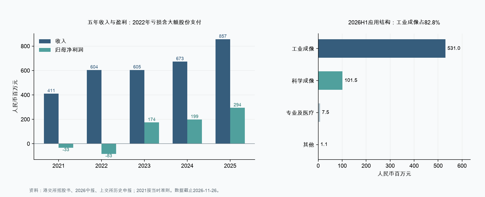

# 长光辰芯（03277.HK）研究报告

> **研究与资料截止日：2026-11-26，亚洲/上海。** 公司全称：长春长光辰芯微电子股份有限公司，Gpixel Changchun Microelectronics Inc.；港交所主板，2026-04-17上市，与长光华芯（688048.SH）为不同公司。未发现需要合并研究的ADR证券。
>
> 行情：11月26日收盘 **37.32港元**；已发行445,088,300股，市值 **166.1070亿港元**。最近完整财务为2026中报；今天另有未经审计、未经审阅的前十个月经营预告。按当前股本重算，TTM归母PE **30.68倍**；以本报告假设的2026年归母净利6亿元计，预测PE **23.53倍**。
>
> 研究主线：工业检测需求、产品组合与研发费用杠杆共同提高盈利，现金也有支撑；但高增长主要来自工业成像，不能直接外推为所有业务同时爆发，更不能把研发现金储备视为可立即分给股东的闲钱。

本报告复用[4月9日原报告](长光辰芯-team-20260409/最终报告.md)的公司目录，更新研究判断，保留原稿作为历史记录。全文金额除股价、市值及明确说明外均为人民币；财务表统一使用百万元，避免“亿元/百万元”误读。行情经腾讯、StockAnalysis及其他行情页交叉核对。[S1][s1] [S2][s2] [S3][s3]

---

## AI研究偏见自觉

**信息丰富度评级：B级。** 招股书和首次中报足以观察收入、成本、客户结构和治理，但上市时间短，同型号价格、真实终端库存、晶圆移植进展及增量资本回报缺少独立资料。财务数字可以交叉核验，长期竞争力的把握仍有限。

**AI研究局限性声明：** 本报告没有访谈客户或供应商，也没有测量芯片性能、良率和工艺切换成本。细分市场规模及份额主要来自公司付费委托的弗若斯特沙利文（F&S）报告，多家新闻转述不能算独立行业验证。今天的十个月预告也只有一个原始经营信息来源。行业份额、未来利润和情景概率的置信度低于已披露财务，不能用表格完整度掩盖这些差异。

- [x] 不把高毛利直接等同于可随意提价：销量、产品组合和价格要分别判断。
- [x] 不把“国产替代”写成“国产供应链完全独立”。
- [x] 不用股价曾经更高证明现价便宜，也不锚定4月的静态买入线。
- [x] 不用资料少推出生意差；Leica的独立客户公告是值得认真对待的正面证据。

### 与旧稿的关键对账

| 项目 | 本次核实与影响 |
|---|---|
| 核心市场规模 | 招股书的2024年工业与科学成像CIS合计为41.1亿元人民币，旧稿“25—33亿美元”不能沿用。市场较小，但招股书预测其增长较快；两件事应同时看到 |
| 收入结构 | 2025年工业/科学占比实际为74.6%/23.9%；2026H1为82.8%/15.8%，旧稿约66%/29%已过时 |
| 盈利口径 | 2025年集团净利293.146百万元，归母294.182百万元；本报告估值统一用归母。2026H1同样区分集团247.004与归母250.234 |
| 股本与PE | 超额配售后股本445,088,300股；不能继续用IPO前后粗估股数，也不能照抄使用加权股本EPS计算的行情页PE |
| 管理层持股 | 夫妻的披露权益重叠，且含控制平台；41.18%控制集团权益不等于夫妻净经济权益，更不能两行相加。旧49.53%为上市前口径 |
| 技术与代工 | 原件点名Tower与DB HiTek，已有堆叠BSI合作及国内试产记录；没有依据将台积电写为关键代工方，也不能说完全没有本土备份 |
| 风险断言 | 撤A“真实动机”、关联利益输送、国产“唯一选择”、索尼尚未认真进入，均缺充分证据；本报告以可核交易、集中度和现有竞品评价 |
| 大师点评 | 旧稿若干“某大师会说”没有原话支持。本报告改用短引原文和明确标注的框架应用，不代言个人买卖立场 |

上述纠错分别来自正式招股书、2026中报、月报及客户/供应商公告；它们不会追溯修改旧建议的历史结果。[S1][s1] [S2][s2] [S3][s3] [S7][s7] [S8][s8]

---

## 第一步：核心数据总览

### 五年经营趋势

| 指标，人民币百万元 | 2021 | 2022 | 2023 | 2024 | 2025 | 2026H1 |
|---|---:|---:|---:|---:|---:|---:|
| 营业收入 | 410.608 | 604.407 | 604.835 | 673.048 | 856.513 | 641.115 |
| 归母净利润 | -33.168 | -83.148 | 174.199 | 198.675 | 294.182 | 250.234 |
| 毛利率 | 未闭环 | 76.16% | 63.48% | 58.96% | 66.93% | 68.70% |
| 核心营业利润率，定义见下 | 未闭环 | 未重建 | 27.38% | 25.55% | 31.21% | 43.78% |
| 经营现金流CFO | 87.063 | 121.883 | 208.258 | 224.841 | 466.346 | 325.213 |
| CFO减PPE、无形投入及设备押金 | 未闭环 | 未闭环 | 180.163 | 196.013 | 441.852 | 250.606 |
| 现金等价物，不含定存及理财 | 168.57，口径有限 | 299.369 | 92.713 | 402.984 | 236.305 | 823.236 |

2023—2025数据以正式招股书为主，2022采用历史HKFRS申请材料，2021收入、归母、CFO以当时A股申报与StockAnalysis交叉验证。2021毛利存在准则/重分类差异，不拼接；2022 A股CFO105.306与HKFRS121.883不同，本表统一采用后者。现金等价物的2021严格同口径仍有限，不能据此评价五年全部现金储备变化。[S1][s1] [S2][s2] [S4][s4] [S5][s5]

“核心营业利润率”由毛利减销售、管理、研发及应收减值重建，不含其他收入收益、其他开支、融资和联营损益，并非公司另行披露的法定利润行。2026H1不能直接乘二当全年承诺。历史大额股份支付影响2021—2022净利润，也不能把其后扭亏全部视为经营爆发。



### 收入从哪里来

| 应用场景 | 2025收入，百万元 | 2025占比，按金额重算 | 2025毛利率 | 2026H1收入，百万元 | 2026H1占比 |
|---|---:|---:|---:|---:|---:|
| 工业成像 | 638.980 | 74.60% | 63.7% | 约531.0 | 82.8% |
| 科学成像 | 204.304 | 23.85% | 77.7% | 约101.5 | 15.8% |
| 专业影像与医疗 | 9.991 | 1.17% | 合计62.7% | 约7.5 | 1.2% |
| 其他 | 3.238 | 0.38% | 47.2% | 约1.115，按总额扣回 | 约0.2% |
| 合计 | 856.513 | 100% | 66.9% | 641.115 | 100% |

年度占比统一由金额重算，避免直接加总原件各项舍入百分比；原件“其他”列0.3%，与3.238/856.513反算约0.38%不同，本表采用金额。中报按应用只披露上述四舍五入数，因此H1“其他”含舍入差，不冒充独立分部实数；H1应用分部毛利未完整披露。另一种产品口径是面阵498.891、线阵100.583、其他器件35.542、定制方案5.826、其他0.273百万元，两套分类不能相加。近四个独立季度的应用收入和毛利没有完整公开表，本报告不伪造季度序列。[S1][s1] [S3][s3]

### 今天的新信息：十个月预告

| 截至2026年10月31日的十个月 | 管理层预估，百万元 | 公告所称同比 |
|---|---:|---:|
| 收入 | 1,150—1,160 | +70%至+75% |
| 归母净利润 | 500—520 | +140%至+150% |
| 调整净利润 | 555—575 | +105%至+115% |

增长主要来自高端工业检测、锂电池检测和PCB检测。**该公告未经核数师审计或审阅，也未经审计委员会审阅**；没有同步披露十个月CFO、应收、存货或分部利润。调整利润剔除了股付及上市费，本报告没有拿调整利润替代归母进行PE估值。东方财富等转刊只验证转录一致，不构成第二份独立账簿。[S6][s6]

### 现金质量比盈利增速更值得核对

| 2026H1现金桥，百万元 | 金额 | 含义 |
|---|---:|---|
| CFO | 325.213 | 为归母净利的129.96%，有现金支撑 |
| 减PPE现金投入 | 62.662 | 较过去扩产投入增加 |
| 减无形资产投入 | 10.249 | 不能漏掉软件/IP等现金支出 |
| 减设备押金 | 1.696 | 已支付但尚未转为固定资产 |
| 广义简化FCF | 250.606 | 未扣租赁本金与已付利息 |
| 再减租赁本金及利息 | 2.825 | 分别2.709、0.116 |
| 租赁后现金余量 | 247.781 | 为归母净利的99.02%，并非母公司可分红现金 |
| 假设合同负债不再增加后的余量 | 183.807 | 去掉本期63.974的客户预收增量，仍为正 |
| 再按股付现金替代计价的压力余量 | 152.474 | 额外扣31.333，属于经济成本压力，不是重复修改法定现金流 |

中报有41.445百万元汇兑损失，已从利润扣除、在CFO中加回。它是非现金损失调整，不能简单叫“虚增现金”，再机械扣一次。合同预收款则有后续履约义务：定制方案合同负债约205.9百万元，不能当作无偿融资永久滚动。[S3][s3]

2025简化FCF为441.852百万元，StockAnalysis的457.19仅扣PPE，少扣无形资产15.336；差异已对账，不能宣称两者同口径吻合。TTM同一广义简化FCF为590.488百万元，尚未统一扣租赁，且含预收变化，后文仅作现金能力参考。

### 资产负债表与股本

| 项目 | 核实值 | 时点与口径 |
|---|---:|---|
| 已发行股份 | 445,088,300股 | 2026年10月月报；H股300,932,600，非上市144,155,700 |
| 未行权期权 | 6,151,000股 | 尚未计入发行股数；约相当于现有股本1.382% |
| 现金等价物 | 823.236百万元 | 2026-06-30 |
| 流动/非流动定存 | 2,892.765 / 30.942百万元 | 不与现金等价物混淆 |
| 受限现金 | 55.099百万元 | 不计入保守净现金 |
| 流动/非流动FVTPL资产 | 217.472 / 21.501百万元 | 不按无风险现金全额加到估值 |
| 银行借款/租赁负债 | 无 / 5.399百万元 | 未把所有经营负债称为有息债 |
| 保守净现金 | 3,741.544百万元 | 现金等价物+全部定存−租赁，不含受限及理财 |
| 归母权益 | 4,274.188百万元 | 总净资产4,283.508另含少数股东权益 |

现金共同口径交叉核验采用“等价物+流动定存+流动FVTPL”：原件分项合计3,933.473百万元，对StockAnalysis3,933，误差小于1%。保守净现金是另一口径，并非第二套冲突数字。大部分新增现金来自IPO，后续有研发、研发中心及封测用途；不能把整笔现金当作额外分红并重复加到盈利PE估值。[S1][s1] [S2][s2] [S3][s3]

> 框架追问：如果只能相信现金流量表的一页，而不能看股价，这份增长还成立吗？目前H1成立，十个月预告的现金转化仍待全年验证。

---

## 第二步：生意本质分析

**这门生意是：让相机和仪器厂商付费获得“看得清、看得快、测得准”的传感器，靠设计能力、工艺协同和客户认证，在客户设备持续出货时反复卖芯片。**

收入以硬件出货为主，辅以定制开发和服务。它没有订阅合同带来的自动续费；复购来自客户已经完成的光学、电路、软件、热管理与可靠性验证。更换供应商可能要改整机，既消耗工程资源，也承担客户现场失效风险。然而，下一代设备重新设计时仍可能换供应商，锁定有期限。

| 生意环节 | 谁承担什么 | 对利润的意义 |
|---|---|---|
| 设计与开发 | 自有像素、电路、读出及工艺协同能力 | 高价值环节；研发投入须持续，不能因Fabless就认定无需再投资 |
| 晶圆与封装 | 外部代工，部分封装测试逐步内部化 | 降低自建晶圆厂负担，同时留下交付和地缘风险 |
| 导入认证 | 相机/OEM、仪器与科研客户 | 形成转换成本，客户放量后可重复出货 |
| 定制开发 | 依据里程碑与验收确认 | 预收可改善现金，但验收波动影响收入和利润时点 |
| 量产与迭代 | 客户设备销量、型号组合、良率共同决定 | 主要变量是出货量与组合，之后才是同型号提价 |

2025年相机制造商及OEM贡献81.6%收入，科研机构约5.1%。H1直销占94.7%，海外占20.3%；相比“科研项目公司”，商业化设备客户的份量更高，但H1国内工业需求权重也更集中。[S1][s1] [S3][s3]

H1面阵与线阵销量从约26.4万颗增加至54.8万颗。按这两类收入和合计颗数粗算，混合每颗收入反而约下降14.66%；这包含型号结构变化，并不能证明同型号降价。它足以说明“高增长=涨价”的解释不成立。毛利率上升更可能来自高毛利应用组合、产量与成本变化；同型号ASP仍缺证据。

经营杠杆有实数：2025研发186.168百万元、占收入21.74%；H1研发91.512百万元、占收入14.27%。H1收入同比+78.36%，而研发金额增速较低，推高核心营业利润率。未来IPO资金投入研发中心、封测和新产品后，费用率不必继续下降，不能把H1利润率当永远的稳态。

毛利率也须正确比较：长光辰芯H1为68.70%，onsemi 2026Q3全公司为41.4%。后者含大量功率和汽车业务、制造资产更重，差距支持产品及模式不同，不证明长光辰芯技术全面优于对方。Sony综合集团更不应被当作纯工业CIS可比。[S14][s14]

> 段永平式追问：这门生意好在哪？客户为整机检测性能和低失效风险付费，传感器一旦进入量产设备便有复购；是否足够“对”，仍取决于下一代设备继续选它，而非只看这一代高毛利。

---

## 第三步：护城河评估

| 来源 | 判断 | 支持证据 | 能推翻判断的现象 |
|---|---|---|---|
| 品牌与定价权 | 有专业信誉，尚未验证持续提价权 | 科学成像高毛利，Leica确认联合开发；但招股书也有批量折扣 | 同型号ASP持续降、关键客户把第二供应商变成主供应商 |
| 转换成本 | 中等偏强 | CIS涉及光学、电路、算法和可靠性认证，导入后通常长期合作 | 下一代设备频繁切换、认证周期显著缩短 |
| 网络效应 | 弱 | 更多客户有利于学习与复用，但不会自动提升每个客户的产品价值 | 不给这一项额外估值溢价 |
| 规模与成本 | 中等 | IP复用、研发摊薄、采购及自有封测效率 | 为维持增长不得不同比例增加研发、或晶圆成本上升吞掉规模收益 |
| 技术与工艺协同 | 中等偏强，非全面领先 | 全局快门、低噪声、TDI、BSI及堆叠技术有具体产品与合作支持 | 新制程良率/性能落后，持续流片却不能量产 |

过去数年的产品广度、客户商业化和海外合作支持护城河变宽的方向；未来能否继续变宽，证据不如已披露利润充分。用“领先几年”给出精确年限没有依据。

Tower在2021年已公告双方GTOF0503采用像素级堆叠BSI；Leica在2026年4月确认联合开发下一代专用传感器。前者证明工艺合作基础，后者提供客户侧认可；两者都不能证明所有型号已实现可替代Sony的性能、良率与成本。[S7][s7] [S8][s8]

Sony也不是未来才可能进入的竞争者。其2025年已发布105MP、100fps工业全局快门IMX927，已有成熟工业产品体系。真正的壁垒须在这些竞品存在时仍能保住设计赢单，而不是假设巨头忽视市场。[S9][s9]

> 巴菲特式追问：十年后护城河还在吗？较可能留下的是客户信任与跨代产品能力；单个传感器规格领先、国产身份和一次导入都不足以保证十年利润。

---

## 第四步：逆向思考与风险清单

最强的空方论点是：公司正处于高端工业检测和国产导入的有利周期，短期量、组合和费用杠杆同时改善。投资者若把这组三重顺风永久化，就可能高估正常利润；与此同时，关键工艺不完全掌握在自己手里，下一轮增量研发未必复制旧型号回报。

| 失败路径 | 概率判断，非统计频率 | 影响 | 可观察信号 |
|---|---|---|---|
| 下游扩产放缓或提前备货反转 | 中高 | 订单、产品组合和利润率同时承压 | 收入增长与客户设备出货脱节，应收及库存周转连续恶化 |
| 海外晶圆交付受限或跨工艺移植失败 | 低至中、难量化 | 极高，可能失去型号和客户 | 许可/交付限制成为正式事实，备份流片反复延期 |
| 大客户下一代设计输给Sony等 | 中 | 中高，技术价值被重估 | 老客户新品采用竞品，促销仍无法维持收入 |
| 关连交易定价或回款失真 | 概率不可可靠估计 | 高 | 毛利显著偏离独立客户、逾期和应收增加、持续突破上限或程序失守 |
| 定制验收或合同履约成本减值 | 中 | 中 | 预收款迟迟不结转，履约成本增长快于收入并计提减值 |
| 新市场投入没有回报 | 中 | 中高 | 研发/封测现金支出扩大，专业及医疗收入仍小、资本回报下降 |

2025最大供应商占采购50.1%、前五70.5%；最大客户占收入16.6%、前五40.7%。这些数字反映集中度，不能推导出客户全部关联，也不能把采购集中度直接等同于同一国家产能占比。[S1][s1]

招股书点名Tower与DB HiTek，后者已有多款稳定量产；国内代工厂已完成试生产，公司在招股时称即将量产。**目前未核到国内备份的规模与收入贡献**。因此风险既不是“完全没有备份”，也不是“国产替代已消除断供风险”。晶圆制造及封装全流程可达数月，移植不是即时换单。[S1][s1]

历史类比可以用成熟模拟/传感器设计商的“多型号、小批量、长认证”模式理解耐久性；onsemi的汽车与工业周期也提醒需求会反转。但两者制造模式和产品组合不同，不据此编造长光辰芯的失败概率。技术采纳曲线与认证成本共同解释早期份额增长；竞争博弈则提醒，规模扩大后更容易进入巨头重点竞争区域。

本报告最可能犯的错，是把2026年的产品组合和资本开支需求看得过于平稳，继而把6亿元正常盈利和18%增长当作理所当然。另一个方向的错误，是把技术与海外供应风险写得过重，错过真实的利基复利；Leica认可和现有现金表现正是对此的反证。

> 芒格式追问：聪明人为什么不买？因为当前价需要未来增长转成每股现金，而不是只需要今年财报很好看；看懂产业趋势仍不等于看懂下一代工艺与客户选择。

---

## 第五步：管理层评估

王欣洋为技术型创始人，现任董事长、总经理兼CEO；张艳霞参与运营管理。组织长期专注CIS是加分项，职权集中和关联客户关系仍要求外部监督。学历或研究所背景本身不证明资本配置能力。

| 决策或安排 | 已见结果 | 本报告评价 |
|---|---|---|
| 长期专注高性能CIS、发展自有技术及全球研发 | 多产品系列、商业化OEM客户与海外合作 | 正面，研发成果已产生收入 |
| 引入DB HiTek及推进自有封测 | 多款量产；上半年自有高可靠陶瓷封装月产量超过3万颗 | 正面但未消除上游工艺集中 |
| 港股融资后增加研发、研发中心及封测投入 | 现金显著增加，后续回报尚未经过完整周期检验 | 中性；募到钱不是创造回报 |
| 与Leica联合开发 | 客户官方确认，尚无公开订单金额/量产时间 | 技术正面，财务贡献待证 |
| 11月25日拟回购 | 资金上限2.4亿港元，需完成相关登记，实际执行未确认 | 方向正面，不先计为注销或收益 |

回购上限约为当前市值的1.445%，且股份可能注销、用于激励或作为库存股；回购意向不能等同于每股权益一定增加。报告模型没有给尚未执行的回购加收益。[S10][s10]

持股须区分：招股书直接持股记录中，王101,217,000股、张7,050,000股，按现有总股本合计约24.32%；这是可识别的直接经济权益。夫妻被视为拥有的同一控制集团183,267,000股约41.18%，含平台及配偶权益，不能当两人全部实益资产。穿透平台后的净经济权益未完整闭环，也未发现可据以主张AB股超级投票权的结构。[S1][s1] [S3][s3] [S11][s11]

H1研发人员242人、占员工49.4%，对持续开发有支持；但人才留存、接班及平台激励的效果仍须时间检验。股付既影响利润，也可能影响未来每股价值，不能只在调整利润中剔除后不再讨论。

### 关联交易：有明确风险，但没有证据就不能定性舞弊

| 事项 | 已披露安排 | 应关注什么 |
|---|---|---|
| 凌云光 | 2026销售年度上限由1,500万升至4,000万元；未来年度仍有框架安排 | H1实际交易7.8百万元；上限不是订单。董事关联及回避程序、定价和回款须核对 |
| 长春光机所集团 | 上市日至年底销售上限拟由3,800万升至7,500万元；2027—2029每年拟1.5亿元 | 无最低采购承诺，须独立股东批准；未来上限不计入本报告确定收入 |
| 董事调整 | 杨艺、高腾拟由赵严、谢佶隽接任 | 截止日仍待股东批准及生效，不等同于创始人离任或业务崩坏 |

11月20日通函把7,500万拆为已售2,150万、Q4预计确定交付3,600万和可能交付1,750万，可能交付仍受项目进度影响。独立财顾明确未来上限并非收入预测。股东会安排为12月10日10:30，研究时尚未召开。[S11][s11] [S12][s12]

旧稿“大额年薪”把股份支付、年份与现金薪酬混在一起，不能据此认定现金转移或诚信问题；同样，港股与A股不同关联范围披露有差额，也不能不作范围对账就定性造假。本次对管理层诚信保持中等置信，既不推定清白无风险，也不把指控当事实。

> 段永平式追问：如果CEO退休，公司还行吗？产品与研发组织已有基础，但技术路线、客户合作和控制权仍集中；尚无足够接班证据，不能给“完全不依赖创始人”的评价。

---

## 第六步：行业与文明趋势

机器视觉让工业从“能制造”走向“能精确、稳定地检测制造”。AI识别算法提升检测价值，但感光、速度、噪声、动态范围仍受硬件约束。长光辰芯位于相机及检测设备上游，能够分享硬件性能升级；下游软件和设备集成商也会拿走利润，并非所有AI视觉价值都流向CIS。

| 全球细分市场，人民币十亿元 | 2024 | 2026E | 2029E |
|---|---:|---:|---:|
| 工业成像CIS | 2.93 | 4.42 | 7.77 |
| 科学成像CIS | 1.18 | 1.52 | 2.16 |
| 专业级CIS | 6.6 | 7.2 | 9.1 |
| 医疗CIS | 3.0 | 4.7 | 8.8 |

以上均来自招股书所引F&S，预测年份不是实际市场销售。2024工业/科学份额15.2%/16.3%也来自同一委托报告；截至本次研究尚未找到独立同口径精确复核。**不能用收入占比与整体CIS总市场混算份额。**[S1][s1]

当前工业和科学市场较小，未来仍有渗透、CCD替代与高端检测规格升级；公司的收入天花板并不固定在今天的市场规模。另一方面，专业与医疗虽扩大可触达空间，H1合计仅7.5百万元，不能为它们提前计入成熟利润。Sony最新一次性内窥镜产品也表明这些增量市场并非无人竞争。[S13][s13]

相比互联网平台，这条产业链的竞争优势更偏工程积累与客户认证，扩张通常伴随研发、流片和客户验证。文明趋势为需求提供方向，股东回报取决于赢单、现金成本、再投资回报和买入价格。把它类比成垄断性“标准石油”证据不足，把利基市场直接归为“昙花一现”同样草率。

> 李录式追问：二十年后留下什么？如果公司持续把感知性能变成客户设备竞争力，它可以成为长寿的专业部件商；是否成为大公司，须靠新产品和新场景的真实兑现。

---

## 第七步：估值与安全边际

### 当前到底在付多少

采用1港元=0.85元人民币的圆整建模汇率，当日多源参考约在0.8496附近；这是固定汇率假设，不是银行成交价。所有人民币盈利在模型中按同一汇率转为港元，不把不同币种的增长和折现率静默混用。[S15][s15]

| 指标 | 工具重算值 | 解释 |
|---|---:|---|
| 市值 | 166.1070亿港元 | 37.32×445,088,300 |
| 折合市值 | 141.1909亿元人民币 | 使用0.85汇率 |
| TTM收入 | 1,138.173百万元人民币 | 2025+2026H1−2025H1 |
| TTM归母净利 | 460.207百万元人民币 | 同上，统一归母 |
| TTM归母PE | 30.68倍 | 当前全部发行股本口径 |
| 2025归母PE | 47.99倍 | 历史全年，不能当最新盈利水平 |
| 2026E归母PE | 23.53倍 | 6亿元纯属本报告预测，非公司全年指引 |
| TTM PS | 12.41倍 | 毛利较高，但收入倍数仍不低 |
| PB | 3.30倍 | 采用6月末归母权益，非11月实时净资产 |
| EV/TTM收入 | 约9.12倍 | 扣中报时点保守净现金的混合时点参考；不再额外给PE模型加现金 |
| TTM简化FCF收益率 | 约4.18% | 扣PPE、无形及设备押金，未统一扣租赁；不是承诺股息率 |

StockAnalysis报价页曾显示27.02倍PE，采用加权股本每股盈利等口径；本报告以当期归母金额和最新总股本计算30.68倍，不因差异而挑较便宜的指标。相对于IPO，股价只下降约6.42%，盈利却大幅改善，估值变化主要来自利润增长。[S2][s2]

横向参考：onsemi报价页TTM PE为36.34倍、预测14.10倍；Sony集团TTM PE显示不适用、预测21.48倍，均为11月25日美股收盘附近的供应商快照。预测盈利及业务组合不同，不能用这些数字直接证明长光辰芯该给多少倍，更不能据此确定十年终值倍数。不存在足够长的本公司上市历史可计算可信的五年PE分位。[S16][s16]

### 三年三情景：判断价格是否有余地

起点采用2026E归母6亿元、现有总股本不变，对应EPS1.585938港元。十个月预告已有5.0—5.2亿元，这个起点意味着最后两个月仍须贡献利润；它有依据，但不是实绩。未来增速、倍数和权重均为作者判断。

| 情景 | 概率假设 | 2026E至2029E盈利年增长 | 2029年PE假设 | 2029年EPS，港元 | 2029年价格，港元 | 按10%折回今日，港元 | 不含息年化价差 |
|---|---:|---:|---:|---:|---:|---:|---:|
| 悲观 | 30% | 0% | 16倍 | 1.5859 | 25.38 | 19.06 | -12.07% |
| 基准 | 50% | +18% | 25倍 | 2.6057 | 65.14 | 48.94 | +20.40% |
| 乐观 | 20% | +30% | 32倍 | 3.4843 | 111.50 | 83.77 | +44.03% |

概率加权今日值约46.95港元。表内25倍基准反映三年后仍处成长期的判断，不是永续终值；若届时增长消失，倍数必须下降。三年模型不计未来股息，也不预先给Leica订单和拟回购加利润。现有期权全部新增发行、忽略行权资金时，每股估值约乘0.98637，亦即下降约1.36%。

18%基准增长低于当前经营增速，依据是高端工业检测继续增长、科学业务稳定及研发摊薄；不沿用本期接近翻倍的利润增长。30%乐观需要更多高端设计赢单；零增长悲观仍未涵盖完全断供或严重治理损失，不能把19.06港元误当绝对底。

### 反向DCF：现价隐含的长期要求

把每年归母利润的30%作为未来分配，固定汇率、无新增净稀释、十年后稳态ROIC20%、永续增长2%、资本成本10%，从2026E的6亿元反求：未来十年利润需约 **16.18%年增长**，才让这一组条件现金流覆盖当前市值。这不是市场真实预期的唯一解，而是一个可核算的要求。

当前工业顺风足以支持“可能做到”，不足以支持“十年大概率做到”。如果分配低于30%、工艺切换或新市场投入更大，所需利润增长更高；若投资回报好、业务边界扩大，条件也可能改善。反向模型不额外返还现有现金，避免与含利息利润及再投资假设重复。

### 十年折现：只回答仓位能否加重

| 输入 | 主用假设与理由 |
|---|---|
| 币种及r | 全部现金流换算为港元，r=10%；沿用仓库港元/美元参考无风险利率4.7%加5.3%股权溢价、β=1。4.7%是方法中的参考参数，**不是声称11月26日实时国债收益率** |
| 稳态增量ROIC | 20%；Fabless有研发与认证复用，但新增研发、封测及新市场回报低于早期成功产品并不意外。它是判断值，缺少可直接验证的增量ROIC，不冒充审计指标 |
| 永续g | 悲观0.5%、基准2%、乐观3%；低于港元模型4%的基准上限，基准2%亦符合人民币口径的基准约束。固定汇率下两端增长一致；不是未来十年的增长率 |
| 分母r−g | 分别9.5、8.0、7.0个百分点；均不低于5个百分点 |
| 2036归母利润 | 悲观3亿、基准15亿、乐观30亿元人民币；相对2026E年化分别约-6.70%、+9.60%、+17.46% |
| 离散风险 | 完全/长期断供另设尾部；新产品失败进入情景；关连交易失真未量化建模，作为明确限制，不加进r或β |

基准利润并非“市场小就不能成长”：公司在核心细分市场继续增长，专业领域适度贡献，正常费用投入回升。乐观30亿元需更大业务边界与客户拓展，不能仅凭现有科学成像客户自然获得。悲观3亿元表示一个周期后正常利润退回当前以前水平，并非已覆盖破产。

终值PE仅采用 `(1−g/ROIC)/(r−g)`，未使用同行当前PE：

| 情景 | 2036归母利润，亿元人民币 | 永续g | 终值PE | 不含中途分配的工具年化值 | 加入逐年30%分配后的现金流IRR |
|---|---:|---:|---:|---:|---:|
| 悲观 | 3 | 0.5% | 10.2632倍 | -14.13% | -12.37% |
| 基准 | 15 | 2% | 11.2500倍 | +1.80% | +3.77% |
| 乐观 | 30 | 3% | 12.1429倍 | +9.94% | +11.98% |

工具的`k=0`结果是只看终值的年化代理；没有用“加一个股息率”冒充逐年现金流。补充现金流模型假设2027—2036利润按各情景对应的恒定年增速到达终值，每年分配30%，2036再收到终值股权价值；没有把剩余留存资金另算现金红包。年度路径和派息率均非公司指引。

再为长期断供设5%主观尾部概率，尾部期间不分红、末年仅回收初始市值20%；其余95%按上表30%/50%/20%分配。**对概率加权年度现金流求IRR，主参数下约+3.03%**。这是期望现金流的IRR，不是三个IRR的简单平均，也不保证实际收益。该尾部仍未量化治理造假、资金不能分配、技术突变的所有路径。

### 折现率敏感性与翻转

| r | 终值工具的概率加权年化代理 | 能否覆盖本档r | 含分配及5%尾部的期望现金流IRR | 能否覆盖本档r |
|---|---:|---|---:|---|
| 8% | +1.50% | 未通过；区间外，仅供参考 | +5.91% | 未通过；区间外，仅供参考 |
| 10% | -1.35% | 未通过 | +3.03% | 未通过 |
| 12% | -3.51% | 未通过；区间外，仅供参考 | +0.94% | 未通过；区间外，仅供参考 |
| 9%，补做区间内复核 | -0.04% | 未通过 | +4.34% | 未通过 |
| 11%，补做区间内复核 | -2.49% | 未通过 | +1.91% | 未通过 |

**在港元合理区间内的9%/10%/11%采样中，压力测试结论没有随r翻转，均不支持重仓。** 两侧±2个百分点均在合理区间外，因此另跑±1个百分点，未用8%的结果为买入辩护。这是对已运行档位的结论，不冒充所有参数连续取值的数学证明。

### 估值分歧对账

三年基准今日值48.94、加权46.95港元，支持“相对中期增长已有一定价格余地”；十年模型却没有覆盖资本成本。分歧来自两处：三年后假设仍有较强增长、PE维持25倍，十年后则按成熟业务的再投资和永续模型降至约11倍；长期情景还包含利润回落和断供尾部。

三年属于定价判断，十年属于仓位压力测试。后者不能单独取消前者，也不意味着公司没有投资价值；但前者依赖增长继续，不能把“未来市场仍给25倍”当作确定的安全边际。

最终策略综合生意质量、护城河、管理层、风险、行业趋势与估值：对现有合理小仓保留持有空间；对空仓者，现价并未提供足够理由跳过治理及全年现金核验。新增研究带定为32—35港元，并设置业务前提，首笔仅0.25%—0.5%、研究总仓参考不超过1.5%。这个仓位约束同时来自上游集中、利基市场与治理证据边界，十年压力进一步阻止其升级核心仓；没有把十年未通过当成清仓票。

> 巴菲特式追问：r错两个百分点会翻转吗？本次有效档位未翻转，继续受限的是仓位；最大的分歧来自增长持续时间与成熟期利润，而不只是折现率。
>
> 段永平式追问：股市关门五年，愿意持有吗？能接受供应链和客户跨代风险的小仓可以；目前证据尚不足以支持把主要资产押在2026顺风延续上。

---

## 第八步：最终决策与行动清单

| 维度 | 判断 | 信心度 |
|---|---|---|
| 生意质量 | 高性能芯片设计、认证后复购、上半年有真实现金；仍受硬件需求与验收周期影响 | 中高 |
| 护城河 | 技术协同及客户转换成本真实，客户认可增强；无网络垄断，也未证明全面提价权 | 中 |
| 管理层 | 技术投入及商业化有成果；平台持股、关连交易及资本配置需持续监督 | 中 |
| 最大风险 | 晶圆采购集中、下游周期、下一代设计输单与治理失真 | 中；尾部概率低置信 |
| 文明趋势 | 工业精密检测、科学仪器和专业影像长期需要更好感知；价值捕获仍有竞争 | 中高 |
| 估值 | 三年基准今日48.94、加权46.95港元；十年期望现金流IRR约3.03%，有效r采样不翻转，仅支持严格限仓 | 模型计算高，输入判断中低 |

估值维度不是最终决策的唯一裁决。**本次结论为现价观望新增，合理小仓持有；32—35港元且条件满足时研究性分批。** 相比4月把≤30港元作为主要线，新增研究上沿有所提高，原因是最新归母盈利和现金支撑增强，而不是机械跟随历史股价。旧稿更深跌就“重仓”的建议不再沿用。

| 投资者/条件 | 动作 |
|---|---|
| 空仓者，现价37.32港元 | 观望新增。先看12月股东会治理结果及下一完整财务对预告利润和现金的验证；不因一日反弹追价 |
| 持仓者，已有合理小仓 | 无红线可持有并复核，暂停加仓；成本和历史高点不决定动作。若明显超出研究风险预算，先降低集中度 |
| 32—35港元研究带 | 仅在没有实质代工中断/重大治理红线、独立股东程序可核，最新信息仍支持2026正常归母约6亿元，且完整财务显示CFO能覆盖PPE、无形、设备押金和租赁后，再研究首笔0.25%—0.5%；总仓参考≤1.5% |
| 低于32港元 | 先复核是否利润正常化或永久损失，不自动提高仓位；不能沿用旧稿“越低越重仓” |
| 高于35、低于60港元 | 已有仓按论文持有/复检；空仓等价格或经营证据变化。本带不是合理价值精确边界 |
| 达到或高于60港元，模型没有增强 | 触发估值与超配复核，优先控制集中度；60港元是主动设定的研究警戒线，不是自动卖出，也不是乐观目标价 |
| 卖出/显著减仓信号 | 已证实重大信息失真或关联利益侵占、实质断供且无法替代、跨代产品持续失去客户导致正常盈利受损；不等价格止损才处理基本面破坏 |
| 加仓信号 | 价格进入研究带且上述前提满足；全年与随后正式披露显示利润转现金、预收履约与研发回报可解释，再逐步评估，仍不因十个月预告直接升核心仓 |

用户未提供具体成本、持仓和风险预算，上述仓位为研究参考，不是针对个人资产负债安排的指令。

### 后续复检

| 日期 | 要核实的事 | 性质 |
|---|---|---|
| 2026-12-10 10:30 | 关连交易框架及董事议案的股东会决议、回避和生效安排 | 公司已公告会议 |
| 2026-12-11 | 读取会后正式公告，核对关联上限、管理层与回购后续 | 本报告设置的人工研究日 |
| 2027-03-31 | 检查2026全年业绩是否披露；核实际归母、CFO、全部现金投入、预收、应收库存与代工备份 | 信息兜底检查日，不是已确认预约财报日；提前披露即提前复检 |

价位登记更新既有target“长光辰芯”，32—35研究带与60警戒线替代旧≤30主线；保留旧报告链接。当前活跃每日监控扫描下行研究带，排除above上涨警戒线，因此60港元只保留人工复核。事件同样仅供人工复核，不自动提醒财报或股东会。公司不在重点标的主表，本次新建议进入非重点跟踪表，旧建议接续关闭，不追溯认定命中。

### 四个框架的原文约束

以下短引均已阅读原文或仓库原文档案。右侧是本报告的框架应用，**不是四位本人对长光辰芯的公开评价或买卖建议**。

| 框架 | 可核验短引 | 本报告的应用 |
|---|---|---|
| 巴菲特 | “Time is the friend of the wonderful business, the enemy of the mediocre.”——1989股东信 | 长期回报要看生意能否持续创造价值，不能只等PE反弹。[原文][m1] |
| 芒格 | “held self-delusion at bay as he underclaimed expertise”——2014年本人署名的副主席回顾 | 承认无法验证良率、客户替代和增量ROIC，不把行业故事当能力圈。[原文，正文p42附近的相关段落][m2] |
| 段永平 | “买股票就是买公司”——2011-09-19雪球原发言 | 分析应落在客户为什么复购、现金如何归股东；不因宏观猜测机械卖出好公司。[原帖][m3]；[仓库档案](../段永平/段永平雪球全量原发言.md)第91条 |
| 李录 | “如果发现自己犯了错，会第一时间卖出。”——2024-12-07北大演讲问答 | 基本面被证伪先纠错；股价下跌本身不能证明 thesis 出错。[已读仓库原文及来源索引](../李录/李录-北大演讲-20241207.md) |

未找到上述四位直接评价该公司的充分一手原文，因此不模拟其个人买卖立场。

---

## AI分析置信度与投资确定性

**财务事实置信度中高，长期投资确定性中等偏低。** 收入、归母、当前股本、中报现金桥和净现金分项有充分资料及跨来源核验；长期份额、同型号定价、国内代工量产规模、平台穿透权益、增量ROIC和十年概率依赖有限信息推理。计算精确不会提高输入假设的真实性。

最值得一手验证的是：大客户本期采购有多少对应终端真实出货；替代供应商是否进入下一代设备；国内备份工艺的良率和交付规模；定制合同负债的验收、取消和毛利条款；关连客户与独立客户的定价/回款差异；IPO研发和封测项目按投入年份产生多少利润与现金。即使本公司评级为B，这些问题也值得通过产品测试、客户及供应链访谈补齐。

限制包括：细分市场仅一套委托研究；应用分部及部分现金细项主要依靠原件，未完整取得独立双源；2021部分指标未闭环；2026十个月未审计且无现金明细；2026E利润不是指引；固定汇率及无新增净稀释；十年简化利润路径与30%分配并非经营预算；ROIC20%未有可验证的增量回报序列；5%断供尾部及20%回收率为主观假设，关连交易失真未量化。报告用于学习和研究，不构成投资建议。

---

## 数据来源与审计记录

### 关键来源

1. [S1：2026-04-09正式招股书][s1]：摘要p3、p6—8；行业p71—81；持股p115；业务p140—163；附录I会计师报告。行业数据为付费委托F&S；公司站亦有[镜像][s1mirror]。
2. [S2：StockAnalysis财务表][s2]，并读[现金流][s2cf]和[资产负债表][s2bs]：S&P等第三方标准化源，用于数字交叉，不替代原件；[腾讯03277行情][quote]核11月26日收盘。
3. [S3：2026中报][s3]：p6—13业务与利润对账；p18—19权益；p24损益；p26—27资产负债；p30—31现金流；p40存款。
4. [S4：历史HKFRS申请资料][s4]：2022财务口径；其为申请资料，上市状态与现股本以正式公告为准。
5. [S5：2023年上交所申报招股书][s5]：2021历史收入、归母及CFO，仅在可比处使用。
6. [S6：2026-11-26十个月经营预告][s6]，公司站[英文镜像][s6mirror]：p1区间，p2审计限制。
7. [S7：Tower与Gpixel堆叠BSI合作公告][s7]；[S8：Leica联合开发公告][s8]；[S9：Sony工业IMX927发布][s9]。
8. [S10：11月25日拟回购公告][s10]；[S11：11月20日关连交易及董事变更通函][s11]；[S12：9月11日凌云光交易公告][s12]。
9. [S13：Sony一次性内窥镜传感器发布][s13]；[S14：onsemi 2026Q3正式业绩][s14]。
10. [S15：港元/人民币历史参考][s15]：仅用于0.85圆整假设的合理性；[S16：ON估值页][s16]、[Sony估值页][s16sony]只作横向背景。

### 关键数据交叉验证记录

市值、收入、归母、现金共同口径均调用`financial_rigor.py`；三年情景、终值倍数、IRR代理、r敏感性调用共享工具。额外十年逐年现金流用同一十进制上下文及折现方程求根，未改共享工具。[计算参数及精确结果](长光辰芯-research-20261126-计算记录.json)保留公式与数值。

```text
市值验算
37.32 HKD × 445,088,300 = 16,610,695,356 HKD
行情报告市值 16,610,700,000 HKD；四舍五入偏差0.00%；通过

交叉验证（均以1%为阈值）
2025收入：HKEX 856.513 / StockAnalysis 856.51 百万元；通过
2025归母：HKEX 294.182 / StockAnalysis 294.18 百万元；通过
2026H1归母：HKEX 250.234 / StockAnalysis 250.23 百万元；通过
H1现金+流动投资：HKEX分项3933.473 / StockAnalysis3933；通过
股本：HKEX445088300 / Tencent445088300 / SA445090000（舍入）；通过

估值验算
PE (TTM): 37.32 / 1.216432784236296483 = 30.68x
PB: 37.32 / 11.297660420613696864 = 3.30x
PS: 37.32 / 3.008452612264868368 = 12.41x
FCF Yield: 4.18%（本报告广义简化口径，见现金桥）

三年三情景（原工具四舍五入输出）
乐观：30%增长 / 32x / EPS3.48 / 目标111.5 / +198.8%
中性：18%增长 / 25x / EPS2.61 / 目标65.1 / +74.6%
悲观：0%增长 / 16x / EPS1.59 / 目标25.4 / -32.0%

terminal_value audit
C1 币种一致：HKD，r10%，g0.5%/2%/3%；通过
C2 分母：9.5/8.0/7.0个百分点；通过
C3 断供→尾部档、新产品失败→情景；通过
警告：关连交易失真未建模，已在限制中披露
【准出】三条硬约束通过

flip，±2个百分点
8%：期望代理IRR+1.50%，未通过（区间外，仅供参考）
10%：-1.35%，未通过
12%：-3.51%，未通过（区间外，仅供参考）
flip，补做±1个百分点
9%：-0.04%，未通过；10%：-1.35%，未通过；11%：-2.49%，未通过
有效档位不翻转；未通过只约束仓位，不自动等于回避
```

工具验算输出的EPS/BVPS商是截面代理，本报告没有把它误写为正式平均权益ROE。财务的不同口径已分别对账；行业、治理与预测没有伪装为双独立经营来源。

固定随机种子20261126，从工具识别的187个点抽取29个，数值一致性均通过；其中含模型输入、模型重算及一个被提取器识别的日历月份，不能声称29个都是独立双源财务事实。单源预测和披露下限均在[审计JSON](长光辰芯-research-20261126-审计.json)逐项标注，判决见[审计记录](长光辰芯-research-20261126-审计.txt)。最后一次终值准出检查通过，保留“关连交易失真未建模”限制。触发配置与每日监控配置检查通过；临时状态定点扫描返回OK、37.32港元处于研究带之外，未写正式日报或机器状态，也未发送通知。数字一致性通过不代表未来假设得到验证。

[s1]: https://www1.hkexnews.hk/listedco/listconews/sehk/2026/0409/2026040900048_c.pdf
[s1mirror]: https://gpixel.com/public/uploads/admin/file/de05cf3cafbb7be7a0bbee53bbfb891d.pdf
[s2]: https://stockanalysis.com/quote/hkg/3277/financials/
[s2cf]: https://stockanalysis.com/quote/hkg/3277/financials/cash-flow-statement/
[s2bs]: https://stockanalysis.com/quote/hkg/3277/financials/balance-sheet/
[s3]: https://www1.hkexnews.hk/listedco/listconews/sehk/2026/0924/2026092400552.pdf
[s4]: https://www1.hkexnews.hk/listedco/listconews/sehk/2026/0417/sehk25121901774.pdf
[s5]: https://static.sse.com.cn/stock/disclosure/announcement/c/202306/001927_20230630_ZOCX.pdf
[s6]: https://www1.hkexnews.hk/listedco/listconews/sehk/2026/1126/2026112600001.pdf
[s6mirror]: https://www.gpixel.com/public/uploads/admin/file/5ea89a0a1e6b3721d1fe0fd8decfca84.pdf
[s7]: https://towersemi.com/2021/05/06/05062021/
[s8]: https://leica-camera.com/en-AT/press/new-era-imaging
[s9]: https://www.sony-semicon.com/en/info/2025/2025092901.html
[s10]: https://www.gpixel.com/public/uploads/admin/file/ae1431a5b1a0117f595d7cea5775036d.pdf
[s11]: https://www.hkexnews.hk/listedco/listconews/sehk/2026/1120/2026112001794_c.pdf
[s12]: https://gpixel.com/public/uploads/admin/file/99571117f6e01a21d9bacdfebf6d33b6.pdf
[s13]: https://www.sony-semicon.com/en/news/2026/2026102201.html
[s14]: https://investor.onsemi.com/news-releases/news-release-details/onsemi-reports-third-quarter-2026-results
[s15]: https://www.investing.com/currencies/hkd-cny-historical-data
[s16]: https://stockanalysis.com/stocks/on/statistics/
[s16sony]: https://stockanalysis.com/stocks/sony/statistics/
[quote]: https://qt.gtimg.cn/q=hk03277
[m1]: https://www.berkshirehathaway.com/letters/1989.html
[m2]: https://www.berkshirehathaway.com/letters/2014ltr.pdf
[m3]: https://xueqiu.com/1247347556/20397713
