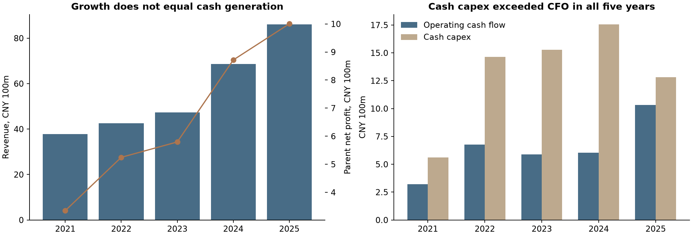
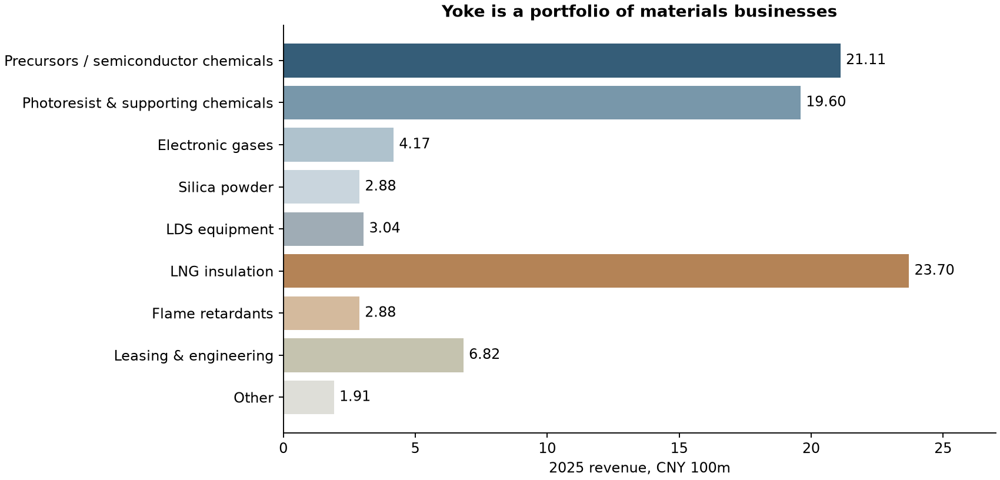

# 雅克科技（002409.SZ）研究报告

**研究日期 / 数据截止日**：2026-11-25，Asia/Shanghai。财务截至2026-09-30，三季报10月28日披露、未经审计；资本事项查询截至11月25日。  
**身份核对**：江苏雅克科技股份有限公司，Jiangsu Yoke Technology Co., Ltd.，深交所主板A股002409；复用本目录与触发记录“雅克科技”，本报告未识别到同公司已上市的ADR或H股证券。  
**行情**：11月25日收盘71.68元；总股本475,927,678股，复算市值341.14亿元；TTM归母PE 32.86倍、扣非PE 35.01倍、归母PB 4.01倍。人民币计价。  
**研究主线**：客户认证构成真实壁垒，Q3回款也已改善；但增长需要的资本、子公司股权让渡与潜在补偿义务，决定了产业机会有多少最终归属于每一股。

## AI研究偏见自觉

**信息丰富度评级：A。** 长期年报、互动记录及行情充足，客户级收入、材料量价、分部现金流和投资协议完整条款仍有缺口。AI研究局限性声明：双源一致可以减少抄录及单位错误，不能证明发行人底层数字真实，更不能把公开资料丰富等同于长期投资确定性。本次发现若干原始披露不桥接，均保留差异，不能用第三方平台重复同一数字来消除问题。

- [x] 把半导体材料的认证壁垒与集团整体资本回报分开判断。
- [x] 不以“长鑫/HBM概念”替代客户收入、利润和回款证据。
- [x] 同时承认Q3改善、TTM现金回报偏弱，避免单季外推。
- [x] 不因股价大跌而维持旧买入锚，也不因十年模型偏保守而否定全部经营价值。

相较[10月8日H1复核](雅克科技-earnings-2026H1-20261008.md)，本次新增三季报、雅睿增资条款和华飞完成增资的信息；价格模型同时由报告利润改为扣非利润、加入折现及未来股息假设。新旧价格差不能全部解释为经营恶化。

---

## 第一步：核心数据总览

除每股、百分比和特别说明外，金额为人民币亿元。资本开支统一为“购建固定资产、无形资产和其他长期资产支付的现金”；简化FCF=CFO−该项资本开支，不扣除收购、租赁本金及少数股东分配，也不把理财赎回算经营现金。

### 五年经营与现金地图

| 年度 | 收入 | 归母净利润 | 毛利率 | 营业利润率 | 经营现金流 | 现金资本开支 | 简化FCF | 货币资金 |
|---|---:|---:|---:|---:|---:|---:|---:|---:|
| 2021 | 37.8231 | 3.3475 | 25.76% | 11.06% | 3.2046 | 5.6031 | -2.3985 | 13.5676 |
| 2022 | 42.5919 | 5.2475 | 31.21% | 15.36% | 6.7623 | 14.6482 | -7.8859 | 26.9118 |
| 2023 | 47.3777 | 5.7948 | 31.33% | 16.00% | 5.8908 | 15.2706 | -9.3798 | 20.4507 |
| 2024 | 68.6232 | 8.7158 | 31.59% | 15.50% | 6.0387 | 17.5670 | -11.5283 | 14.2938 |
| **2025** | **86.1147** | **10.0032** | **30.96%** | **14.76%** | **10.3142** | **12.8142** | **-2.5000** | **25.8872** |

2022归母净利润采用后续年报追溯口径。毛利率与营业利润率由绝对额重算；营业利润包含其他收益等中国会计准则项目，并非剔除全部非经营因素后的EBIT。来源为东方财富结构化三表，交叉核对[2023更正版年报](https://static.cninfo.com.cn/finalpage/2024-04-27/1219853209.PDF)第8、87、95页、[2022年报](https://static.cninfo.com.cn/finalpage/2023-04-28/1216658638.PDF)第81、89、126页及[2025年报](https://static.cninfo.com.cn/finalpage/2026-04-28/1225216877.PDF)主要指标、合并报表；部分历史毛利及营业利润率为平台绝对额重算，未逐年独立复审所有附注，置信度中等。



利润的确变大了，但这五个完整年度的简化FCF均为负。扩建期可以出现这种组合；它要求研究者证明新增资本未来能带来每股现金回报，不能只给收入增长一个高倍数。

### Q3改善到哪一步

| 指标 | 2026前三季 | 同比 / 解释 |
|---|---:|---|
| 营业收入 | 67.2081 | +3.93% |
| 归母净利润 | 8.3388 | +4.74% |
| 扣非归母净利润 | 8.1754 | +2.57% |
| 毛利率 | 30.58% | 按合并收入与成本重算 |
| 经营现金流 | 9.4906 | +6.53% |
| 现金资本开支 | 4.8778 | 2025同期6.8246 |
| 简化FCF | 4.6128 | 现金流改善与支出减少共同贡献 |
| CFO / 归母净利润 | 113.81% | 合并CFO对归母利润的代理比率，非归属现金转化率 |

| 最近四季：累计数相减 | 收入 | 归母净利润 | 扣非净利润 | CFO | 资本开支 | 简化FCF |
|---|---:|---:|---:|---:|---:|---:|
| 2025Q4 | 21.4478 | 2.0419 | 1.5685 | 1.4053 | 5.9896 | -4.5843 |
| 2026Q1 | 19.7276 | 2.6669 | 2.4439 | -0.4236 | 1.5361 | -1.9597 |
| 2026Q2 | 25.4023 | 2.9422 | 2.8552 | 2.9718 | 0.8136 | 2.1582 |
| **2026Q3** | **22.0783** | **2.7298** | **2.8763** | **6.9425** | **2.5281** | **4.4143** |
| TTM | 88.6559 | 10.3807 | 9.7438 | 10.8960 | 10.8675 | 0.0285 |

Q3单季归母同比+1.15%、扣非同比+7.61%；单季毛利率由Q2的28.80%恢复到32.04%。这足以修正“现金继续恶化”的说法。可是TTM简化FCF只有285.18万元，收益率约0.0084%，离稳定股东回报仍远。三季报解释，信用减值转回包含LNG前期较长账龄货款收回；不能把清理旧应收全部当作新产品长期现金创造能力。来源：[正式三季报](https://static.cninfo.com.cn/finalpage/2026-10-28/1225628305.PDF)第2—3、7—9页与[东方财富财务入口](https://data.eastmoney.com/stockdata/002409.html)。

**披露不桥接，采用口径明确如下。** 2025年报分季表前三季归母合计7.9267亿元，正式前三季累计为7.9613亿元；分季扣非与CFO也不能完整对上累计表。故本报告TTM一律用“2025全年＋2026前三季−2025前三季正式累计”，Q4用全年减正式累计，未采用年报分季栏。上述差异未能从已读公告取得充分解释，Q4拆分及TTM仍有这项来源限制。

### 收入组合与资产负债

| 2025产品 | 收入 | 占总收入 | 毛利率 / 经济特征 |
|---|---:|---:|---|
| 半导体化学材料 | 21.1076 | 24.51% | 44.79%；认证与稳定供货较重要 |
| 光刻胶及配套试剂 | 19.5966 | 22.76% | 16.72%；不能统一按先进半导体光刻胶定价 |
| 电子特气 | 4.1737 | 4.85% | 30.22%；品种与供需决定价格 |
| 硅微粉 | 2.8824 | 3.35% | 填料及封装应用，不能按前驱体毛利类推 |
| LDS设备 | 3.0393 | 3.53% | 设备交付与耗材复购节奏不同 |
| LNG保温绝热材料 | 23.7044 | 27.53% | 船用认证与交付；受造船订单周期影响 |
| 阻燃剂 | 2.8768 | 3.34% | 化工供需与成本影响较大 |
| 租赁及工程服务 | 6.8201 | 7.92% | 项目执行、设备及服务组合 |
| 其他 | 1.9137 | 2.22% | 不据此推断高科技盈利 |

数据来自2025年报第29—30页；占比采用本年收入口径，未照抄存在疑点的上年占比及部分同比栏。2025半导体化学材料收入同比+8.01%，LNG同比+44.94%，因此不能把集团收入增长全部归于AI存储。



2026H1主文把“半导体化学材料、光刻胶及配套试剂”合并披露为22.8893亿元、毛利率31.94%。但同一中报附注分项相加为26.4118亿元，无法与主文桥接，原因未获充分说明。**不把这两个分项拼成可比前驱体增速，更不填写未披露的最近四季分部毛利率。** Q3没有足够分部数据纠正这个缺口。[H1原文](https://static.cninfo.com.cn/finalpage/2026-08-26/1225503911.PDF)第13、109—110页。

| 2026-09-30资产负债 | 金额 |
|---|---:|
| 货币资金 | 19.1711 |
| 现金及现金等价物 | 19.0086 |
| 交易性金融资产 | 2.0173 |
| 短期借款 | 6.6743 |
| 长期借款 | 25.9426 |
| 一年内到期非流动负债 | 0.3937 |
| 租赁负债 | 0.2053 |
| 保守有息债务合计 | 33.2158 |
| 净债务代理：上述债务−货币资金−交易性金融资产 | 12.0274 |
| 归母权益 | 85.0317 |
| 少数股东权益：正式合并资产负债表 | 36.7993 |

一年内到期非流动负债全计债务是保守简化；交易性金融资产不保证随时无损变现，货币资金也不等于全部可分配现金。三季报第3页变动说明的少数权益为37.1691亿元，与正式资产负债表差0.3698亿元，本报告采用后者，保留披露不一致。借款较年初下降值得肯定，但需同时看少数股东投入、投资款转股本及后续投资人保护条款。

> 段永平式追问（本报告提问）：收入和利润增长中，有多少在扣除全部投入后，最终成为普通股股东的现金？

---

## 第二步：生意本质分析

**一句话：向晶圆厂、显示面板厂及LNG产业客户销售经过认证的材料与配套服务，靠稳定品质进入生产流程，再靠客户生产和项目执行获取重复订单。**

前驱体在薄膜沉积过程中被消耗，经济驱动更接近“晶圆投片×单位晶圆材料用量×份额×实现价格”。先进结构可能提高材料复杂度和单片价值，但客户降价、工艺改变及多供策略会抵消收益。通过认证后替换材料会影响良率与再验证成本，复购有基础；它仍是持续销售产品的工业企业，没有订阅合同式的永久收入保证。

光刻胶及配套试剂包含面板相关产品，不能把整个收入桶当成国产先进晶圆光刻胶。LNG板材由船厂、船东、围护系统认证和交付计划共同驱动，壁垒真实，现金回款也可能跨期；其资本周期和估值逻辑与前驱体不同。LDS设备又有一次性交付的成分。不同业务共享集团资本，却并不共享相同定价权。

盈利最重要的变量有三个：通过认证后的实际放量与价格；新产线利用率能否覆盖折旧、人工和研发；增长占用的库存、应收与新投资能否回收。2025半导体化学材料毛利较高、光刻胶较低，说明“电子材料”内部也存在明显质量差异。集团收入增加而营业利润率较2022—2024下降，不能仅凭规模扩大推断经营杠杆持续为正。

> 段永平式追问（本报告提问）：如果只能保留一句买入理由，是客户离不开产品，还是市场愿意给“材料平台”更高的PE？

---

## 第三步：护城河评估

| 来源 | 判断 | 证据及可证伪条件 |
|---|---|---|
| 品牌与定价权 | 中等偏弱 | 工业可靠性有价值；未取得同品种持续提价且不丢量的证据，集团毛利不能证明全面定价权 |
| 转换成本 | 中强、产品特定 | 认证、纯度、杂质与良率稳定性提高替换成本；同工艺多供导入或价格下降会削弱优势 |
| 网络效应 | 弱 | 更多客户不会自动使其他客户获得更好产品，不能借用平台互联网逻辑 |
| 规模与交付 | 中等 | 中韩研发生产、包装和供应响应有价值；扩产利用率不足亦会变成负担 |
| 技术与专利 | 中强、需更新 | 分子设计、纯化及量产一致性形成门槛；新节点材料替代、竞争对手协同开发可绕过旧优势 |
| LNG认证 | 中强、限业务范围 | 公司年报披露GTT相关认证及交付；不等于永久独占，仍受订单、成本和收款约束 |

过去五年产品覆盖、客户验证与生产能力扩大，进入门槛有所增加；集团毛利及现金回报没有同步形成“越来越轻、越来越能提价”的证据。未来五年，更可能是部分产品护城河加深、旧产品竞争加剧的并存格局，而非整个集团护城河均匀变宽。

竞争也在投入。液化空气2026年3月公布台湾先进沉积与刻蚀材料新厂，面向ALD等工艺；这是一手证据，说明国际对手同样在靠近客户和更新分子，雅克不能仅凭“已认证”就假设未来十年无竞争。[液化空气官方公告](https://www.airliquide.com/group/press-releases-news/2026-03-25/air-liquide-inaugurates-its-first-advanced-materials-manufacturing-plant-taiwan-strengthening-next)。

> 巴菲特式追问（本报告提问）：十年后留下的是可持续资本回报，还是今天的客户名单和已经折旧的产线？

---

## 第四步：逆向思考与风险清单

最强的空方论证是：这家企业需要持续投入来维持技术与产能，当前报表利润并不等于可自由分配现金；集团估值却容易由其中最优质的前驱体业务主导。外部增资改善集团资金，却也可能让未来利润更多归少数股东，附带的受让及补偿条款还可能把风险留给母公司。

| 失败路径 | 主观可能性 | 对股东的影响 | 应观察什么 |
|---|---|---|---|
| 存储扩产/投片不及预期，材料降价 | 中高 | 利润增长弱于估值要求 | 正式披露扣非、分部量价与毛利，不能只数扩产新闻 |
| 新工艺更换材料，对手先进入新节点 | 中 | 旧认证的价值衰减 | 新产品放量、客户验证转量产、研发资本化及减值 |
| LNG交付与收款周期反转 | 中 | 利润波动、应收重新累积 | 回款持续性、长账龄款、存货及合同执行 |
| 新投资回报不足，少数股权融资消耗母公司价值 | 中高 | 合并收入增长、每股回报偏低 | 归母利润与少数损益、增资定价、义务触发及用款 |
| 出口、跨境供应或客户合规限制 | 中 | 部分客户与产品受阻 | 正式监管与公司说明；已放入悲观经营情景，不加到β |
| 重大财务/治理事件或补偿义务集中兑现 | 无可靠概率 | 可能永久损失 | 披露差异解释、审计意见、协议触发、现金责任；尾部损失未定量 |

这些风险可能相关，不能把表中“中”机械转成独立概率相加。估值情景的30%/50%/20%是研究者的主观权重，非统计发生率，也未覆盖所有灾难性结果。

历史上，把一次技术繁荣外推为永久资本回报，是材料与设备投资常见的错误；本报告采用这一机制类比，不用未经同口径核验的某家公司历史收益证明雅克必然重复某种结局。技术采纳曲线解释需求可能放量，竞争博弈解释客户会培养第二供应商，资本周期解释高利润为何会吸引新增供给。三者必须同时成立于分析中。

**最可能犯的错**：把Q3回收旧款等同于稳定现金创造，把未来三年15%扣非增长当作已经实现，或在没有客户贡献数据时高估AI存储带来的归母弹性。

> 芒格式追问（本报告提问）：聪明人为什么不买？因为他即使相信行业，也可能不愿为尚未证明的归母现金回报支付成长溢价。

---

## 第五步：管理层评估

沈琦担任董事长兼总经理。2026Q3沈琦持104,721,941股、约22.00%，沈馥持96,031,300股、约20.18%；兄弟持股较高，经济利益与股价相关，但集中控制并不能自动保证中小股东在每项增资中的待遇。股数由季报股东表与东方财富股东研究交叉核对；本报告不把两人持股误写成全部家族或一致行动人持股。

| 决策 | 结果与评价 | 本报告判断 |
|---|---|---|
| 由传统化工向电子材料并购、建设与研发 | 形成前驱体、配套材料与海外生产研发能力 | 战略执行有实物及收入证据，不能据此认定全部收购均创造价值 |
| 持续扩建与技术投入 | 2025研发投入3.6767亿元，其中资本化0.2288亿元；费用化研发与总投入口径不同 | 能力建设必要；回报仍须由利用率、归母盈利和现金验证 |
| 2026已实施每股0.31元年度及0.35元中期分红 | 合计每股0.66元，按现价的历史已支付股息率约0.92% | 有回报但不足抵消估值风险，未来分红未承诺延续 |
| 华飞增资引入投资人 | 10月23日披露已出资并完成工商变更；母公司持股降至54.3541% | 改善资金来源，同时降低未来归母权益份额 |
| 雅睿拟增资 | 总额不超过17.8891亿元，母公司不超过4.3891亿元，外部不超过13.5亿元；母公司持股不低于28.95%且保留控制安排 | 应按经济权益而非合并收入评价；完成情况以进一步披露为准 |

雅睿是先进材料研发验证平台。母公司拟委派五名董事中的四名，保留管理控制；会计并表与经济利益大幅下降可以同时发生。董事雷亚玲对相关议案弃权，理由包括本次价格低于基准日估值、定价仍需进一步论证。她并非否定半导体布局方向。不能把弃权直接升级为造假指控，也不能用“未见重大丑闻”略过具体分歧。[董事会决议](https://static.cninfo.com.cn/finalpage/2026-10-15/1225604663.PDF)第2页。

更关键的是，[增资详细公告](https://static.cninfo.com.cn/finalpage/2026-10-15/1225604662.PDF)第6—7、10页披露：资金可以偿还雅睿对母公司的借款，母公司再还金融债务；发生约定的投资延续事件时，投资人可以要求母公司受让标的股权；后续低价融资可能触发母公司现金或股权形式补偿。完整触发条件与价款公式未全部公开，**不能把外部投资都当作无追索、无附带义务的永久权益，也不能把尚未触发的责任硬加成已确定债务。** 本报告没有把全部拟募资金加进当前现金。

截至11月25日已检索公告，未见雅睿完成增资的进一步披露；这不等同于断言交易尚未完成。华飞使用[正式完成公告](https://static.cninfo.com.cn/finalpage/2026-10-23/1225615090.PDF)的54.3541%，不沿用早期方案比例。

管理层整体评价为“具有业务整合与执行能力，资本配置和少数股东安排需更严格验证”。多地技术团队降低单一产品依赖，跨境协同、核心技术人员留任和创始人控制仍是组织风险；公开资料不足以给出CEO退休后的确定结论。

> 段永平式追问（本报告提问）：引入投资人之后，是每股创造的价值增加，还是只有集团收入、现金余额与控制范围扩大？

---

## 第六步：行业与文明趋势

AI、先进存储与三维结构带来更多材料工程需求，国产供应安全也提高本地服务的价值。雅克位于材料开发、纯化、量产与交付环节，潜在价值来源是帮助客户稳定良率和提高工艺性能。客户、设备公司与材料公司共同开发工艺，最终利润如何分配仍取决于可替代性、供应商数量和技术路线。

| 方向 | 有利变化 | 不能直接推出的结论 |
|---|---|---|
| DRAM/NAND与AI需求 | 生产扩大、结构复杂化可能增加材料需求 | 存储芯片涨价不会等比例传导为雅克材料利润 |
| 国产替代 | 供应安全和快速响应扩大进入机会 | 具名客户关系不等于已披露收入占比，更非独家供应 |
| 新材料与封装 | 新分子和验证平台提供产品迭代机会 | 研发项目、在建厂房不能预先算作已量产利润 |
| LNG运输与储存 | 板材认证及国产交付具价值 | 在手订单不等于无周期、无营运资本占用的永久现金流 |

2025前五名客户销售额占比44.00%，具体客户贡献未充分公开。公司资料涉及存储、显示及国内外客户，但没有足够证据量化长鑫贡献或HBM前驱体全球份额；本报告不采用媒体的“独家”“全球份额”数字。新节点认证和订单扩张若属实，应最终落到收入质量和归母现金，而非只停留在客户名单。

没有取得可与公司产品边界严格匹配、双源可靠的前驱体及LNG可服务市场规模，本报告不虚构统一TAM和精确天花板，也未采用中报引述中难以独立复核的激进全行业增长预测。研究采用自下而上的投片、用量、份额、价格与资本效率框架。行业趋势判断中高信心，公司最终攫取的利润份额只有中等或以下信心。

> 李录式追问（本报告提问）：二十年后真正稀缺的是今天的产能，还是持续开发并被客户采用新材料的能力？

---

## 第七步：估值与安全边际

### 当前定价与可比边界

| 指标 | 11月25日口径 |
|---|---:|
| 实际收盘价 | 71.68元 |
| 实际总股本 | 475,927,678股 |
| 复算总市值 | 341.1450亿元 |
| TTM归母EPS / PE | 2.1812元 / 32.86倍 |
| TTM扣非EPS / PE | 2.0473元 / 35.01倍 |
| 每股归母净资产 / PB | 17.8665元 / 4.01倍 |
| PS | 3.85倍 |
| EV / 合并收入代理 | 4.40倍 |
| 简化FCF收益率 | 0.0084% |

EV代理在市值上加保守净债务，并加少数权益账面值；后者非公允价值，也未量化雅睿受让/补偿责任，因此4.40倍只作结构参照。权益PE模型已经使用扣息、扣少数损益后的归母利润，不再重复扣除全部净债务。PEG高度依赖选哪段增长，平台历史增速口径不代表未来增长，本报告不据其作买入判断。

部分页面显示约2.80倍PB，是用包含少数权益的集团净资产作分母；本报告采用归母权益。市值必须与同日价格和股本配对，不能混入旧日期的市值。行情为[腾讯快照](https://qt.gtimg.cn/q=sz002409)及[东方财富历史估值序列](https://data.eastmoney.com/gzfx/detail/002409.html)，二者核对日期均为11月25日。

| 历史参照 | PE TTM年度中位数 |
|---|---:|
| 2021 | 79.67倍 |
| 2022 | 66.72倍 |
| 2023 | 58.98倍 |
| 2024 | 40.98倍 |
| 2025 | 33.01倍 |
| 2026截至11月25日 | 49.67倍 |

使用东方财富直接历史PE序列，不拼接不同复权股价。当前接近2025中位数，并低于更早年份；这说明情绪和估值回落，不自动证明长期便宜。历史平台数据未逐日另源复审，置信度中等。

同行11月25日腾讯行情中，中船特气PE TTM约83.58倍、江丰电子约52.80倍，均高于雅克；品种、成长、现金效率和业务组合不同，只能说明市场愿意对部分材料企业支付更高预期，不能直接据此给雅克上调倍数。国际综合材料集团也不是纯前驱体估值标尺。[同行行情](https://qt.gtimg.cn/q=sh688146,sz300666)。同行倍数为单一行情平台辅助数据，不计入本报告的双源核心估值准出。

### 三年三情景：回答“贵不贵”

以TTM扣非EPS 2.047337元为起点，股本保持不变；悲观/基准/乐观概率为30%/50%/20%，均为判断。三年EPS增长假设分别为0%、15%、25%；PE分别20、30、40倍。基准已要求盈利增长明显快于当前前三季扣非增长，不是把现状保守外推。短期PE表达三年后市场仍给予的成长溢价，不充当十年终值来源。

未来三年每年假设派发当年扣非盈利的20%，只是现金情景，并非已公告股息；以人民币8%折现。已支付的每股0.66元不重复加入未来收益。

| 情景 | 三年EPS增速 | 三年末PE | 三年末股价 | 股价折现值 | 未来股息现值 | 含息今日价值 | 现价含息年化回报 |
|---|---:|---:|---:|---:|---:|---:|---:|
| 悲观 | 0% | 20倍 | 40.95元 | 32.50元 | 1.06元 | 33.56元 | -16.33% |
| 基准 | +15% | 30倍 | 93.41元 | 74.15元 | 1.39元 | **75.55元** | +9.92% |
| 乐观 | +25% | 40倍 | 159.95元 | 126.97元 | 1.66元 | 128.63元 | +31.36% |

概率加权含息今日价值73.57元。现价略低于基准与加权值，折扣不足以充分抵消分部口径、增资责任、现金回报及增速假设的不确定性；“从高点跌很多”不替代安全边际。

### 十年折现：约束仓位

输入全部使用人民币。r=8%，β=1；11月25日中债十年国债收益率1.5914%，模型其余部分为主观ERP约6.4086个百分点，并非声称测得市场ERP。合理r区间取6%—9%。[中债曲线](https://yield.chinabond.com.cn/cbweb-cbrc-web/cbrc/showCbrc)。

稳态增量ROIC取8%，接近平台对2025存量ROIC约8.18%的估计、并考虑成熟竞争后的回落；存量与增量ROIC不可等同，该值是低置信度判断，未取得足以按业务独立重构增量回报的数据。现有分红也不能唯一反解新增资本回报，未假装完成这一识别。永续g为0%/0.5%/1%，基准低于人民币2%的上限，反映成熟产品价格竞争与技术更新；g不随r变化。

退出PE只用 `(1−g/ROIC)/(r−g)`。基准r下三档分母分别8、7.5、7个百分点，均超过5个百分点；由于ROIC恰等于r，三档退出PE均为12.50倍——此时再投资增长不额外创造超额价值。没有用同行今天的PE证明十年后的PE。

| 十年情景 | 扣非归母利润年增速 | 2036利润 | 永续g | 退出PE | 仅终值年化回报 | 含逐年假设分红的现金流IRR |
|---|---:|---:|---:|---:|---:|---:|
| 悲观 | 0% | 9.7438亿元 | 0% | 12.50倍 | -9.79% | -8.85% |
| 基准 | +10% | 25.2730亿元 | +0.5% | 12.50倍 | -0.77% | +0.27% |
| 乐观 | +18% | 50.9977亿元 | +1% | 12.50倍 | +6.45% | +7.56% |

十年基准增速低于前三年基准，表达后续减速。`terminal_value.py`规定流程的IRR为“只用终值、不含期间分红”的年化代理，本报告把它与完整现金流明确分列。完整模型每年分配当年扣非利润的20%，不把所有CFO当股息；保留利润用于增长，不重复加回终值。股数不变、归母利润预测已须吸收少数股东权益变化，没有先加入拟融资现金或无依据回购收益。

中间增长需要真实资本回报支持。乐观情景要求在保留大部分利润的同时保持较高增长，隐含的扩产效率明显高于当前已证实水平；若依赖进一步让渡股权或增发实现，当前模型会高估每股回报。分红假设也可能被资本需求挤压。模型不应被理解为已经验证的十年股息预测。

| r敏感性 | 仅终值概率加权年化代理 | 含逐年分红的概率加权IRR | 是否覆盖该r |
|---|---:|---:|---|
| 6% | +1.05% | +1.92% | 两者均未覆盖；人民币区间内 |
| 8% | -2.03% | -1.01% | 两者均未覆盖；人民币区间内 |
| 10% | -4.31% | -3.16% | 均未覆盖；**区间外，仅供参考** |

已经运行r±2个百分点的flip，合理区间内压力测试结论不翻转；即使r=6%，所有永续分母仍不小于5个百分点。表内期望IRR是情景IRR的概率加权，不是把所有情景现金流先平均再求IRR，也不是承诺收益。

反向现金折现保持20%假设分配、稳态ROIC 8%、g 0.5%、r 8%，求解现价所需的十年扣非利润年增速约18.48%。它说明若成熟估值回到上述水平，现价需要相当强且持久的盈利增长；并不意味着市场参与者全都采用这套模型。

### 估值分歧对账

三年模型以30倍基准PE保留成长溢价，含息今日75.55元，显示现价接近合理；十年模型假设成熟资本回报降至8%、退出PE 12.5倍，显示重仓回报压力较大。主要分歧来自成长溢价能维持多久和再投资效率，而非多算了几个月利润。

前者是定价判断，后者是仓位压力测试。最终观望新增，由安全边际薄、资本和少数权益条款、现金历史及数据缺口共同形成；**十年未覆盖r不是单独否决票**。已有合理小仓可以有条件持有；十年结果将其约束为研究性卫星配置，不能据三年基准回报就升级重仓。

本次明确以**55—60元**作为经营条件满足后的研究性分批区间；它低于三年基准含息现值并留出判断误差空间，不由当天价格倒推。**90元**为模型未增强时复核超配的上行警戒值，非自动卖出线。低于55元必须先检查永久损失。上述区间替代旧90—110元暂停执行的观察带，旧带不再作为新增依据。

> 巴菲特式追问（本报告提问）：资本成本错两个百分点，会不会改变仓位压力判断？本次合理区间内未翻转。  
> 段永平式追问（本报告提问）：如果市场关闭五年，是否愿意在现金归属和资本义务尚未看清时以现价重仓？本报告的答案是否定的。

---

## 第八步：最终决策与行动清单

| 六个并列维度 | 结论 | 信心度 |
|---|---|---|
| 生意质量 | 部分材料复购与客户认证有价值，集团整体仍需较多资本 | 中高 |
| 护城河 | 产品特定的转换成本较强，集团全面定价权证据不足 | 中 |
| 管理层 | 有执行能力；增资定价、附带责任及归母回报需验证 | 中 |
| 最大风险 | 产业增长与普通股股东现金回报脱节，叠加披露差异及潜在资本责任 | 中高 |
| 文明趋势 | 先进材料与供应安全顺势，不能保证特定公司资本回报 | 中高 |
| 估值 | 三年近合理但折扣薄；十年压力未覆盖r、合理区间内不翻转，只限制仓位 | 中低 |

估值维度不独自裁决最终动作；十年模型不替代前述生意、治理、竞争和风险证据。

| 对象 / 信号 | 建议 |
|---|---|
| 空仓者 | **观望新增**。55—60元仅在下列经营与资本条件通过后，研究约0.5%的首笔；不是挂单指令 |
| 持仓者 | 合理小仓有条件持有、暂停加仓；大仓位先复核主题集中度和承受能力，不按跌幅机械补仓 |
| 加仓条件 | 后续连续两次正式财务披露：单季CFO为正，滚动CFO覆盖全部现金资本开支；毛利未再结构恶化、扣非维持增长；同时取得分部差异解释、可接受的投资延续/补偿责任与融资用款证据，重新核算每股价值 |
| 减仓 / 卖出信号 | 重要客户或产品永久退出、会计与诚信红线、资本责任超承受能力，应重审持有；达到90元而模型无增强则复核超配，不能单凭价格自动卖出 |
| 仓位边界 | 未知用户组合、成本及风险预算；研究示例总仓参考不超过1.5%，并合并计算存储及半导体主题风险。这是主观风险预算，不是数学最优仓位 |
| 下次动作 | 2026-12-31人工检查增资与条款、披露差异、回款；2027-04-30检查全年及Q1正式披露，提前披露即提前复核。后者是研究兜底窗口，非已确认财报预约日 |

机会成本也要计入：把钱留待经营与价格同时满足，或按既有分散配置计划投入，均比必须立刻押注单一产业映射更有选择权。当前现金收益率和估值误差，没有要求研究者急于把卫星仓变成核心仓。

### 四位大师的方法论延伸

以下均不是大师对雅克科技的意见，也不冒充其本人预测。只有读到的原话才引用。

| 人物 | 已读原话与出处 | 本报告据此提出的应用 |
|---|---|---|
| 巴菲特 | “You only have to be able to evaluate companies within your circle of competence.” [1996股东信](https://www.berkshirehathaway.com/letters/1996.html) | 先弄懂材料验证和资本责任，不能用客户名称补齐能力圈 |
| 芒格 | “只有一群可靠的人，他们彼此之间有正确的信任。” [喜马拉雅资本官网引述](https://www.himcap.com/cn/home) | 董事异议应促使核对具体条款，既不忽略，也不凭异议推断欺诈 |
| 段永平 | 资料不足，不模拟代言。可索引到相关雪球帖，但本次未读到可充分核验的原文 | 保留本报告自己的生意、价格与能力圈追问，不署成他的原话 |
| 李录 | “在大多数时候，你什么也不用做，只要看着就好了。” [本人投资原则](https://www.himcap.com/cn/home) | 趋势正确仍需价格、证据和风险预算进入适合出手的区间 |

> 综合追问（本报告提问）：最该增加的是持仓，还是对每股现金、股权条款和新产线回报的理解？

---

## AI分析置信度与投资确定性

合并收入、归母及扣非利润、CFO、资本开支、股本、当前价格和主要资本公告，取得原文或双平台核验，分析置信度中高；分部可比性、少数权益差异、历史分季桥接存在明确未解问题。行业份额、客户贡献、真实新增资本回报、投资人保护责任的完整边界和未来估值，只有中低置信度。

投资确定性是中等偏低：认证与复购的生意机制能够理解，技术路线、资本配置及买入价格仍会改变股东结局。公开资料再多，也不能把情景概率变成事实。

需要一手补证的重点：主文与附注的业务分类对账；年报分季与累计差异；新产线回报及维护性投入；长账龄回款的持续性；雅睿投资延续触发条款、受让价、补偿上限及最终完成状态；资本让渡后的真实归母现金。未建模的重大治理损失及潜在受让/补偿责任，可能使模型显著高估价值。

## 数据来源与审计记录

一手来源为上述巨潮定期报告、资本事项公告及中债曲线；第二平台为东方财富结构化财务、股东研究和历史估值，行情另核腾讯。财务底层都源于同一发行人，不是两套独立审计意见；转载同一公告不额外算独立来源。

- 精确市值、双源核心字段、估值、三情景、终值倍数和flip原始输出见[金融验证记录](证据/20261125/financial-rigor.log)。金额计算以Decimal保留完整精度，显示时四舍五入。
- 定稿参数及所有情景、现金流计算结果见[模型底稿](证据/20261125/model.json)、[十年参数](证据/20261125/terminal-config.json)；原始接口及披露地址见[来源索引](证据/20261125/source-urls.json)。
- 定稿后按固定种子20261125抽检15%，事实、计算与主观假设分别归类；最终抽检记录见[审计说明](证据/20261125/audit-notes.md)。假设复算通过不意味着预测已获事实验证；审计不消除本报告明确列出的披露差异。
- 最后一次终值口径审计见[终值准出记录](证据/20261125/terminal-final-audit.log)。价格及复检节点登记于原“雅克科技”target；事件仅供人工复核，当前每日监控自动扫描价格条件。

### 关键数据交叉验证记录

下列为工具原输出节选；B表示十亿，M表示百万。未以工具四舍五入显示替代底稿精确值。

```text
市值验算 (Market Cap Verification)
  股价 (Price):       71.68 CNY
  总股本 (Shares):    475.93M
  计算市值:           34.11B CNY
  报告市值:           34.11B CNY
  偏差:               0.00%
  ✅ 验证通过, 偏差仅 0.00%

交叉验证: 2025收入 (Cross-Validation)
  数据来源数: 2
  参考中位数: 8.61B 元
  ✅ 巨潮原文                : 8.61B 元  (偏差 0.00%)
  ✅ 东方财富                : 8.61B 元  (偏差 0.00%)
  ✅ 所有来源偏差 ≤ 1.0%, 数据一致
  共识值 (加权中位数): 8.61B 元

交叉验证: 2025归母净利 (Cross-Validation)
  数据来源数: 2
  参考中位数: 1.00B 元
  ✅ 巨潮原文                : 1.00B 元  (偏差 0.00%)
  ✅ 东方财富                : 1.00B 元  (偏差 0.00%)
  ✅ 所有来源偏差 ≤ 1.0%, 数据一致
  共识值 (加权中位数): 1.00B 元

交叉验证: 9M26货币资金 (Cross-Validation)
  数据来源数: 2
  参考中位数: 1.92B 元
  ✅ 巨潮原文                : 1.92B 元  (偏差 0.00%)
  ✅ 东方财富                : 1.92B 元  (偏差 0.00%)
  ✅ 所有来源偏差 ≤ 1.0%, 数据一致
  共识值 (加权中位数): 1.92B 元
```

*仅供学习与研究，不构成投资建议。*
